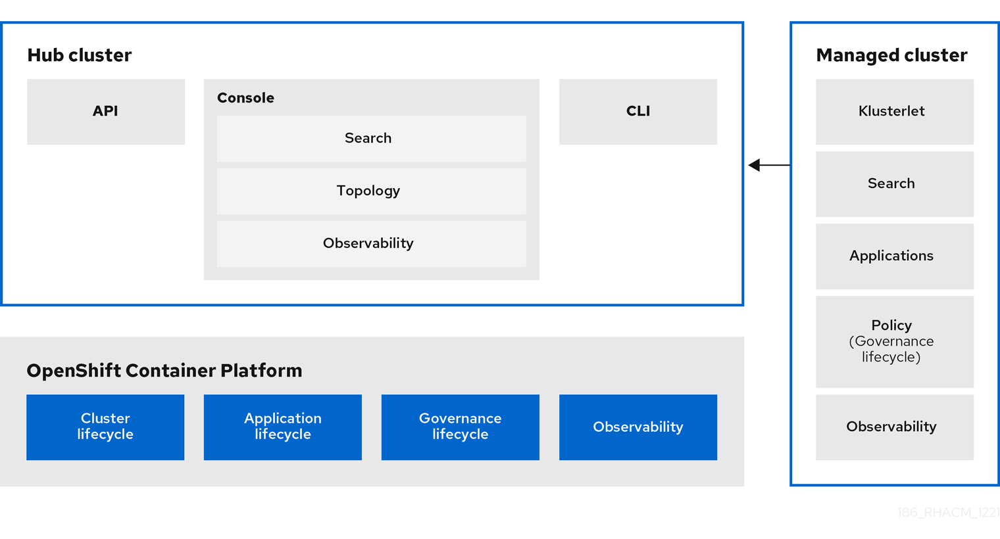

> Source: [Red Hat Advanced Cluster Management for Kubernetes 2.17](https://docs.redhat.com/en/documentation/red_hat_advanced_cluster_management_for_kubernetes/2.17/html/about/index). Copyright Red Hat.
> Adapted from AsciiDoc to Markdown for offline use; see [legal notice](LEGAL-NOTICE.md), [CC BY-SA 3.0](LICENSE.md) and SOURCE.json for source revisions and gaps.

# Welcome to Red Hat Advanced Cluster Management for Kubernetes

Kubernetes provides a platform for deploying and managing containers in a standard, consistent control plane. However, as application workloads move from development to production, they often require multiple fit-for-purpose Kubernetes clusters to support DevOps pipelines.

**Note:** Use of this Red Hat product requires licensing and subscription agreement.

Users, such as administrators and site reliability engineers, face challenges as they work across a range of environments, including multiple data centers, private clouds, and public clouds that run Kubernetes clusters. Red Hat Advanced Cluster Management for Kubernetes provides the tools and capabilities to address these common challenges.

Red Hat Advanced Cluster Management for Kubernetes provides end-to-end management visibility and control to manage your Kubernetes environment. Take control of your application modernization program with management capabilities for cluster creation, application lifecycle, and provide security and compliance for all of them across hybrid cloud environments. Clusters and applications are all visible and managed from a single console, with built-in security policies. Run your operations from anywhere that Red Hat OpenShift runs, and manage any Kubernetes cluster in your fleet.

The *Welcome page* from the Red Hat Advanced Cluster Management for Kubernetes console has a header that displays the *Applications* switcher to return to Red Hat OpenShift Container Platform and more. The tiles describe the main functions of the product and link to important console pages.

With Red Hat Advanced Cluster Management for Kubernetes:

- Work across a range of environments, including multiple data centers, private clouds and public clouds that run Kubernetes clusters.

- Easily create Kubernetes clusters and offer cluster lifecycle management in a single console.

- Enforce policies at the target clusters using Kubernetes-supported custom resource definitions.

- Deploy and maintain day-two operations of business applications distributed across your cluster landscape.

This guide assumes that users are familiar with Kubernetes concepts and terminology.

Additional resources

- [Web console](console.md#web-console)

- [Kubernetes documentation](https://kubernetes.io/docs/home/)

- [Multicluster architecture](about.md#multicluster-architecture)

- [Glossary of terms](about.md#glossary-of-terms)

## Multicluster architecture

Red Hat Advanced Cluster Management for Kubernetes consists of several multicluster components, which are used to access and manage your clusters.

- Hub cluster

  The *hub* cluster is the common term that is used to define the central controller that runs in a Red Hat Advanced Cluster Management for Kubernetes cluster. From the hub cluster, you can access the console and product components, as well as the Red Hat Advanced Cluster Management APIs. You can also use the console to search resources across clusters and view your topology.

Additionally, you can enable *observability* on your hub cluster to monitor metrics from your managed clusters across your cloud providers.

The Red Hat Advanced Cluster Management hub cluster uses the `MultiClusterHub` operator to manage, update, and install hub cluster components and runs in the `open-cluster-management` namespace. The hub cluster aggregates information from multiple clusters by using an asynchronous work request model and search collectors. The hub cluster maintains the state of clusters and applications that run on it.

The *local cluster* is the term used to define a hub cluster that is also a managed cluster.

- Managed cluster

  The *managed* cluster is the term that is used to define additional clusters that are managed by the hub cluster. The connection between the two is completed by using the *klusterlet*, which is the agent that is installed on the managed cluster. The managed cluster receives and applies requests from the hub cluster and enables it to service cluster lifecycle, application lifecycle, governance, and observability on the managed cluster.

For example, managed clusters send metrics to the hub cluster if the observability service is enabled.

- Cluster lifecycle

  Red Hat Advanced Cluster Management *cluster lifecycle* defines the process of creating, importing, managing, and destroying Kubernetes clusters across various infrastructure cloud providers, private clouds, and on-premises data centers.

The cluster lifecycle function is provided by the multicluster engine for Kubernetes operator, which is installed automatically with Red Hat Advanced Cluster Management.

From the hub cluster console, you can view an aggregation of all cluster health statuses, or view individual health metrics of many Kubernetes clusters. Additionally, you can update managed OpenShift Container Platform clusters individually or in bulk, as well as destroy any OpenShift Container Platform clusters that you created using your hub cluster. From the console, you can also hibernate, resume, and detach clusters.

- Application lifecycle

  Red Hat Advanced Cluster Management *Application lifecycle* defines the processes that are used to manage application resources on your managed clusters. A multicluster application allows you to deploy resources on multiple managed clusters, as well as maintain full control of Kubernetes resource updates for all aspects of the application with high availability.

A multicluster application uses the Kubernetes specification, but provides additional automation of the deployment and lifecycle management of resources. Ansible Automation Platform jobs allow you to automate tasks. You can also set up a continuous GitOps environment to automate application consistency across clusters in development, staging, and production environments.

- Governance

  *Governance* enables you to define policies that either enforce security compliance, or inform you of changes that violate the configured compliance requirements for your environment. Using dynamic policy templates, you can manage the policies and compliance requirements across all of your management clusters from a central interface.

After you configure a Red Hat Advanced Cluster Management hub cluster and a managed cluster, you can view and create policies with the Red Hat Advanced Cluster Management policy framework.

- Observability

  The *observability* component collects and reports the status and health of the OpenShift Container Platform version 4.x or later, managed clusters to the hub cluster, which are visible from the Grafana dashboard. You can create custom alerts to inform you of problems with your managed clusters. Since observability requires configured persistent storage, enable observability after the Red Hat Advanced Cluster Management installation is complete.

Additional resources

- [Observing environments](observability.md)

- [Cluster lifecycle introduction](clusters.md#cluster-intro)

- [Manage applications](applications.md#managing-applications)

- [Role-based access control](secure_clusters.md#rbac-rhacm)

- [`policy-collection` open community](https://github.com/stolostron/policy-collection/tree/main/community)

- [Observability service](observability.md#observing-environments-intro)

- [Release notes](release_notes.md)

- [Get started with Red Hat Advanced Cluster Management](get_started.md#get-started-acm)

- [Cluster lifecycle overview](clusters.md#cluster_mce_overview)

## Glossary of terms

Red Hat Advanced Cluster Management for Kubernetes consists of several multicluster components that are defined in the following sections. Additionally, some common Kubernetes terms are used within the product. Terms are listed alphabetically.

Application lifecycle  
The processes that are used to manage application resources on your managed clusters. A multicluster application uses a Kubernetes specification, but with additional automation of the deployment and lifecycle management of resources to individual clusters.

Channel  
A custom resource definition that references repositories where Kubernetes resources are stored, such as Git repositories, Helm chart repositories, ObjectStore repositories, or namespaces templates on the hub cluster. Channels support multiple subscriptions from multiple targets.

Cluster lifecycle  
Defines the process of creating, importing, and managing clusters across public and private clouds.

Console  
The graphical user interface for Red Hat Advanced Cluster Management for Kubernetes.

Deployable  
A resource that retrieves the output of a build, packages the output with configuration properties, and installs the package in a pre-defined location so that it can be tested or run.

Governance  
The Red Hat Advanced Cluster Management for Kubernetes processes used to manage security and compliance.

Hosted cluster  
An OpenShift Container Platform API endpoint that is managed by HyperShift.

Hosted cluster infrastructure  
Resources that exist in the customer cloud account, including network, compute, storage, and so on.

Hosted control plane  
An OpenShift Container Platform control plane that is running on the hosting service cluster, which is exposed by the API endpoint of a hosted cluster. The component parts of a control plane include `etcd`, `apiserver`, `kube-controller-manager`, `vpn`, and other components.

Hosted control plane infrastructure  
Resources on the management cluster or external cloud provider that are prerequisites to running hosted control plane processes.

Hosting service cluster  
An OpenShift Container Platform cluster that hosts the HyperShift operator and zero-to-many hosted clusters.

Hosted service cluster infrastructure  
Resources of the hosting service cluster, including network, compute, storage, and so on.

Hub cluster  
The central controller that runs in a Red Hat Advanced Cluster Management for Kubernetes cluster. From the hub cluster, you can access the console and components found on that console, as well as APIs.

klusterlet  
The agent that contains two controllers on the managed cluster that initiates a connection to the Red Hat Advanced Cluster Management for Kubernetes hub cluster.

Klusterlet add-on  
Specialized controller on the Klusterlet that provides additional management capability.

Managed cluster  
Created and imported clusters are managed by the klusterlet agent and its add-ons, which initiates a connection to the Red Hat Advanced Cluster Management for Kubernetes hub cluster.

Placement binding  
A resource that binds a placement to a policy.

Placement policy  
A policy that defines where the application components are deployed and how many replicas there are.

Subscriptions  
A resource that identifies the Kubernetes resources within channels (resource repositories), then places the Kubernetes resource on the target clusters.

Additional resources

- [Kubernetes glossary](https://kubernetes.io/docs/reference/glossary/?fundamental=true)

