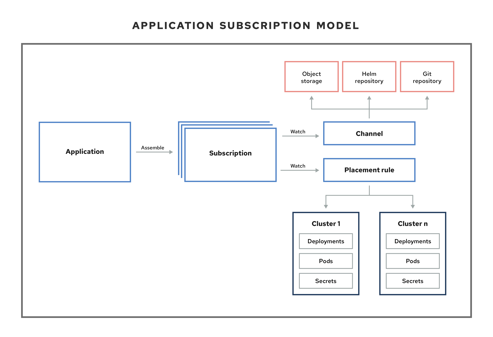
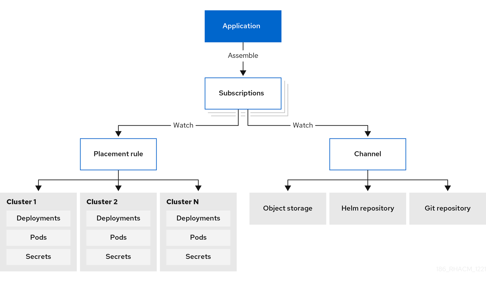

> Source: [Red Hat Advanced Cluster Management for Kubernetes 2.17](https://docs.redhat.com/en/documentation/red_hat_advanced_cluster_management_for_kubernetes/2.17/html/applications/index). Copyright Red Hat.
> Adapted from AsciiDoc to Markdown for offline use; see [legal notice](LEGAL-NOTICE.md), [CC BY-SA 3.0](LICENSE.md) and SOURCE.json for source revisions and gaps.

<a id="managing-applications"></a>

# Manage applications (Deprecated)

Review the following topics to learn more about creating, deploying, and managing your applications. This guide assumes familiarity with Kubernetes concepts and terminology. Key Kubernetes terms and components are not defined. For more information about Kubernetes concepts, see [Kubernetes Documentation](https://kubernetes.io/docs/home/).

**Deprecation:** Application *subscription*, and all processes that use Application subscription, is deprecated. See [GitOps overview](gitops.md#gitops-overview) for updated function.

The application management functions provide you with unified and simplified options for constructing and deploying applications and application updates. With these functions, your developers and DevOps personnel can create and manage applications across environments through channel and subscription-based automation.

**Important:** An application name cannot exceed 37 characters.

- [Application model and definitions (Deprecated)](applications.md#application-model-and-definitions)

  - [Application console](applications.md#application-console)

  - [Subscription reports](applications.md#subscription-reports)

  - [Manage application resources](applications.md#managing-application-resources)

  - [Manage apps with Git repositories](applications.md#managing-apps-with-git-repositories)

  - [Manage apps with Helm repositories](applications.md#managing-apps-with-helm-cluster-repositories)

  - [Manage apps with Object storage repositories](applications.md#managing-apps-with-object-storage-repositories)

- [Application advanced configuration (Deprecated)](applications.md#application-advanced-configuration)

  - [Subscribe to Git resources](applications.md#subscribing-git-resources)

  - [Grant subscription admin privilege](applications.md#granting-subscription-admin-privilege)

  - [Create an allow and deny list as subscription administrator](applications.md#creating-allow-deny-list)

  - [Add reconcile options](applications.md#reconcile-options)

  - [Configure application channel and subscription for a secure Git connection](applications.md#configuring-git-channel)

  - [Set up Ansible Automation Platform tasks](applications.md#setting-up-ansible)

  - [Schedule a deployment](applications.md#scheduling-a-deployment)

  - [Configure package overrides](applications.md#configuring-package-overrides)

  - [Channel samples](applications.md#channel-samples)

  - [Subscription samples](applications.md#subscription-samples)

  - [Application samples](applications.md#application-samples)

<a id="application-model-and-definitions"></a>

## Application model and definitions (Deprecated)

The application model is based on subscribing to one or more Kubernetes resource repositories (*channel* resources) that contains resources that are deployed on managed clusters. Both single and multicluster applications use the same Kubernetes specifications, but multicluster applications involve more automation of the deployment and application management lifecycle.

**Deprecation:** Application *subscription*, and all processes that use Application subscription, is deprecated. See [GitOps overview](gitops.md#gitops-overview) for updated function.

See the following image to understand more about the application model:



**Best practice:** Use the GitOps Operator or Argo CD integration instead of the *Channel* and *Subscription* model. Learn more from the [GitOps overview](gitops.md#gitops-overview).

- [Applications overview](applications.md#applications_overview)

- [Subscriptions](applications.md#subscriptions)

- [ApplicationSet](applications.md#applicationset)

- [Application documentation](applications.md#applicationdoc)

<a id="applications_overview"></a>

### Applications overview

Applications (`application.app.k8s.io`) in Red Hat Advanced Cluster Management for Kubernetes are used for grouping Kubernetes resources that make up an application.

All of the application component resources for Red Hat Advanced Cluster Management for Kubernetes applications are defined in YAML file specification sections. When you need to create or update an application component resource, you need to create or edit the appropriate section to include the labels for defining your resource.

You can also work with *Discovered* applications, which are applications that are discovered by the OpenShift Container Platform GitOps or an Argo CD operator that is installed in your clusters. Applications that share the same repository are grouped together in this view.

<a id="subscriptions"></a>

### Subscriptions

Subscriptions (`subscription.apps.open-cluster-management.io`) allow clusters to subscribe to a source repository (channel) that can be the following types: Git repository, Helm release registry, or Object storage repository.

Subscriptions can deploy application resources locally to the hub cluster if the hub cluster is self-managed. You can then view the `local-cluster` (the self-managed hub cluster) subscription in the topology. Resource requirements might adversely impact hub cluster performance.

Subscriptions can point to a channel or storage location for identifying new or updated resource templates. The subscription operator can then download directly from the storage location and deploy to targeted managed clusters without checking the hub cluster first. With a subscription, the subscription operator can monitor the channel for new or updated resources instead of the hub cluster.

See the following subscription architecture image:



<div>

<div class="title">

Additional resources

</div>

- [Channels](applications.md#channels)

</div>

<a id="channels"></a>

#### Channels

Channels (`channel.apps.open-cluster-management.io`) define the source repositories that a cluster can subscribe to with a subscription, and can be the following types: Git, Helm release, and Object storage repositories, and resource templates on the hub cluster.

If you have applications that require Kubernetes resources or Helm charts from channels that require authorization, such as entitled Git repositories, you can use secrets to provide access to these channels. Your subscriptions can access Kubernetes resources and Helm charts for deployment from these channels, while maintaining data security.

Channels use a namespace within the hub cluster and point to a physical place where resources are stored for deployment. Clusters can subscribe to channels for identifying the resources to deploy to each cluster.

**Notes:** It is best practice to create each channel in a unique namespace. However, a Git channel can share a namespace with another type of channel, including Git, Helm, and Object storage.

Resources within a channel can be accessed by only the clusters that subscribe to that channel.

<div>

<div class="title">

Additional resources

</div>

- [Supported Git repository servers](applications.md#supported-git-servers)

</div>

<a id="supported-git-servers"></a>

##### Supported Git repository servers

The following Git repository servers are supported:

- GitHub

- GitLab

- Bitbucket

- Gogs

<a id="applicationset"></a>

### ApplicationSet

`ApplicationSet` is a sub-project of Argo CD that is supported by the GitOps Operator. `ApplicationSet` adds multicluster support for Argo CD applications. You can create an application set from the Red Hat Advanced Cluster Management console.

If you would like to learn more about `ApplicationSets`, see [Cluster Decision Resource Generator](https://argocd-applicationset.readthedocs.io/en/stable/Generators-Cluster-Decision-Resource/).

- OpenShift Container Platform GitOps uses Argo CD to maintain cluster resources. Argo CD is an open-source declarative tool for the continuous integration and continuous deployment (CI/CD) of applications. OpenShift Container Platform GitOps implements Argo CD as a controller (OpenShift Container Platform GitOps Operator) so that it continuously monitors application definitions and configurations defined in a Git repository. Then, Argo CD compares the specified state of these configurations with their live state on the cluster.

- The `ApplicationSet` controller is installed on the cluster through a GitOps operator instance and supplements it by adding additional features in support of cluster-administrator-focused scenarios. The `ApplicationSet` controller provides the following function:

  - The ability to use a single Kubernetes manifest to target multiple Kubernetes clusters with the GitOps operator.

  - The ability to use a single Kubernetes manifest to deploy multiple applications from one or multiple Git repositories with the GitOps operator.

  - Improved support for monorepo, which is in the context of Argo CD, multiple Argo CD Application resources that are defined within a single Git repository.

  - Within multitenant clusters, improved ability of individual cluster tenants to deploy applications using Argo CD without needing to involve privileged cluster administrators in enabling the destination clusters/namespaces.

- The `ApplicationSet` operator leverages the cluster decision generator to interface Kubernetes custom resources that use custom resource-specific logic to decide which managed clusters to deploy to. A cluster decision resource generates a list of managed clusters, which are then rendered into the template fields of the `ApplicationSet` resource. This is done using duck-typing, which does not require knowledge of the full shape of the referenced Kubernetes resource.

- See the following example of a `generators.clusterDecisionResource` value within an `ApplicationSet`:

  ``` yaml
  apiVersion: argoproj.io/v1alpha1
  kind: ApplicationSet
  metadata:
    name: sample-application-set
    namespace: sample-gitops-namespace
  spec:
    generators:
      - clusterDecisionResource:
          configMapRef: acm-placement
          labelSelector:
            matchLabels:
              cluster.open-cluster-management.io/placement: sample-application-placement
          requeueAfterSeconds: 180
    template:
      metadata:
        name: sample-application-{{name}}
      spec:
        project: default
        sources: [
        {
          repoURL: https://github.com/sampleapp/apprepo.git
          targetRevision: main
          path: sample-application
           }
        ]
        destination:
          namespace: sample-application
          server: "{{server}}"
        syncPolicy:
          syncOptions:
            - CreateNamespace=true
            - PruneLast=true
            - Replace=true
            - ApplyOutOfSyncOnly=true
            - Validate=false
          automated:
            prune: true
            allowEmpty: true
            selfHeal: true
  ```

- See the following `Placement`:

  ``` yaml
  apiVersion: cluster.open-cluster-management.io/v1beta1
  kind: Placement
  metadata:
    name: sample-application-placement
    namespace: sample-gitops-namespace
  spec:
    clusterSets:
      - sampleclusterset
  ```

<a id="applicationdoc"></a>

### Application documentation

Learn more about application resources, Git subscriptions, Ansible Automation Platform setup, and sample YAML files.

- [Application console](applications.md#application-console)

- [Manage application resources](applications.md#managing-application-resources)

- [Manage apps with Git repositories](applications.md#managing-apps-with-git-repositories)

- [Manage apps with Helm repositories](applications.md#managing-apps-with-helm-cluster-repositories)

- [Manage apps with Object storage repositories](applications.md#managing-apps-with-object-storage-repositories)

- [Application advanced configuration (Deprecated)](applications.md#application-advanced-configuration)

- [Subscribe to Git resources](applications.md#subscribing-git-resources)

- [Set up Ansible Automation Platform tasks](applications.md#setting-up-ansible)

- [Channel samples](applications.md#channel-samples)

- [Subscription samples](applications.md#subscription-samples)

- [Application samples](applications.md#application-samples)

<a id="application-console"></a>

## Application console

The console includes a dashboard for managing the application lifecycle. You can use the console dashboard to create and manage applications and view the status of applications. Enhanced capabilities help your developers and operations personnel create, deploy, update, manage, and visualize applications across your clusters.

**Deprecation:** Application *subscription*, and all processes that use Application subscription, is deprecated. See [GitOps overview](gitops.md#gitops-overview) for updated function.

See some of the console capability in the following list and see the console for guided information about terms, actions, and how to read the Topology:

**Important:** Available actions are based on your assigned role. Learn about access requirements from the [Role-based access control](secure_clusters.md) documentation.

- Visualize deployed applications across your clusters, including any associated resource repositories, subscriptions, and placement configurations.

- Create and edit applications, and subscribe resources. From the *Actions* menu, you can search, edit, or delete. Ensure you select `YAML:On` to view and edit the YAML as you update the fields.

- From the main *Overview* tab, you can click an application name to view details and application resources, including resource repositories, subscriptions, placements, and deployed resources such as any optional predeployment and postdeployment hooks that are using Ansible Automation Platform tasks (for Git repositories). You can also create an application from the overview.

- Create and view applications, such as *ApplicationSet*, *Subscription*, *OpenShift*, *Flux*, and *Argo CD* types. An `ApplicationSet` represents Argo applications that are generated from the controller.

  - For an Argo CD `ApplicationSet` to be created, you need to enable `Automatically sync when cluster state changes` from the `Sync policy`.

  - For Flux with the `kustomization` controller, find Kubernetes resources with the label `kustomize.toolkit.fluxcd.io/name=<app_name>`.

  - For Flux with the `helm` controller, find Kubernetes resources with the label `helm.toolkit.fluxcd.io/name=<app_name>`.

- From the main *Overview*, when you click on an application name in the table to view a single application overview, you can see the following information:

  - Cluster details, such as resource status

  - Resource topology

  - Subscription details

  - Access to the Editor tab to edit

- Click the *Topology* tab for visual representation of all the applications and resources in your project. For Helm subscriptions, see [Configure package overrides](applications.md#configuring-package-overrides) to define the appropriate `packageName` and the `packageAlias` to get an accurate topology display.

- Click the **Advanced configuration** tab to view terminology and tables of resources for all applications. You can find resources and you can filter subscriptions, placement, and channels. If you have access, you can also click multiple **Actions**, such as Edit, Search, and Delete.

- View a successful Ansible Automation Platform deployment if you are using Ansible tasks as prehook or posthook for the deployed application.

- Click **Launch resource in Search** to search for related resources.

- Use *Search* to find application resources by the component `kind` for each resource. To search for resources, use the following values:

  | Application resource | Kind (search parameter) |
  |----------------------|-------------------------|
  | Subscription         | `Subscription`          |
  | Channel              | `Channel`               |
  | Secret               | `Secret`                |
  | Placement            | `Placement`             |
  | Application          | `Application`           |

You can also search by other fields, including name, namespace, cluster, label, and more. For more information about using search, see [Search service](search.md#search-service).

<a id="subscription-reports"></a>

## Subscription reports

Subscription reports are collections of application statuses from all the managed clusters in your fleet. Specifically, the parent application resource can hold reports from a scalable amount of managed clusters.

**Deprecation:** Application *subscription*, and all processes that use Application subscription, is deprecated. See [GitOps overview](gitops.md#gitops-overview) for updated function.

Detailed application status is available on the managed clusters, while the `subscriptionReports` on the hub cluster are lightweight and more scalable. See the following three types of subsription status reports:

Package-level `SubscriptionStatus`  
This is the application package status on the managed cluster with detailed status for all the resources that are deployed by the application in the `appsub` namespace.

Cluster-level `SubscriptionReport`  
This is the overall status report on all the applications that are deployed to a particular cluster.

Application-level `SubscriptionReport`  
This is the overall status report on all the managed clusters to which a particular application is deployed.

<div>

<div class="title">

Additional resources

</div>

- [SubscriptionStatus package-level](applications.md#package-subscription-status)

- [SubscriptionReport cluster-level](applications.md#subscription-report-cluster)

- [SubscriptionReport application-level](applications.md#application-level)

- [ManagedClusterView](applications.md#managed-cluster-view)

- [CLI application-level status](applications.md#cli-appsub-status)

- [CLI Last Update Time](applications.md#cli-last-update)

</div>

<a id="package-subscription-status"></a>

### SubscriptionStatus package-level

**Deprecation:** Application *subscription*, and all processes that use Application subscription, is deprecated. See [GitOps overview](gitops.md#gitops-overview) for updated function.

The package-level managed cluster status is located in `<namespace:<your-appsub-namespace>` on the managed cluster and contains detailed status for all the resources that are deployed by the application. For every `appsub` that is deployed to a managed cluster, there is a `SubscriptionStatus` CR created in the `appsub` namespace on the managed cluster. Every resource is reported with detailed errors if errors exist.

The package status only indicates the status of an individual package. You can view the overall subscription status by referencing the field, `.status.subscription`.

See the following `SubscriptionStatus` sample YAML file:

``` yaml
apiVersion: apps.open-cluster-management.io/v1alpha1
kind: SubscriptionStatus
metadata:
  labels:
    apps.open-cluster-management.io/cluster: <your-managed-cluster>
    apps.open-cluster-management.io/hosting-subscription: <your-appsub-namespace>.<your-appsub-name>
  name: <your-appsub-name>
  namespace: <your-appsub-namespace>
statuses:
  packages:
  - apiVersion: v1
    kind: Service
    lastUpdateTime: "2021-09-13T20:12:34Z"
    Message: <detailed error. visible only if the package fails>
    name: frontend
    namespace: test-ns-2
    phase: Deployed
  - apiVersion: apps/v1
    kind: Deployment
    lastUpdateTime: "2021-09-13T20:12:34Z"
    name: frontend
    namespace: test-ns-2
    phase: Deployed
  - apiVersion: v1
    kind: Service
    lastUpdateTime: "2021-09-13T20:12:34Z"
    name: redis-master
    namespace: test-ns-2
    phase: Deployed
  - apiVersion: apps/v1
    kind: Deployment
    lastUpdateTime: "2021-09-13T20:12:34Z"
    name: redis-master
    namespace: test-ns-2
    phase: Deployed
  - apiVersion: v1
    kind: Service
    lastUpdateTime: "2021-09-13T20:12:34Z"
    name: redis-slave
    namespace: test-ns-2
    phase: Deployed
  - apiVersion: apps/v1
    kind: Deployment
    lastUpdateTime: "2021-09-13T20:12:34Z"
    name: redis-slave
    namespace: test-ns-2
    phase: Deployed
subscription:
  lastUpdateTime: "2021-09-13T20:12:34Z"
  phase: Deployed
```

<a id="subscription-report-cluster"></a>

### SubscriptionReport cluster-level

**Deprecation:** Application *subscription*, and all processes that use Application subscription, is deprecated. See [GitOps overview](gitops.md#gitops-overview) for updated function.

The cluster-level status is located in `<namespace:<your-managed-cluster-1>` on the hub cluster and only contains the overall status on each application on that managed cluster. The `subscriptionReport` in each cluster namespace on the hub cluster reports one of the following statuses:

- `Deployed`

- `Failed`

- `propagationFailed`

See the following `SubscriptionReport` sample YAML file:

``` yaml
apiVersion: apps.open-cluster-management.io/v1alpha1
kind: subscriptionReport
metadata:
  labels:
    apps.open-cluster-management.io/cluster: "true"
  name: <your-managed-cluster-1>
  namespace: <your-managed-cluster-1>
reportType: Cluster
results:
- result: deployed
  source: appsub-1-ns/appsub-1                     // appsub 1 to <your-managed-cluster-1>
  timestamp:
    nanos: 0
    seconds: 1634137362
- result: failed
  source: appsub-2-ns/appsub-2                     // appsub 2 to <your-managed-cluster-1>
  timestamp:
    nanos: 0
    seconds: 1634137362
- result: propagationFailed
  source: appsub-3-ns/appsub-3                     // appsub 3 to <your-managed-cluster-1>
  timestamp:
    nanos: 0
    seconds: 1634137362
```

<a id="application-level"></a>

### SubscriptionReport application-level

**Deprecation:** Application *subscription*, and all processes that use Application subscription, is deprecated. See [GitOps overview](gitops.md#gitops-overview) for updated function.

One application-level `subscriptionReport` for each application is located in `<namespace:<your-appsub-namespace>` in `appsub` namespace on the hub cluster and contains the following information:

- The overall status of the application for each managed cluster

- A list of all resources for the application

- A report summary with the total number of total clusters

- A report summary with the total number of clusters where the application is in the status: `deployed`, `failed`, `propagationFailed`, and `inProgress`.

**Note:** The `inProcess` status is the total minus `deployed`, minus `` failed `, and minus `propagationFailed ``.

See the following `SubscriptionReport` sample YAML file:

``` yaml
apiVersion: apps.open-cluster-management.io/v1alpha1
kind: subscriptionReport
metadata:
  labels:
    apps.open-cluster-management.io/hosting-subscription: <your-appsub-namespace>.<your-appsub-name>
  name: <your-appsub-name>
  namespace: <your-appsub-namespace>
reportType: Application
resources:
- apiVersion: v1
  kind: Service
  name: redis-master2
  namespace: playback-ns-2
- apiVersion: apps/v1
  kind: Deployment
  name: redis-master2
  namespace: playback-ns-2
- apiVersion: v1
  kind: Service
  name: redis-slave2
  namespace: playback-ns-2
- apiVersion: apps/v1
  kind: Deployment
  name: redis-slave2
  namespace: playback-ns-2
- apiVersion: v1
  kind: Service
  name: frontend2
  namespace: playback-ns-2
- apiVersion: apps/v1
  kind: Deployment
  name: frontend2
  namespace: playback-ns-2
results:
- result: deployed
  source: cluster-1                            //cluster 1 status
  timestamp:
    nanos: 0
    seconds: 0
- result: failed
  source: cluster-3                            //cluster 2 status
  timestamp:
    nanos: 0
    seconds: 0
- result: propagationFailed
  source: cluster-4                            //cluster 3 status
  timestamp:
    nanos: 0
    seconds: 0
summary:
  deployed: 8
  failed: 1
  inProgress: 0
  propagationFailed: 1
  clusters: 10
```

<a id="managed-cluster-view"></a>

### ManagedClusterView

A `ManagedClusterView` CR is reported on the first `failed` cluster. If an application is deployed on multiple clusters with resource deployment failures, only one `managedClusterView` CR is created for the first failed cluster namespace on the hub cluster. The `managedClusterView` CR retrieves the detailed subscription status from the failed cluster so that the application owner does not need to access the failed remote cluster.

See the following command that you can run to get the status:

<div>

<div class="title">

Procedure

</div>

- Run the following command to get the status:

  ``` bash
  % oc get managedclusterview -n <failing-clusternamespace> "<app-name>-<app name>"
  ```

</div>

<a id="cli-appsub-status"></a>

### CLI application-level status

If you cannot access the managed clusters to get a subscription status, you can use the CLI. The cluster-level or the application-level subscription report provides the overall status, but not the detailed error messages for an application.

<div>

<div class="title">

Procedure

</div>

1.  Download the CLI from [multicloud-operators-subscription](https://github.com/open-cluster-management-io/multicloud-operators-subscription/blob/main/cmd/scripts/getAppSubStatus.sh).

2.  Run the following command to create a `managedClusterView` resource to see the managed cluster application `SubscriptionStatus` so that you can identify the error:

    ``` bash
    % getAppSubStatus.sh -c <your-managed-cluster> -s <your-appsub-namespace> -n <your-appsub-name>
    ```

</div>

<a id="cli-last-update"></a>

### CLI Last Update Time

You can also get the Last Update Time of an AppSub on a given managed cluster when it is not practical to log in to each managed cluster to retrieve this information. Thus, an utility script was created to simplify the retrieval of the Last Update Time of an AppSub on a managed cluster. This script is designed to run on the Hub cluster. It creates a managedClusterView resource to get the AppSub from the managed cluster, and parses the data to get the Last Update Time.

<div>

<div class="title">

Procedure

</div>

1.  Download the CLI from [multicloud-operators-subscription](https://github.com/open-cluster-management-io/multicloud-operators-subscription/blob/main/cmd/scripts/getLastUpdateTime.sh).

2.  Run the following command to retriev the `Last Update Time` of an `AppSub` on a managed cluster. This script is designed to run on the hub cluster. It creates a `managedClusterView` resource to get the AppSub from the managed cluster, and parses the data to get the Last Update Time:

    ``` bash
    % getLastUpdateTime.sh -c <your-managed-cluster> -s <your-appsub-namespace> -n <your-appsub-name>
    ```

</div>

<a id="managing-application-resources"></a>

## Manage application resources

From the console, you can create applications by using Git repositories, Helm repositories, and Object storage repositories.

**Deprecation:** Application *subscription*, and all processes that use Application subscription, is deprecated. See [GitOps overview](gitops.md#gitops-overview) for updated function.

**Important:** Git Channels can share a namespace with all other channel types: Helm, Object storage, and other Git namespaces.

To configure a proxy server while managing applications, see [Enable cluster-wide proxy on existing cluster add-ons](add-ons.md#enable-cluster-wide-proxy-addon).

- [Manage apps with Git repositories](applications.md#managing-apps-with-git-repositories)

- [Manage apps with Helm repositories](applications.md#managing-apps-with-helm-cluster-repositories)

- [Manage apps with Object storage repositories](applications.md#managing-apps-with-object-storage-repositories)

<a id="managing-apps-with-git-repositories"></a>

### Manage apps with Git repositories

When you deploy Kubernetes resources using an application, the resources are located in specific repositories. Learn how to deploy resources from Git repositories in the following procedure. Learn more about the application model at [Application model and definitions (Deprecated)](applications.md#application-model-and-definitions).

**Deprecation:** Application *subscription*, and all processes that use Application subscription, is deprecated. See [GitOps overview](gitops.md#gitops-overview) for updated function.

**User required access:** A user role that can create applications. You can only perform actions that your role is assigned. Learn about access requirements from the [Role-based access control](secure_clusters.md) documentation.

<div>

<div class="title">

Procedure

</div>

1.  From the console navigation menu, click **Applications** to see listed applications and to create new applications.

2.  **Optional:** After you choose the kind of application you want to create, you can select **YAML: On** to view the YAML in the console as you create and edit your application. See the YAML samples later in the topic.

3.  Choose **Git** from the list of repositories that you can use and enter the values in the correct fields. Follow the guidance in the console and see the YAML editor change values based on your input.

    **Notes:**

    - If you select an existing Git repository path, you do not need to specify connection information if this is a private repository. The connection information is pre-set and you do not need to view these values.

    - If you enter a new Git repository path, you can optionally enter Git connection information if this is a private Git repository.

    - Notice the reconcile option. The `merge` option is the default selection, which means that new fields are added and existing fields are updated in the resource. You can choose to `replace`. With the `replace` option, the existing resource is replaced with the Git source. When the subscription reconcile rate is set to `low`, it can take up to one hour for the subscribed application resources to reconcile. On the card on the single application view, click **Sync** to reconcile manually. If set to `off`, it never reconciles.

4.  Set any optional pre-deployment and post-deployment tasks. Set the Ansible Automation Platform secret if you have Ansible Automation Platform jobs that you want to run before or after the subscription deploys the application resources. The Ansible Automation Platform tasks that define jobs must be placed within `prehook` and `posthook` folders in this repository.

5.  You can click **Add credential** if you need to add a credential using the console. Follow the directions in the console. See more information at [Managing credentials overview](clusters.md).

6.  Click **Create**.

7.  You are redirected to the *Overview* page where you can view the details and topology.

</div>

<div>

<div class="title">

Additional resources

</div>

- [More examples](applications.md#more-examples)

- [Keep deployed resources after deleting subscription with Git](applications.md#git-keep-resource-after-sub-delete)

</div>

<a id="more-examples"></a>

#### More examples

See the following examples of Git subscriptions:

- For an example of `root-subscription/`, see [`application-subscribe-all`](https://github.com/stolostron/application-samples/tree/main/subscriptions/subscribe-all).

- For examples of subscriptions that point to other folders in the same repository, see [`subscribe-all`](https://github.com/stolostron/application-samples/tree/main/subscriptions).

- See an example of the `common-managed` folder with application artifacts in the [`nginx-apps`](https://github.com/stolostron/application-samples/tree/main/subscriptions/nginx) repository.

- See policy examples in [Policy collection](https://github.com/stolostron/policy-collection).

<a id="git-keep-resource-after-sub-delete"></a>

#### Keep deployed resources after deleting subscription with Git

When creating subscriptions using a Git repository, you can add a `do-not-delete` annotation to keep specific deployed resources after you delete the subscription. The `do-not-delete` annotation only works with top-level deployment resources. To add the `do-not-delete` annotation, complete the following steps:

<div>

<div class="title">

Procedure

</div>

1.  Create a subscription that deploys at least one resource.

2.  Add the following annotation to the resource or resources that you want to keep, even after you delete the subscription:

    `apps.open-cluster-management.io/do-not-delete: 'true'`

    See the following example:

    ``` yaml
    apiVersion: v1
    kind: PersistentVolumeClaim
    metadata:
      annotations:
        apps.open-cluster-management.io/do-not-delete: 'true'
        apps.open-cluster-management.io/hosting-subscription: sub-ns/subscription-example
        apps.open-cluster-management.io/reconcile-option: merge
        pv.kubernetes.io/bind-completed: "yes"
    ```

    After deleting the subscription, the resources with the `do-not-delete` annotation still exist, while other resources are deleted.

    **Note:** The resources that remain deployed by using the `do-not-delete` annotation bind to the namespace. As a result, you cannot delete the namespace until you remove the remaining resources.

</div>

<a id="managing-apps-with-helm-cluster-repositories"></a>

### Manage apps with Helm repositories

When you deploy Kubernetes resources using an application, the resources are located in specific repositories. Learn how to deploy resources from Helm repositories in the following procedure. Learn more about the application model at [Application model and definitions (Deprecated)](applications.md#application-model-and-definitions).

**Deprecation:** Application *subscription*, and all processes that use Application subscription, is deprecated. See [GitOps overview](gitops.md#gitops-overview) for updated function.

**User required access:** A user role that can create applications. You can only perform actions that your role is assigned. Learn about access requirements from the [Role-based access control](secure_clusters.md) documentation.

<div>

<div class="title">

Procedure

</div>

1.  From the console navigation menu, click **Applications** to see listed applications and to create new applications.

2.  **Optional:** After you choose the kind of application you want to create, you can select **YAML: On** to view the YAML in the console as you create and edit your application. See the YAML samples later in the topic.

3.  Choose **Helm** from the list of repositories that you can use and enter the values in the correct fields. Follow the guidance in the console and see the YAML editor change values based on your input.

4.  Click **Create**.

5.  You are redirected to the *Overview* page where you can view the details and topology.

</div>

<div>

<div class="title">

Additional resources

</div>

- [Sample YAML](applications.md#sample-yaml-helm)

- [Keep deployed resources after deleting subscription with Helm](applications.md#helm-keep-resource-after-sub-delete)

</div>

<a id="sample-yaml-helm"></a>

#### Sample YAML

The following example channel definition abstracts a Helm repository as a channel:

**Note:** For Helm, all Kubernetes resources contained within the Helm chart must have the label release. `` {{ .Release.Name }}` `` for the application topology to be displayed properly.

``` yaml
apiVersion: v1
kind: Namespace
metadata:
  name: hub-repo
---
apiVersion: apps.open-cluster-management.io/v1
kind: Channel
metadata:
  name: helm
  namespace: hub-repo
spec:
    pathname: [https://kubernetes-charts.storage.googleapis.com/] # URL references a valid chart URL.
    type: HelmRepo
```

The following channel definition shows another example of a Helm repository channel:

``` yaml
apiVersion: apps.open-cluster-management.io/v1
kind: Channel
metadata:
  name: predev-ch
  namespace: ns-ch
  labels:
    app: nginx-app-details
spec:
  type: HelmRepo
  pathname: https://kubernetes-charts.storage.googleapis.com/
```

**Note:** To view REST APIs, use the *API Explorer* in the console, or an `oc` command.

<a id="helm-keep-resource-after-sub-delete"></a>

#### Keep deployed resources after deleting subscription with Helm

Helm provides an annotation to keep specific deployed resources after you delete a subscription. See [Tell Helm Not To Uninstall a Resource](https://helm.sh/docs/howto/charts_tips_and_tricks/#tell-helm-not-to-uninstall-a-resource) for more information. **Note:** The annotation must be in the Helm chart.

<a id="managing-apps-with-object-storage-repositories"></a>

### Manage apps with Object storage repositories

When you deploy Kubernetes resources using an application, the resources are located in specific repositories. Learn more about the application model at [Application model and definitions (Deprecated)](applications.md#application-model-and-definitions):

**Deprecation:** Application *subscription*, and all processes that use Application subscription, is deprecated. See [GitOps overview](gitops.md#gitops-overview) for updated function.

**User required access:** A user role that can create applications. You can only perform actions that your role is assigned. Learn about access requirements from the [Role-based access control](secure_clusters.md) documentation.

<div>

<div class="title">

Procedure

</div>

1.  From the console navigation menu, click **Applications** to see listed applications and to create new applications.

2.  **Optional:** After you choose the kind of application you want to create, you can select **YAML: On** to view the YAML in the console as you create and edit your application. See the YAML samples later in the topic.

3.  Choose **Object store** from the list of repositories that you can use and enter the values in the correct fields. Follow the guidance in the console and see the YAML editor change values based on your input.

4.  Click **Create**.

5.  You are redirected to the *Overview* page where you can view the details and topology.

</div>

<div>

<div class="title">

Additional resources

</div>

- [Sample YAML](applications.md#sample-yaml-object)

- [Create your Amazon Web Services (AWS) S3 object storage bucket](applications.md#creating-aws-object-bucket)

- [Subscribe to the object in the AWS bucket](applications.md#subscribing-to-aws-bucket)

- [Sample AWS subscription](applications.md#sample-aws-subscription)

- [Keep deployed resources after deleting subscription with Object storage](applications.md#object-storage-keep-resource-after-sub-delete)

</div>

<a id="sample-yaml-object"></a>

#### Sample YAML

The following example channel definition abstracts an object storage as a channel:

``` yaml
apiVersion: apps.open-cluster-management.io/v1
kind: Channel
metadata:
 name: dev
 namespace: ch-obj
spec:
 type: Object storage
 pathname: [http://sample-ip:#####/dev] # URL is appended with the valid bucket name, which matches the channel name.
 secretRef:
   name: <s3-secret>
 gates:
   annotations:
     dev-ready: true
```

**Note:** To view REST APIs, use the *API Explorer* in the console, or an `oc` command.

<a id="creating-aws-object-bucket"></a>

#### Create your Amazon Web Services (AWS) S3 object storage bucket

You can set up subscriptions to subscribe resources that are defined in the Amazon Simple Storage Service (Amazon S3) object storage service. See the following procedure:

<div>

<div class="title">

Procedure

</div>

1.  Log in to the [AWS console](https://s3.console.aws.amazon.com/) with your AWS account, user name, and password.

2.  Navigate to **Amazon S3** \> **Buckets** to the bucket home page.

3.  Click **Create Bucket** to create your bucket.

4.  Select the **AWS region**, which is essential for connecting your AWS S3 object bucket.

5.  Create the bucket access token.

6.  Navigate to your user name in the navigation bar, then from the drop-down menu, select **My Security Credentials**.

7.  Navigate to *Access keys for CLI, SDK, & API access* in the *AWS IAM credentials* tab and click on **Create access key**.

8.  Save your *Access key ID* , *Secret access key*.

9.  Upload your object YAML files to the bucket.

</div>

<a id="subscribing-to-aws-bucket"></a>

#### Subscribe to the object in the AWS bucket

Subscribe to objects in your Amazon S3 bucket by creating a channel that specifies the bucket credentials and URL.

<div>

<div class="title">

Procedure

</div>

1.  Create an object bucket type channel with a secret to specify the *AccessKeyID*, *SecretAccessKey*, and *Region* for connecting the AWS bucket. The three fields are created when the AWS bucket is created.

2.  Add the URL. The URL identifies the channel in a AWS S3 bucket if the URL contains `s3://` or `s3 and aws` keywords. For example, see all of the following bucket URLs have AWS s3 bucket identifiers:

        https://s3.console.aws.amazon.com/s3/buckets/sample-bucket-1
        s3://sample-bucket-1/
        https://sample-bucket-1.s3.amazonaws.com/

    **Note:** The AWS S3 object bucket URL is not necessary to connect the bucket with the AWS S3 API.

</div>

<a id="sample-aws-subscription"></a>

#### Sample AWS subscription

See the following complete AWS S3 object bucket channel sample YAML file:

``` yaml
apiVersion: apps.open-cluster-management.io/v1
kind: Channel
metadata:
  name: object-dev
  namespace: ch-object-dev
spec:
  type: ObjectBucket
  pathname: https://s3.console.aws.amazon.com/s3/buckets/sample-bucket-1
  secretRef:
    name: secret-dev
---
apiVersion: v1
kind: Secret
metadata:
  name: secret-dev
  namespace: ch-object-dev
stringData:
  AccessKeyID: <your AWS bucket access key id>
  SecretAccessKey: <your AWS bucket secret access key>
  Region: <your AWS  bucket region>
type: Opaque
```

**Deprecated:** You can continue to create other AWS subscription and placement rule objects, as you see in the following sample YAML with `kind: PlacementRule` and `kind: Subscription` added:

``` yaml
apiVersion: apps.open-cluster-management.io/v1
kind: PlacementRule
metadata:
  name: towhichcluster
  namespace: obj-sub-ns
spec:
  clusterSelector: {}
---
apiVersion: apps.open-cluster-management.io/v1
kind: Subscription
metadata:
  name: obj-sub
  namespace: obj-sub-ns
spec:
  channel: ch-object-dev/object-dev
  placement:
    placementRef:
      kind: PlacementRule
      name: towhichcluster
```

You can also subscribe to objects within a specific subfolder in the object bucket. Add the `subfolder` annotation to the subscription, which forces the object bucket subscription to only apply all the resources in the subfolder path.

See the annotation with `subfolder-1` as the `bucket-path`:

``` yaml
annotations:
  apps.open-cluster-management.io/bucket-path: <subfolder-1>
```

See the following complete sample for a subfolder:

``` yaml
apiVersion: apps.open-cluster-management.io/v1
kind: Subscription
metadata:
  annotations:
    apps.open-cluster-management.io/bucket-path: subfolder1
  name: obj-sub
  namespace: obj-sub-ns
  labels:
    name: obj-sub
spec:
  channel: ch-object-dev/object-dev
  placement:
    placementRef:
      kind: PlacementRule
      name: towhichcluster
```

<a id="object-storage-keep-resource-after-sub-delete"></a>

#### Keep deployed resources after deleting subscription with Object storage

When creating subscriptions using an Object storage repository, you can add a `do-not-delete` annotation to keep specific deployed resources after you delete the subscription. The `do-not-delete` annotation only works with top-level deployment resources. To add the `do-not-delete` annotation, complete the following steps:

<div>

<div class="title">

Procedure

</div>

1.  Create a subscription that deploys at least one resource.

2.  Add the following annotation to the resource or resources that you want to keep, even after you delete the subscription:

    `apps.open-cluster-management.io/do-not-delete: 'true'`

    See the following example:

    ``` yaml
    apiVersion: v1
    kind: PersistentVolumeClaim
    metadata:
      annotations:
        apps.open-cluster-management.io/do-not-delete: 'true'
        apps.open-cluster-management.io/hosting-subscription: sub-ns/subscription-example
        apps.open-cluster-management.io/reconcile-option: merge
        pv.kubernetes.io/bind-completed: "yes"
    ```

    After deleting the subscription, the resources with the `do-not-delete` annotation still exist, while other resources are deleted.

    **Note:** The resources that remain deployed by using the `do-not-delete` annotation bind to the namespace. As a result, you cannot delete the namespace until you remove the remaining resources.

</div>

<a id="aap-intro"></a>

## Ansible Automation Platform integration

Red Hat Advanced Cluster Management is integrated with Red Hat Ansible Automation Platform so that you can create prehook and posthook `AnsibleJob` instances for Git subscription application management. Learn about the components and how to configure Ansible Automation Platform.

**Required access:** Cluster administrator

**Deprecation:** Application *subscription*, and all processes that use Application subscription, is deprecated. See [GitOps overview](gitops.md#gitops-overview) for updated function.

<div>

<div class="title">

Additional resources

</div>

- [Integration and components](applications.md#ansible-integration)

- [Set up Ansible Automation Platform](applications.md#setting-up-ansible)

- [Configure Ansible Automation Platform](applications.md#ansible_config)

</div>

<a id="ansible-integration"></a>

### Integration and components

You can integrate Ansible Automation Platform jobs into Git subscriptions. For instance, for a database front end and back end application, the database is required to be instantiated by using Ansible Automation Platform with an Ansible Automation Platform Job. The application is installed by a Git subscription. The database is instantiated *before* you deploy the front end and back end application with the subscription.

The application subscription operator is enhanced to define two subfolders named `prehook` and `posthook`. Both folders are in the Git repository resource root path and contain all prehook and posthook Ansible Automation Platform jobs, respectively.

When the Git subscription is created, all of the prehook and posthook `AnsibleJob` resources are parsed and stored in memory as an object. The application subscription controller decides when to create the prehook and posthook `AnsibleJob` instances.

When you create a subscription custom resource, the Git branch and Git path references a Git repository root location. In the Git root location, the two subfolders `prehook` and `posthook` should contain at least one `Kind:AnsibleJob` resource.

<div>

<div class="title">

Additional resources

</div>

- [Prehook](applications.md#prehook)

- [Posthook](applications.md#posthook)

</div>

<a id="prehook"></a>

#### Prehook

The application subscription controller searches all the `kind:AnsibleJob` CRs in the prehook folder as the prehook `AnsibleJob` objects, then generates a new prehook `AnsibleJob` instance. The new instance name is the prehook `AnsibleJob` object name and a random suffix string.

See the following example instance name: `database-sync-1-2913063`.

The application subscription controller queues the reconcile request again in a one minute loop, where it checks the prehook `AnsibleJob` `status.AnsibleJobResult`. When the prehook status is `successful`, the application subscription continues to deploy the main subscription.

<a id="posthook"></a>

#### Posthook

When the application subscription status is updated, if the subscription status is subscribed or propagated to all target clusters in subscribed status, the application subscription controller searches all of the `AnsibleJob` `kind` custom resources in the posthook folder as the posthook `AnsibleJob` objects. Then, it generates new posthook `AnsibleJob` instances. The new instance name is the posthook `AnsibleJob` object name and a random suffix string.

See the following example instance name: `service-ticket-1-2913849`.

<a id="setting-up-ansible"></a>

### Set up Ansible Automation Platform

With Ansible Automation Platform jobs, you can automate tasks and integrate with external services, such as Slack and PagerDuty services. Your Git repository resource root path will contain `prehook` and `posthook` directories for Ansible Automation Platform jobs that run as part of deploying the application, updating the application, or removing the application from a cluster.

**Required access:** Cluster administrator

<div>

<div class="title">

Additional resources

</div>

- [Prepare to set up Ansible Automation Platform](applications.md#prepare-ansible)

- [Install Ansible Automation Platform Resource Operator](applications.md#install-ansible)

</div>

<a id="prepare-ansible"></a>

#### Prepare to set up Ansible Automation Platform

Complete the following steps before you integrate Ansible Automation Platform with Git subscriptions.

<div>

<div class="title">

Procedure

</div>

1.  Install a supported OpenShift Container Platform version.

2.  Install Ansible Automation Platform. See [Red Hat Ansible Automation Platform](https://docs.redhat.com/en/documentation/red_hat_ansible_automation_platform) documentation to install the latest supported version.

3.  Install the Ansible Automation Platform Resource Operator to connect Ansible Automation Platform jobs to the lifecycle of Git subscriptions. Make sure the Ansible Automation Platform job template is idempotent.

    You can install the Ansible Automation Platform Resource Operator on a different cluster than the hub cluster. If you install the Ansible Automation Platform Resource Operator on the hub cluster, the operator must be the same version as the Ansible Automation Platform Tower.

4.  Check `PROMPT ON LAUNCH` on the template for both `INVENTORY` and `EXTRA VARIABLES`. See [Job templates](https://docs.ansible.com/ansible-tower/latest/html/userguide/job_templates.html) for more information.

</div>

<a id="install-ansible"></a>

#### Install Ansible Automation Platform Resource Operator

Install the Ansible Automation Platform Resource Operator to connect Ansible Automation Platform jobs to the lifecycle of Git subscriptions.

<div>

<div class="title">

Procedure

</div>

1.  Log in to your OpenShift Container Platform cluster console.

2.  Go to **Ecosystem** \> **Software Catalog**.

3.  Search for and install the *Ansible Automation Platform Resource Operator*. **Note:** To submit prehook and posthook `AnsibleJobs`, install Red Hat Ansible Automation Platform Resource Operator with corresponding version available on the OpenShift Container Platform versions.

    You can then create the credential from the *Credentials* page in the console. Click **Add credential**, or access the page from the navigation. See [Creating a credential for Ansible Automation Platform](clusters.md#creating-a-credential-for-ansible) for credential information.

</div>

<a id="ansible_config"></a>

### Configure Ansible Automation Platform

With Ansible Automation Platform jobs, you can automate tasks and integrate with external services, such as Slack and PagerDuty services. Your Git repository resource root path will contain `prehook` and `posthook` directories for Ansible Automation Platform jobs that run as part of deploying the application, updating the application, or removing the application from a cluster.

**Required access:** Cluster administrator

**Deprecation:** Application *subscription*, and all processes that use Application subscription, is deprecated. See [GitOps overview](gitops.md#gitops-overview) for updated function.

Complete the following steps to configure Ansible Automation Platform with Git subscriptions:

<div>

<div class="title">

Procedure

</div>

1.  Create an Ansible Automation Platform secret in the subscription namespace so that prehook and posthook jobs can authenticate to Ansible Automation Platform. See [Set up Ansible Automation Platform secrets](applications.md#ansible-secrets).

2.  Set secret reconciliation so the main subscription refreshes after prehook and posthook `AnsibleJob` resources, or the main subscription, change in Git. See [Set secret reconciliation](applications.md#ansible-secret-reconciliation).

3.  See the sample `AnsibleJob` YAML to define jobs in the Git `prehook` and `posthook` folders. See [Use Ansible Automation Platform sample YAML files](applications.md#ansible-sample-yaml).

4.  Launch an Ansible Automation Platform Workflow when you need to run a workflow template instead of a single job template. See [Launch Workflow](applications.md#launch-workflow).

5.  See the workflow sample YAML to specify `workflow_template_name` in your `AnsibleJob` resource. See [Use Ansible Automation Platform sample YAML Workflow](applications.md#workflow-sample-yaml).

</div>

<a id="ansible-secrets"></a>

#### Set up Ansible Automation Platform secrets

You must create an Ansible Automation Platform secret custom resources in the same subscription namespace. The Ansible Automation Platform secret is limited to the same subscription namespace.

<div>

<div class="title">

Procedure

</div>

1.  Create the secret from the console by filling in the `Ansible Automation Platform secret name` section. To create the secret using terminal, edit and apply the sample `yaml` file:

    **Note:** The `namespace` is the same namespace as the subscription namespace. The `stringData:token` and `host` are from the Ansible Automation Platform.

    ``` yaml
    apiVersion: v1
    kind: Secret
    metadata:
      name: toweraccess
      namespace: same-as-subscription
    type: Opaque
    stringData:
      token: ansible-tower-api-token
      host: https://ansible-tower-host-url
    ```

2.  Run the following command to add your YAML file:

    ``` bash
    oc apply -f
    ```

    When the app subscription controller creates prehook and posthook Ansible jobs, if the secret from subscription `spec.hooksecretref` is available, then it is sent to the `AnsibleJob` custom resources `spec.tower_auth_secret` and the `AnsibleJob` can access the Ansible Automation Platform.

</div>

<a id="ansible-secret-reconciliation"></a>

#### Set secret reconciliation

For a main-sub subscription with prehook and posthook `AnsibleJob`, the main-sub subscription should be reconciled after all prehook and posthook `AnsibleJob` or main subscription are updated in the Git repository.

Prehook `AnsibleJob` and the main subscription continuously reconcile and relaunch a new pre `AnsibleJob` instance.

**Notes:**

The `AnsibleJob` `status.conditions` is reserved by the Ansible Automation Platform Job operator for storing the creation of Kubernetes job result. The `status.conditions` does not reflect the actual Ansible Automation Platform job status.

The subscription controller checks the Ansible Automation Platform job status by the `AnsibleJob.status.AnsibleJob.Result` instead of `AnsibleJob.status.conditions`.

As previously mentioned in the prehook and posthook `AnsibleJob` workflow, when the main subscription is updated in Git repository, a new prehook and posthook `AnsibleJob` instance is created. As a result, one main subscription can link to multiple `AnsibleJob` instances.

Four fields are defined in `subscription.status.ansiblejobs`:

`lastPrehookJobs`  
The most recent prehook Ansible jobs

`prehookJobsHistory`  
All the prehook Ansible jobs history

`lastPosthookJobs`  
The most recent posthook Ansible jobs

`posthookJobsHistory`  
All the posthook Ansible jobs history

<div>

<div class="title">

Procedure

</div>

1.  After the pre `AnsibleJob` is complete, re-run the main subscription.

2.  If there is any specification change in the main subscription, redeploy the subscription. The main subscription status should be updated to align with the redeployment procedure.

3.  Reset the hub cluster subscription status to `nil`. The subscription is refreshed along with the subscription deployment on target clusters.

    When the deployment is finished on the target cluster, the subscription status on the target cluster is updated to `"subscribed"` or `"failed"`, and is synced to the hub cluster subscription status.

4.  After the main subscription is complete, relaunch a new post-`AnsibleJob` instance.

5.  Verify that the subscription is updated. See the following output:

    - subscription.status == `"subscribed"`

    - subscription.status == `"propagated"` with all of the target clusters `"subscribed"`

      When an `AnsibleJob` custom resources is created, A Kubernetes job custom resources is created to launch an Ansible Automation Platform job by communicating to the target Ansible Automation Platform. When the job is complete, the final status for the job is returned to `AnsibleJob` `status.AnsibleJob Result`.

</div>

<a id="ansible-sample-yaml"></a>

#### Use Ansible Automation Platform sample YAML files

See the following sample of an `AnsibleJob` YAML file in a Git prehook and posthook folder:

``` yaml
apiVersion: tower.ansible.com/v1alpha1
kind: AnsibleJob
metadata:
  name: demo-job-001
  namespace: default
spec:
  tower_auth_secret: toweraccess
  job_template_name: Demo Job Template
  extra_vars:
    cost: 6.88
    ghosts: ["inky","pinky","clyde","sue"]
    is_enable: false
    other_variable: foo
    pacman: mrs
    size: 8
    targets_list:
    - aaa
    - bbb
    - ccc
    version: 1.23.45
  job_tags: "provision,install,configuration"
  skip_tags: "configuration,restart"
```

<a id="launch-workflow"></a>

#### Launch Workflow

To launch an Ansible Automation Platform Workflow by using the `AnsibleJob` custom resource, replace the `job_template_name` field with the `workflow_template_name`.

<div>

<div class="title">

Procedure

</div>

- Replace the `job_template_name` field with the `workflow_template_name`. See [Use Ansible Automation Platform sample YAML Workflow](applications.md#workflow-sample-yaml).

</div>

<a id="workflow-sample-yaml"></a>

#### Use Ansible Automation Platform sample YAML Workflow

See the following sample of a Workflow `AnsibleJob` YAML file in a Git prehook and Git posthook folder. See [Workflows](https://docs.ansible.com/ansible-tower/latest/html/userguide/workflows.html) to learn more about Ansible Workflow:

\+

``` yaml
apiVersion: tower.ansible.com/v1alpha1
kind: AnsibleJob
metadata:
  name: demo-job-001
  namespace: default
spec:
  tower_auth_secret: toweraccess
  workflow_template_name: Demo Workflow Template
  extra_vars:
    cost: 6.88
    ghosts: ["inky","pinky","clyde","sue"]
    is_enable: false
    other_variable: foo
    pacman: mrs
    size: 8
    targets_list:
    - aaa
    - bbb
    - ccc
    version: 1.23.45
```

<a id="application-advanced-configuration"></a>

## Application advanced configuration (Deprecated)

**Deprecation:** Application *subscription*, and all processes that use Application subscription, is deprecated. See [GitOps overview](gitops.md#gitops-overview) for updated function.

Within Red Hat Advanced Cluster Management for Kubernetes, applications are composed of multiple application resources. You can use channel, subscription, and placements to help you deploy, update, and manage your overall applications.

Both single and multicluster applications use the same Kubernetes specifications, but multicluster applications involve more automation of the deployment and application management lifecycle.

All of the application component resources for Red Hat Advanced Cluster Management for Kubernetes applications are defined in YAML file specification sections. When you need to create or update an application component resource, you need to create or edit the appropriate section to include the labels for defining your resource.

- [Subscribe to Git resources](applications.md#subscribing-git-resources)

- [Grant subscription admin privilege](applications.md#granting-subscription-admin-privilege)

- [Create an allow and deny list as subscription administrator](applications.md#creating-allow-deny-list)

- [Add reconcile options](applications.md#reconcile-options)

- [Configure leader election](applications.md#config_leader_election)

- [Configure application channel and subscription for a secure Git connection](applications.md#configuring-git-channel)

- [Configure application channel and subscription for a secure object storage connection](applications.md#configuring-object-channel)

- [Set up Ansible Automation Platform tasks](applications.md#setting-up-ansible)

- [Configure Helm to watch namespace resources](applications.md#helm-watch-config)

- [Configure package overrides](applications.md#configuring-package-overrides)

- [Schedule a deployment](applications.md#scheduling-a-deployment)

- [Subscription to application match](applications.md#subscription-to-application-match)

- [Manage deployables with a rolling update](applications.md#managing-deployables-with-a-rolling-update)

- [View placement rule status](applications.md#view-placement-rule-status)

- [Channel samples overview](applications.md#channel-samples)

- [Subscription samples overview](applications.md#subscription-samples)

- [Application samples overview](applications.md#application-samples)

<a id="subscribing-git-resources"></a>

### Subscribe to Git resources

By default, when a subscription deploys subscribed applications to target clusters, the applications are deployed to that subscription namespace, even if the application resources are associated with other namespaces. A *subscription administrator* can change default behavior, as described in [Grant subscription admin privilege](applications.md#granting-subscription-admin-privilege).

**Deprecation:** Application *subscription*, and all processes that use Application subscription, is deprecated. See [GitOps overview](gitops.md#gitops-overview) for updated function.

Additionally, if an application resource exists in the cluster and was not created by the subscription, the subscription cannot apply a new resource on that existing resource. You can change default settings as the subscription administrator.

**Required access:** Cluster administrator

<div>

<div class="title">

Additional resources

</div>

- [Create application resources in Git](applications.md#creating-application-resources-git)

- [Subscribe to specific Git elements](applications.md#subscribing-specific-git)

- [Application namespace example](applications.md#namespace-example)

- [Resource overwrite example](applications.md#resource-overwrite-example)

</div>

<a id="creating-application-resources-git"></a>

#### Create application resources in Git

You need to specify the full group and version for `apiVersion` in resource YAML when you subscribe. For example, if you subscribe to `apiVersion: v1`, the subscription controller fails to validate the subscription and you receive an error: `Resource /v1, Kind=ImageStream is not supported`.

If the `apiVersion` is changed to `image.openshift.io/v1`, as in the following sample, it passes the validation in the subscription controller and the resource is applied successfully.

``` yaml
apiVersion: `image.openshift.io/v1`
kind: ImageStream
metadata:
  name: default
  namespace: default
spec:
  lookupPolicy:
    local: true
  tags:
    - name: 'latest'
      from:
        kind: DockerImage
        name: 'quay.io/repository/open-cluster-management/multicluster-operators-subscription:community-latest'
```

<a id="subscribing-specific-git"></a>

#### Subscribe to specific Git elements

You can subscribe to a specific Git branch, commit, or tag.

**Deprecation:** Application *subscription*, and all processes that use Application subscription, is deprecated. See [GitOps overview](gitops.md#gitops-overview) for updated function.

<div>

<div class="title">

Additional resources

</div>

- [Subscribe to a specific branch](applications.md#subscribing-specific-branch)

- [Subscribe to a specific commit](applications.md#subscribing-specific-commit)

- [Subscribe to a specific tag](applications.md#subscribing-specific-tag)

</div>

<a id="subscribing-specific-branch"></a>

##### Subscribe to a specific branch

The subscription operator that is included in the `multicloud-operators-subscription` repository subscribes to the default branch of a Git repository. If you want to subscribe to a different branch, you need to specify the branch name annotation in the subscription.

<div>

<div class="title">

Procedure

</div>

- Specify the branch name annotation in the subscription.

  The following example, the YAML file displays how to specify a different branch with `apps.open-cluster-management.io/git-branch: <branch1>`:

  ``` yaml
  apiVersion: apps.open-cluster-management.io/v1
  kind: Subscription
  metadata:
    name: git-mongodb-subscription
    annotations:
      apps.open-cluster-management.io/git-path: stable/ibm-mongodb-dev
      apps.open-cluster-management.io/git-branch: <branch1>
  ```

</div>

<a id="subscribing-specific-commit"></a>

##### Subscribe to a specific commit

The subscription operator that is included in the `multicloud-operators-subscription` repository subscribes to the latest commit of specified branch of a Git repository by default. If you want to subscribe to a specific commit, you need to specify the desired commit annotation with the commit hash in the subscription.

<div>

<div class="title">

Procedure

</div>

- Specify the desired commit annotation with the commit hash in the subscription.

  The following example, the YAML file displays how to specify a different commit with `apps.open-cluster-management.io/git-desired-commit: <full commit number>`:

  ``` yaml
  apiVersion: apps.open-cluster-management.io/v1
  kind: Subscription
  metadata:
    name: git-mongodb-subscription
    annotations:
      apps.open-cluster-management.io/git-path: stable/ibm-mongodb-dev
      apps.open-cluster-management.io/git-desired-commit: <full commit number>
      apps.open-cluster-management.io/git-clone-depth: 100
  ```

  The `git-clone-depth` annotation is optional and set to `20` by default, which means the subscription controller retrieves the previous 20 commit histories from the Git repository. If you specify a much older `git-desired-commit`, you need to specify `git-clone-depth` accordingly for the desired commit.

</div>

<a id="subscribing-specific-tag"></a>

##### Subscribe to a specific tag

The subscription operator that is included in the `multicloud-operators-subscription` repository subscribes to the latest commit of specified branch of a Git repository by default. If you want to subscribe to a specific tag, you need to specify the tag annotation in the subscription.

<div>

<div class="title">

Procedure

</div>

- Specify the tag annotation in the subscription.

  The following example, the YAML file displays how to specify a different tag with `apps.open-cluster-management.io/git-tag: <v1.0>`:

  ``` yaml
  apiVersion: apps.open-cluster-management.io/v1
  kind: Subscription
  metadata:
    name: git-mongodb-subscription
    annotations:
      apps.open-cluster-management.io/git-path: stable/ibm-mongodb-dev
      apps.open-cluster-management.io/git-tag: <v1.0>
      apps.open-cluster-management.io/git-clone-depth: 100
  ```

  **Note:** If both Git desired commit and tag annotations are specified, the tag is ignored.

  The `git-clone-depth` annotation is optional and set to `20` by default, which means the subscription controller retrieves the previous `20` commit history from the Git repository. If you specify much older `git-tag`, you need to specify `git-clone-depth` accordingly for the desired commit of the tag.

</div>

<a id="namespace-example"></a>

#### Application namespace example

In this following examples, you are logged in as a subscription administrator.

**Deprecation:** Application *subscription*, and all processes that use Application subscription, is deprecated. See [GitOps overview](gitops.md#gitops-overview) for updated function.

<div>

<div class="title">

Additional resources

</div>

- [Application to different namespaces](applications.md#different-namespace)

- [Application to same namespace](applications.md#same-namespace)

</div>

<a id="different-namespace"></a>

##### Application to different namespaces

Create a subscription to subscribe the sample resource YAML file from a Git repository. The example file contains subscriptions that are located within the following different namespaces:

**Applicable channel types:** Git

- ConfigMap `test-configmap-1` gets created in `multins` namespace.

- ConfigMap `test-configmap-2` gets created in `default` namespace.

- ConfigMap `test-configmap-3` gets created in the `subscription` namespace.

  ``` yaml
  ---
  apiVersion: v1
  kind: Namespace
  metadata:
    name: multins
  ---
  apiVersion: v1
  kind: ConfigMap
  metadata:
    name: test-configmap-1
    namespace: multins
  data:
    path: resource1
  ---
  apiVersion: v1
  kind: ConfigMap
  metadata:
    name: test-configmap-2
    namespace: default
  data:
    path: resource2
  ---
  apiVersion: v1
  kind: ConfigMap
  metadata:
    name: test-configmap-3
  data:
    path: resource3
  ```

If the subscription was created by other users, all the ConfigMaps get created in the same namespace as the subscription.

<a id="same-namespace"></a>

##### Application to same namespace

**Deprecation:** Application *subscription*, and all processes that use Application subscription, is deprecated. See [GitOps overview](gitops.md#gitops-overview) for updated function.

As a subscription administrator, you might want to deploy all application resources into the same namespace.

You can deploy all application resources into the subscription namespace by [Create an allow and deny list as subscription administrator](applications.md#creating-allow-deny-list).

<div>

<div class="title">

Procedure

</div>

- Add the `apps.open-cluster-management.io/current-namespace-scoped: true` annotation to the subscription YAML. For example, when a subscription administrator creates the following subscription, all three ConfigMaps in the previous example are created in `subscription-ns` namespace.

  ``` yaml
  apiVersion: apps.open-cluster-management.io/v1
  kind: Subscription
  metadata:
    name: subscription-example
    namespace: subscription-ns
    annotations:
      apps.open-cluster-management.io/git-path: sample-resources
      apps.open-cluster-management.io/reconcile-option: merge
      apps.open-cluster-management.io/current-namespace-scoped: "true"
  spec:
    channel: channel-ns/somechannel
    placement:
      placementRef:
        name: dev-clusters
  ```

</div>

<a id="resource-overwrite-example"></a>

#### Resource overwrite example

**Applicable channel types:** Git, ObjectBucket (Object storage in the console)

**Note:** The resource overwrite option is not applicable to `helm` charts from the Git repository because the `helm` chart resources are managed by Helm.

In this example, the following ConfigMap already exists in the target cluster.

``` yaml
apiVersion: v1
kind: ConfigMap
metadata:
  name: test-configmap-1
  namespace: sub-ns
data:
  name: user1
  age: 19
```

Subscribe the following sample resource YAML file from a Git repository and replace the existing ConfigMap. See the change in the `data` specification:

``` yaml
apiVersion: v1
kind: ConfigMap
metadata:
  name: test-configmap-1
  namespace: sub-ns
data:
  age: 20
```

<div>

<div class="title">

Additional resources

</div>

- [Default merge option](applications.md#default-merge-option)

- [mergeAndOwn option](applications.md#mergeandown-option)

- [Replace option](applications.md#replace-option)

</div>

<a id="default-merge-option"></a>

##### Default merge option

**Deprecation:** Application *subscription*, and all processes that use Application subscription, is deprecated. See [GitOps overview](gitops.md#gitops-overview) for updated function.

See the following sample resource YAML file from a Git repository with the default `apps.open-cluster-management.io/reconcile-option: merge` annotation. See the following example:

``` yaml
apiVersion: apps.open-cluster-management.io/v1
kind: Subscription
metadata:
  name: subscription-example
  namespace: sub-ns
  annotations:
    apps.open-cluster-management.io/git-path: sample-resources
    apps.open-cluster-management.io/reconcile-option: merge
spec:
  channel: channel-ns/somechannel
  placement:
    placementRef:
      name: dev-clusters
```

When this subscription is created by a subscription administrator and subscribes the ConfigMap resource, the existing ConfigMap is merged, as you can see in the following example:

``` yaml
apiVersion: v1
kind: ConfigMap
metadata:
  name: test-configmap-1
  namespace: sub-ns
data:
  name: user1
  age: 20
```

When the `merge` option is used, entries from subscribed resource are either created or updated in the existing resource. No entry is removed from the existing resource.

**Important:** If the existing resource you want to overwrite with a subscription is automatically reconciled by another operator or controller, the resource configuration is updated by both subscription and the controller or operator. Do not use this method in this case.

<a id="mergeandown-option"></a>

##### mergeAndOwn option

With `mergeAndOwn`, entries from subscribed resource are either created or updated in the existing resource.

<div>

<div class="title">

Procedure

</div>

- Log in as a subscription administrator and create a subscription with the `apps.open-cluster-management.io/reconcile-option: mergeAndOwn` annotation. See the following example:

  ``` yaml
  apiVersion: apps.open-cluster-management.io/v1
  kind: Subscription
  metadata:
    name: subscription-example
    namespace: sub-ns
    annotations:
      apps.open-cluster-management.io/git-path: sample-resources
      apps.open-cluster-management.io/reconcile-option: mergeAndOwn
  spec:
    channel: channel-ns/somechannel
    placement:
      placementRef:
        name: dev-clusters
  ```

  When this subscription is created by a subscription administrator and subscribes the ConfigMap resource, the existing ConfigMap is merged, as you can see in the following example:

  ``` yaml
  apiVersion: v1
  kind: ConfigMap
  metadata:
    name: test-configmap-1
    namespace: sub-ns
    annotations:
      apps.open-cluster-management.io/hosting-subscription: sub-ns/subscription-example
  data:
    name: user1
    age: 20
  ```

  As previosly mentioned, when the `mergeAndOwn` option is used, entries from subscribed resource are either created or updated in the existing resource. No entry is removed from the existing resource. It also adds the `apps.open-cluster-management.io/hosting-subscription` annotation to indicate that the resource is now owned by the subscription. Deleting the subscription deletes the ConfigMap.

</div>

<a id="replace-option"></a>

##### Replace option

**Deprecation:** Application *subscription*, and all processes that use Application subscription, is deprecated. See [GitOps overview](gitops.md#gitops-overview) for updated function.

<div>

<div class="title">

Procedure

</div>

- Log in as a subscription administrator and create a subscription with the `apps.open-cluster-management.io/reconcile-option: replace` annotation. See the following example:

  ``` yaml
  apiVersion: apps.open-cluster-management.io/v1
  kind: Subscription
  metadata:
    name: subscription-example
    namespace: sub-ns
    annotations:
      apps.open-cluster-management.io/git-path: sample-resources
      apps.open-cluster-management.io/reconcile-option: replace
  spec:
    channel: channel-ns/somechannel
    placement:
      placementRef:
        name: dev-clusters
  ```

  When this subscription is created by a subscription administrator and subscribes the ConfigMap resource, the existing ConfigMap is replaced by the following:

  ``` yaml
  apiVersion: v1
  kind: ConfigMap
  metadata:
    name: test-configmap-1
    namespace: sub-ns
  data:
    age: 20
  ```

</div>

<a id="granting-subscription-admin-privilege"></a>

### Grant subscription administrator privilege

Learn how to grant subscription administrator access. A *subscription* administrator can change default behavior. Learn more in the following process:

**Deprecation:** Application *subscription*, and all processes that use Application subscription, is deprecated. See [GitOps overview](gitops.md#gitops-overview) for updated function.

<div>

<div class="title">

Procedure

</div>

1.  From the console, log in to your Red Hat OpenShift Container Platform cluster.

2.  Create one or more users. See [Preparing for users](https://docs.redhat.com/en/documentation/openshift_container_platform/4.20/html/postinstallation_configuration/post-install-preparing-for-users) for information about creating users. You can also prepare groups or service accounts.

    Users that you create are administrators for the `app.open-cluster-management.io/subscription` application. With OpenShift Container Platform, a *subscription* administrator can change default behavior. You can group these users to represent a subscription administrative group, which is demonstrated in later examples.

3.  From the terminal, log in to your Red Hat Advanced Cluster Management cluster.

4.  If `open-cluster-management:subscription-admin` ClusterRoleBinding does not exist, you need to create it. See the following example:

    ``` yaml
    apiVersion: rbac.authorization.k8s.io/v1
    kind: ClusterRoleBinding
    metadata:
      name: open-cluster-management:subscription-admin
    roleRef:
      apiGroup: rbac.authorization.k8s.io
      kind: ClusterRole
      name: open-cluster-management:subscription-admin
    ```

5.  Add the following subjects into `open-cluster-management:subscription-admin` ClusterRoleBinding with the following command:

    ``` bash
    oc edit clusterrolebinding open-cluster-management:subscription-admin
    ```

    **Note:** Initially, `open-cluster-management:subscription-admin` ClusterRoleBinding has no subject.

    Your subjects might display as the following example:

    ``` yaml
    subjects:
    - apiGroup: rbac.authorization.k8s.io
      kind: User
      name: example-name
    - apiGroup: rbac.authorization.k8s.io
      kind: Group
      name: example-group-name
    - kind: ServiceAccount
      name: my-service-account
      namespace: my-service-account-namespace
    - apiGroup: rbac.authorization.k8s.io
      kind: User
      name: 'system:serviceaccount:my-service-account-namespace:my-service-account'
    ```

    `Service Account` can be used as a user subject.

</div>

<a id="creating-allow-deny-list"></a>

### Create an allow and deny list as subscription administrator

**Deprecation:** Application *subscription*, and all processes that use Application subscription, is deprecated. See [GitOps overview](gitops.md#gitops-overview) for updated function.

As a subscription administrator, you can create an application from a Git repository application subscription that contains an `allow` list to allow deployment of only specified Kubernetes `kind` resources. You can also create a `deny` list in the application subscription to deny deployment of specific Kubernetes `kind` resources.

By default, `policy.open-cluster-management.io/v1` resources are not deployed by an application subscription. To avoid this default behavior, application subscription needs deployed by a subscription administrator.

See the following example of `allow` and `deny` specifications:

``` yaml
apiVersion: apps.open-cluster-management.io/v1
kind: Subscription
metadata:
  annotations:
    apps.open-cluster-management.io/github-path: sub2
  name: demo-subscription
  namespace: demo-ns
spec:
  channel: demo-ns/somechannel
  allow:
  - apiVersion: policy.open-cluster-management.io/v1
    kinds:
    - Policy
  - apiVersion: v1
    kinds:
    - Deployment
  deny:
  - apiVersion: v1
    kinds:
    - Service
    - ConfigMap
  placement:
    local: true
```

The following application subscription YAML specifies that when the application is deployed from the `myapplication` directory from the source repository, it deploys only `v1/Deployment` resources, even if there are other resources in the source repository:

``` yaml
apiVersion: apps.open-cluster-management.io/v1
kind: Subscription
metadata:
  annotations:
    apps.open-cluster-management.io/github-path: myapplication
  name: demo-subscription
  namespace: demo-ns
spec:
  channel: demo-ns/somechannel
  deny:
  - apiVersion: v1
     kinds:
      - Service
      - ConfigMap
  placement:
    placementRef:
      name: demo-placement
      kind: Placement
```

This example application subscription YAML specifies deployments of all valid resources except `v1/Service` and `v1/ConfigMap` resources. Instead of listing individual resource kinds within an API group, you can add `"*"` to allow or deny all resource kinds in the API Group.

<a id="reconcile-options"></a>

### Add reconcile options

You can use the `apps.open-cluster-management.io/reconcile-option` annotation in individual resources to override the subscription-level reconcile option.

**Deprecation:** Application *subscription*, and all processes that use Application subscription, is deprecated. See [GitOps overview](gitops.md#gitops-overview) for updated function.

For example, if you add `apps.open-cluster-management.io/reconcile-option: replace` annotation in the subscription and add `apps.open-cluster-management.io/reconcile-option: merge` annotation in a resource YAML in the subscribed Git repository, the resource is merged on the target cluster while other resources are replaced.

<div>

<div class="title">

Additional resources

</div>

- [Reconcile frequency Git channel](applications.md#reconcile-frequency-git)

- [Reconcile frequency Helm channel](applications.md#reconcile-frequency-helm)

</div>

<a id="reconcile-frequency-git"></a>

#### Reconcile frequency Git channel

You can select reconcile frequency options: `high`, `medium`, `low`, and `off` in channel configuration to avoid unnecessary resource reconciliations and therefore prevent overload on subscription operator.

**Required access:** Administrator and cluster administrator

See the following definitions of the `settings:attribute:<value>`:

`Off`  
The deployed resources are not automatically reconciled. A change in the `Subscription` custom resource initiates a reconciliation. You can add or update a label or annotation.

`Low`  
The deployed resources are automatically reconciled every hour, even if there is no change in the source Git repository.

`Medium`  
This is the default setting. The subscription operator compares the currently deployed commit ID to the latest commit ID of the source repository every 3 minutes, and applies changes to target clusters. Every 15 minutes, all resources are reapplied from the source Git repository to the target clusters, even if there is no change in the repository.

`High`  
The deployed resources are automatically reconciled every two minutes, even if there is no change in the source Git repository.

<div>

<div class="title">

Procedure

</div>

- Set the frequency by using the `apps.open-cluster-management.io/reconcile-rate` annotation in the channel custom resource that is referenced by subscription.

  See the following `name: git-channel` example:

  ``` yaml
  apiVersion: apps.open-cluster-management.io/v1
  kind: Channel
  metadata:
    name: git-channel
    namespace: sample
    annotations:
      apps.open-cluster-management.io/reconcile-rate: <value from the list>
  spec:
    type: GitHub
    pathname: <Git URL>
  ---
  apiVersion: apps.open-cluster-management.io/v1
  kind: Subscription
  metadata:
    name: git-subscription
    annotations:
      apps.open-cluster-management.io/git-path: <application1>
      apps.open-cluster-management.io/git-branch: <branch1>
  spec:
    channel: sample/git-channel
    placement:
      local: true
  ```

  In the previous example, all subscriptions that use `sample/git-channel` are assigned `low` reconciliation frequency.

  When the subscription reconcile rate is set to `low`, it can take up to one hour for the subscribed application resources to reconcile. On the card on the single application view, click **Sync** to reconcile manually. If set to `off`, it never reconciles.

  Regardless of the `reconcile-rate` setting in the channel, a subscription can turn the auto-reconciliation `off` by specifying `apps.open-cluster-management.io/reconcile-rate: off` annotation in the `Subscription` custom resource.

  See the following `git-channel` example:

  ``` yaml
  apiVersion: apps.open-cluster-management.io/v1
  kind: Channel
  metadata:
    name: git-channel
    namespace: sample
    annotations:
      apps.open-cluster-management.io/reconcile-rate: high
  spec:
    type: GitHub
    pathname: <Git URL>
  ---
  apiVersion: apps.open-cluster-management.io/v1
  kind: Subscription
  metadata:
    name: git-subscription
    annotations:
      apps.open-cluster-management.io/git-path: application1
      apps.open-cluster-management.io/git-branch: branch1
      apps.open-cluster-management.io/reconcile-rate: "off"
  spec:
    channel: sample/git-channel
    placement:
      local: true
  ```

  See that the resources deployed by `git-subscription` are never automatically reconciled even if the `reconcile-rate` is set to `high` in the channel.

</div>

<a id="reconcile-frequency-helm"></a>

#### Reconcile frequency Helm channel

Every 15 minutes, the subscription operator compares currently deployed hash of your Helm chart to the hash from the source repository. Changes are applied to target clusters. The frequency of resource reconciliation impacts the performance of other application deployments and updates.

For example, if there are hundreds of application subscriptions and you want to reconcile all subscriptions more frequently, the response time of reconciliation is slower.

Depending on the Kubernetes resources of the application, appropriate reconciliation frequency can improve performance.

`Off`  
The deployed resources are not automatically reconciled. A change in the Subscription custom resource initiates a reconciliation. You can add or update a label or annotation.

`Low`  
The subscription operator compares currently deployed hash to the hash of the source repository every hour and apply changes to target clusters when there is change.

`Medium`  
This is the default setting. The subscription operator compares currently deployed hash to the hash of the source repository every 15 minutes and apply changes to target clusters when there is change.

`High`  
The subscription operator compares currently deployed hash to the hash of the source repository every 2 minutes and apply changes to target clusters when there is change.

<div>

<div class="title">

Procedure

</div>

- Set the frequency by using the `apps.open-cluster-management.io/reconcile-rate` annotation in the `Channel` custom resource that is referenced by subscription. See the following `helm-channel` example:

  ``` yaml
  apiVersion: apps.open-cluster-management.io/v1
  kind: Channel
  metadata:
    name: helm-channel
    namespace: sample
    annotations:
      apps.open-cluster-management.io/reconcile-rate: low
  spec:
    type: HelmRepo
    pathname: <Helm repo URL>
  ---
  apiVersion: apps.open-cluster-management.io/v1
  kind: Subscription
  metadata:
    name: helm-subscription
  spec:
    channel: sample/helm-channel
    name: nginx-ingress
    packageOverrides:
    - packageName: nginx-ingress
      packageAlias: nginx-ingress-simple
      packageOverrides:
      - path: spec
        value:
          defaultBackend:
            replicaCount: 3
    placement:
      local: true
  ```

  In this example, all subscriptions that uses `sample/helm-channel` are assigned a `low` reconciliation frequency.

  Regardless of the reconcile-rate setting in the channel, a subscription can turn the auto-reconciliation `off` by specifying `apps.open-cluster-management.io/reconcile-rate: off` annotation in the `Subscription` custom resource, as displayed in the following example:

  ``` yaml
  apiVersion: apps.open-cluster-management.io/v1
  kind: Channel
  metadata:
    name: helm-channel
    namespace: sample
    annotations:
      apps.open-cluster-management.io/reconcile-rate: high
  spec:
    type: HelmRepo
    pathname: <Helm repo URL>
  ---
  apiVersion: apps.open-cluster-management.io/v1
  kind: Subscription
  metadata:
    name: helm-subscription
    annotations:
      apps.open-cluster-management.io/reconcile-rate: "off"
  spec:
    channel: sample/helm-channel
    name: nginx-ingress
    packageOverrides:
    - packageName: nginx-ingress
      packageAlias: nginx-ingress-simple
      packageOverrides:
      - path: spec
        value:
          defaultBackend:
            replicaCount: 3
    placement:
      local: true
  ```

  In this example, the resources deployed by `helm-subscription` are never automatically reconciled, even if the `reconcile-rate` is set to `high` in the channel.

</div>

<a id="config_leader_election"></a>

### Configure leader election

With `LeaderElection`, you can change how the controllers make requests to choose a new leader in case of a failure, which ensures only one leader instance handles the reconciliation at a time. You can increase or decrease the amount of time a controller takes to acquire `LeaderElection`. With decreased time, a new leader is chosen quicker during a failure.

**Deprecation:** Application *subscription*, and all processes that use Application subscription, is deprecated. See [GitOps overview](gitops.md#gitops-overview) for updated function.

**Note:** Changes to the default values for the controllers might impact system performance during that task. You can reduce your `etcd` load by changing the default values for `leaseDuration`, `renewDeadline`, or `retryPeriod` of controllers.

**Required access:** Cluster administrator

<div>

<div class="title">

Additional resources

</div>

- [Edit the controller flag](applications.md#controller-change)

</div>

<a id="controller-change"></a>

#### Edit the controller flag

To configure `LeaderElection`, you change the following default values:

`leader-election-lease-duration`  
137 seconds

`renew-deadline`  
107 seconds

`retry-period`  
26 seconds

See the following steps to change the `multicluster-operators-application`, `multicluster-operators-channel`, `multicluster-operators-standalone-subscription`, or `multicluster-operators-hub-subscription` controllers:

<div>

<div class="title">

Procedure

</div>

1.  Run the following command to pause your `multiclusterhub`:

    ``` bash
    oc annotate mch -n open-cluster-management multiclusterhub mch-pause=true --overwrite=true
    ```

2.  Edit the `deployment` file by adding the controller name to the `oc edit` command. See the following example command:

    ``` bash
    oc edit deployment -n open-cluster-management multicluster-operators-hub-subscription
    ```

3.  Locate the controller command flags by searching for `- command`.

4.  From the containers section in the controller, insert a `- command` flag. For instance, insert `RetryPeriod`.

5.  Save the file. The controller automatically restarts to apply the flag.

6.  Repeat this procedure for each controller that you want to change.

7.  Run the following command to resume your `multiclusterhub`:

    ``` bash
    oc annotate mch -n open-cluster-management multiclusterhub mch-pause=false --overwrite=true
    ```

    See the following example output of a successful edit to the `-command`, where the `retryPeriod` flag doubles the previously mentioned default time to `52`, which is allotted to retry acquiring `leaderElection`:

    ``` yaml
    command:
    - /usr/local/bin/multicluster-operators-subscription
    - --sync-interval=60
    - --retry-period=52
    ```

</div>

<a id="configuring-git-channel"></a>

### Configure application channel and subscription for a secure Git connection

Git channels and subscriptions connect to the specified Git repository through HTTPS or SSH.

**Deprecation:** Application *subscription*, and all processes that use Application subscription, is deprecated. See [GitOps overview](gitops.md#gitops-overview) for updated function.

- [Connect to a private repo with user and access token](applications.md#connecting-with-user-access-token)

- [Make an insecure HTTPS connection to a Git server](applications.md#insecure-http-server)

- [Use custom CA certificates for a secure HTTPS connection](applications.md#using-custom-CA-certificates-for-secure-HTTPS-connection)

- [Make an SSH connection to a Git server](applications.md#git-SSH-connection)

- [Update certificates and SSH keys](applications.md#update-channel-secret-config)

<a id="connecting-with-user-access-token"></a>

#### Connect to a private repo with user and access token

You can connect to a Git server using channel and subscription. See the following procedures for connecting to a private repository with a user and access token:

<div>

<div class="title">

Procedure

</div>

1.  Create a secret in the same namespace as the channel. Set the `user` field to a Git user ID and the `accessToken` field to a Git personal access token. The values should be base64 encoded. See the following sample with user and accessToken populated:

    ``` yaml
    apiVersion: v1
    kind: Secret
    metadata:
      name: my-git-secret
      namespace: channel-ns
    data:
      user: dXNlcgo=
      accessToken: cGFzc3dvcmQK
    ```

2.  Configure the channel with a secret. See the following sample with the `secretRef` populated:

    ``` yaml
    apiVersion: apps.open-cluster-management.io/v1
    kind: Channel
    metadata:
      name: sample-channel
      namespace: channel-ns
    spec:
        type: Git
        pathname: <Git HTTPS URL>
        secretRef:
          name: my-git-secret
    ```

</div>

<a id="insecure-http-server"></a>

#### Make an insecure HTTPS connection to a Git server

You can use the following connection method in a development environment to connect to a privately-hosted Git server with SSL certificates that are signed by custom or self-signed certificate authority. However, this procedure is not recommended for production:

<div>

<div class="title">

Procedure

</div>

- Specify `insecureSkipVerify: true` in the channel specification. Otherwise, the connection to the Git server fails with an error similar to the following:

  ``` bash
  x509: certificate is valid for localhost.com, not localhost
  ```

  See the following sample with the channel specification addition for this method:

  ``` yaml
  apiVersion: apps.open-cluster-management.io/v1
  kind: Channel
  metadata:
  labels:
    name: sample-channel
    namespace: sample
  spec:
    type: GitHub
    pathname: <Git HTTPS URL>
    insecureSkipVerify: true
  ```

</div>

<a id="using-custom-CA-certificates-for-secure-HTTPS-connection"></a>

#### Use custom CA certificates for a secure HTTPS connection

You can use this connection method to securely connect to a privately-hosted Git server with SSL certificates that are signed by custom or self-signed certificate authority.

<div>

<div class="title">

Procedure

</div>

1.  Create a ConfigMap to contain the Git server root and intermediate CA certificates in PEM format. The ConfigMap must be in the same namespace as the channel CR. The field name must be `caCerts` and use `|`. From the following sample, notice that `caCerts` can contain multiple certificates, such as root and intermediate CAs:

    ``` yaml
    apiVersion: v1
    kind: ConfigMap
    metadata:
      name: git-ca
      namespace: channel-ns
    data:
      caCerts: |
        # Git server root CA

        -----BEGIN CERTIFICATE-----
        MIIF5DCCA8wCCQDInYMol7LSDTANBgkqhkiG9w0BAQsFADCBszELMAkGA1UEBhMC
        Q0ExCzAJBgNVBAgMAk9OMRAwDgYDVQQHDAdUb3JvbnRvMQ8wDQYDVQQKDAZSZWRI
        YXQxDDAKBgNVBAsMA0FDTTFFMEMGA1UEAww8Z29ncy1zdmMtZGVmYXVsdC5hcHBz
        LnJqdW5nLWh1YjEzLmRldjA2LnJlZC1jaGVzdGVyZmllbGQuY29tMR8wHQYJKoZI
        hvcNAQkBFhByb2tlakByZWRoYXQuY29tMB4XDTIwMTIwMzE4NTMxMloXDTIzMDky
        MzE4NTMxMlowgbMxCzAJBgNVBAYTAkNBMQswCQYDVQQIDAJPTjEQMA4GA1UEBwwH
        VG9yb250bzEPMA0GA1UECgwGUmVkSGF0MQwwCgYDVQQLDANBQ00xRTBDBgNVBAMM
        PGdvZ3Mtc3ZjLWRlZmF1bHQuYXBwcy5yanVuZy1odWIxMy5kZXYwNi5yZWQtY2hl
        c3RlcmZpZWxkLmNvbTEfMB0GCSqGSIb3DQEJARYQcm9rZWpAcmVkaGF0LmNvbTCC
        AiIwDQYJKoZIhvcNAQEBBQADggIPADCCAgoCggIBAM3nPK4mOQzaDAo6S3ZJ0Ic3
        U9p/NLodnoTIC+cn0q8qNCAjf13zbGB3bfN9Zxl8Q5fv+wYwHrUOReCp6U/InyQy
        6OS3gj738F635inz1KdyhKtlWW2p9Ye9DUtx1IlfHkDVdXtynjHQbsFNIdRHcpQP
        upM5pwPC3BZXqvXChhlfAy2m4yu7vy0hO/oTzWIwNsoL5xt0Lw4mSyhlEip/t8lU
        xn2y8qhm7MiIUpXuwWhSYgCrEVqmTcB70Pc2YRZdSFolMN9Et70MjQN0TXjoktH8
        PyASJIKIRd+48yROIbUn8rj4aYYBsJuoSCjJNwujZPbqseqUr42+v+Qp2bBj1Sjw
        +SEZfHTvSv8AqX0T6eo6njr578+DgYlwsS1A1zcAdzp8qmDGqvJDzwcnQVFmvaoM
        gGHCdJihfy3vDhxuZRDse0V4Pz6tl6iklM+tHrJL/bdL0NdfJXNCqn2nKrM51fpw
        diNXs4Zn3QSStC2x2hKnK+Q1rwCSEg/lBawgxGUslTboFH77a+Kwu4Oug9ibtm5z
        ISs/JY4Kiy4C2XJOltOR2XZYkdKaX4x3ctbrGaD8Bj+QHiSAxaaSXIX+VbzkHF2N
        aD5ijFUopjQEKFrYh3O93DB/URIQ+wHVa6+Kvu3uqE0cg6pQsLpbFVQ/I8xHvt9L
        kYy6z6V/nj9ZYKQbq/kPAgMBAAEwDQYJKoZIhvcNAQELBQADggIBAKZuc+lewYAv
        jaaSeRDRoToTb/yN0Xsi69UfK0aBdvhCa7/0rPHcv8hmUBH3YgkZ+CSA5ygajtL4
        g2E8CwIO9ZjZ6l+pHCuqmNYoX1wdjaaDXlpwk8hGTSgy1LsOoYrC5ZysCi9Jilu9
        PQVGs/vehQRqLV9uZBigG6oZqdUqEimaLHrOcEAHB5RVcnFurz0qNbT+UySjsD63
        9yJdCeQbeKAR9SC4hG13EbM/RZh0lgFupkmGts7QYULzT+oA0cCJpPLQl6m6qGyE
        kh9aBB7FLykK1TeXVuANlNU4EMyJ/e+uhNkS9ubNJ3vuRuo+ECHsha058yi16JC9
        NkZqP+df4Hp85sd+xhrgYieq7QGX2KOXAjqAWo9htoBhOyW3mm783A7WcOiBMQv0
        2UGZxMsRjlP6UqB08LsV5ZBAefElR344sokJR1de/Sx2J9J/am7yOoqbtKpQotIA
        XSUkATuuQw4ctyZLDkUpzrDzgd2Bt+aawF6sD2YqycaGFwv2YD9t1YlD6F4Wh8Mc
        20Qu5EGrkQTCWZ9pOHNSa7YQdmJzwbxJC4hqBpBRAJFI2fAIqFtyum6/8ZN9nZ9K
        FSEKdlu+xeb6Y6xYt0mJJWF6mCRi4i7IL74EU/VNXwFmfP6IadliUOST3w5t92cB
        M26t73UCExXMXTCQvnp0ki84PeR1kRk4
        -----END CERTIFICATE-----

        # Git server intermediate CA 1

        -----BEGIN CERTIFICATE-----
        MIIF5DCCA8wCCQDInYMol7LSDTANBgkqhkiG9w0BAQsFADCBszELMAkGA1UEBhMC
        Q0ExCzAJBgNVBAgMAk9OMRAwDgYDVQQHDAdUb3JvbnRvMQ8wDQYDVQQKDAZSZWRI
        YXQxDDAKBgNVBAsMA0FDTTFFMEMGA1UEAww8Z29ncy1zdmMtZGVmYXVsdC5hcHBz
        LnJqdW5nLWh1YjEzLmRldjA2LnJlZC1jaGVzdGVyZmllbGQuY29tMR8wHQYJKoZI
        hvcNAQkBFhByb2tlakByZWRoYXQuY29tMB4XDTIwMTIwMzE4NTMxMloXDTIzMDky
        MzE4NTMxMlowgbMxCzAJBgNVBAYTAkNBMQswCQYDVQQIDAJPTjEQMA4GA1UEBwwH
        VG9yb250bzEPMA0GA1UECgwGUmVkSGF0MQwwCgYDVQQLDANBQ00xRTBDBgNVBAMM
        PGdvZ3Mtc3ZjLWRlZmF1bHQuYXBwcy5yanVuZy1odWIxMy5kZXYwNi5yZWQtY2hl
        c3RlcmZpZWxkLmNvbTEfMB0GCSqGSIb3DQEJARYQcm9rZWpAcmVkaGF0LmNvbTCC
        AiIwDQYJKoZIhvcNAQEBBQADggIPADCCAgoCggIBAM3nPK4mOQzaDAo6S3ZJ0Ic3
        U9p/NLodnoTIC+cn0q8qNCAjf13zbGB3bfN9Zxl8Q5fv+wYwHrUOReCp6U/InyQy
        6OS3gj738F635inz1KdyhKtlWW2p9Ye9DUtx1IlfHkDVdXtynjHQbsFNIdRHcpQP
        upM5pwPC3BZXqvXChhlfAy2m4yu7vy0hO/oTzWIwNsoL5xt0Lw4mSyhlEip/t8lU
        xn2y8qhm7MiIUpXuwWhSYgCrEVqmTcB70Pc2YRZdSFolMN9Et70MjQN0TXjoktH8
        PyASJIKIRd+48yROIbUn8rj4aYYBsJuoSCjJNwujZPbqseqUr42+v+Qp2bBj1Sjw
        +SEZfHTvSv8AqX0T6eo6njr578+DgYlwsS1A1zcAdzp8qmDGqvJDzwcnQVFmvaoM
        gGHCdJihfy3vDhxuZRDse0V4Pz6tl6iklM+tHrJL/bdL0NdfJXNCqn2nKrM51fpw
        diNXs4Zn3QSStC2x2hKnK+Q1rwCSEg/lBawgxGUslTboFH77a+Kwu4Oug9ibtm5z
        ISs/JY4Kiy4C2XJOltOR2XZYkdKaX4x3ctbrGaD8Bj+QHiSAxaaSXIX+VbzkHF2N
        aD5ijFUopjQEKFrYh3O93DB/URIQ+wHVa6+Kvu3uqE0cg6pQsLpbFVQ/I8xHvt9L
        kYy6z6V/nj9ZYKQbq/kPAgMBAAEwDQYJKoZIhvcNAQELBQADggIBAKZuc+lewYAv
        jaaSeRDRoToTb/yN0Xsi69UfK0aBdvhCa7/0rPHcv8hmUBH3YgkZ+CSA5ygajtL4
        g2E8CwIO9ZjZ6l+pHCuqmNYoX1wdjaaDXlpwk8hGTSgy1LsOoYrC5ZysCi9Jilu9
        PQVGs/vehQRqLV9uZBigG6oZqdUqEimaLHrOcEAHB5RVcnFurz0qNbT+UySjsD63
        9yJdCeQbeKAR9SC4hG13EbM/RZh0lgFupkmGts7QYULzT+oA0cCJpPLQl6m6qGyE
        kh9aBB7FLykK1TeXVuANlNU4EMyJ/e+uhNkS9ubNJ3vuRuo+ECHsha058yi16JC9
        NkZqP+df4Hp85sd+xhrgYieq7QGX2KOXAjqAWo9htoBhOyW3mm783A7WcOiBMQv0
        2UGZxMsRjlP6UqB08LsV5ZBAefElR344sokJR1de/Sx2J9J/am7yOoqbtKpQotIA
        XSUkATuuQw4ctyZLDkUpzrDzgd2Bt+aawF6sD2YqycaGFwv2YD9t1YlD6F4Wh8Mc
        20Qu5EGrkQTCWZ9pOHNSa7YQdmJzwbxJC4hqBpBRAJFI2fAIqFtyum6/8ZN9nZ9K
        FSEKdlu+xeb6Y6xYt0mJJWF6mCRi4i7IL74EU/VNXwFmfP6IadliUOST3w5t92cB
        M26t73UCExXMXTCQvnp0ki84PeR1kRk4
        -----END CERTIFICATE-----

        # Git server intermediate CA 2

        -----BEGIN CERTIFICATE-----
        MIIF5DCCA8wCCQDInYMol7LSDTANBgkqhkiG9w0BAQsFADCBszELMAkGA1UEBhMC
        Q0ExCzAJBgNVBAgMAk9OMRAwDgYDVQQHDAdUb3JvbnRvMQ8wDQYDVQQKDAZSZWRI
        YXQxDDAKBgNVBAsMA0FDTTFFMEMGA1UEAww8Z29ncy1zdmMtZGVmYXVsdC5hcHBz
        LnJqdW5nLWh1YjEzLmRldjA2LnJlZC1jaGVzdGVyZmllbGQuY29tMR8wHQYJKoZI
        hvcNAQkBFhByb2tlakByZWRoYXQuY29tMB4XDTIwMTIwMzE4NTMxMloXDTIzMDky
        MzE4NTMxMlowgbMxCzAJBgNVBAYTAkNBMQswCQYDVQQIDAJPTjEQMA4GA1UEBwwH
        VG9yb250bzEPMA0GA1UECgwGUmVkSGF0MQwwCgYDVQQLDANBQ00xRTBDBgNVBAMM
        PGdvZ3Mtc3ZjLWRlZmF1bHQuYXBwcy5yanVuZy1odWIxMy5kZXYwNi5yZWQtY2hl
        c3RlcmZpZWxkLmNvbTEfMB0GCSqGSIb3DQEJARYQcm9rZWpAcmVkaGF0LmNvbTCC
        AiIwDQYJKoZIhvcNAQEBBQADggIPADCCAgoCggIBAM3nPK4mOQzaDAo6S3ZJ0Ic3
        U9p/NLodnoTIC+cn0q8qNCAjf13zbGB3bfN9Zxl8Q5fv+wYwHrUOReCp6U/InyQy
        6OS3gj738F635inz1KdyhKtlWW2p9Ye9DUtx1IlfHkDVdXtynjHQbsFNIdRHcpQP
        upM5pwPC3BZXqvXChhlfAy2m4yu7vy0hO/oTzWIwNsoL5xt0Lw4mSyhlEip/t8lU
        xn2y8qhm7MiIUpXuwWhSYgCrEVqmTcB70Pc2YRZdSFolMN9Et70MjQN0TXjoktH8
        PyASJIKIRd+48yROIbUn8rj4aYYBsJuoSCjJNwujZPbqseqUr42+v+Qp2bBj1Sjw
        +SEZfHTvSv8AqX0T6eo6njr578+DgYlwsS1A1zcAdzp8qmDGqvJDzwcnQVFmvaoM
        gGHCdJihfy3vDhxuZRDse0V4Pz6tl6iklM+tHrJL/bdL0NdfJXNCqn2nKrM51fpw
        diNXs4Zn3QSStC2x2hKnK+Q1rwCSEg/lBawgxGUslTboFH77a+Kwu4Oug9ibtm5z
        ISs/JY4Kiy4C2XJOltOR2XZYkdKaX4x3ctbrGaD8Bj+QHiSAxaaSXIX+VbzkHF2N
        aD5ijFUopjQEKFrYh3O93DB/URIQ+wHVa6+Kvu3uqE0cg6pQsLpbFVQ/I8xHvt9L
        kYy6z6V/nj9ZYKQbq/kPAgMBAAEwDQYJKoZIhvcNAQELBQADggIBAKZuc+lewYAv
        jaaSeRDRoToTb/yN0Xsi69UfK0aBdvhCa7/0rPHcv8hmUBH3YgkZ+CSA5ygajtL4
        g2E8CwIO9ZjZ6l+pHCuqmNYoX1wdjaaDXlpwk8hGTSgy1LsOoYrC5ZysCi9Jilu9
        PQVGs/vehQRqLV9uZBigG6oZqdUqEimaLHrOcEAHB5RVcnFurz0qNbT+UySjsD63
        9yJdCeQbeKAR9SC4hG13EbM/RZh0lgFupkmGts7QYULzT+oA0cCJpPLQl6m6qGyE
        kh9aBB7FLykK1TeXVuANlNU4EMyJ/e+uhNkS9ubNJ3vuRuo+ECHsha058yi16JC9
        NkZqP+df4Hp85sd+xhrgYieq7QGX2KOXAjqAWo9htoBhOyW3mm783A7WcOiBMQv0
        2UGZxMsRjlP6UqB08LsV5ZBAefElR344sokJR1de/Sx2J9J/am7yOoqbtKpQotIA
        XSUkATuuQw4ctyZLDkUpzrDzgd2Bt+aawF6sD2YqycaGFwv2YD9t1YlD6F4Wh8Mc
        20Qu5EGrkQTCWZ9pOHNSa7YQdmJzwbxJC4hqBpBRAJFI2fAIqFtyum6/8ZN9nZ9K
        FSEKdlu+xeb6Y6xYt0mJJWF6mCRi4i7IL74EU/VNXwFmfP6IadliUOST3w5t92cB
        M26t73UCExXMXTCQvnp0ki84PeR1kRk4
        -----END CERTIFICATE-----
    ```

2.  Configure the channel with this ConfigMap. See the following sample with the `git-ca` name from the previous step:

    ``` yaml
    apiVersion: apps.open-cluster-management.io/v1
    kind: Channel
    metadata:
      name: my-channel
      namespace: channel-ns
    spec:
      configMapRef:
        name: git-ca
      pathname: <Git HTTPS URL>
      type: Git
    ```

</div>

<a id="git-SSH-connection"></a>

#### Make an SSH connection to a Git server

You can connect to a Git server by using SSH.

<div>

<div class="title">

Procedure

</div>

1.  Create a secret to contain your private SSH key in `sshKey` field in `data`. If the key is passphrase-protected, specify the password in `passphrase` field. This secret must be in the same namespace as the channel CR. Create this secret using a `oc` command to create a secret generic `git-ssh-key --from-file=sshKey=./.ssh/id_rsa`, then add base64 encoded `passphrase`. See the following sample:

    ``` yaml
    apiVersion: v1
    kind: Secret
    metadata:
      name: git-ssh-key
      namespace: channel-ns
    data:
      sshKey: LS0tLS1CRUdJTiBPUEVOU1NIIFBSSVZBVEUgS0VZLS0tLS0KYjNCbGJuTnphQzFyWlhrdGRqRUFBQUFBQ21GbGN6STFOaTFqZEhJQUFBQUdZbU55ZVhCMEFBQUFHQUFBQUJDK3YySHhWSIwCm8zejh1endzV3NWODMvSFVkOEtGeVBmWk5OeE5TQUgcFA3Yk1yR2tlRFFPd3J6MGIKOUlRM0tKVXQzWEE0Zmd6NVlrVFVhcTJsZWxxVk1HcXI2WHF2UVJ5Mkc0NkRlRVlYUGpabVZMcGVuaGtRYU5HYmpaMmZOdQpWUGpiOVhZRmd4bTNnYUpJU3BNeTFLWjQ5MzJvOFByaDZEdzRYVUF1a28wZGdBaDdndVpPaE53b0pVYnNmYlZRc0xMS1RrCnQwblZ1anRvd2NEVGx4TlpIUjcwbGVUSHdGQTYwekM0elpMNkRPc3RMYjV2LzZhMjFHRlMwVmVXQ3YvMlpMOE1sbjVUZWwKSytoUWtxRnJBL3BUc1ozVXNjSG1GUi9PV25FPQotLS0tLUVORCBPUEVOU1NIIFBSSVZBVEUgS0VZLS0tLS0K
      passphrase: cGFzc3cwcmQK
    type: Opaque
    ```

2.  Configure the channel with the secret. See the following sample:

    ``` yaml
    apiVersion: apps.open-cluster-management.io/v1
    kind: Channel
    metadata:
      name: my-channel
      namespace: channel-ns
    spec:
      secretRef:
        name: git-ssh-key
      pathname: <Git SSH URL>
      type: Git
    ```

    The subscription controller does an `ssh-keyscan` with the provided Git hostname to build the `known_hosts` list to prevent an Man-in-the-middle (MITM) attack in the SSH connection. If you want to skip this and make insecure connection, use `insecureSkipVerify: true` in the channel configuration. This is not best practice, especially in production environments.

    ``` yaml
    apiVersion: apps.open-cluster-management.io/v1
    kind: Channel
    metadata:
      name: my-channel
      namespace: channel-ns
    spec:
      secretRef:
        name: git-ssh-key
      pathname: <Git SSH URL>
      type: Git
      insecureSkipVerify: true
    ```

</div>

<a id="update-channel-secret-config"></a>

#### Update certificates and SSH keys

You can update CA certificates, credentials, or SSH keys for a Git channel connection.

<div>

<div class="title">

Procedure

</div>

- Create a new secret and `ConfigMap` in the same namespace and update the channel to reference that new secret and `ConfigMap`. For more information, see [Use custom CA certificates for a secure HTTPS connection](applications.md#using-custom-CA-certificates-for-secure-HTTPS-connection).

</div>

<a id="configuring-object-channel"></a>

### Configure application channel and subscription for a secure object storage connection

To get transport layer security (TLS) support for your S3 buckets, you must configure your applications and subscriptions to use a secure object storage connection.

**Deprecation:** Application *subscription*, and all processes that use Application subscription, is deprecated. See [GitOps overview](gitops.md#gitops-overview) for updated function.

- [Create an insecure HTTPS connection to an object storage server](applications.md#creating-insecure-http-object-server)

- [Use custom CA certificates for a secure HTTPS connection](applications.md#using-certificates-secure-https-connection)

<a id="creating-insecure-http-object-server"></a>

#### Create an insecure HTTPS connection to an object storage server

In your *development* environment, use a connection method to connect a privately hosted object storage server with the TLS certificates that are signed by the custom certificate authority (CA) certificates. By doing this, you create an insecure HTTPS connection to an object storage server.

To create an insecure HTTPS connection to an object storage server, complete the following steps:

<div>

<div class="title">

Procedure

</div>

1.  In the channel specification, specify `insecureSkipVerify: true`.

2.  Use the following YAML as your connection method:

    ``` yaml
    apiVersion: apps.open-cluster-management.io/v1
    kind: Channel
    metadata:
    labels:
      name: sample-channel
      namespace: sample
    spec:
      type: ObjectBucket
      pathname: <ObjectBucket HTTPS URL>
      insecureSkipVerify: true
    ```

</div>

<a id="using-certificates-secure-https-connection"></a>

#### Use custom CA certificates for a secure HTTPS connection

You can use this connection method to securely connect to a privately hosted Git server with TLS certificates that are signed by the custom CA certificates. By doing so, you create a secure HTTPS connection.

To use custom CA certificates for a secure HTTPS connection, complete the following steps:

<div>

<div class="title">

Procedure

</div>

1.  Create a `ConfigMap` to contain the object storage server root and intermediate CA certificates in the privacy enhanced mail (PEM) format.

2.  Use the following YAML as your connection method:

    ``` yaml
    apiVersion: v1
    kind: ConfigMap
    metadata:
      name: obj-ca
      namespace: ch-object-dev
    data:
      caCerts: |
      -----BEGIN CERTIFICATE-----
      ...
      -----END CERTIFICATE-----
    ```

    - Create the `ConfigMap` in the same namespace as the channel resource.

    - Add your secret.

3.  Configure the channel resource with the `ConfigMap` by using the following YAML as your connection method:

    ``` yaml
    apiVersion: apps.open-cluster-management.io/v1
    kind: Channel
    metadata:
      name: object-dev
      namespace: ch-object-dev
    spec:
      type: ObjectBucket
      pathname: <ObjectBucket HTTPS URL>
      configMapRef:
        name: obj-ca
    ```

    - Get this object name by creating the `ConfigMap` like you did in the earlier step.

</div>

<a id="helm-watch-config"></a>

### Configure Helm to watch namespace resources

By default, when a subscription deploys subscribed Helm resources to target clusters, the application resources are watched. You can configure the Helm channel type to watch namespace-scoped resources. When enabled, manual changes to those watched namespace-scoped resources are reverted.

**Deprecation:** Application *subscription*, and all processes that use Application subscription, is deprecated. See [GitOps overview](gitops.md#gitops-overview) for updated function.

<div>

<div class="title">

Additional resources

</div>

- [Set the Helm namespace watch](applications.md#configure-watch)

</div>

<a id="configure-watch"></a>

#### Set the Helm namespace watch

To configure the Helm application to watch namespace scoped resources, complete the following step.

**Required access:** Cluster administrator

<div>

<div class="title">

Procedure

</div>

- Set the value for the `watchHelmNamespaceScopedResources` field in your subscription definition to `true`. See the following sample.

  ``` yaml
  apiVersion: apps.open-cluster-management.io/v1
  kind: Subscription
  metadata:
    name: nginx
    namespace: ns-sub-1
  spec:
    watchHelmNamespaceScopedResources: true
    channel: ns-ch/predev-ch
    name: nginx-ingress
    packageFilter:
      version: "1.36.x"
  ```

</div>

<a id="scheduling-a-deployment"></a>

### Schedule a deployment

If you need to deploy new or change Helm charts or other resources during only specific times, you can define subscriptions for those resources to begin deployments during only those specific times. Alternatively, you can restrict deployments.

**Deprecation:** Application *subscription*, and all processes that use Application subscription, is deprecated. See [GitOps overview](gitops.md#gitops-overview) for updated function.

For instance, you can define time windows between 10:00 PM and 11:00 PM each Friday to serve as scheduled maintenance windows for applying patches or other application updates to your clusters.

You can restrict or block deployments from beginning during specific time windows, such as to avoid unexpected deployments during peak business hours. For instance, to avoid peak hours you can define a time window for a subscription to avoid beginning deployments between 8:00 AM and 8:00 PM.

By defining time windows for your subscriptions, you can coordinate updates for all of your applications and clusters. For instance, you can define subscriptions to deploy only new application resources between 6:01 PM and 11:59 PM and define other subscriptions to deploy only updated versions of existing resources between 12:00 AM to 7:59 AM.

When a time window is defined for a subscription, the time ranges when a subscription is active changes. As part of defining a time window, you can define the subscription to be *active* or *blocked* during that window.

The deployment of new or changed resources begins only when the subscription is active. Regardless of whether a subscription is active or blocked, the subscription continues to monitor for any new or changed resource. The active and blocked setting affects only deployments.

When a new or changed resource is detected, the time window definition determines the next action for the subscription.

For subscriptions to `HelmRepo`, `ObjectBucket`, and `Git` type channels:

`active`  
If the resource is detected during the time range when the subscription is *active*, the resource deployment begins.

`blocked`  
If the resource is detected outside the time range when the subscription is blocked from running deployments, the request to deploy the resource is cached. When the next time range that the subscription is active occurs, the cached requests are applied and any related deployments begin.

When a time window is *blocked*, all resources that were previously deployed by the application subscription remain. Any new update is blocked until the time window is active again.

End user may wrongly think when the app sub time window is blocked, all deployed resources will be removed. And they will be back when the app sub time window is active again.

If a deployment begins during a defined time window and is running when the defined end of the time window elapses, the deployment continues to run to completion.

To define a time window for a subscription, you need to add the required fields and values to the subscription resource definition YAML.

- As part of defining a time window, you can define the days and hours for the time window.

- You can also define the time window type, which determines whether the time window when deployments can begin occurs during, or outside, the defined time frame.

  `active`  
  Deployments can begin only during the defined time frame. You can use this setting when you want deployments to occur within only specific maintenance windows.

  `block`  
  Deployments cannot begin during the defined time frame, but can begin at any other time. You can use this setting when you have critical updates that are required, but still need to avoid deployments during specific time ranges. For instance, you can use this type to define a time window to allow security-related updates to be applied at any time except between 10:00 AM and 2:00 PM.

- You can define multiple time windows for a subscription, such as to define a time window every Monday and Wednesday.

<a id="configuring-package-overrides"></a>

### Configure package overrides

Configure package overrides for a subscription override value for the Helm chart or Kubernetes resource that is subscribed to by the subscription.

<div>

<div class="title">

Procedure

</div>

1.  Specify the field within the Kubernetes resource `spec` to override as the value for the `path` field.

2.  Specify the replacement value as the value for the `value` field.

    For example, if you need to override the values field within the `spec` for a Helm release for a subscribed Helm chart, you need to set the value for the `path` field in your subscription definition to `spec`.

    ``` yaml
    packageOverrides:
    - packageName: nginx-ingress
      packageOverrides:
      - path: spec
        value: my-override-values
    ```

    - The contents for the `value` field are used to override the values within the `spec` field of the `Helm` spec.

      For a Helm release, override values for the `spec` field are merged into the Helm release `values.yaml` file to override the existing values. This file is used to retrieve the configurable variables for the Helm release.

      If you need to override the release name for a Helm release, include the `packageOverride` section within your definition. Define the `packageAlias` for the Helm release by including the following fields:

      `packageName`  
      Identifies the Helm chart.

      `packageAlias`  
      Indicates that you are overriding the release name.

      By default, if no Helm release name is specified, the Helm chart name is used to identify the release. In some cases, such as when there are multiple releases subscribed to the same chart, conflicts can occur. The release name must be unique among the subscriptions within a namespace. If the release name for a subscription that you are creating is not unique, an error occurs. You must set a different release name for your subscription by defining a `packageOverride`. If you want to change the name within an existing subscription, you must first delete that subscription and then recreate the subscription with the preferred release name.

      ``` yaml
      packageOverrides:
      - packageName: nginx-ingress
        packageAlias: my-helm-release-name
      ```

</div>

<a id="subscription-to-application-match"></a>

### Subscription to application match

To associate a subscription with an application, both the subscription and application must be in the same namespace so that the subscription can retrieve Helm charts, deployables, or other resources from a channel.

**Deprecation:** Application *subscription*, and all processes that use Application subscription, is deprecated. See [GitOps overview](gitops.md#gitops-overview) for updated function.

Within the application resource definition, the definition must include `spec.componentKinds` settings to indicate that the application uses a subscription. The definition must also include `spec.selector` settings to define the labels (`matchLabels`) or expressions (`matchExpressions`) to use to match the application with the subscription.

Within the subscription resource definition, the definition must include the required values to match the labels or expressions that are defined by the application.

When the subscription is associated with an application, the subscription uses the `spec.placement` settings for the subscription or deployable to deploy any subscribed charts, deployables or other Kubernetes resources for the application.

For more information about the resource definition for an application, see [Manage application resources](applications.md#managing-application-resources).

<a id="managing-deployables-with-a-rolling-update"></a>

### Manage deployables with a rolling update

If you want to roll out an update for a subscription to your managed clusters, you can configure the deployment to occur on only a percentage of your managed clusters at a time. When the deployment on those clusters is successful, the deployment is rolled out incrementally to the remaining clusters.

**Deprecation:** Application *subscription*, and all processes that use Application subscription, is deprecated. See [GitOps overview](gitops.md#gitops-overview) for updated function.

When you run a percentage rollout, the rolling update happens on only the specified percentage of clusters. As the deployment completes on one cluster, the deployment begins on another cluster while maintaining the percentage of clusters that are made unavailable. If an error occurs during the deployment to one cluster, the deployment to that cluster is stopped. The cluster remains unavailable until the error is resolved and the deployment can complete on that cluster. Meanwhile, the overall deployment continues on the remaining clusters. The cluster or clusters where an error occurred are still counted towards the percentage of clusters where the rolling update occurs. If the number of clusters where occurred matches the specified percentage for the rolling update, the overall rollout for the deployment is stopped until the errors are resolved.

With a percentage rollout, you can phase in a deployment to your clusters to find any bugs or issues during the rollout before the deployment begins on all clusters. For instance, you can use a percentage rollout when you need to deploy a patch to your clusters. You can start your deployment with a rollout of the patch to 10% of your clusters to view the success of the deployment as the rolling update occurs. When the deployment is successful on a cluster, the deployment continues to another cluster to reach the 10% of clusters until the overall deployment reaches 100% completion. By limiting the deployment to only a percentage of clusters you can determine earlier whether a deployment is failing and stop the deployment to correct any issues.

The rolling update for a deployment runs on the hub cluster. The deployment rollout occurs for the managed cluster namespaces that exist on the hub cluster. When the rolling update is completed, the updates can be propagated to the actual managed clusters, such as by using an existing subscription for each managed cluster. The managed cluster namespaces that are updated are defined by the placement for the subscription or deployable.

You can configure a percentage rollout for a subscription or directly for a deployable resource.

A rolling update for a subscription uses the rolling update feature that is included in the Kubernetes resource definition. To configure this feature for a deploying a subscription, you need to create or update the following Kubernetes resources:

The initial subscription resource  
This resource is used to define and deploy the initial resource that later updated through the rolling update. As part of the definition for this initial resource, you need to identify that a rolling update is used for deploying updates. You also need to identify the percentage of clusters to be updated at a time, the associated target resource that identifies the target clusters.

The target subscription resource  
This resource defines the version of the subscription that is being deployed through the rolling update.

**Note:** For a subscription rolling update, the initial and target subscription must be included within the same namespace.

<div>

<div class="title">

Additional resources

</div>

- [Configure a rolling update for a subscription](applications.md#configuring-a-rolling-update-for-a-subscription)

</div>

<a id="configuring-a-rolling-update-for-a-subscription"></a>

#### Configure a rolling update for a subscription

If you have existing subscriptions that you want to configure to use a rolling update, you need to create your target subscription and update your initial existing subscription to include the required annotations.

<div>

<div class="title">

Prerequisites

</div>

- You have an initial subscription that references the initial version of a Kubernetes resource or Helm chart and a placement for defining the resource or chart deployment.

  This initial subscription serves as the channel subscription and includes the settings for defining the channel and package information for the subscription.

  For more information about how to define a subscription, see [Create an allow and deny list as subscription administrator](applications.md#creating-allow-deny-list).

- The subscription that references the initial resource or chart version is deployed to your target managed clusters and has been used to deploy the initial version of the resource or chart to the same target managed clusters.

  At this stage no rolling update is configured and any change to the initial version at the source is then deployed to all managed clusters.

</div>

<div>

<div class="title">

Procedure

</div>

1.  Create the target subscription resource YAML definition to point to the newer version of the resource or chart to deploy.

    This definition must use the same definition structure as any subscription application resource kind.

2.  Update the initial subscription YAML definition to include the following annotations to indicate that a rolling update is used for updating the subscription:

    ``` yaml
    annotations:
      apps.open-cluster-management.io/rollingupdate-target:
      apps.open-cluster-management.io/rollingupdate-maxunavailable:
    ```

    - The `apps.open-cluster-management.io/rollingupdate-target` annotation identifies the target subscription.

    - The `apps.open-cluster-management.io/rollingupdate-maxunavailable` annotation identifies the maximum percentage of clusters that can be deployed at a time and rendered unavailable during the update. The actual number of clusters is determined by rounding down to an absolute value. By default, the maximum percentage is 25%.

    - The definition does not include any other configurations for the managing the rolling update.

      For example, the following snippet of a YAML definition shows sample values for these annotations:

      ``` yaml
      metadata:
      annotations:
          apps.open-cluster-management.io/rollingupdate-target: target-subscription-name
          apps.open-cluster-management.io/rollingupdate-maxunavaialble: 30
      name: initial-subscription-name
      namespace: default
      ```

      In the preceding example, the rolling update includes 30% of clusters.

      You can use the OpenShift CLI (oc) tool to add the annotations to an existing subscription instead of directly modifying the YAML definition. Use the following command to add the annotations to a subscription:

      ``` bash
      oc annotate --overwrite subscriptions.apps.open-cluster-management.io sub-orig -n ns-sub-1 apps.open-cluster-management.io/rollingupdate-target=sub-target apps.open-cluster-management.io/rollingupdate-maxunavaialble=30
      ```

      With the subscription resources created or updated, the rolling update begins and the new target subscription and updated initial subscription are deployed to the managed clusters. Then, the target subscription that is on the managed clusters is used to detect the new version of the resource or chart for deployment.

</div>

See subscription samples in [Application samples](applications.md#application-samples).

<a id="view-placement-rule-status"></a>

### View placement rule status

When a placement rule is created and in use, you can view the status details for the rule. This status is appended to the YAML definition for a placement rule and indicates the target clusters where the rule is used for placing deployables.

**Deprecation:** Application *subscription*, and all processes that use Application subscription, is deprecated. See [GitOps overview](gitops.md#gitops-overview) for updated function.

To view the status fields for a placement rule, you can use the console, the Kubernetes command line interface (`oc`) tool, or REST API.

<div>

<div class="title">

Additional resources

</div>

- [View placement rule status in the console](applications.md#view-placement-console)

- [View placement rule status with the CLI](applications.md#view-placement-cli)

- [View placement rule status with the REST API](applications.md#view-placement-api)

</div>

<a id="view-placement-console"></a>

#### View placement rule status in the console

You can view placement rule status from the console.

<div>

<div class="title">

Procedure

</div>

1.  Open the console.

2.  Click the **Search** icon in the Header.

3.  **Deprecated:** Within the search box, filter by `kind:placementrule` to view all placement rules.

4.  Within the list of all placement rules, click the placement rule that you want review.

    The YAML for that rule is displayed.

5.  Review the fields and values within the `status` section of the YAML content.

</div>

<a id="view-placement-cli"></a>

#### View placement rule status with the CLI

You can view placement rule status by using the OpenShift CLI.

<div>

<div class="title">

Procedure

</div>

1.  Run the following command. Replace `name` and `namespace` with the name of the placement rule and the target namespace:

    ``` bash
    oc get PlacementRule <name> -n <namespace>
    ```

2.  Review the fields and values within the `status` section of the YAML content.

</div>

<a id="view-placement-api"></a>

#### View placement rule status with the REST API

To use the REST API, use the *API Explorer* in the console, or an `oc` command.

<a id="app-apply-yaml-cli"></a>

### Apply application YAML files with the CLI

You can apply application YAML files by using the OpenShift CLI.

<div>

<div class="title">

Procedure

</div>

1.  Compose and save your application YAML file with your preferred editing tool.

2.  Run the following command to apply your file to an API server. Replace `filename` with the name of your file:

    ``` bash
    oc apply -f filename.yaml
    ```

3.  Verify that your application resource is created by running the following command:

    ``` bash
    oc get application.app
    ```

</div>

<a id="channel-samples"></a>

### Channel samples overview

View samples and YAML definitions that you can use to build your files. Channels (`channel.apps.open-cluster-management.io`) provide you with improved continuous integration and continuous delivery capabilities for creating and managing your Red Hat Advanced Cluster Management for Kubernetes applications.

**Deprecation:** Application *subscription*, and all processes that use Application subscription, is deprecated. See [GitOps overview](gitops.md#gitops-overview) for updated function.

To use the OpenShift CLI tool, see [Apply application YAML files with the CLI](applications.md#app-apply-yaml-cli).

- [Channel YAML structure](applications.md#channel-yaml-structure)

- [Channel YAML table](applications.md#channel-yaml-table)

- [Object storage bucket channel](applications.md#object-storage-bucket-object-storage-channel)

- [Helm repository channel](applications.md#helm-repository-channel)

- [Git repository channel](applications.md#github-repository-channel)

<a id="channel-yaml-structure"></a>

#### Channel YAML structure

For application samples that you can deploy, see the [`stolostron`](https://github.com/stolostron/application-samples) repository.

The following YAML structures show the required fields for a channel and some of the common optional fields. Your YAML structure needs to include some required fields and values. Depending on your application management requirements, you might need to include other optional fields and values. You can compose your own YAML content with any tool and in the product console.

``` yaml
apiVersion: apps.open-cluster-management.io/v1
kind: Channel
metadata:
  name:
  namespace: # Each channel needs a unique namespace, except Git channel.
spec:
  sourceNamespaces:
  type:
  pathname:
  secretRef:
    name:
  gates:
    annotations:
  labels:
```

<a id="channel-yaml-table"></a>

#### Channel YAML table

View the required and optional fields for a channel resource YAML file.

| Field | Optional or required | Description |
|----|----|----|
| apiVersion | Required | Set the value to `apps.open-cluster-management.io/v1`. |
| kind | Required | Set the value to `Channel` to indicate that the resource is a channel. |
| metadata.name | Required | The name of the channel. |
| metadata.namespace | Required | The namespace for the channel; Each channel needs a unique namespace, except the Git channel. |
| spec.sourceNamespaces | Optional | Identifies the namespace that the channel controller monitors for new or updated deployables to retrieve and promote to the channel. |
| spec.type | Required | The channel type. The supported types are: `HelmRepo`, `Git`, and `ObjectBucket` (Object storage in the console) |
| spec.pathname | Required for `HelmRepo`, `Git`, `ObjectBucket` channels | For a `HelmRepo` channel, set the value to be the URL for the Helm repository. For an `ObjectBucket` channel, set the value to be the URL for the Object storage. For a `Git` channel, set the value to be the HTTPS URL for the Git repository. |
| spec.secretRef.name | Optional | Identifies a Kubernetes Secret resource to use for authentication, such as for accessing a repository or chart. You can use a secret for authentication with only `HelmRepo`, `ObjectBucket`, and `Git` type channels. |
| spec.gates | Optional | Defines requirements for promoting a deployable within the channel. If no requirements are set, any deployable that is added to the channel namespace or source is promoted to the channel. The `gates` value is only for `ObjectBucket` channel types and does not apply to `HelmRepo` and `Git` channel types, . |
| spec.gates.annotations | Optional | The annotations for the channel. Deployables must have matching annotations to be included in the channel. |
| metadata.labels | Optional | The labels for the channel. |
| spec.insecureSkipVerify | Optional | Default value is `false`, if set `true`, the channel connection is built by skipping the authentication |

Channel YAML table

The definition structure for a channel can resemble the following YAML content:

``` yaml
apiVersion: apps.open-cluster-management.io/v1
kind: Channel
metadata:
  name: predev-ch
  namespace: ns-ch
  labels:
    app: nginx-app-details
spec:
  type: HelmRepo
  pathname: https://kubernetes-charts.storage.googleapis.com/
```

<a id="object-storage-bucket-object-storage-channel"></a>

#### Object storage bucket channel

The following example channel definition abstracts an Object storage bucket as a channel:

``` yaml
apiVersion: apps.open-cluster-management.io/v1
kind: Channel
metadata:
 name: dev
 namespace: ch-obj
spec:
 type: ObjectBucket
 pathname: [http://9.28.236.243:xxxx/dev] # URL is appended with the valid bucket name, which matches the channel name.
 secretRef:
   name: <s3-secret>
 gates:
   annotations:
     dev-ready: true
```

<a id="helm-repository-channel"></a>

#### Helm repository channel

The following example channel definition abstracts a Helm repository as a channel:

**Deprecation notice:** For 2.17, specifying `insecureSkipVerify: "true"` in channel `ConfigMap` reference to skip Helm repo SSL certificate is deprecated. See the replacement in the following current sample, with `spec.insecureSkipVerify: true` that is used in the channel instead:

``` yaml
apiVersion: v1
kind: Namespace
metadata:
  name: hub-repo
---
apiVersion: apps.open-cluster-management.io/v1
kind: Channel
metadata:
  name: Helm
  namespace: hub-repo
spec:
    pathname: [https://9.21.107.150:8443/helm-repo/charts] # URL references a valid chart URL.
    insecureSkipVerify: true
    type: HelmRepo
```

The following channel definition shows another example of a Helm repository channel:

**Note:** For Helm, all Kubernetes resources contained within the Helm chart must have the label release `{{ .Release.Name }}` for the application topology to display properly.

``` yaml
apiVersion: apps.open-cluster-management.io/v1
kind: Channel
metadata:
  name: predev-ch
  namespace: ns-ch
  labels:
    app: nginx-app-details
spec:
  type: HelmRepo
  pathname: https://kubernetes-charts.storage.googleapis.com/
```

<a id="github-repository-channel"></a>

#### Git repository channel

The following example channel definition displays an example of a channel for the Git Repository. In the following example, `secretRef` refers to the user identity that is used to access the Git repo that is specified in the `pathname`. If you have a public repo, you do not need the `secretRef` label and value:

``` yaml
apiVersion: apps.open-cluster-management.io/v1
kind: Channel
metadata:
  name: hive-cluster-gitrepo
  namespace: gitops-cluster-lifecycle
spec:
  type: Git
  pathname: https://github.com/open-cluster-management/gitops-clusters.git
  secretRef:
    name: github-gitops-clusters
---
apiVersion: v1
kind: Secret
metadata:
  name: github-gitops-clusters
  namespace: gitops-cluster-lifecycle
data:
  user: dXNlcgo=            # Value of user and accessToken is Base 64 coded.
  accessToken: cGFzc3dvcmQ
```

<a id="subscription-samples"></a>

### Subscription samples overview

View samples and YAML definitions that you can use to build your files. As with channels, subscriptions (`subscription.apps.open-cluster-management.io`) provide you with improved continuous integration and continuous delivery capabilities for application management.

**Deprecation:** Application *subscription*, and all processes that use Application subscription, is deprecated. See [GitOps overview](gitops.md#gitops-overview) for updated function.

To use the OpenShift CLI tool, see [Apply application YAML files with the CLI](applications.md#app-apply-yaml-cli).

<div>

<div class="title">

Additional resources

</div>

- [Subscription YAML structure](applications.md#subscription-yaml-structure)

- [Subscription YAML table](applications.md#subscription-yaml-table)

- [Subscription file samples](applications.md#subscription-file-samples)

- [Secondary channel sample](applications.md#secondary-channel-samples)

- [Subscription time window example](applications.md#subscription-time-window-example)

- [Subscription with overrides example](applications.md#subscription-with-overrides-example)

- [Helm repository subscription example](applications.md#helm-repository-subscription-example)

- [Git repository subscription example](applications.md#github-repository-subscription-example)

</div>

<a id="subscription-yaml-structure"></a>

#### Subscription YAML structure

**Deprecation:** Application *subscription*, and all processes that use Application subscription, is deprecated. See [GitOps overview](gitops.md#gitops-overview) for updated function.

The following YAML structure shows the required fields for a subscription and some of the common optional fields. Your YAML structure needs to include certain required fields and values.

Depending on your application management requirements, you might need to include other optional fields and values. You can compose your own YAML content with any tool:

``` yaml
apiVersion: apps.open-cluster-management.io/v1
kind: Subscription
metadata:
  name:
  namespace:
  labels:
spec:
  sourceNamespace:
  source:
  channel:
  name:
  packageFilter:
    version:
    labelSelector:
      matchLabels:
        package:
        component:
    annotations:
  packageOverrides:
  - packageName:
    packageAlias:
    - path:
      value:
  placement:
    local:
    clusters:
      name:
    clusterSelector:
    placementRef:
      name:
      kind: Placement
  overrides:
    clusterName:
    clusterOverrides:
      path:
      value:
```

<a id="subscription-yaml-table"></a>

#### Subscription YAML table

**Deprecation:** Application *subscription*, and all processes that use Application subscription, is deprecated. See [GitOps overview](gitops.md#gitops-overview) for updated function.

<table>
<colgroup>
<col style="width: 33%" />
<col style="width: 33%" />
<col style="width: 33%" />
</colgroup>
<thead>
<tr>
<th style="text-align: left;">Field</th>
<th style="text-align: left;">Required or Optional</th>
<th style="text-align: left;">Description</th>
</tr>
</thead>
<tbody>
<tr>
<td style="text-align: left;"><p>apiVersion</p></td>
<td style="text-align: left;"><p>Required</p></td>
<td style="text-align: left;"><p>Set the value to <code>apps.open-cluster-management.io/v1</code>.</p></td>
</tr>
<tr>
<td style="text-align: left;"><p>kind</p></td>
<td style="text-align: left;"><p>Required</p></td>
<td style="text-align: left;"><p>Set the value to <code>Subscription</code> to indicate that the resource is a subscription.</p></td>
</tr>
<tr>
<td style="text-align: left;"><p>metadata.name</p></td>
<td style="text-align: left;"><p>Required</p></td>
<td style="text-align: left;"><p>The name for identifying the subscription.</p></td>
</tr>
<tr>
<td style="text-align: left;"><p>metadata.namespace</p></td>
<td style="text-align: left;"><p>Required</p></td>
<td style="text-align: left;"><p>The namespace resource to use for the subscription.</p></td>
</tr>
<tr>
<td style="text-align: left;"><p>metadata.labels</p></td>
<td style="text-align: left;"><p>Optional</p></td>
<td style="text-align: left;"><p>The labels for the subscription.</p></td>
</tr>
<tr>
<td style="text-align: left;"><p>spec.channel</p></td>
<td style="text-align: left;"><p>Optional</p></td>
<td style="text-align: left;"><p>The namespace name ("Namespace/Name") that defines the channel for the subscription. Define either the <code>channel</code>, or the <code>source</code>, or the <code>sourceNamespace</code> field. In general, use the <code>channel</code> field to point to the channel instead of using the <code>source</code> or <code>sourceNamespace</code> fields. If more than one field is defined, the first field that is defined is used.</p></td>
</tr>
<tr>
<td style="text-align: left;"><p>spec.sourceNamespace</p></td>
<td style="text-align: left;"><p>Optional</p></td>
<td style="text-align: left;"><p>The source namespace where deployables are stored on the hub cluster. Use this field only for namespace channels. Define either the <code>channel</code>, or the <code>source</code>, or the <code>sourceNamespace</code> field. In general, use the <code>channel</code> field to point to the channel instead of using the <code>source</code> or <code>sourceNamespace</code> fields.</p></td>
</tr>
<tr>
<td style="text-align: left;"><p>spec.source</p></td>
<td style="text-align: left;"><p>Optional</p></td>
<td style="text-align: left;"><p>The path name ("URL") to the Helm repository where deployables are stored. Use this field for only Helm repository channels. Define either the <code>channel</code>, or the <code>source</code>, or the <code>sourceNamespace</code> field. In general, use the <code>channel</code> field to point to the channel instead of using the <code>source</code> or <code>sourceNamespace</code> fields.</p></td>
</tr>
<tr>
<td style="text-align: left;"><p>spec.name</p></td>
<td style="text-align: left;"><p>Required for <code>HelmRepo</code> type channels, optional for <code>ObjectBucket</code> type channels</p></td>
<td style="text-align: left;"><p>The specific name for the target Helm chart or deployable within the channel. If neither the <code>name</code> or <code>packageFilter</code> are defined for channel types where the field is optional, all deployables are found and the latest version of each deployable is retrieved.</p></td>
</tr>
<tr>
<td style="text-align: left;"><p>spec.packageFilter</p></td>
<td style="text-align: left;"><p>Optional</p></td>
<td style="text-align: left;"><p>Defines the parameters to use to find target deployables or a subset of a deployables. If multiple filter conditions are defined, a deployable must meet all filter conditions.</p></td>
</tr>
<tr>
<td style="text-align: left;"><p>spec.packageFilter.version</p></td>
<td style="text-align: left;"><p>Optional</p></td>
<td style="text-align: left;"><p>The version or versions for the deployable. You can use a range of versions in the form <code>&gt;1.0</code>, or <code>&lt;3.0</code>. By default, the version with the most recent "creationTimestamp" value is used.</p></td>
</tr>
<tr>
<td style="text-align: left;"><p>spec.packageFilter.annotations</p></td>
<td style="text-align: left;"><p>Optional</p></td>
<td style="text-align: left;"><p>The annotations for the deployable.</p></td>
</tr>
<tr>
<td style="text-align: left;"><p>spec.packageOverrides</p></td>
<td style="text-align: left;"><p>Optional</p></td>
<td style="text-align: left;"><p>Section for defining overrides for the Kubernetes resource that is subscribed to by the subscription, such as a Helm chart, deployable, or other Kubernetes resource within a channel.</p></td>
</tr>
<tr>
<td style="text-align: left;"><p>spec.packageOverrides.packageName</p></td>
<td style="text-align: left;"><p>Optional, but required for setting override</p></td>
<td style="text-align: left;"><p>Identifies the Kubernetes resource that is being overwritten.</p></td>
</tr>
<tr>
<td style="text-align: left;"><p>spec.packageOverrides.packageAlias</p></td>
<td style="text-align: left;"><p>Optional</p></td>
<td style="text-align: left;"><p>Gives an alias to the Kubernetes resource that is being overwritten.</p></td>
</tr>
<tr>
<td style="text-align: left;"><p>spec.packageOverrides.packageOverrides</p></td>
<td style="text-align: left;"><p>Optional</p></td>
<td style="text-align: left;"><p>The configuration of parameters and replacement values to use to override the Kubernetes resource.</p></td>
</tr>
<tr>
<td style="text-align: left;"><p>spec.placement</p></td>
<td style="text-align: left;"><p>Required</p></td>
<td style="text-align: left;"><p>Identifies the subscribing clusters where deployables need to be placed, or the placement rule that defines the clusters. Use the placement configuration to define values for multicluster deployments.</p></td>
</tr>
<tr>
<td style="text-align: left;"><p>spec.placement.local</p></td>
<td style="text-align: left;"><p>Optional, but required for a stand-alone cluster or cluster that you want to manage directly</p></td>
<td style="text-align: left;"><p>Defines whether the subscription must be deployed locally.</p>
<p>Set the value to <code>true</code> to have the subscription synchronize with the specified channel.</p>
<p>Set the value to <code>false</code> to prevent the subscription from subscribing to any resources from the specified channel.</p>
<p>Use this field when your cluster is a stand-alone cluster or you are managing this cluster directly. If your cluster is part of a multicluster and you do not want to manage the cluster directly, use only one of <code>clusters</code>, <code>clusterSelector</code>, or <code>placementRef</code> to define where your subscription is to be placed. If your cluster is the Hub of a multicluster and you want to manage the cluster directly, you must register the Hub as a managed cluster before the subscription operator can subscribe to resources locally.</p></td>
</tr>
<tr>
<td style="text-align: left;"><p>spec.placement.clusters</p></td>
<td style="text-align: left;"><p>Optional</p></td>
<td style="text-align: left;"><p>Defines the clusters where the subscription is to be placed. Only one of <code>clusters</code>, <code>clusterSelector</code>, or <code>placementRef</code> is used to define where your subscription is to be placed for a multicluster. If your cluster is a stand-alone cluster that is not your hub cluster, you can also use <code>local cluster</code>.</p></td>
</tr>
<tr>
<td style="text-align: left;"><p>spec.placement.clusters.name</p></td>
<td style="text-align: left;"><p>Optional, but required for defining the subscribing clusters</p></td>
<td style="text-align: left;"><p>The name or names of the subscribing clusters.</p></td>
</tr>
<tr>
<td style="text-align: left;"><p>spec.placement.clusterSelector</p></td>
<td style="text-align: left;"><p>Optional</p></td>
<td style="text-align: left;"><p>Defines the label selector to use to identify the clusters where the subscription is to be placed. Use only one of <code>clusters</code>, <code>clusterSelector</code>, or <code>placementRef</code> to define where your subscription is to be placed for a multicluster. If your cluster is a stand-alone cluster that is not your hub cluster, you can also use <code>local cluster</code>.</p></td>
</tr>
<tr>
<td style="text-align: left;"><p>spec.placement.placementRef</p></td>
<td style="text-align: left;"><p>Optional</p></td>
<td style="text-align: left;"><p>Defines the placement rule to use for the subscription. Use only one of <code>clusters</code>, <code>clusterSelector</code> , or <code>placementRef</code> to define where your subscription is to be placed for a multicluster. If your cluster is a stand-alone cluster that is not your Hub cluster, you can also use <code>local cluster</code>.</p></td>
</tr>
<tr>
<td style="text-align: left;"><p>spec.placement.placementRef.name</p></td>
<td style="text-align: left;"><p>Optional, but required for using a placement rule</p></td>
<td style="text-align: left;"><p>The name of the placement rule for the subscription.</p></td>
</tr>
<tr>
<td style="text-align: left;"><p>spec.placement.placementRef.kind</p></td>
<td style="text-align: left;"><p>Optional, but required for using a placement rule.</p></td>
<td style="text-align: left;"><p>Set the value to <code>Placement</code> to indicate that a placement rule is used for deployments with the subscription.</p></td>
</tr>
<tr>
<td style="text-align: left;"><p>spec.overrides</p></td>
<td style="text-align: left;"><p>Optional</p></td>
<td style="text-align: left;"><p>Any parameters and values that need to be overridden, such as cluster-specific settings.</p></td>
</tr>
<tr>
<td style="text-align: left;"><p>spec.overrides.clusterName</p></td>
<td style="text-align: left;"><p>Optional</p></td>
<td style="text-align: left;"><p>The name of the cluster or clusters where parameters and values are being overridden.</p></td>
</tr>
<tr>
<td style="text-align: left;"><p>spec.overrides.clusterOverrides</p></td>
<td style="text-align: left;"><p>Optional</p></td>
<td style="text-align: left;"><p>The configuration of parameters and values to override.</p></td>
</tr>
<tr>
<td style="text-align: left;"><p>spec.timeWindow</p></td>
<td style="text-align: left;"><p>Optional</p></td>
<td style="text-align: left;"><p>Defines the settings for configuring a time window when the subscription is active or blocked.</p></td>
</tr>
<tr>
<td style="text-align: left;"><p>spec.timeWindow.type</p></td>
<td style="text-align: left;"><p>Optional, but required for configuring a time window</p></td>
<td style="text-align: left;"><p>Indicates whether the subscription is active or blocked during the configured time window. Deployments for the subscription occur only when the subscription is active.</p></td>
</tr>
<tr>
<td style="text-align: left;"><p>spec.timeWindow.location</p></td>
<td style="text-align: left;"><p>Optional, but required for configuring a time window</p></td>
<td style="text-align: left;"><p>The time zone of the configured time range for the time window. All time zones must use the Time Zone (tz) database name format. For more information, see <a href="https://www.iana.org/time-zones">Time Zone Database</a>.</p></td>
</tr>
<tr>
<td style="text-align: left;"><p>spec.timeWindow.daysofweek</p></td>
<td style="text-align: left;"><p>Optional, but required for configuring a time window</p></td>
<td style="text-align: left;"><p>Indicates the days of the week when the time range is applied to create a time window. The list of days must be defined as an array, such as <code>daysofweek: ["Monday", "Wednesday", "Friday"]</code>.</p></td>
</tr>
<tr>
<td style="text-align: left;"><p>spec.timeWindow.hours</p></td>
<td style="text-align: left;"><p>Optional, but required for configuring a time window</p></td>
<td style="text-align: left;"><p>Defined the time range for the time window. A start time and end time for the hour range must be defined for each time window. You can define multiple time window ranges for a subscription.</p></td>
</tr>
<tr>
<td style="text-align: left;"><p>spec.timeWindow.hours.start</p></td>
<td style="text-align: left;"><p>Optional, but required for configuring a time window</p></td>
<td style="text-align: left;"><p>The timestamp that defines the beginning of the time window. The timestamp must use the Go programming language Kitchen format <code>"hh:mmpm"</code>. For more information, see <a href="https://godoc.org/time#pkg-constants">Constants</a>.</p></td>
</tr>
<tr>
<td style="text-align: left;"><p>spec.timeWindow.hours.end</p></td>
<td style="text-align: left;"><p>Optional, but required for configuring a time window</p></td>
<td style="text-align: left;"><p>The timestamp that defines the ending of the time window. The timestamp must use the Go programming language Kitchen format <code>"hh:mmpm"</code>. For more information, see <a href="https://godoc.org/time#pkg-constants">Constants</a>.</p></td>
</tr>
</tbody>
</table>

**Notes:**

- When you are defining your YAML, a subscription can use `packageFilters` to point to multiple Helm charts, deployables, or other Kubernetes resources. The subscription, however, only deploys the latest version of one chart, or deployable, or other resource.

- For time windows, when you are defining the time range for a window, the start time must be set to occur before the end time. If you are defining multiple time windows for a subscription, the time ranges for the windows cannot overlap. The actual time ranges are based on the `subscription-controller` container time, which can be set to a different time and location than the time and location that you are working within.

- Within your subscription specification, you can also define the placement of a Helm release as part of the subscription definition. Each subscription can reference an existing placement rule, or define a placement rule directly within the subscription definition.

- When you are defining where to place your subscription in the `spec.placement` section, use only one of `clusters`, `clusterSelector`, or `placementRef` for a multicluster environment.

- If you include more than one placement setting, one setting is used and others are ignored. The following priority is used to determine which setting the subscription operator uses:

  1.  `placementRef`

  2.  `clusters`

  3.  `clusterSelector`

Your subscription can resemble the following YAML content:

``` yaml
apiVersion: apps.open-cluster-management.io/v1
kind: Subscription
metadata:
  name: nginx
  namespace: ns-sub-1
  labels:
    app: nginx-app-details
spec:
  channel: ns-ch/predev-ch
  name: nginx-ingress
  packageFilter:
    version: "1.36.x"
  placement:
    placementRef:
      kind: Placement
      name: towhichcluster
  overrides:
  - clusterName: "/"
    clusterOverrides:
    - path: "metadata.namespace"
      value: default
```

<a id="subscription-file-samples"></a>

#### Subscription file samples

**Deprecation:** Application *subscription*, and all processes that use Application subscription, is deprecated. See [GitOps overview](gitops.md#gitops-overview) for updated function.

For application samples that you can deploy, see the [`stolostron`](https://github.com/stolostron/application-samples) repository.

``` yaml
apiVersion: apps.open-cluster-management.io/v1
kind: Subscription
metadata:
  name: nginx
  namespace: ns-sub-1
  labels:
    app: nginx-app-details
spec:
  channel: ns-ch/predev-ch
  name: nginx-ingress
```

<a id="secondary-channel-samples"></a>

#### Secondary channel sample

If there is a mirrored channel (application source repository), you can specify a `secondaryChannel` in the subscription YAML. When an application subscription fails to connect to the repository server using the primary channel, it connects to the repository server using the secondary channel. Ensure that the application manifests stored in the secondary channel are in sync with the primary channel. See the following sample subscription YAML with the `secondaryChannel`.

``` yaml
apiVersion: apps.open-cluster-management.io/v1
kind: Subscription
metadata:
  name: nginx
  namespace: ns-sub-1
  labels:
    app: nginx-app-details
spec:
  channel: ns-ch/predev-ch
  secondaryChannel: ns-ch-2/predev-ch-2
  name: nginx-ingress
```

<a id="subscription-time-window-example"></a>

#### Subscription time window example

The following example subscription includes multiple configured time windows. A time window occurs between 10:20 AM and 10:30 AM every Monday, Wednesday, and Friday. A time window also occurs between 12:40 PM and 1:40 PM every Monday, Wednesday, and Friday. The subscription is active only during these six weekly time windows for deployments to begin.

``` yaml
apiVersion: apps.open-cluster-management.io/v1
kind: Subscription
metadata:
  name: nginx
  namespace: ns-sub-1
  labels:
    app: nginx-app-details
spec:
  channel: ns-ch/predev-ch
  name: nginx-ingress
  packageFilter:
    version: "1.36.x"
  placement:
    placementRef:
      kind: Placement
      name: towhichcluster
  timewindow:
    windowtype: "active"
    location: "America/Los_Angeles"
    daysofweek: ["Monday", "Wednesday", "Friday"]
    hours:
      - start: "10:20AM"
        end: "10:30AM"
      - start: "12:40PM"
        end: "1:40PM"
```

For `timewindow`, enter `active` or `blocked`, depending on the purpose of the type.

<a id="subscription-with-overrides-example"></a>

#### Subscription with overrides example

The following example includes package overrides to define a different release name of the Helm release for Helm chart. A package override setting is used to set the name `my-nginx-ingress-releaseName` as the different release name for the `nginx-ingress` Helm release.

``` yaml
apiVersion: apps.open-cluster-management.io/v1
kind: Subscription
metadata:
  name: simple
  namespace: default
spec:
  channel: ns-ch/predev-ch
  name: nginx-ingress
  packageOverrides:
  - packageName: nginx-ingress
    packageAlias: my-nginx-ingress-releaseName
    packageOverrides:
    - path: spec
      value:
        defaultBackend:
          replicaCount: 3
  placement:
    local: false
```

<a id="helm-repository-subscription-example"></a>

#### Helm repository subscription example

The following subscription automatically pulls the latest `nginx` Helm release for the version `1.36.x`. The Helm release deployable is placed on the `my-development-cluster-1` cluster when a new version is available in the source Helm repository.

The `spec.packageOverrides` section shows optional parameters for overriding values for the Helm release. The override values are merged into the Helm release `values.yaml` file, which is used to retrieve the configurable variables for the Helm release.

``` yaml
apiVersion: apps.open-cluster-management.io/v1
kind: Subscription
metadata:
  name: nginx
  namespace: ns-sub-1
  labels:
    app: nginx-app-details
spec:
  channel: ns-ch/predev-ch
  name: nginx-ingress
  packageFilter:
    version: "1.36.x"
  placement:
    clusters:
    - name: my-development-cluster-1
  packageOverrides:
  - packageName: my-server-integration-prod
    packageOverrides:
    - path: spec
      value:
        persistence:
          enabled: false
          useDynamicProvisioning: false
        license: accept
        tls:
          hostname: my-mcm-cluster.icp
        sso:
          registrationImage:
            pullSecret: hub-repo-docker-secret
```

<a id="github-repository-subscription-example"></a>

#### Git repository subscription example

Use the following Git repository subscription examples to subscribe to a branch and directory, ignore files, apply Kustomize, or enable a Git WebHook.

**Deprecation:** Application *subscription*, and all processes that use Application subscription, is deprecated. See [GitOps overview](gitops.md#gitops-overview) for updated function.

<div>

<div class="title">

Additional resources

</div>

- [Subscribe to specific branch and directory of Git repository](applications.md#subscribing-specific-branch-and-directory-of-github-repository)

- [Add a `.kubernetesignore` file](applications.md#adding-a-file)

- [Apply Kustomize](applications.md#applying-kustomize)

- [Enable Git WebHook](applications.md#enabling-github-webhook)

</div>

<a id="subscribing-specific-branch-and-directory-of-github-repository"></a>

##### Subscribe to specific branch and directory of Git repository

See the following sample subscription that subscribes to a specific Git branch and directory:

``` yaml
    apiVersion: apps.open-cluster-management.io/v1
    kind: Subscription
    metadata:
      name: sample-subscription
      namespace: default
      annotations:
        apps.open-cluster-management.io/git-path: sample_app_1/dir1
        apps.open-cluster-management.io/git-branch: branch1
    spec:
      channel: default/sample-channel
      placement:
        placementRef:
          kind: Placement
          name: dev-clusters
```

In this example subscription, the annotation `apps.open-cluster-management.io/git-path` indicates that the subscription subscribes to all Helm charts and Kubernetes resources within the `sample_app_1/dir1` directory of the Git repository that is specified in the channel. The subscription subscribes to `master` branch by default. In this example subscription, the annotation `apps.open-cluster-management.io/git-branch: branch1` is specified to subscribe to `branch1` branch of the repository.

**Note:** When you are using a Git channel subscription that subscribes to Helm charts, the resource topology view might show an additional `Helmrelease` resource. This resource is an internal application management resource and can be safely ignored.

<a id="adding-a-file"></a>

##### Add a `.kubernetesignore` file

You can include a `.kubernetesignore` file within your Git repository root directory, or within the `apps.open-cluster-management.io/git-path` directory that is specified in subscription’s annotations.

You can use this `.kubernetesignore` file to specify patterns of files or subdirectories, or both, to ignore when the subscription deploys Kubernetes resources or Helm charts from the repository.

You can also use the `.kubernetesignore` file for fine-grain filtering to selectively apply Kubernetes resources. The pattern format of the `.kubernetesignore` file is the same as a `.gitignore` file.

If the `apps.open-cluster-management.io/git-path` annotation is not defined, the subscription looks for a `.kubernetesignore` file in the repository root directory. If the `apps.open-cluster-management.io/git-path` field is defined, the subscription looks for the `.kubernetesignore` file in the `apps.open-cluster-management.io/git-path` directory. Subscriptions do not search in any other directory for a `.kubernetesignore` file.

<a id="applying-kustomize"></a>

##### Apply Kustomize

If there is `kustomization.yaml` or `kustomization.yml` file in a subscribed Git folder, kustomize is applied.

<div>

<div class="title">

Procedure

</div>

- Use `spec.packageOverrides` to override `kustomization` at the subscription deployment time.

  ``` yaml
  apiVersion: apps.open-cluster-management.io/v1
  kind: Subscription
  metadata:
    name: example-subscription
    namespace: default
  spec:
    channel: some/channel
    packageOverrides:
    - packageName: kustomization
      packageOverrides:
      - value: |
  patchesStrategicMerge:
  - patch.yaml
  ```

  In order to override `kustomization.yaml` file, `packageName: kustomization` is required in `packageOverrides`. The override either adds new entries or updates existing entries. It does not remove existing entries.

</div>

<a id="enabling-github-webhook"></a>

##### Enable Git WebHook

By default, a Git channel subscription clones the Git repository specified in the channel every minute and applies changes when the commit ID has changed. Alternatively, you can configure your subscription to apply changes only when the Git repository sends repo PUSH and PULL webhook event notifications.

In order to configure webhook in a Git repository, you need a target webhook payload URL and optionally a secret.

<div>

<div class="title">

Additional resources

</div>

- [Payload URL](applications.md#payload-url)

- [Webhook secret](applications.md#webhook-secret)

- [Enable WebHook event notification in channel](applications.md#enable-webhook-event-notification-in-channel)

</div>

<a id="payload-url"></a>

###### Payload URL

Create a route (ingress) in the hub cluster to expose the subscription operator’s webhook event listener service.

<div>

<div class="title">

Procedure

</div>

1.  Create a route (ingress) in the hub cluster to expose the subscription operator’s webhook event listener service.

    ``` bash
    oc create route passthrough --service=multicluster-operators-subscription -n open-cluster-management
    ```

2.  Run the following command to find the externally-reachable hostname:

    ``` bash
    oc get route multicluster-operators-subscription -n open-cluster-management
    ```

    The webhook payload URL is `https://<externally-reachable hostname>/webhook`.

    Use the payload URL and webhook secret to configure WebHook in your Git repository.

</div>

<a id="webhook-secret"></a>

###### Webhook secret

Webhook secret is optional.

<div>

<div class="title">

Procedure

</div>

- Create a Kubernetes secret in the channel namespace. The secret must contain `data.secret`.

  See the following example:

  ``` yaml
  apiVersion: v1
  kind: Secret
  metadata:
    name: my-github-webhook-secret
  data:
    secret: BASE64_ENCODED_SECRET
  ```

  The value of `data.secret` is the base-64 encoded WebHook secret you are going to use. **Best practice:** Use a unique secret for each Git repository.

</div>

<a id="enable-webhook-event-notification-in-channel"></a>

###### Enable WebHook event notification in channel

Annotate the subscription channel to enable webhook event notification. No webhook specific configuration is needed in subscription

<div>

<div class="title">

Procedure

</div>

1.  Annotate the subscription channel. See the following example:

    ``` bash
    oc annotate channel.apps.open-cluster-management.io <channel name> apps.open-cluster-management.io/webhook-enabled="true"
    ```

2.  If you used a secret to configure WebHook, annotate the channel with this as well where `<the_secret_name>` is the kubernetes secret name containing webhook secret.

    ``` bash
    oc annotate channel.apps.open-cluster-management.io <channel name> apps.open-cluster-management.io/webhook-secret="<the_secret_name>"
    ```

</div>

<a id="placement-rule-samples"></a>

### Placement rule samples overview (Deprecated)

**Deprecated:** `PlacementRules` is deprecated. Use `Placement` instead.

**Deprecation:** Application *subscription*, and all processes that use Application subscription, is deprecated. See [GitOps overview](gitops.md#gitops-overview) for updated function.

Placement rules (`placementrule.apps.open-cluster-management.io`) define the target clusters where deployables can be deployed. Use placement rules to help you facilitate the multicluster deployment of your deployables.

To use the OpenShift CLI tool, see [Apply application YAML files with the CLI](applications.md#app-apply-yaml-cli).

<div>

<div class="title">

Additional resources

</div>

- [Placement rule YAML structure](applications.md#placement-rule-yaml-structure)

- [Placement rule YAML values table](applications.md#placement-rule-yaml-values-table)

- [Placement rule sample files](applications.md#placement-rule-sample-files)

</div>

<a id="placement-rule-yaml-structure"></a>

#### Placement rule YAML structure

The following YAML structure shows the required fields for a placement rule and some of the common optional fields. Your YAML structure needs to include some required fields and values. Depending on your application management requirements, you might need to include other optional fields and values. You can compose your own YAML content with any tool and in the product console

``` yaml
apiVersion: apps.open-cluster-management.io/v1
kind: PlacementRule
metadata:
  name:
  namespace:
  resourceVersion:
  labels:
    app:
    chart:
    release:
    heritage:
  selfLink:
  uid:
spec:
  clusterSelector:
    matchLabels:
      datacenter:
      environment:
  clusterReplicas:
  clusterConditions:
  ResourceHint:
    type:
    order:
  Policies:
```

<a id="placement-rule-yaml-values-table"></a>

#### Placement rule YAML values table

| Field | Required or Optional | Description |
|----|----|----|
| apiVersion | Required | Set the value to `apps.open-cluster-management.io/v1`. |
| kind | Required | Set the value to `PlacementRule` to indicate that the resource is a placement rule. |
| metadata.name | Required | The name for identifying the placement rule. |
| metadata.namespace | Required | The namespace resource to use for the placement rule. |
| metadata.resourceVersion | Optional | The version of the placement rule resource. |
| metadata.labels | Optional | The labels for the placement rule. |
| spec.clusterSelector | Optional | The labels for identifying the target clusters |
| spec.clusterSelector.matchLabels | Optional | The labels that must exist for the target clusters. |
| spec.clusterSelector.matchExpressions | Optional | The labels that must exist for the target clusters. |
| status.decisions | Optional | Defines the target clusters where deployables are placed. |
| status.decisions.clusterName | Optional | The name of a target cluster |
| status.decisions.clusterNamespace | Optional | The namespace for a target cluster. |
| spec.clusterReplicas | Optional | The number of replicas to create. |
| spec.clusterConditions | Optional | Define any conditions for the cluster. |
| spec.ResourceHint | Optional | If more than one cluster matches the labels and values that you provided in the previous fields, you can specify a resource specific criteria to select the clusters. For example, you can select the cluster with the most available CPU cores. |
| spec.ResourceHint.type | Optional | Set the value to either `cpu` to select clusters based on available CPU cores or `memory` to select clusters based on available memory resources. |
| spec.ResourceHint.order | Optional | Set the value to either `asc` for ascending order, or `desc` for descending order. |
| spec.Policies | Optional | The policy filters for the placement rule. |

<a id="placement-rule-sample-files"></a>

#### Placement rule sample files

For application samples that you can deploy, see the [`stolostron`](https://github.com/stolostron/application-samples) repository.

Existing placement rules can include the following fields that indicate the status for the placement rule. This status section is appended after the `spec` section in the YAML structure for a rule.

``` yaml
status:
  decisions:
    clusterName:
    clusterNamespace:
```

| Field | Description |
|----|----|
| status | The status information for the placement rule. |
| status.decisions | Defines the target clusters where deployables are placed. |
| status.decisions.clusterName | The name of a target cluster |
| status.decisions.clusterNamespace | The namespace for a target cluster. |

- Example 1

``` yaml
apiVersion: apps.open-cluster-management.io/v1
kind: PlacementRule
metadata:
  name: gbapp-gbapp
  namespace: development
  labels:
    app: gbapp
spec:
  clusterSelector:
    matchLabels:
      environment: Dev
  clusterReplicas: 1
status:
  decisions:
    - clusterName: <your-local-cluster-name>
      clusterNamespace: <your-local-cluster-name>
```

- Example 2

``` yaml
apiVersion: apps.open-cluster-management.io/v1
kind: PlacementRule
metadata:
  name: towhichcluster
  namespace: ns-sub-1
  labels:
    app: nginx-app-details
spec:
  clusterReplicas: 1
  clusterConditions:
    - type: ManagedClusterConditionAvailable
      status: "True"
  clusterSelector:
    matchExpressions:
    - key: environment
      operator: In
      values:
      - dev
```

<a id="application-samples"></a>

### Application samples

View samples and YAML definitions that you can use to build your files. Applications (`Application.app.k8s.io`) in Red Hat Advanced Cluster Management for Kubernetes are used for viewing the application components.

**Deprecation:** Application *subscription*, and all processes that use Application subscription, is deprecated. See [GitOps overview](gitops.md#gitops-overview) for updated function.

To use the OpenShift CLI tool, see [Apply application YAML files with the CLI](applications.md#app-apply-yaml-cli).

- [Application YAML structure](applications.md#application-yaml-structure)

- [Application YAML table](applications.md#application-yaml-table)

- [Application file samples](applications.md#application-file-samples)

<a id="application-yaml-structure"></a>

#### Application YAML structure

To compose the application definition YAML content for creating or updating an application resource, your YAML structure needs to include some required fields and values. Depending on your application requirements or application management requirements, you might need to include other optional fields and values.

The following YAML structure shows the required fields for an application and some of the common optional fields.

``` yaml
apiVersion: app.k8s.io/v1beta1
kind: Application
metadata:
  name:
  namespace:
spec:
  selector:
    matchLabels:
      label_name: label_value
```

<a id="application-yaml-table"></a>

#### Application YAML table

View the required fields and values for an application resource YAML file.

| Field | Value | Description |
|----|----|----|
| apiVersion | `app.k8s.io/v1beta1` | Required |
| kind | `Application` | Required |
| metadata.name | The name for identifying the application resource. | Required |
| metadata.namespace | The namespace resource to use for the application. | Required |
| spec.selector.matchLabels | A `key:value` pair that are a Kubernetes label and value found on the subscription or subscriptions this application is associated with. The label is used for the application resource to find the related subscriptions by performing a label name and value match. | Required |

Application YAML table

The spec for defining these applications is based on the Application metadata descriptor custom resource definition that is provided by the Kubernetes Special Interest Group (SIG). Only the values shown in the table are required.

You can use this definition to help you compose your own application YAML content. For more information about this definition, see [Kubernetes SIG Application CRD community specification](https://github.com/kubernetes-sigs/application).

<a id="application-file-samples"></a>

#### Application file samples

For application samples that you can deploy, see the [`stolostron`](https://github.com/stolostron/application-samples) repository.

The definition structure for an application can resemble the following example YAML content:

``` yaml
apiVersion: app.k8s.io/v1beta1
kind: Application
metadata:
  name: my-application
  namespace: my-namespace
spec:
  selector:
    matchLabels:
      my-label: my-label-value
```
