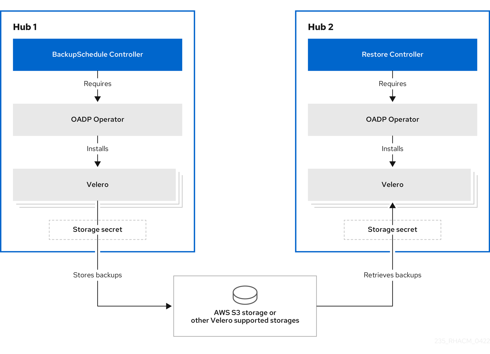
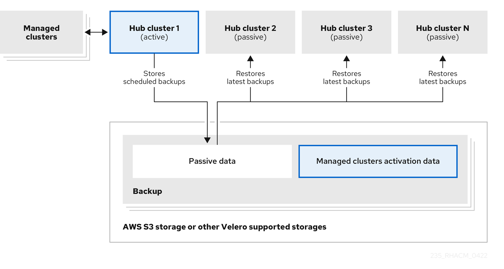
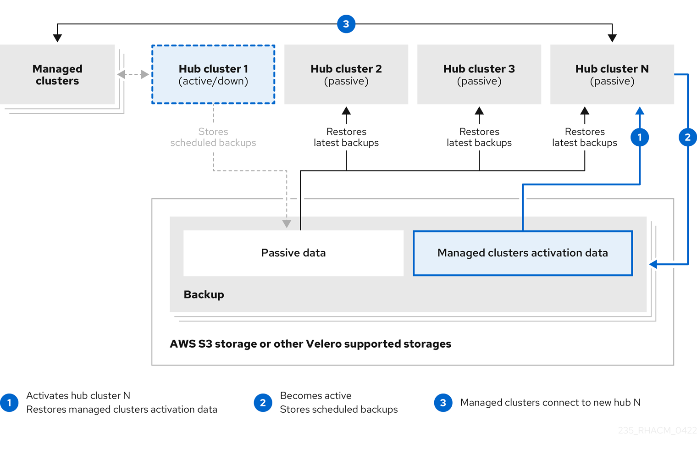

> Source: [Red Hat Advanced Cluster Management for Kubernetes 2.17](https://docs.redhat.com/en/documentation/red_hat_advanced_cluster_management_for_kubernetes/2.17/html/business_continuity/index). Copyright Red Hat.
> Adapted from AsciiDoc to Markdown for offline use; see [legal notice](LEGAL-NOTICE.md), [CC BY-SA 3.0](LICENSE.md) and SOURCE.json for source revisions and gaps.

<a id="business-cont-overview"></a>

# Business continuity

See the following topics for disaster recovery solutions and for the hub cluster, as well as managed clusters.

- [Backup and restore](business_continuity.md#backup-intro)

- [VolSync persistent volume replication service](business_continuity.md#volsync)

<a id="backup-intro"></a>

## Backup and restore

The cluster backup and restore operator runs on the hub cluster and provides disaster recovery solutions for Red Hat Advanced Cluster Management for Kubernetes hub cluster failures. When the hub cluster fails, some features stop working, even if all managed clusters still work. When the hub cluster is unavailable, you need a recovery plan to decide if recovery is possible, or if you need to recover the data on a newly deployed hub cluster.

The cluster backup and restore operator supports backups of any third-party resources that extend the hub cluster installation. With this backup solution, you can define cron-based backup schedules that run at specified time intervals. When the hub cluster fails, you can deploy a new hub cluster and move the backed up data to that new hub cluster.

<div>

<div class="title">

Additional resources

</div>

- [Backup and restore operator architecture](business_continuity.md#backup-restore-architecture)

- [Active-passive hub cluster configuration](business_continuity.md#dr4hub-config)

- [Install the backup and restore operator](business_continuity.md#dr4hub-install-backup-and-restore)

- [Schedule backups](business_continuity.md#using-backup-restore)

- [Restore a backup](business_continuity.md#restore-backup)

- [Backup and restore configuration validation](business_continuity.md#backup-validation-using-a-policy)

- [Managed clusters connection using Managed Service Account](business_continuity.md#auto-connect-clusters-msa)

- [Run the restore operation while the primary hub cluster is active](business_continuity.md#keep-hub-active-restore)

- [Configuring Velero resource requests and limits](business_continuity.md#config-velero-res-limit)

- [Scenarios when using an existing hub cluster as a restore hub cluster](business_continuity.md#using-existing-hub)

- [Tag user resources with the backup label](business_continuity.md#tagging-resources)

- [Restore data to the initial hub cluster](business_continuity.md#restore-data-initial-hub)

- [Backup and restore for hosted control plane overview](business_continuity.md#config-hcp-backup)

- [Restore the hosted control plane management configuration](business_continuity.md#restore-hcp-management)

- [Backup and restore configuration for observability](business_continuity.md#backup-restore-obs-config)

- [Back up and restore the observability service](business_continuity.md#backup-restore-obs)

</div>

<a id="backup-restore-architecture"></a>

### Backup and restore operator architecture

The backup and restore operator manages the backup and restore processes for Red Hat Advanced Cluster Management hub clusters. The operator implements the following custom resources:

- `BackupSchedule.cluster.open-cluster-management.io` to set up Red Hat Advanced Cluster Management backup schedules.

- `restore.cluster.open-cluster-management.io` to process and restore these backups.

With the operator, you have Velero resources to define the options that you need to back up remote and hub cluster resources that need to be restored.

For a visual of this process, see the following architecture diagram:



The backup and restore component gives a set of policies for reporting issues. Use the policy templates to create an alert to the hub cluster administrator if the backup solution is not functioning.

The cluster backup and restore operator depends on the OADP Operator to install Velero, and to create a connection from the hub cluster to the backup storage location where the data is stored. Velero is the component that runs the backup and restore operations. The cluster backup and restore operator solution provides backup and restore support for all Red Hat Advanced Cluster Management hub cluster resources, including managed clusters, applications, and policies.

<div>

<div class="title">

Additional resources

</div>

- [Resources that are backed up](business_continuity.md#backed-up-resources)

- [Resources restored at managed cluster activation time](business_continuity.md#backup-arch-activation)

- [Backup function](business_continuity.md#backup-function)

- [Backup and restore configuration validation](business_continuity.md#backup-validation-using-a-policy)

- [OADP Operator](https://docs.redhat.com/en/documentation/openshift_container_platform/4.20/html/backup_and_restore/oadp-application-backup-and-restore)

</div>

<a id="backed-up-resources"></a>

### Resources that are backed up

The cluster backup and restore operator solution provides backup and restore support for all hub cluster resources such as managed clusters, applications, and policies. With this backup solution, define a cron-based backup schedule, which runs at specified time intervals and continuously backs up the latest version of the hub cluster content.

When the hub cluster needs to be replaced or is in a disaster scenario when the hub cluster fails, a new hub cluster can be deployed and backed up data is moved to the new hub cluster.

View the following list of the cluster backup and restore process, and how they back up or exclude resources and groups to identify backup data:

- Exclude all resources in the `MultiClusterHub` namespace. This is to avoid backing up installation resources that are linked to the current hub cluster identity and should not be backed up.

- Back up all resources with an API version suffixed by `.open-cluster-management.io` and `.hive.openshift.io`. These suffixes indicate that all Red Hat Advanced Cluster Management resources are backed up.

- Back up all resources from the following API groups: `argoproj.io`, `app.k8s.io`, `core.observatorium.io`, `hive.openshift.io`. The resources are backed up within the `acm-resources-schedule` backup, with the exception of the resources from the `agent-install.openshift.io` API group. Resources from the `agent-install.openshift.io` API group are backed up within the `acm-managed-clusters-schedule` backup. The following resources from `hive.openshift.io` and `hiveinternal.openshift.io` API groups are also backed up by the `acm-managed-clusters-schedule` backup:

  - `clusterdeployment.hive.openshift.io`

  - `machinepool.hive.openshift.io`

  - `clusterpool.hive.openshift.io`

  - `clusterclaim.hive.openshift.io`

  - `clusterimageset.hive.openshift.io`

  - `clustersync.hiveinternal.openshift.io`

- Exclude all resources from the following API groups:

  - `internal.open-cluster-management.io`

  - `operator.open-cluster-management.io`

  - `work.open-cluster-management.io`

  - `search.open-cluster-management.io`

  - `admission.hive.openshift.io`

  - `proxy.open-cluster-management.io`

  - `action.open-cluster-management.io`

  - `view.open-cluster-management.io`

  - `clusterview.open-cluster-management.io`

  - `velero.io`

- Exclude all of the following resources that are a part of the included API groups, but are either not needed or are being recreated by owner resources that are also backed up:

  - `clustermanagementaddon.addon.open-cluster-management.io`

  - `backupschedule.cluster.open-cluster-management.io`

  - `restore.cluster.open-cluster-management.io`

  - `clusterclaim.cluster.open-cluster-management.io`

  - `discoveredcluster.discovery.open-cluster-management.io`

- Back up secrets and ConfigMaps with one of the following labels: `cluster.open-cluster-management.io/type`, `hive.openshift.io/secret-type`, `cluster.open-cluster-management.io/backup`.

- Use the `cluster.open-cluster-management.io/backup` label for any other resources that you want to be backed up and are not included in the previously mentioned criteria or are part of the excluded API groups. See the following example:

  ``` yaml
  apiVersion: my.group/v1alpha1
  kind: MyResource
  metadata:
    labels:
      cluster.open-cluster-management.io/backup: ""
  ```

  **Note:** Secrets used by the `hive.openshift.io.ClusterDeployment` resource need to be backed up, and are automatically annotated with the `cluster.open-cluster-management.io/backup` label only when you create the cluster by using the console. If you deploy the Hive cluster by using GitOps instead, you must manually add the `cluster.open-cluster-management.io/backup` label to the secrets used by the `ClusterDeployment` resource. Secret and config map resources with the `cluster.open-cluster-management.io/backup: cluster-activation` label are restored at cluster activation time.

- Exclude specific resources that you do not want backed up. See the following example to exclude Velero resources from the backup process:

  ``` yaml
  apiVersion: my.group/v1alpha1
  kind: MyResource
  metadata:
    labels:
      velero.io/exclude-from-backup: "true"
  ```

<a id="backup-arch-activation"></a>

### Resources restored at managed cluster activation time

Some backed up resources are restored only when managed cluster activation data is restored on a new hub cluster.

When you add the `cluster.open-cluster-management.io/backup` label to a resource, the resource is automatically backed up in the `acm-resources-generic-schedule` backup, except for the `Secrets` and `ConfigMap` resources which are backed up in the `acm-credentials-schedule-<timestamp>` backup. Set the label value to `cluster-activation` if you need to restore any of the resources after you move the managed clusters to the new hub cluster, and when you use `veleroManagedClustersBackupName: latest` on the restore resource.

When you set the `cluster.open-cluster-management.io/backup` label to `cluster-activation`, you ensure that the resource is not restored unless you activate the managed cluster. View the following example:

``` yaml
apiVersion: my.group/v1alpha1
kind: MyResource
metadata:
  labels:
    cluster.open-cluster-management.io/backup: cluster-activation
```

**Note:** For any managed cluster namespace, or any resource in it, you must restore either one at the cluster activation step. Therefore, if you need to add to the backup resource created in the managed cluster namespace, then use the `cluster-activation` value for the `cluster.open-cluster-management.io/backup` label. To understand the restore process, see the following information:

- If you restore the namespace, then the `managedcluster-import-controller` deletes the namespace.

- If you restore the `managedCluster` custom resource, then the `cluster-manager-registration-controller` creates the namespace.

Aside from the activation data resources that are identified by using the `cluster.open-cluster-management.io/backup: cluster-activation` label and stored by the `acm-resources-generic-schedule` backup, the cluster backup and restore operator includes a few resources in the activation set by default. The following resources are backed up by the `acm-managed-clusters-schedule` backup:

- `managedcluster.cluster.open-cluster-management.io`

- `klusterletaddonconfig.agent.open-cluster-management.io`

- `managedclusteraddon.addon.open-cluster-management.io`

- `managedclusterset.cluster.open-cluster-management.io`

- `managedclusterset.clusterview.open-cluster-management.io`

- `managedclustersetbinding.cluster.open-cluster-management.io`

- `clusterpool.hive.openshift.io`

- `clusterclaim.hive.openshift.io`

- `clustercurator.cluster.open-cluster-management.io`

<a id="dr4hub-config"></a>

## Active-passive hub cluster configuration

In an active-passive hub cluster configuration, the initial hub cluster backs up data and the passive hub clusters control the managed clusters when the active cluster becomes unavailable.

In an active-passive configuration, there is one active hub cluster and passive hub clusters. An active hub cluster is also considered the primary hub cluster, which manages clusters and backs up resources at defined time intervals, using the `BackupSchedule.cluster.open-cluster-management.io` resource.

**Note:** To back up the primary hub cluster data, you do not need an `active-passive` configuration. You can simply backup and store the hub cluster data. This way, if there is an issue or failure, you can deploy a new hub cluster and restore your primary hub cluster data on this new hub cluster. To reduce the time to recover the primary hub cluster data, you can use an `active-passive` configuration; however, this is not necessary.

Passive hub clusters continuously retrieve the latest backups and restore the passive data. Passive hubs use the `Restore.cluster.open-cluster-management.io` resource to restore passive data from the primary hub cluster when new backup data is available. These hub clusters are on standby to become a primary hub when the primary hub cluster fails.

Active and passive hub clusters are connected to the same storage location, where the primary hub cluster backs up data for passive hub clusters to access the primary hub cluster backups. For more details on how to set up this automatic restore configuration, see *Restore passive resources while checking for backups*.

In the following diagram, the active hub cluster manages the local clusters and backs up the hub cluster data at regular intervals:



The passive hub cluster restores this data, except for the managed cluster activation data, which moves the managed clusters to the passive hub cluster. The passive hub clusters can restore the passive data continuously. Passive hub clusters can restore passive data as a one-time operation. See *Restore passive resources while checking for backups* for more details.

<div>

<div class="title">

Additional resources

</div>

- [Disaster recovery](business_continuity.md#dr4hub-disaster-recovery)

- [Restore passive resources while checking for backups](business_continuity.md#restore-passive-resources-check-backups)

</div>

<a id="dr4hub-disaster-recovery"></a>

### Disaster recovery

When the primary hub cluster fails, as a hub administrator, you can promote a passive hub cluster to become the new primary hub cluster and restore managed cluster activation data.

In the following *Disaster recovery diagram*, see how you can use *Hub cluster N* as the new primary hub cluster:



*Hub cluster N* restores the managed cluster activation data. The managed clusters connect to *Hub cluster N*. You activate a backup on the new primary hub cluster, *Hub cluster N*, by creating a `BackupSchedule.cluster.open-cluster-management.io` resource, and storing the backups at the same storage location as the initial primary hub cluster.

All other passive hub clusters now restore passive data by using the backup data that is created by the new primary hub cluster. *Hub N* is now the primary hub cluster, managing clusters and backing up data.

**Important:**

- The first process in the earlier *Disaster recovery diagram* is not automated because of the following reasons:

  - You must decide if the primary hub cluster has failed and needs to be replaced, or if there is a network communication error between the hub cluster and the managed clusters.

  - You must decide which passive hub cluster becomes the primary hub cluster. The policy integration with Red Hat Ansible Automation Platform jobs can help you automate this step by making a job run when the backup policy reports backup errors.

- The second process in the earlier *Disaster recovery diagram* is manual. If you did not create a backup schedule on the new primary hub cluster, the `backup-restore-enabled` policy shows a violation by using the `backup-schedule-cron-enabled` policy template. In this second process, you can do the following actions:

  - Use the `backup-schedule-cron-enabled` policy template to validate if the new primary hub cluster has backups running as a cron job.

  - Use the policy integration with `Ansible` and define an `Ansible` job that can run when the `backup-schedule-cron-enabled` policy template reports violations.

- For more details about the `backup-restore-enabled` policy templates, see *Backup and restore configuration validation* in the *Additional resources* section.

<div>

<div class="title">

Additional resources

</div>

- [Backup and restore configuration validation](business_continuity.md#backup-validation-using-a-policy)

- [Restore passive resources while checking for backups](business_continuity.md#restore-passive-resources-check-backups)

- [Restore passive resources](business_continuity.md#restore-passive-resources-check-backups)

- [Restore activation resources](business_continuity.md#restore-activation-resources)

</div>

<a id="backup-function"></a>

## Backup function

You can backup third-party resources with cluster backup and restore by adding the `cluster.open-cluster-management.io/backup` label to the resources.

The value of the label can be any string, including an empty string. Use a value that can help you identify the component that you are backing up. For example, use the `cluster.open-cluster-management.io/backup: idp` label if the components are provided by an IDP solution.

**Note:** Use the `cluster-activation` value for the `cluster.open-cluster-management.io/backup` label if you want the resources to be restored when the managed clusters activation resources are restored. When you restore the managed clusters activation resources, the restore starts for the managed clusters that are actively managed by the hub cluster.

<a id="dr4hub-install-backup-and-restore"></a>

## Install the backup and restore operator

Install and enable the backup and restore operator on hub clusters by setting up your hub cluster. The cluster backup and restore operator is not installed automatically.

<div>

<div class="title">

Prerequisites

</div>

- From your Red Hat OpenShift Container Platform cluster, install the Red Hat Advanced Cluster Management operator version 2.17. The `MultiClusterHub` resource is automatically created when you install Red Hat Advanced Cluster Management, and displays the following status: `Running`.

</div>

Complete the following steps to set up your hub cluster for the installation.

<div>

<div class="title">

Procedure

</div>

1.  By default, the backup and restore operator is disabled. To enable the operator, see [Enable the backup operator for your hub clusters](business_continuity.md#dr4hub-install-enable-backup-operator).

2.  You must create a `Secret` resource that has credentials for your target backup location. See [Create the storage location secret](business_continuity.md#dr4hub-install-storage-secret).

3.  To help with disaster recovery, you need to install the OADP operator. See [OADP operator installation on the hub cluster](business_continuity.md#dr4hub-install-oadp).

4.  You can install a specific OADP version. See [Install a custom OADP version](business_continuity.md#dr4hub-install-oadp-custom).

5.  To define your backup locations and enable specific storage plugins, see [Create a *DataProtectionApplication* resource](business_continuity.md#dr4hub-install-dpa).

6.  If you are in a disconnected environment, you can enable the backup and restore operator. See [Enable the backup and restore component in a disconnected environment](business_continuity.md#dr4hub-install-disconnected).

</div>

<a id="dr4hub-install-enable-backup-operator"></a>

### Enable the backup operator for your hub clusters

Enable the backup operator for your active and passive hub clusters. The cluster backup and restore operator can be enabled by updating the `MultiClusterHub` resource. When the operator is enabled, the operator resources are installed.

If the `MultiClusterHub` resource is already created, you can install or uninstall the cluster backup operator by editing the `MultiClusterHub` resource. Set `cluster-backup` to `false`, if you want to uninstall the cluster backup operator.

<div>

<div class="title">

Procedure

</div>

1.  Enable the cluster backup and restore operator, `cluster-backup`, by updating the `MultiClusterHub` resource and setting the `cluster-backup` parameter to `true`. Your `MultiClusterHub` resource might resemble following example:

    ``` yaml
    apiVersion: operator.open-cluster-management.io/v1
    kind: MultiClusterHub
    metadata:
      name: multiclusterhub
      namespace: open-cluster-management
    spec:
      availabilityConfig: High
      enableClusterBackup: false
      imagePullSecret: multiclusterhub-operator-pull-secret
      ingress:
        sslCiphers:
          - ECDHE-ECDSA-AES256-GCM-SHA384
          - ECDHE-RSA-AES256-GCM-SHA384
          - ECDHE-ECDSA-AES128-GCM-SHA256
          - ECDHE-RSA-AES128-GCM-SHA256
      overrides:
        components:
          - enabled: true
            name: multiclusterhub-repo
          - enabled: true
            name: search
          - enabled: true
            name: management-ingress
          - enabled: true
            name: console
          - enabled: true
            name: insights
          - enabled: true
            name: grc
          - enabled: true
            name: cluster-lifecycle
          - enabled: true
            name: volsync
          - enabled: true
            name: multicluster-engine
          - enabled: true
            name: cluster-backup
      separateCertificateManagement: false
    ```

    **Notes:**

    - For the OpenShift APIs for Data Protection (OADP) operator installation, the automatic installation is the default. In this default situation, the OADP operator automatically installs in the same namespace where you enabled the `cluster-backup` component.

    - In certain cases, you must manually install the OADP operator. If your hub cluster runs on AWS cloud and uses AWS Security Token Service (STS) authentication, you must manually install the OADP operator before you enable the backup component. The STS configurations require an Amazon Resource Name (ARN) token that you must configure during the OADP operator installation.

2.  Verify that the restore hub cluster uses the same Red Hat Advanced Cluster Management version that the backup hub cluster uses. You cannot restore a backup on a hub cluster with a version earlier than the one used by the backup hub cluster.

3.  Manually configure the restore hub cluster by completing the following steps:

    1.  Install all operators that are installed on the active hub cluster and in the same namespace as the active hub cluster.

    2.  Verify that the new hub cluster is configured the same way as the backup hub cluster.

        **Note:** Use the same namespace name as the backup hub cluster when you install the backup and restore operator and any operators that are configured on the backup hub cluster.

4.  Create the `DataProtectionApplication` resource on both the active and passive hub cluster.

    **Note:** For the restore hub cluster, when you create the `DataProtectionApplication` resource, use the same storage location as the backup hub.

</div>

<div>

<div class="title">

Additional resources

</div>

- [Velero](https://velero.io/)

- [AWS S3 compatible backup storage providers](https://docs.redhat.com/en/documentation/openshift_container_platform/4.20/html/backup_and_restore/oadp-application-backup-and-restore)

- [*DataProtectionApplication*](https://docs.redhat.com/en/documentation/openshift_container_platform/4.20/html/backup_and_restore/oadp-application-backup-and-restore)

</div>

<a id="dr4hub-install-storage-secret"></a>

### Create the storage location secret

Create a storage location secret for the cloud storage where backups are saved.

<div>

<div class="title">

Procedure

</div>

1.  Complete the steps for [Creating a default Secret](https://docs.redhat.com/en/documentation/openshift_container_platform/4.20/html/backup_and_restore/oadp-application-backup-and-restore#oadp-creating-default-secret_installing-oadp-aws) for the cloud storage where the backups are saved.

2.  Create the secret resource in the OADP Operator namespace, which is located in the backup component namespace.

</div>

<a id="dr4hub-install-oadp"></a>

### OADP operator installation on the hub cluster

If the OADP operator is not automatically installed after you enable the backup and restore operator, manually install the OADP operator. To learn how to install OADP, see *OADP operator installation on the hub cluster* in the OpenShift Container Platform documentation.

For hub clusters where you enabled the AWS Security Token Service (STS) option, the OADP operator is not installed when you installed the cluster backup and restore operator on the hub cluster. To pass the STS `role_arn` to the OADP operator, you must manually install the OADP operator.

For hub clusters where you did not enable the STS option, the OADP operator is automatically installed when you install the cluster backup and restore operator on the hub cluster.

When you enable the backup option from the `MultiClusterHub` resource, the backup option remains in the `Pending` state until you install the OADP operator in the `open-cluster-management-backup` namespace. If you have not enabled the AWS STS option on your hub cluster, then the OADP operator is automatically installed with the backup chart. Otherwise, you must manually install the OADP operator.

When the cluster is in the STS mode, the backup chart creates a config map named `acm-redhat-oadp-operator-subscription` in the `open-cluster-management-backup` namespace. This config map also contains the OADP channel and environment information. Use this config map to get the OADP version that you need to install and to get any environment options to be set on the OADP subscription.

**Important:**

When you install the OADP operator, see the following notes:

- Custom resource definitions are cluster-scoped, so you cannot have two different versions of OADP or Velero installed on the same cluster. If you have two different versions, one version runs with the wrong custom resource definitions.

- When you create the `MultiClusterHub` resource, the Velero custom resource definitions (CRDs) do not automatically install on the hub cluster. When you install the OADP operator, the Velero CRDs are installed on the hub cluster. As a result, the Velero CRD resources are no longer reconciled and updated by the `MultiClusterHub` resource.

- The backup component works with the OADP Operator that is installed in the component namespace.

- If you manually install the OADP operator, the custom resource definition version of the OADP operator and Velero must exactly match. If these versions do not exactly match one another, you get problems.

- Velero is installed with the OADP Operator on the Red Hat Advanced Cluster Management for Kubernetes hub cluster. It is used to backup and restore Red Hat Advanced Cluster Management hub cluster resources.

- For a list of supported storage providers for Velero, see *About installing OADP* from the *Additional resources* section.

<div>

<div class="title">

Additional resources

</div>

- [Installing the OADP Operator](https://docs.redhat.com/en/documentation/openshift_container_platform/4.20/html/backup_and_restore/oadp-application-backup-and-restore#installing-operator-oadp_installing-oadp-operator)

- [About installing OADP](https://docs.redhat.com/en/documentation/openshift_container_platform/4.20/html/backup_and_restore/oadp-application-backup-and-restore)

</div>

<a id="dr4hub-install-oadp-custom"></a>

### Install a custom OADP version

Customize the OADP version installed by the backup and restore operator by setting an annotation on your `MultiClusterHub` resource.

<div>

<div class="title">

Procedure

</div>

1.  To override the OADP version installed by the backup and restore operator, use the following annotation on the `MultiClusterHub` resource:

    ``` yaml
    installer.open-cluster-management.io/oadp-subscription-spec: '{"channel": "stable-1.4"}'
    ```

    **Important:** If you use this option to get a different OADP version than the one installed by default by the backup and restore operator, make sure this version is supported on the Red Hat OpenShift Container Platform version used by the hub cluster. Use this override option with caution because it can result in unsupported configurations.

2.  **Optional:** To install a specific OADP version of the operator, set your annotation. For example, if you want to install OADP from the `stable-1.5` channel and select a specific version of the operator, set the `startingCSV` property on the `installer.open-cluster-management.io/oadp-subscription-spec` annotation. Your `MultiClusterHub` resource might resemble the following example:

    ``` yaml
    apiVersion: operator.open-cluster-management.io/v1
    kind: MultiClusterHub
    metadata:
      annotations:
        installer.open-cluster-management.io/oadp-subscription-spec: '{"channel": "stable-1.5","installPlanApproval": "Automatic","name":
          "redhat-oadp-operator","source": "redhat-operators","sourceNamespace": "openshift-marketplace" "startingCSV": “oadp-operator.v5.0.2”}'
      name: multiclusterhub
    spec: {}
    ```

3.  Enable the `cluster-backup` option on the `MultiClusterHub` resource by setting `cluster-back` to `true`.

4.  To verify that the OADP operator uses the `oadp-subscription-spec` annotation properties, confirm that the subscription YAML for the OADP operator includes the properties that are specified by the annotation.

</div>

<a id="dr4hub-install-dpa"></a>

### Create a *DataProtectionApplication* resource

Create an instance of the `DataProtectionApplication` resource for your active and passive hub clusters.

<div>

<div class="title">

Procedure

</div>

1.  From the Red Hat OpenShift Container Platform console, select **Operators** \> **Installed Operators**.

2.  Click `Create instance` within the *DataProtectionApplication* dialog box.

3.  Create the Velero instance by selecting configurations using the OpenShift Container Platform console or by using a YAML file as mentioned in the `DataProtectionApplication` example.

4.  Set the `DataProtectionApplication` namespace to `open-cluster-management-backup`.

5.  Set the specification (`spec:`) values appropriately for the `DataProtectionApplication` resource. Then click **Create**.

    If you intend on using the default backup storage location, set the following value, `default: true` in the `backupStorageLocations` section. View the following `DataProtectionApplication` resource sample:

    ``` yaml
    apiVersion: oadp.openshift.io/v1alpha1
    kind: DataProtectionApplication
    metadata:
      name: dpa-sample
    spec:
      configuration:
        velero:
          defaultPlugins:
          - openshift
          - aws
        restic:
          enable: true
      backupLocations:
        - name: default
          velero:
            provider: aws
            default: true
            objectStorage:
              bucket: my-bucket
              prefix: my-prefix
            config:
              region: us-east-1
              profile: "default"
            credential:
              name: cloud-credentials
              key: cloud
      snapshotLocations:
        - name: default
          velero:
            provider: aws
            config:
              region: us-west-2
              profile: "default"
    ```

</div>

<a id="dr4hub-install-disconnected"></a>

### Enable the backup and restore component in a disconnected environment

Enable the backup and restore component with Red Hat OpenShift Container Platform in a disconnected environment.

<div>

<div class="title">

Procedure

</div>

1.  Update the `MultiClusterHub` resource with the following annotation to override the source from which the OADP operator is installed. Create the annotation before the `cluster-backup` component is enabled on the `MultiClusterHub` resource:

    ``` yaml
    apiVersion: operator.open-cluster-management.io/v1
    kind: MultiClusterHub
    metadata:
      annotations:
        installer.open-cluster-management.io/oadp-subscription-spec: '{"source": "redhat-operator-index"}'
    ```

2.  The `redhat-operator-index` is a custom name and represents the name of the `CatalogSource` resource that you define and use to access Red Hat OpenShift Operators in the disconnected environment. Run the following command to retrieve the `catalogsource`:

    ``` bash
    oc get catalogsource -A
    ```

    The output might resemble the following:

    ``` bash
    NAMESPACE               NAME                         DISPLAY                       TYPE   PUBLISHER   AGE
    openshift-marketplace   acm-custom-registry          Advanced Cluster Management   grpc   Red Hat     42h
    openshift-marketplace   multiclusterengine-catalog   MultiCluster Engine           grpc   Red Hat     42h
    openshift-marketplace   redhat-operator-index                                      grpc               42h
    ```

</div>

<a id="using-backup-restore"></a>

## Schedule backups

By scheduling a backup, you help ensure your data remains protected and accessible.

<div>

<div class="title">

Procedure

</div>

1.  Run the following command to create a `backupschedule.cluster.open-cluster-management.io` resource:

    ``` bash
    oc create -f cluster_v1beta1_backupschedule.yaml
    ```

    Your `cluster_v1beta1_backupschedule.yaml` resource might resemble the following file:

    ``` yaml
    apiVersion: cluster.open-cluster-management.io/v1beta1
    kind: BackupSchedule
    metadata:
      name: schedule-acm
      namespace: open-cluster-management-backup
    spec:
      veleroSchedule: 0 */2 * * *
      veleroTtl: 120h
      useManagedServiceAccount: true
      paused: false
    ```

    - The `veleroSchedule` is a required property and defines a cron job for scheduling the backups. In the earlier example, it creates a backup every 2 hours.

    - The `veleroTtl` is an optional property and defines the expiration time for a scheduled backup resource. If not specified, the maximum default value set by Velero is used, which is `720h`. It deletes scheduled backups after `120h`.

    - The `useManagedServiceAccount` is an optional property which can enable the automatic import feature, importing clusters in a restore operation. If you set it to `true`, it enables the automatic import feature, importing clusters in a restore operation.

    - The `paused` is an optional property which can pause the backup schedule. If you set it to `true`, it pauses the backup schedule, deleting all Velero schedules created by this resource.

2.  Check the status of your `backupschedule.cluster.open-cluster-management.io` resource, which displays the definition for the three `schedule.velero.io` resources. Run the following command:

    ``` bash
    oc get BackupSchedule -n open-cluster-management-backup
    ```

3.  As a reminder, the restore operation is run on a different hub cluster for restore scenarios. To initiate a restore operation, create a `restore.cluster.open-cluster-management.io` resource on the hub cluster where you want to restore backups.

    **Note:** When you restore a backup on a new hub cluster, make sure that you shut down the previous hub cluster where the backup was created. If it is running, the previous hub cluster tries to reimport the managed clusters as soon as the managed cluster reconciliation finds that the managed clusters are no longer available.

4.  View the list of scheduled resources. Run the following command:

    ``` bash
    oc get schedules -A | grep acm
    ```

    **Note:** Resources are backed up separately in the `Credentials`, `Resources`, and `ManagedClusters` groups.

</div>

<div>

<div class="title">

Additional resources

</div>

- [Backup resource groups](business_continuity.md#backup-schedule-resource-groups)

- [BackupSchedule status](business_continuity.md#backup-schedule-status)

- [Backup collisions](business_continuity.md#understanding-backup-collisions)

- [Prevent backup collisions](business_continuity.md#preventing-backup-collisions)

- [Restore a backup](business_continuity.md#restore-backup)

- [Backup and restore](business_continuity.md#backup-intro)

</div>

<a id="backup-schedule-resource-groups"></a>

### Backup resource groups

Resources are separately backed up in the following groups.

`Credentials` backup  
Backup file that stores Hive credentials, Red Hat Advanced Cluster Management, and user-created credentials and ConfigMaps.

`Resources` backup  
Contains one backup for the Red Hat Advanced Cluster Management resources and one for generic resources. These resources use the `cluster.open-cluster-management.io/backup` label.

`ManagedClusters` backup  
Contains only resources that activate the managed cluster connection to the hub cluster, where the backup is restored.

**Note:** The *resources backup* file contains managed cluster-specific resources, but does not contain the subset of resources that connect managed clusters to the hub cluster. The resources that connect managed clusters are called activation resources and are contained in the managed clusters backup. When you restore backups only for the *credentials* and *resources* backup on a new hub cluster, the new hub cluster shows all managed clusters that are created by using the Hive API in a detached state. The managed clusters that are imported on the primary hub cluster by using the import operation appear only when the activation data is restored on the passive hub cluster. The managed clusters are still connected to the original hub cluster that created the backup files.

When the activation data is restored, only managed clusters created by using the Hive API are automatically connected with the new hub cluster. All other managed clusters appear in a *Pending* state. You need to manually reattach them to the new cluster.

<div>

<div class="title">

Additional resources

</div>

- [Schedule backups](business_continuity.md#using-backup-restore)

</div>

<a id="backup-schedule-status"></a>

### BackupSchedule status

Review the descriptions of the various `BackupSchedule` statuses.

`Enabled`  
The `BackupSchedule` is running and generating backups.

`FailedValidation`  
An error prevents the `BackupSchedule` from running. As a result, the `BackupSchedule` is not generating backups, but instead, it is reconciling and waiting for the error to be fixed. Look at the `BackupSchedule` status section for the reason why the resource is not valid. After the error is addressed, the `BackupSchedule` status changes to `Enabled`, and the resource starts generating backups.

`BackupCollision`  
The `BackupSchedule` is not generating backups. Look at the `BackupSchedule` status section for the reason why the resource status is `BackupCollision`. To start creating backups, delete this resource and create a new one.

`Paused`  
If you paused the Red Hat Advanced Cluster Management backup schedule by using the `BackupSchedule.paused` property, the Velero schedules created by the `BackupSchedule` resources get deleted and no new hub backups get generated. If you update the `BackupSchedule.paused` property to `False`, the `BackupSchedule` resource status returns to `Enabled` and the Velero schedules get recreated.

<div>

<div class="title">

Additional resources

</div>

- [Backup collisions](business_continuity.md#understanding-backup-collisions)

- [Prevent backup collisions](business_continuity.md#preventing-backup-collisions)

</div>

<a id="understanding-backup-collisions"></a>

### Backup collisions

Backup collisions might occur if the hub cluster changes status from passive to primary hub cluster, or from primary to passive, and different hub clusters back up data at the same storage location.

As a result, the latest backups are generated by a hub cluster that is no longer set as the primary hub cluster. This hub cluster still produces backups because the `BackupSchedule.cluster.open-cluster-management.io` resource is still enabled.

When you run a restore operation in a controlled environment, such as a disaster recovery test operation, you can prevent a backup collision when you use the `BackupSchedule` `paused` property on the backup hub cluster. Before you restore the resources on the new hub cluster, pause the `BackupSchedule` resource on the backup hub by setting the `paused=true` property on the `BackupSchedule` resource.

See the following list to learn about scenarios that might cause a backup collision:

- The primary hub cluster fails unexpectedly, which is caused by the following conditions:

  - Communication from the primary hub cluster to the initial hub cluster fails.

  - The initial hub cluster backup data is restored on a secondary hub cluster, called secondary hub cluster.

  - The administrator creates the `BackupSchedule.cluster.open-cluster-management.io` resource on the secondary hub cluster, which is now the primary hub cluster and generates backup data to the common storage location.

  - The initial hub cluster unexpectedly starts working again.

    Since the `BackupSchedule.cluster.open-cluster-management.io` resource is still enabled on the initial hub cluster, the initial hub cluster resumes writing backups to the same storage location as the secondary hub cluster. Both hub clusters are now writing backup data at the same storage location. Any hub cluster restoring the latest backups from this storage location might use the initial hub cluster data instead of the secondary hub cluster data.

- The administrator tests a disaster scenario by making the secondary hub cluster a primary hub cluster, which is caused by the following conditions:

  - The initial hub cluster is stopped.

  - The initial hub cluster backup data is restored on the secondary hub cluster.

  - The administrator creates the `BackupSchedule.cluster.open-cluster-management.io` resource on the secondary hub cluster, which is now the primary hub cluster and generates backup data to the common storage location.

  - After the disaster test is completed, the administrator reverts to the earlier state and makes the initial hub cluster the primary hub cluster again.

  - The initial hub cluster starts while the secondary hub cluster is still active.

    Since the `BackupSchedule.cluster.open-cluster-management.io` resource is still enabled on the secondary hub cluster, it writes backups at the same storage location that corrupts the backup data. Any hub cluster that restores the latest backups from this location might use the secondary hub cluster data instead of the initial hub cluster data. In this scenario, stop the secondary hub cluster first or pause the `BackupSchedule.cluster.open-cluster-management.io` resource on the secondary hub cluster before you start the initial hub cluster to avoid the backup collision issue.

- The administrator tests a disaster scenario by making the secondary hub cluster a primary hub cluster, without stopping the initial hub cluster first, causing the following conditions:

  - The initial hub cluster is still running.

  - The initial hub cluster backup data is restored on the secondary hub cluster, including managed clusters backup. Therefore, the secondary hub cluster is now the active cluster.

  - Since the `BackupSchedule.cluster.open-cluster-management.io` resource is still enabled on the initial hub cluster, it writes backups at the same storage location which corrupts the backup data. For example, any hub cluster restoring the latest backups from this location might use the initial hub cluster data instead of the secondary hub cluster data. To avoid data corruption, the initial hub cluster `BackupSchedule` resource status automatically changes to `BackupCollision`. In this scenario, to avoid getting into this backup collision state, stop the initial hub cluster first or delete the `BackupSchedule.cluster.open-cluster-management.io` resource on the initial hub cluster before restoring managed clusters data on the secondary hub cluster.

<div>

<div class="title">

Additional resources

</div>

- [Prevent backup collisions](business_continuity.md#preventing-backup-collisions)

</div>

<a id="preventing-backup-collisions"></a>

### Prevent backup collisions

Prevent and report backup collisions by using the `BackupCollision` state in the `BackupSchedule.cluster.open-cluster-management.io` resource.

To prevent and report backup collisions, use the `BackupCollision` state in the `BackupSchedule.cluster.open-cluster-management.io` resource. The controller checks regularly if the latest backup in the storage location has been generated from the current hub cluster. If not, a different hub cluster has recently written backup data to the storage location, indicating that the hub cluster is colliding with a different hub cluster.

In the backup collision scenario, the current hub cluster `BackupSchedule.cluster.open-cluster-management.io` resource status is set to `BackupCollision`. To prevent data corruption, this resource deletes the `Schedule.velero.io` resources. The backup policy reports the `BackupCollision`.

In this same scenario, the administrator verifies which hub cluster writes to the storage location. The administrator does this verification before removing the `BackupSchedule.cluster.open-cluster-management.io` resource from the invalid hub cluster. Then, the administrator can create a new `BackupSchedule.cluster.open-cluster-management.io` resource on the valid primary hub cluster, resuming the backup.

<div>

<div class="title">

Procedure

</div>

- To check if there is a backup collision, run the following command:

  ``` bash
  oc get backupschedule -A
  ```

  If there is a backup collision, the output might resemble the following example:

      NAMESPACE       NAME               PHASE             MESSAGE
      openshift-adp   schedule-hub-1   BackupCollision   Backup acm-resources-schedule-20220301234625, from cluster with id [be97a9eb-60b8-4511-805c-298e7c0898b3] is using the same storage location. This is a backup collision with current cluster [1f30bfe5-0588-441c-889e-eaf0ae55f941] backup. Review and resolve the collision then create a new BackupSchedule resource to  resume backups from this cluster.

</div>

<div>

<div class="title">

Additional resources

</div>

- [Backup collisions](business_continuity.md#understanding-backup-collisions)

- [Restore a backup](business_continuity.md#restore-backup)

</div>

<a id="restore-backup"></a>

## Restore a backup

In a typical restore situation, the hub cluster where the backups run becomes unavailable, and you need to move the backed up data to a new hub cluster. Run the cluster restore operation on the new hub cluster. In this case, the restore operation runs on a different hub cluster than where the backup is created.

If you want to restore the data on the same hub cluster where the backup was collected, recover the data from an earlier snapshot. In this case, both restore and backup operations run on the same hub cluster.

To fully restore a backup, complete the following:

<div>

<div class="title">

Procedure

</div>

1.  Use the restore operation for backup types. See [Restore operation for backup types](business_continuity.md#restore-backup-types).

2.  Prepare the new hub cluster. See [Prepare the new hub cluster](business_continuity.md#prepare-new-hub).

3.  Run a restore operation on a hub cluster with a newer version. See [Run a restore operation on a hub cluster with a newer version](business_continuity.md#run-restore-operation).

4.  Post restore clean up. See [Post restore clean up](business_continuity.md#clean-hub-restore).

5.  Restore passive resources. See [Restore passive resources while checking for backups](business_continuity.md#restore-passive-resources-check-backups).

6.  Restore activation resources. See [Restore activation resources](business_continuity.md#restore-activation-resources).

7.  Restore imported managed clusters. See [Restore imported managed clusters](business_continuity.md#restore-imported-managed-clusters).

8.  Use other restore samples. See [Restore samples](business_continuity.md#more-restore-samples).

9.  View restore events. See [View restore events](business_continuity.md#viewing-restore-events).

</div>

<div>

<div class="title">

Additional resources

</div>

- [*DataProtectionApplication*](https://docs.redhat.com/en/documentation/openshift_container_platform/4.20/html/backup_and_restore/oadp-application-backup-and-restore)

- [Import a cluster by using the auto import secret](clusters.md#importing-clusters-auto-import-secret)

- [Schedule backups](business_continuity.md#using-backup-restore)

</div>

<a id="restore-backup-types"></a>

### Restore operation for backup types

Use the restore operation to restore all three backup types that the backup operation creates. Choose to install only a certain type of backup, such as only managed clusters, only user credentials, or only hub cluster resources.

The restore defines the following three required `spec` properties, where the restore logic is defined for the types of backed up files:

- `veleroManagedClustersBackupName` is used to define the restore option for the managed clusters activation resources.

- `veleroCredentialsBackupName` is used to define the restore option for the user credentials.

- `veleroResourcesBackupName` is used to define the restore option for the hub cluster resources (`Applications`, `Policy`, and other hub cluster resources like managed cluster passive data).

  The valid options for the previously mentioned properties are following values:

  - `latest` - This property restores the last available backup file for this type of backup.

  - `skip` - This property does not attempt to restore this type of backup with the current restore operation.

  - `<backup_name>` - This property restores the specified backup pointing to it by name.

The name of the `restore.velero.io` resources that are created by the `restore.cluster.open-cluster-management.io` is generated using the following template rule, `<restore.cluster.open-cluster-management.io name>-<velero-backup-resource-name>`. View the following descriptions:

- `restore.cluster.open-cluster-management.io name` is the name of the current `restore.cluster.open-cluster-management.io` resource, which initiates the restore.

- `velero-backup-resource-name` is the name of the Velero backup file that is used for restoring the data. For example, the `restore.cluster.open-cluster-management.io` resource named `restore-acm` creates `restore.velero.io` restore resources. View the following examples for the format:

  - `restore-acm-acm-managed-clusters-schedule-20210902205438` is used for restoring managed cluster activation data backups. In this sample, the `backup.velero.io` backup name used to restore the resource is `acm-managed-clusters-schedule-20210902205438`.

  - `restore-acm-acm-credentials-schedule-20210902206789` is used for restoring credential backups. In this sample, the `backup.velero.io` backup name used to restore the resource is `acm-managed-clusters-schedule-20210902206789`.

  - `restore-acm-acm-resources-schedule-20210902201234` is used for restoring application, policy, and other hub cluster resources like managed cluster passive data backups. In this sample, the `backup.velero.io` backup name used to restore the resource is `acm-managed-clusters-schedule-20210902201234`.

    **Note:** If `skip` is used for a backup type, `restore.velero.io` is not created.

View the following YAML sample of the cluster `Restore` resource. In this sample, all three types of backed up files are being restored, using the latest available backed up files:

``` yaml
apiVersion: cluster.open-cluster-management.io/v1beta1
kind: Restore
metadata:
  name: restore-acm
  namespace: open-cluster-management-backup
spec:
  veleroManagedClustersBackupName: latest
  veleroCredentialsBackupName: latest
  veleroResourcesBackupName: latest
```

**Note:** Only managed clusters created by the Hive API are automatically connected with the new hub cluster when the `acm-managed-clusters` backup from the managed clusters backup is restored on another hub cluster. All other managed clusters remain in the `Pending Import` state and must be imported back onto the new hub cluster.

<div>

<div class="title">

Additional resources

</div>

- [Restore imported managed clusters](business_continuity.md#restore-imported-managed-clusters)

</div>

<a id="prepare-new-hub"></a>

### Prepare the new hub cluster

To restore a hub cluster and ensure that it is the same as the initial hub cluster, use a new hub cluster when you run the hub restore operation.

When you use a new hub cluster, you prevent any pre-existing user data from interfering with the restoration. You also ensure that the new hub cluster only has the backup data, making the cluster the same as the initial hub cluster.

<div>

<div class="title">

Prerequisites

</div>

- In a disaster recovery simulation, you might need to return back to your initial hub cluster instead of using a new hub cluster. To return to your initial hub cluster, complete the steps in [Return to the primary hub cluster](business_continuity.md#restore-hub-return-primary).

- **Important:** To prevent managed clusters from switching back and forth between the old and new hub clusters, stop the initial hub cluster before running the restore operation and the new cluster becomes the active hub cluster. To keep the initial hub cluster active during or after the restore operation, complete the steps in [Prepare the primary hub cluster](business_continuity.md#active-restore-prepare).

</div>

<div>

<div class="title">

Procedure

</div>

- Before running the restore operation on a new hub cluster, you need to manually configure the hub cluster and install the same operators as on the initial hub cluster. You must install the Red Hat Advanced Cluster Management operator in the same namespace as the initial hub cluster, create the *DataProtectionApplication* resource, and then connect to the same storage location where the initial hub cluster previously backed up data.

  **Note:** Use the same configuration as on the initial hub cluster for the `MultiClusterHub` resource created by the Red Hat Advanced Cluster Management operator, including any changes to the `MultiClusterEngine` resource.

  For example, if the initial hub cluster has any other operators installed, such as Ansible Automation Platform, Red Hat OpenShift GitOps, `cert-manager`, you have to install them before running the restore operation. This ensures that the new hub cluster is configured in the same way as the initial hub cluster.

</div>

<div>

<div class="title">

Additional resources

</div>

- [Run a restore operation on a hub cluster with a newer version](business_continuity.md#run-restore-operation)

</div>

<a id="run-restore-operation"></a>

### Run a restore operation on a hub cluster with a newer version

Run the restore operation on the hub cluster that uses the same Red Hat Advanced Cluster Management operator version as the hub cluster where you backed up the data. If you want to run the restore operation on a hub cluster that uses a newer Red Hat Advanced Cluster Management operator version, complete the following steps.

<div>

<div class="title">

Procedure

</div>

1.  On the restore hub cluster, install the Red Hat Advanced Cluster Management operator at the same version as the hub cluster where you created the backup.

2.  Restore the backup data on the restore hub cluster.

3.  On the restore hub cluster, use the upgrade operation to upgrade to the Red Hat Advanced Cluster Management operator version that you want to use.

</div>

<a id="clean-hub-restore"></a>

### Post restore clean up

Velero updates existing resources if they have changed with the currently restored backup. Velero does not clean up delta resources, which are resources created by a previous restore and not part of the currently restored backup. This limits the scenarios you can use when restoring hub cluster data on a new hub cluster. Unless the restore is applied only once, you cannot reliably use the new hub cluster as a passive configuration. The data on the hub cluster does not reflect the data available with the restored resources.

To address this limitation, when a `Restore.cluster.open-cluster-management.io` resource is created, the backup operator runs a post restore operation that cleans up the hub cluster. The operation removes any resources created by a previous Red Hat Advanced Cluster Management restore that are not part of the currently restored backup.

The post restore cleanup uses the `cleanupBeforeRestore` property to identify the subset of objects to clean up. You can use the following options for the post restore cleanup:

- `None`: No clean up necessary, just begin Velero restore. Use `None` on a brand new hub cluster.

- `CleanupRestored`: Clean up all resources created by a previous Red Hat Advanced Cluster Management restore that are not part of the currently restored backup.

- `CleanupAll`: Clean up all resources on the hub cluster that might be part of a Red Hat Advanced Cluster Management backup, even if they were not created as a result of a restore operation.

  **Important:**

  - The `CleanupAll` option removes all hub cluster data, including the content that the user creates.

    Always use the `cleanupBeforeRestore = None` to avoid losing restored resources that you filter out with the restore options `excludedResource`, `excludedNamespaces`, `excludedResources`, or other options that filter out the restored resources.

  - Avoid using the `CleanupAll` option. Only use it as a last resort with extreme caution. `CleanupAll` also cleans up resources on the hub cluster created by the user, in addition to resources created by a previously restored backup. Instead, use the `CleanupRestored` option to prevent updating the hub cluster content when the hub cluster is designated as a passive candidate for a disaster scenario. Use a clean hub cluster as a passive cluster.

**Notes:**

- Velero sets the status, `PartiallyFailed`, for a velero restore resource if the restored backup has no resources. This means that a `restore.cluster.open-cluster-management.io` resource can be in `PartiallyFailed` status if any of the created `restore.velero.io` resources do not restore any resources because the corresponding backup is empty.

- The `restore.cluster.open-cluster-management.io` resource is run once, unless you use the `syncRestoreWithNewBackups:true` to keep restoring passive data when new backups are available. For this case, follow the restore passive with sync sample. See [Restore passive resources while checking for backups](business_continuity.md#restore-passive-resources-check-backups). After the restore operation is complete and you want to run another restore operation on the same hub cluster, you have to create a new `restore.cluster.open-cluster-management.io` resource.

- Although you can create multiple `restore.cluster.open-cluster-management.io` resources, only one can be active at any moment in time.

<a id="restore-passive-resources-check-backups"></a>

### Restore passive resources while checking for backups

Use the `restore-passive-sync` sample to restore passive data, while continuing to check if new backups are available and restore them automatically. To automatically restore new backups, you must set the `syncRestoreWithNewBackups` parameter to `true`. You must also only restore the latest passive data.

Passive data is backup data such as secrets, ConfigMaps, applications, policies, and all the managed cluster custom resources, which do not activate a connection between managed clusters and hub clusters. The backup resources are restored on the hub cluster by the credentials backup and restore resources.

<div>

<div class="title">

Procedure

</div>

1.  Set the `VeleroResourcesBackupName` and `VeleroCredentialsBackupName` parameters to `latest`, and the `VeleroManagedClustersBackupName` parameter to `skip`. Immediately after the `VeleroManagedClustersBackupName` is set to `latest`, the managed clusters are activated on the new hub cluster and is now the primary hub cluster.

    **Note:** When the activated managed cluster becomes the primary hub cluster, the restore resource is set to `Finished` and the `syncRestoreWithNewBackups` is ignored, even if set to `true`.

2.  Change the duration of the check by updating the `restoreSyncInterval` parameter. By default, the controller checks for new backups every 30 minutes when the `syncRestoreWithNewBackups` is set to `true`. If new backups are found, it restores the backed up resources.

3.  If you want to run the same restore operation again after the restore operation is complete, you must create a new `restore.cluster.open-cluster-management.io` resource with the same `spec` options.

    For example, see the following resource that checks for backups every 10 minutes:

    ``` yaml
    apiVersion: cluster.open-cluster-management.io/v1beta1
    kind: Restore
    metadata:
      name: restore-acm-passive-sync
      namespace: open-cluster-management-backup
    spec:
      syncRestoreWithNewBackups: true
      restoreSyncInterval: 10m
      cleanupBeforeRestore: CleanupRestored
      veleroManagedClustersBackupName: skip
      veleroCredentialsBackupName: latest
      veleroResourcesBackupName: latest
    ```

4.  Use the `restore-acm-passive` sample to restore hub cluster resources in a passive configuration. See the following sample:

    ``` yaml
    apiVersion: cluster.open-cluster-management.io/v1beta1
    kind: Restore
    metadata:
      name: restore-acm-passive
      namespace: open-cluster-management-backup
    spec:
      cleanupBeforeRestore: CleanupRestored
      veleroManagedClustersBackupName: skip
      veleroCredentialsBackupName: latest
      veleroResourcesBackupName: latest
    ```

</div>

<a id="restore-activation-resources"></a>

### Restore activation resources

Restore activation data so the hub cluster can manage the clusters.

<div>

<div class="title">

Prerequisites

</div>

- Before you restore the activation data on the passive hub cluster, shut down the previous hub cluster where the backup was created. If the primary hub cluster is still running, it attempts to reconnect with the managed clusters that are no longer available, based on the reconciliation procedure running on this hub cluster.

</div>

<div>

<div class="title">

Procedure

</div>

1.  Restore activation resources when you want the hub cluster to manage the clusters.

    Use the `restore-acm-passive-activate` sample. In this case it is assumed that the other data has been restored already on the hub cluster that is using the passive resource.

    ``` yaml
    apiVersion: cluster.open-cluster-management.io/v1beta1
    kind: Restore
    metadata:
      name: restore-acm-passive-activate
      namespace: open-cluster-management-backup
    spec:
      cleanupBeforeRestore: CleanupRestored
      veleroManagedClustersBackupName: latest
      veleroCredentialsBackupName: skip
      veleroResourcesBackupName: skip
    ```

    See the following options to restore activation resources, depending on how you restored the passive resources:

    - If you used the `restore-acm-passive-sync cluster.open-cluster-management.io` resource as documented in [Restore passive resources while checking for backups](business_continuity.md#restore-passive-resources-check-backups), update the `veleroManagedClustersBackupName` value to `latest` on this resource. As a result, the managed cluster resources and the `restore-acm-passive-sync` resource are restored.

    - If you restored the passive resources as a one time operation, or did not restore any resources yet, choose to restore all resources.

2.  Restore managed cluster activation data. Apply the `cluster.open-cluster-management.io/backup: cluster-activation` label.

    **Note:** Managed cluster activation data or other activation data resources are stored by the managed clusters backup and by the resource-generic backups. when you use the When the activation data is restored on a new hub cluster, managed clusters are being actively managed by the hub cluster where the restore is run. See *Schedule backups* to learn how you can use the operator.

3.  Restore all resources. To restore all the data, use the following `restore-acm` sample:

    ``` yaml
    apiVersion: cluster.open-cluster-management.io/v1beta1
    kind: Restore
    metadata:
      name: restore-acm
      namespace: open-cluster-management-backup
    spec:
      cleanupBeforeRestore: None
      veleroManagedClustersBackupName: latest
      veleroCredentialsBackupName: latest
      veleroResourcesBackupName: latest
    ```

4.  Get the status of the restore operation by running the following command:

    ``` bash
    oc describe -n open-cluster-management-backup restore-acm
    ```

</div>

<div>

<div class="title">

Additional resources

</div>

- [Schedule backups](business_continuity.md#using-backup-restore)

</div>

<a id="restore-imported-managed-clusters"></a>

### Restore imported managed clusters

Restore imported managed clusters so they can reconnect to the new hub cluster after you restore activation data. Unlike clusters created with the Hive API, imported clusters are not connected automatically and appear as `Pending Import` until you enable automatic import.

Only managed clusters connected with the primary hub cluster using the Hive API are automatically connected with the new hub cluster, where the activation data is restored. These clusters have been created on the primary hub cluster by the Hive API, using the **Create cluster** button in the **Clusters** tab or through the CLI. Managed clusters connected with the initial hub cluster using the **Import cluster** button appear as `Pending Import` when the activation data is restored, and must be imported back on the new hub cluster.

The Hive managed clusters can be connected with the new hub cluster because Hive stores the managed cluster `kubeconfig` in the managed cluster namespace on the hub cluster. This is backed up and restored on the new hub cluster. The import controller then updates the bootstrap `kubeconfig` on the managed cluster using the restored configuration, which is only available for managed clusters created using the Hive API. It is not available for imported clusters.

<div>

<div class="title">

Procedure

</div>

- To reconnect imported clusters on the new hub cluster during a restore operation, enable the automatic import feature on the `BackupSchedule`. See [Enable automatic import](business_continuity.md#msa-enable-automatic-import).

</div>

<a id="more-restore-samples"></a>

### Restore samples

The following YAML samples are examples of `Restore` configurations for different types of backed up files.

- Restore for all three types of backed up resources:

  ``` yaml
  apiVersion: cluster.open-cluster-management.io/v1beta1
  kind: Restore
  metadata:
    name: restore-acm
    namespace: open-cluster-management-backup
  spec:
    veleroManagedClustersBackupSchedule: latest
    veleroCredentialsBackupSchedule: latest
    veleroResourcesBackupSchedule: latest
  ```

- Restore for only managed cluster resources:

  ``` yaml
  apiVersion: cluster.open-cluster-management.io/v1beta1
  kind: Restore
  metadata:
    name: restore-acm
    namespace: open-cluster-management-backup
  spec:
    veleroManagedClustersBackupName: latest
    veleroCredentialsBackupName: skip
    veleroResourcesBackupName: skip
  ```

- Restore for managed clusters only that use the `acm-managed-clusters-schedule-20210902205438` backup:

  ``` yaml
  apiVersion: cluster.open-cluster-management.io/v1beta1
  kind: Restore
  metadata:
    name: restore-acm
    namespace: open-cluster-management-backup
  spec:
    veleroManagedClustersBackupName: acm-managed-clusters-schedule-20210902205438
    veleroCredentialsBackupName: skip
    veleroResourcesBackupName: skip
  ```

  **Notes:**

  - The `restore.cluster.open-cluster-management.io` resource is still active if the phase is `Enabled` or `Running`. The resource run is completed if the phase changes to `Finished`. After the restore operation is completed, you can run another restore operation on the same hub cluster.

  - Only one `restore.cluster.open-cluster-management.io` can run at one time.

- Restore for resources only from the `vb-managed-cls-2` managed cluster namespace and to exclude global `MultiCluster` resources:

  ``` yaml
  apiVersion: cluster.open-cluster-management.io/v1beta1
  kind: Restore
  metadata:
    name: restore-filter-sample
    namespace: open-cluster-management-backup
  spec:
    cleanupBeforeRestore: None
    veleroCredentialsBackupName: latest
    veleroResourcesBackupName: latest
    veleroManagedClustersBackupName: latest
  excludedResources:
    - ManagedCluster
  orLabelSelectors:
    - matchExpressions:
    - values:
    - vb-managed-cls-2
  key: name
  operator: In
  ```

- `velero.io.restore` `spec` options to create the Red Hat Advanced Cluster Management restore resource:

  ``` yaml
  spec:
    includedResources
    includedNamespaces
    excludedResources
    excludedNamespaces
    LabelSelector
    OrLabelSelector
  ```

  **Note:**

  - When you set any of these Velero restore filters, set the `cleanupBeforeRestore` to `None` to avoid cleaning up hub cluster resources that are part of the restored backup but are not being restored because of the applied filter.

- Advanced restore options

  There are advanced restore options that are defined by the `velero.io.restore` specification. You can use these advanced restore options to filter out resources that you want to restore.

  For example, you can use the following YAML sample to restore resources only from the `vb-managed-cls-2` managed cluster namespace and to exclude the global `Managedluster` resources:

  ``` yaml
  apiVersion: cluster.open-cluster-management.io/v1beta1
  kind: Restore
  metadata:
    name: restore-filter-sample
    namespace: open-cluster-management-backup
  spec:
    cleanupBeforeRestore: None
    veleroCredentialsBackupName: latest
    veleroResourcesBackupName: latest
    veleroManagedClustersBackupName: latest
    excludedResources:
      - ManagedCluster
    includedNamespaces:
      - vb-managed-cls-2
  ```

  If you want more options for the `velero.io.restore` specification when you create the Red Hat Advanced Cluster Management for Kubernetes restore resource, see the following restore filters:

  ``` yaml
  spec:
    includedResources
    includedNamespaces
    excludedResources
    excludedNamespaces
    LabelSelector
    OrLabelSelector
  ```

  **Note:** For any of the Velero restore filters, set the `cleanupBeforeRestore` field to `None` to prevent having to clean up hub cluster resources that are part of the restored backup, but are not being restored because of the applied filter.

<a id="viewing-restore-events"></a>

### View restore events

View restore events from the command line interface to get information.

<div>

<div class="title">

Procedure

</div>

- Run the following command to get information about restore events:

  ``` bash
  oc describe -n open-cluster-management-backup <restore-name>
  ```

  Your list of events might resemble the following sample:

  ``` yaml
  Spec:
    Cleanup Before Restore:               CleanupRestored
    Restore Sync Interval:                4m
    Sync Restore With New Backups:        true
    Velero Credentials Backup Name:       latest
    Velero Managed Clusters Backup Name:  skip
    Velero Resources Backup Name:         latest
  Status:
    Last Message:                     Velero restores have run to completion, restore will continue to sync with new backups
    Phase:                            Enabled
    Velero Credentials Restore Name:  example-acm-credentials-schedule-20220406171919
    Velero Resources Restore Name:    example-acm-resources-schedule-20220406171920
  Events:
    Type    Reason                   Age   From                Message
    ----    ------                   ----  ----                -------
    Normal  Prepare to restore:      76m   Restore controller  Cleaning up resources for backup acm-credentials-hive-schedule-20220406155817
    Normal  Prepare to restore:      76m   Restore controller  Cleaning up resources for backup acm-credentials-cluster-schedule-20220406155817
    Normal  Prepare to restore:      76m   Restore controller  Cleaning up resources for backup acm-credentials-schedule-20220406155817
    Normal  Prepare to restore:      76m   Restore controller  Cleaning up resources for backup acm-resources-generic-schedule-20220406155817
    Normal  Prepare to restore:      76m   Restore controller  Cleaning up resources for backup acm-resources-schedule-20220406155817
    Normal  Velero restore created:  74m   Restore controller  example-acm-credentials-schedule-20220406155817
    Normal  Velero restore created:  74m   Restore controller  example-acm-resources-generic-schedule-20220406155817
    Normal  Velero restore created:  74m   Restore controller  example-acm-resources-schedule-20220406155817
    Normal  Velero restore created:  74m   Restore controller  example-acm-credentials-cluster-schedule-20220406155817
    Normal  Velero restore created:  74m   Restore controller  example-acm-credentials-hive-schedule-20220406155817
    Normal  Prepare to restore:      64m   Restore controller  Cleaning up resources for backup acm-resources-schedule-20220406165328
    Normal  Prepare to restore:      62m   Restore controller  Cleaning up resources for backup acm-credentials-hive-schedule-20220406165328
    Normal  Prepare to restore:      62m   Restore controller  Cleaning up resources for backup acm-credentials-cluster-schedule-20220406165328
    Normal  Prepare to restore:      62m   Restore controller  Cleaning up resources for backup acm-credentials-schedule-20220406165328
    Normal  Prepare to restore:      62m   Restore controller  Cleaning up resources for backup acm-resources-generic-schedule-20220406165328
    Normal  Velero restore created:  61m   Restore controller  example-acm-credentials-cluster-schedule-20220406165328
    Normal  Velero restore created:  61m   Restore controller  example-acm-credentials-schedule-20220406165328
    Normal  Velero restore created:  61m   Restore controller  example-acm-resources-generic-schedule-20220406165328
    Normal  Velero restore created:  61m   Restore controller  example-acm-resources-schedule-20220406165328
    Normal  Velero restore created:  61m   Restore controller  example-acm-credentials-hive-schedule-20220406165328
    Normal  Prepare to restore:      38m   Restore controller  Cleaning up resources for backup acm-resources-generic-schedule-20220406171920
    Normal  Prepare to restore:      38m   Restore controller  Cleaning up resources for backup acm-resources-schedule-20220406171920
    Normal  Prepare to restore:      36m   Restore controller  Cleaning up resources for backup acm-credentials-hive-schedule-20220406171919
    Normal  Prepare to restore:      36m   Restore controller  Cleaning up resources for backup acm-credentials-cluster-schedule-20220406171919
    Normal  Prepare to restore:      36m   Restore controller  Cleaning up resources for backup acm-credentials-schedule-20220406171919
    Normal  Velero restore created:  36m   Restore controller  example-acm-credentials-cluster-schedule-20220406171919
    Normal  Velero restore created:  36m   Restore controller  example-acm-credentials-schedule-20220406171919
    Normal  Velero restore created:  36m   Restore controller  example-acm-resources-generic-schedule-20220406171920
    Normal  Velero restore created:  36m   Restore controller  example-acm-resources-schedule-20220406171920
    Normal  Velero restore created:  36m   Restore controller  example-acm-credentials-hive-schedule-20220406171919
  ```

</div>

<a id="backup-validation-using-a-policy"></a>

## Backup and restore configuration validation

When you set the `cluster-backup` option to `true` on the `MultiClusterHub` resource, multicluster engine operator installs the cluster backup and restore operator Helm chart that is named the `cluster-backup-chart`. This chart installs the `backup-restore-enabled` policy. Use the policy to view information about issues with your backup and restore components.

**Important:** A hub cluster is automatically imported and self-managed as the `local-cluster`. If you disable self-management by setting `disableHubSelfManagement` to `true` on the `MultiClusterHub` resource, the local cluster feature is disabled, the `backup-restore-enabled` policy is not placed on the hub cluster, and the policy templates do not produce any reports.

If a hub cluster is managed by a global hub cluster, or if it is installed on a managed cluster instance, the self-management option is disabled by setting the `disableHubSelfManagement` to `true`. In this instance, you can still enable the `backup-restore-enabled` policy on the hub cluster. Set the `is-hub=true` label on the `ManagedCluster` resource that represents the local cluster.

The `backup-restore-enabled` policy validates the Red Hat Advanced Cluster Management hub cluster backup and restore configuration and applies to local hub clusters, global hub clusters, and managed clusters where the Red Hat Advanced Cluster Management hub cluster is installed. The policy includes a set of templates that check for the following constraints:

- Cluster backup component validation

  - `acm-cluster-backup-enabled` template checks if the `cluster-backup` component is enabled in the `MultiClusterHub` resource. The template validates that the backup functionality has the correct configuration for the `MultiClusterHub` resource. If the `cluster-backup` component is disabled with the `enabled: false` flag in the `spec.overrides.components` field of the `MultiClusterHub` resource, the policy becomes `noncompliant` and displays instructions for enablement.

- OADP channel validation

  - When you enable the backup component on the `MultiClusterHub`, the cluster backup and restore operator Helm chart can automatically install the OADP operator in the `open-cluster-management-backup` namespace. You can also manually install the OADP operator in the namespace.

  - The `OADP-channel` that you selected for manual installation must match or exceed the version set by the Red Hat Advanced Cluster Management backup and restore operator Helm chart.

  - Since the OADP Operator and Velero Custom Resource Definitions (CRDs) are `cluster-scoped`, you cannot have multiple versions on the same cluster. You must install the same version in the `open-cluster-management-backup` namespace and any other namespaces.

  - Use the following templates to check for availability and validate the OADP installation:

    `oadp-operator-exists`  
    Use this template to verify if the OADP operator is installed in the `open-cluster-management-backup` namespace.

    `oadp-channel-validation`  
    Use this template to ensure the OADP operator version in the `open-cluster-management-backup` namespace matches or exceeds the version set by the Red Hat Advanced Cluster Management backup and restore operator.

    `custom-oadp-channel-validation`  
    Use this template to check if OADP operators in other namespaces match the version in the `open-cluster-management-backup` namespace.

- Pod validation

  The following templates check the pod status for the backup component and dependencies:

  - `acm-backup-pod-running` template checks if the backup and restore operator pod is running.

  - `oadp-pod-running` template checks if the OADP operator pod is running.

  - `velero-pod-running` template checks if the Velero pod is running.

- Data Protection Application validation

  - `data-protection-application-available` template checks if a `DataProtectioApplicatio.oadp.openshift.io` resource is created. This OADP resource sets up Velero configurations.

- Backup storage validation

  - `backup-storage-location-available` template checks if a `BackupStorageLocation.velero.io` resource is created and if the status value is `Available`. This implies that the connection to the backup storage is valid.

- `BackupSchedule` collision validation

  - `acm-backup-clusters-collision-report` template verifies that the status is not `BackupCollision`, if a `BackupSchedule.cluster.open-cluster-management.io` exists on the current hub cluster. This verifies that the current hub cluster is not in collision with any other hub cluster when you write backup data to the storage location.

    For a definition of the `BackupCollision`, see *Prevent backup collisions*.

- `BackupSchedule` and restore status validation

  - `acm-backup-phase-validation` template checks that the status is not in `Failed`, or `Empty` state, if a `BackupSchedule.cluster.open-cluster-management.io` exists on the current cluster. This ensures that if this cluster is the primary hub cluster and is generating backups, the `BackupSchedule.cluster.open-cluster-management.io` status is healthy.

  - The same template checks that the status is not in a `Failed`, or `Empty` state, if a `Restore.cluster.open-cluster-management.io` exists on the current cluster. This ensures that if this cluster is the secondary hub cluster and is restoring backups, the `Restore.cluster.open-cluster-management.io` status is healthy.

- Backups exist validation

  - `acm-managed-clusters-schedule-backups-available` template checks if `Backup.velero.io` resources are available at the location specified by the `BackupStorageLocation.velero.io`, and if the backups are created by a `BackupSchedule.cluster.open-cluster-management.io` resource. This validates that the backups have been run at least once, using the backup and restore operator.

- Backups for completion

  - An `acm-backup-in-progress-report` template checks if `Backup.velero.io` resources are stuck in the `InProgress` state. This validation is added because with a large number of resources, the velero pod restarts as the backup runs, and the backup stays in progress without proceeding to completion. During a normal backup, the backup resources are in progress at some point when it is run, but are not stuck and run to completion. It is normal to see the `acm-backup-in-progress-report` template report a warning during the time the schedule is running and backups are in progress.

- Backup schedules generate backups on the primary hub cluster

  - The `backup-schedule-cron-enabled` policy template notifies the hub cluster administrator that the primary hub cluster is not creating new backups. The policy shows that the `BackupSchedule.cluster.open-cluster-management.io` resource is disabled on the primary hub cluster or is not able to create scheduled backups.

  - The `backup-schedule-cron-enabled` policy template is in violation if the backup schedule on the primary hub cluster did not generate new backups when the `BackupSchedule` cron job definition expects new backups. This might happen if the `BackupSchedule` does not exist, is paused, or the `BackupSchedule` cron job property updated and the time to run the backups increased. The template is in violation until a new set of backups is created.

  - The template validation works in the following ways:

    - A `BackupSchedule.cluster.open-cluster-management.io` actively runs and saves new backups at the storage location. The `backup-schedule-cron-enabled` policy template completes this validation. The template checks that there is a `Backup.velero.io` with a `velero.io/schedule-name: acm-validation-policy-schedule` label at the storage location.

    - The `acm-validation-policy-schedule` backups are set to expire after you set a time for the backups cron schedule. If no cron job is running to create backups, the old `acm-validation-policy-schedule` backup is deleted because it expired and a new one is not created. As a result, if no `acm-validation-policy-schedule` backups exists, there are no active cron jobs generating backups.

- Auto import secret validation

  - The `auto-import-account-secret` template checks whether a `ManagedServiceAccount` secret is created in the managed cluster namespaces other than the `<your-local-cluster-name>` namespace. The backup controller regularly scans for imported managed clusters. When a managed cluster is discovered, the backup controller creates the `ManagedServiceAccount` resource in the managed cluster namespace. This process starts the token creation on the managed cluster. If the managed cluster is not accessible at the time of this operation, the `ManagedServiceAccount` is unable to create the token. For example, if the managed cluster is hibernating, it is unable to create the token. If you then start a hub cluster backup, the backup lacks a token for automatically importing the managed cluster.

- Auto import backup label validation

  - The `auto-import-backup-label` template verifies the existence of a `ManagedServiceAccount` secret in the managed cluster namespaces other than the `<your-local-cluster-name>` namespace. If the template finds the `ManagedServiceAccount` secret, then the template enforces the `cluster.open-cluster-management.io/backup` label on the secret. This label is required for including the `ManagedServiceAccount` secrets in Red Hat Advanced Cluster Management backups.

<div>

<div class="title">

Additional resources

</div>

- [Server-side encryption protection](business_continuity.md#protecting-data-server-side-encryption)

- [Prevent backup collisions](business_continuity.md#preventing-backup-collisions)

</div>

<a id="protecting-data-server-side-encryption"></a>

### Server-side encryption protection

Server-side encryption is data encryption for the application or service that receives the data at the storage location.

The backup mechanism itself does not encrypt data while in-transit (as it travels to and from backup storage location), or at rest (while it is stored on disks at backup storage location). Instead it relies on the native mechanisms in the object and snapshot systems.

**Important**: Encrypt the data at the destination using the available backup storage server-side encryption. The backup contains resources, such as credentials and configuration files that need to be encrypted when stored outside of the hub cluster.

You can use `serverSideEncryption` and `kmsKeyId` parameters to enable encryption for the backups stored in Amazon S3. For more details, see the *Backup Storage Location YAML*. The following sample specifies an AWS KMS key ID when setting up the `DataProtectionApplication` resource:

``` yaml
spec:
  backupLocations:
    - velero:
        config:
          kmsKeyId: 502b409c-4da1-419f-a16e-eif453b3i49f
          profile: default
          region: us-east-1
```

**Note:** Refer to *Velero supported storage providers* to find out about all of the configurable parameters of other storage providers.

<div>

<div class="title">

Additional resources

</div>

- [Backup Storage Location YAML](https://github.com/vmware-tanzu/velero-plugin-for-aws/blob/main/backupstoragelocation.md)

- [Velero supported storage providers](https://github.com/vmware-tanzu/velero/blob/main/site/content/docs/main/supported-providers.md)

</div>

<a id="auto-connect-clusters-msa"></a>

## Managed clusters connection using Managed Service Account

The backup controller automatically connects imported clusters to the new hub cluster by using the Managed Service Account component. The Managed Service Account creates a token that is backed up for each imported cluster in each managed cluster namespace.

The token uses a `klusterlet-bootstrap-kubeconfig` `ClusterRole` binding, allowing an automatic import operation to implement the token. The `klusterlet-bootstrap-kubeconfig` `ClusterRole` can only get or update the `bootstrap-hub-kubeconfig` secret.

When the activation data is restored on the new hub cluster, the restore controller runs a post restore operation and looks for all managed clusters in the `Pending Import` state. If a valid token generated by the Managed Service Account is found, the controller creates an `auto-import-secret` using the token that reconnects import component to the managed cluster. If the cluster is accessible, the operation is successful. Continue reading the following topics:

- [Enable automatic import](business_continuity.md#msa-enable-automatic-import).

- [Automatic import considerations for ManagedServiceAccount](business_continuity.md#msa-automatic-import-considerations)

- [Disable the automatic import](business_continuity.md#msa-disable-automatic-import)

<a id="msa-enable-automatic-import"></a>

### Enable automatic import

Enable the automatic import feature by using the Managed Service Account component.

After you enable the automatic import feature, the backup component starts processing imported managed clusters by creating the following:

- A `ManagedServiceAddon` named `managed-serviceaccount`.

- A `ManagedServiceAccount` named `auto-import-account`.

- A `ManifestWork` for each `ManagedServiceAccount` to set up a `klusterlet-bootstrap-kubeconfig` `RoleBinding` for the `ManagedServiceAccount` token on the managed cluster.

The token is only created if the managed cluster is accessible when you create the Managed Service Account, otherwise it is created later once the managed cluster becomes available.

**Important:** Do not use `managedServiceAccountTTL` parameter unless you need to control how long the token is valid.

<div>

<div class="title">

Procedure

</div>

1.  Enable the Managed Service Account component by setting the `managedserviceaccount` `enabled` parameter to `true` in the `MultiClusterEngine` resource. See the following example:

    ``` yaml
    apiVersion: multicluster.openshift.io/v1
    kind: MultiClusterEngine
    metadata:
      name: multiclusterengine
    spec:
      overrides:
        components:
          - enabled: true
            name: managedserviceaccount
    ```

2.  Enable the automatic import feature for the `BackupSchedule.cluster.open-cluster-management.io` resource by setting the `useManagedServiceAccount` parameter to `true`. See the following example:

    ``` yaml
    apiVersion: cluster.open-cluster-management.io/v1beta1
    kind: BackupSchedule
    metadata:
      name: schedule-acm-msa
      namespace: open-cluster-management-backup
    spec:
      veleroSchedule:
      veleroTtl: 120h
      useManagedServiceAccount: true
    ```

    The default token validity duration is set to twice the value of `veleroTtl` to increase the chance of the token being valid for all backups storing the token for their entire lifecycle. In some cases, you might need to control how long a token is valid by setting a value for the optional `managedServiceAccountTTL` property.

3.  If you need to update the default token expiration time for the generated tokens, define the `managedServiceAccountTTL` parameter. Changing the token expiration time from the default value might result in producing backups with tokens set to expire during the lifecycle of the backup. As a result, the import feature does not work for the managed clusters.

    See the following example for using the `managedServiceAccountTTL` property:

    ``` yaml
    apiVersion: cluster.open-cluster-management.io/v1beta1
    kind: BackupSchedule
    metadata:
      name: schedule-acm-msa
      namespace: open-cluster-management-backup
    spec:
      veleroSchedule:
      veleroTtl: 120h
      useManagedServiceAccount: true
      managedServiceAccountTTL: 300h
    ```

</div>

<a id="msa-automatic-import-considerations"></a>

### Automatic import considerations for ManagedServiceAccount

Learn more about what to consider as you automatically import the `ManagedServiceAccount` resource. Read the following scenarios:

- When running a hub cluster backup without a `ManagedServiceAccount` token, for example when you create the `ManagedServiceAccount` resource while the managed cluster is not accessible, the backup does not contain a token to auto import the managed cluster.

- The auto import operation fails if the `auto-import-account` secret token is valid and is backed up but the restore operation is run when the token available with the backup has already expired. The `restore.cluster.open-cluster-management.io` resource reports invalid token issues for each managed cluster.

- Since the `auto-import-secret` created on restore uses the `ManagedServiceAccount` token to connect to the managed cluster, the managed cluster must also provide the kube `apiserver` information. The `apiserver` must be set on the `ManagedCluster` resource. See the following example:

  ``` yaml
  apiVersion: cluster.open-cluster-management.io/v1
  kind: ManagedCluster
  metadata:
    name: managed-cluster-name
  spec:
    hubAcceptsClient: true
    leaseDurationSeconds: 60
    managedClusterClientConfigs:
        url: <apiserver>
  ```

  When a cluster is imported on the hub cluster, the `apiserver` is only set up automatically on OpenShift Container Platform clusters. You must set the `apiserver` manually on other types of managed clusters, such as EKS clusters, otherwise the automatic import feature ignores the clusters. As a result, the clusters remain in the `Pending Import` state when you move them to the restore hub cluster.

- A `ManagedServiceAccount` secret might not be included in a backup if the backup schedule runs before the backup label is set on the `ManagedServiceAccount` secret. `ManagedServiceAccount` secrets don’t have the cluster `open-cluster-management.io/backup` label set on creation. For this reason, the backup controller regularly searches for `ManagedServiceAccount` secrets under the managed cluster’s namespaces, and adds the backup label if not found.

<a id="msa-disable-automatic-import"></a>

### Disable the automatic import

Disable the automatic import cluster feature on your backup schedule.

<div>

<div class="title">

Procedure

</div>

- Disable the automatic import cluster feature by setting the `useManagedServiceAccount` parameter to `false` in the `BackupSchedule` resource. See the following example:

  ``` yaml
  apiVersion: cluster.open-cluster-management.io/v1beta1
  kind: BackupSchedule
  metadata:
    name: schedule-acm-msa
    namespace: open-cluster-management-backup
  spec:
    veleroSchedule:
    veleroTtl: 120h
    useManagedServiceAccount: false
  ```

  **Note:** The default value is `false`. After setting the value to `false`, the backup operator removes all created resources, including `ManagedServiceAddon`, `ManagedServiceAccount`, and `ManifestWork`. Removing the resources deletes the automatic import token on the hub cluster and managed cluster.

</div>

<div>

<div class="title">

Next steps

</div>

- To turn the feature back on, see [Enable automatic import](business_continuity.md#msa-enable-automatic-import).

- For an overview of the Managed Service Account connection, see [Managed clusters connection using Managed Service Account](business_continuity.md#auto-connect-clusters-msa).

- To manage the backup schedule that includes the `useManagedServiceAccount` setting, see [Schedule backups](business_continuity.md#using-backup-restore).

</div>

<a id="keep-hub-active-restore"></a>

## Run the restore operation while the primary hub cluster is active

In a typical disaster recovery restore operation, the primary hub cluster is inactive, and there is no conflict with the restore hub cluster. You might need to keep the original hub cluster active during or after your restore operation, for example, you would typically need to do this if you run a disaster recovery simulation test.

When you restore data to a new hub cluster while your primary hub cluster is still active, both hub clusters try to manage the same cluster fleet. If the primary hub cluster takes control of the managed clusters, it might override the policy or application changes that you made to your new hub cluster.

To safely restore the hub data on your new hub cluster while keeping the primary hub cluster active, configure the primary hub cluster before you run the disaster recovery test. Complete the following topics in order.

<div>

<div class="title">

Procedure

</div>

1.  You need to prepare the primary hub cluster before you run a disaster recovery test. See [Prepare the primary hub cluster](business_continuity.md#active-restore-prepare).

2.  Start the restore operation. See [Run the restore operation on the new hub cluster](business_continuity.md#active-restore-run).

3.  Clean up managed cluster resources from the primary hub cluster after managed clusters connect to the new hub cluster. See [Clean up managed cluster resources on the backup hub cluster](business_continuity.md#active-restore-cleanup).

</div>

<a id="active-restore-prepare"></a>

### Prepare the primary hub cluster

Prepare the primary hub cluster before you run the restore operation and keep the hub cluster active.

<div>

<div class="title">

Procedure

</div>

1.  Pause the `BackupSchedule` resource by setting the `paused` property to `true`. See the following example:

    ``` yaml
    apiVersion: cluster.open-cluster-management.io/v1beta1
    kind: BackupSchedule
    metadata:
     name: schedule-acm-msa
     namespace: open-cluster-management-backup
    spec:
     veleroSchedule: 0 */1 * * *
     veleroTtl: 120h
     useManagedServiceAccount: true
     paused: true
    ```

2.  Tag the primary hub cluster resources with the backup annotation. Complete the following steps:

    1.  Create a file named `restore-acm.yaml`.

    2.  Add the following content to the file:

        ``` yaml
        apiVersion: cluster.open-cluster-management.io/v1beta1
        kind: Restore
        metadata:
         name: restore-acm
         namespace: open-cluster-management-backup
        spec:
         cleanupBeforeRestore: None
         veleroManagedClustersBackupName: latest
         veleroCredentialsBackupName: latest
         veleroResourcesBackupName: latest
        ```

    3.  Apply the `restore-acm.yaml` file with the following command:

        ``` bash
        oc apply -f restore-acm.yaml
        ```

        **Note:** When you run the `Restore` resource, it tags all hub cluster resources that would be backed up if you enabled the `BackupSchedule`. The resources are tagged with the `velero.io/backup-name: backupName` label, where `backupName` is the name of the latest backup created by the primary hub cluster.

    As a result, any restore operation that runs on the primary cluster by using a `Restore` resource with the `cleanupBeforeRestore` option set to `CleanupRestored` processes these resources, and deletes all resources if they are not part of the latest backup.

    1.  Run the restore operation. See [Run the restore operation on the new hub cluster](business_continuity.md#active-restore-run).

3.  Disable the automatic import for managed clusters. Set the following annotation on the `ManagedCluster` global resource for all managed clusters that you want to move to the restore hub cluster. By setting the annotation, you prevent the backup hub cluster from recovering any managed cluster after you restore the managed cluster on the restore hub cluster:

    ``` yaml
    annotations:
       import.open-cluster-management.io/disable-auto-import: ''
    ```

</div>

<div>

<div class="title">

Additional resources

</div>

- [Run the restore operation while the primary hub cluster is active](business_continuity.md#keep-hub-active-restore)

</div>

<a id="active-restore-run"></a>

### Run the restore operation on the new hub cluster

After you prepare the primary hub cluster, run the restore operation on the new hub cluster and move your managed clusters. The managed clusters connect to the new hub cluster and do not move back to the initial hub cluster because the automatic import feature is now disabled on the backup hub cluster.

<div>

<div class="title">

Procedure

</div>

1.  Add the following content to the `restore-acm.yaml` file:

    ``` yaml
    apiVersion: cluster.open-cluster-management.io/v1beta1
    kind: Restore
    metadata:
     name: restore-acm
     namespace: open-cluster-management-backup
    spec:
     cleanupBeforeRestore: None
     veleroManagedClustersBackupName: latest
     veleroCredentialsBackupName: latest
     veleroResourcesBackupName: latest
    ```

    **Note:** Setting `veleroManagedClustersBackupName` to `latest` restores managed clusters and connects them with the secondary hub cluster.

2.  Apply the file and run the restore operation by running the following command:

    ``` bash
    oc apply -f restore-acm.yaml
    ```

</div>

<div>

<div class="title">

Additional resources

</div>

- [Run the restore operation while the primary hub cluster is active](business_continuity.md#keep-hub-active-restore)

</div>

<a id="active-restore-cleanup"></a>

### Clean up managed cluster resources on the backup hub cluster

After the restore and after the managed clusters successfully connect to the new hub cluster, clean up the managed cluster resources from the initial backup hub cluster. If you want to restore the data to the backup after your recovery test completes, skip cleaning the resources.

<div>

<div class="title">

Procedure

</div>

1.  Make sure that the managed cluster status is `Unknown` on the primary hub before deleting the `ManagedCluster` global resource. If the status is not `Unknown`, your workloads are uninstalled from the managed cluster.

2.  Decide if you want to remove the `ManagedCluster` global resource.

3.  Delete the `ManagedCluster` global resource from the backup hub cluster for each of the managed clusters that you moved to the new hub cluster by using the restore operation.

    **Important:**

    - Removing the `ManagedCluster` global resource also deletes the managed cluster namespace.

</div>

<a id="config-velero-res-limit"></a>

## Configuring Velero resource requests and limits

When you install the backup and restore operator, a `DataProtectionApplication` resource is created to manage the Velero deployment on the hub cluster.

The Velero pod is set to the default CPU and memory limits. If your cluster backs up a large number of resources, you might need to update the Velero resource requests and limits. If you do not update the values, the Velero pod might fail due to an out-of-memory error.

<div>

<div class="title">

Procedure

</div>

1.  Increase resources to support more clusters by adding the following `resourceAllocations` template to the `DataProtectionApplication` resource. The following example works with 2000 clusters:

    ``` yaml
    apiVersion: oadp.openshift.io/v1alpha1
    kind: DataProtectionApplication
    metadata:
      name: velero
      namespace: open-cluster-management-backup
    spec:
    ...
      configuration:
    ...
        velero:
          podConfig:
            resourceAllocations:
              limits:
                cpu: "2"
                memory: 1Gi
              requests:
                cpu: 500m
                memory: 256Mi
    ```

</div>

<div>

<div class="title">

Additional resources

</div>

- [Default Velero cloud provider plugins](https://docs.redhat.com/en/documentation/openshift_container_platform/4.20/html/backup_and_restore/oadp-application-backup-and-restore)

- [CPU and memory requirement for configurations](https://docs.redhat.com/en/documentation/openshift_container_platform/4.20/html-single/backup_and_restore/index)

</div>

<a id="using-existing-hub"></a>

## Scenarios when using an existing hub cluster as a restore hub cluster

If you use an existing hub cluster as a restore hub cluster with resources that you created before the restore operation, consider the following scenarios:

- Existing managed clusters are detached during the restore process

  If the hub cluster you plan to use for the restore operation already manages clusters, and you run a restore operation with the `cleanupBeforeRestore` option set to `CleanupRestored`, expect the following outcomes:

- If the `ManagedCluster` resources are created by a restored backup, then the resources have the `velero.io/backup-name: backupName` label annotation set. If a user runs a restore operation and uses the `cleanupBeforeRestore=CleanupRestored` option, the managed clusters are detached from the hub cluster and workloads are cleaned up on these managed clusters.

- If a user created the `ManagedCluster` resources, then the resources do not have the `velero.io/backup-name: backupName` label annotation set. If you run a restore operation and use the `cleanupBeforeRestore=CleanupRestored` option, the managed cluster resources are not cleaned up even if the resources are not part of the current restored backup.

- Restore hub cluster has more resources than the backup hub cluster

  When you restore data on a hub cluster that includes user-created data, and the `cleanupBeforeRestore` option is set to `CleanupRestored` for the restore operation, that data is not cleaned up. This is because the data is created by the user and not by an earlier restore.

  Even when the user-created resources do not get cleaned up, you can still use an existing hub cluster for a restore hub cluster configuration. You can make the content in the backup and restore hub cluster match one another. Tag the resources with the `cluster.open-cluster-management.io/backup` label to make all the user-created resources appear the same, as if they were generated by an earlier restore operation.

<div>

<div class="title">

Additional resources

</div>

- [Tag user resources with the backup label](business_continuity.md#tagging-resources)

</div>

<a id="tagging-resources"></a>

## Tag user resources with the backup label

Tag user-created resources that you want to include in the hub cluster when you use an existing hub cluster for a restore hub cluster configuration. Apply the `velero.io/backup-name: backupName` label to the resources that you choose.

When you run a hub cluster restore operation and set the `cleanupBeforeRestore` option to `CleanupRestored` on the restore resource, user resources that are not part of your current restored backup are cleaned. After you tag the resources, you can use the hub cluster as a restore cluster.

<div>

<div class="title">

Prerequisites

</div>

- Review the scenarios of using an existing hub cluster as a restore hub cluster with resources that you created before the restore operation. See [Scenarios when using an existing hub cluster as a restore hub cluster](business_continuity.md#using-existing-hub).

- On the restore hub cluster, update the `DataProtectionApplication` resource and set the storage location to a new, temporary location. You do not want to create the backup used to tag the restore hub cluster resources in the same storage location with the backup hub cluster.

- Before you tag the resources, make sure you set the storage location to a different location than the backup hub cluster.

- **Important:**

- If you have managed clusters on the restore hub cluster created by an earlier restore operation that are not part of the restored backup, do not use the restore operation with the `cleanupBeforeRestore` option set to `CleanupRestored`. Otherwise, the managed clusters on the restore hub cluster get detached from the hub cluster and the managed cluster resources are deleted.

- When there are more resources on the restore hub cluster than the backup hub cluster, you can use an existing hub cluster as a restore hub cluster in the following situations:

  - There are no managed clusters on this restore hub cluster.

  - There are managed clusters on the restore hub cluster and you do not expect the restore hub cluster user data to be the same with the one available with the restored backup.

  - The names of the managed clusters from the restore hub cluster do not collide with any of the managed cluster names from the backup hub cluster.

</div>

<div>

<div class="title">

Procedure

</div>

1.  Create a `BackupSchedule` resource to generate a backup that has all these hub cluster resources by using the following YAML sample:

    ``` yaml
    apiVersion: cluster.open-cluster-management.io/v1beta1
    kind: BackupSchedule
    metadata:
      name: schedule-acm-msa
      namespace: open-cluster-management-backup
    spec:
      veleroSchedule: 0 */1 * * *
      veleroTtl: 120h
      useManagedServiceAccount: true
      paused: false
    ```

2.  Verify that the `BackupSchedule` created the hub cluster backup resources and the resource status is `Completed`.

3.  Pause the `BackupSchedule` schedule and stop generating backups by setting the property `paused=true` on the `schedule-acm-msa BackupSchedule`.

    **Note:** You cannot run a restore operation on the hub cluster if the `BackupSchedule` is enabled.

4.  Run a restore operation by using the following YAML:

    ``` yaml
    kind: Restore
    metadata:
      name: restore-acm
      namespace: open-cluster-management-backup
    spec:
      cleanupBeforeRestore: None
      veleroManagedClustersBackupName: latest
      veleroCredentialsBackupName: latest
      veleroResourcesBackupName: latest
      excludedResources:
        - ManagedCluster
      excludedNamespaces:
        - managed-cls-1
        - managed-cls-2
        - managed-cls-n
    ```

    - Resources that you want to exclude. For this example, managed cluster resources are excluded.

    - Namespaces that you want to exclude. For this example, managed cluster namespaces are excluded.

    - The operator goes through each resource that is part of the hub cluster backup and tags it with the `velero.io/backup-name: backupName`, where `backupName` is the name of the latest backup.

    - You can now restore the data from the primary hub cluster by updating the `DataProtectionApplication` storage location to point to the storage location of the backup hub cluster, so you can run a restore operation that uses the hub cluster backup resources.

</div>

<a id="restore-data-initial-hub"></a>

## Restore data to the initial hub cluster

After you run a hub cluster disaster recovery simulation, you can restore your data to the initial hub cluster, then use it as your primary hub cluster. Complete the following steps to restore your data to the initial hub cluster after running a disaster recovery simulation.

When you conduct a disaster recovery operation test, you simulate a primary hub cluster failure and restore its data to a new hub cluster, verifying that your backup and restore process works. After your disaster recovery test simulation completes, return to the primary hub cluster and make it the active hub cluster that manages the cluster fleet.

<div>

<div class="title">

Prerequisites

</div>

- If the primary hub cluster must stay active during the disaster recovery simulation, complete [Run the restore operation while the primary hub cluster is active](business_continuity.md#keep-hub-active-restore) before you begin.

</div>

<div>

<div class="title">

Procedure

</div>

1.  After you restore hub cluster data, make the new hub cluster the active hub cluster. See [Activate the new hub cluster](business_continuity.md#restore-hub-activate-new).

2.  If you want to use the initial primary hub cluster, see [Return to the primary hub cluster](business_continuity.md#restore-hub-return-primary).

3.  After you activate your primary hub cluster, enable the backup schedule. See [Enable the backup schedule on the primary hub cluster](business_continuity.md#restore-hub-enable-schedule).

</div>

<a id="restore-hub-activate-new"></a>

### Activate the new hub cluster

Make the new hub cluster the active hub cluster to begin the disaster recovery simulation.

<div>

<div class="title">

Procedure

</div>

1.  Run the restore operation on the new hub cluster to make it the active hub cluster.

2.  To verify that the managed clusters are now connected to the new hub cluster, check the status of the managed clusters from the cluster console.

3.  Run your disaster recovery simulation tests on the new hub cluster.

</div>

<a id="restore-hub-return-primary"></a>

### Return to the primary hub cluster

Return to the primary hub cluster and make it the active hub cluster that manages the cluster fleet after your disaster recovery tests finish.

<div>

<div class="title">

Procedure

</div>

1.  Create a backup on the restore hub cluster by applying the following resource:

    ``` yaml
    apiVersion: cluster.open-cluster-management.io/v1beta1
    kind: BackupSchedule
    metadata:
     name: schedule-acm-msa
     namespace: open-cluster-management-backup
    spec:
     veleroSchedule: 0 */1 * * *
     veleroTtl: 120h
     useManagedServiceAccount: true
     paused: false
    ```

2.  Make sure the Red Hat Advanced Cluster Management backups are generated and have the `Completed` status.

3.  Pause the backup schedule by setting the `paused=true` property on the `schedule-acm-msa BackupSchedule` resource.

4.  Restore all the resources from the secondary hub cluster backup by applying the following restore resource:

    ``` yaml
    apiVersion: cluster.open-cluster-management.io/v1beta1
    kind: Restore
    metadata:
     name: restore-acm
     namespace: open-cluster-management-backup
    spec:
     cleanupBeforeRestore: CleanupRestored
     veleroManagedClustersBackupName: latest
     veleroCredentialsBackupName: latest
     veleroResourcesBackupName: latest
    ```

    **Note:** When you set the `cleanupBeforeRestore` property to `CleanupRestored`, a cleanup operation runs after all resources are restored. This cleanup operation removes any hub resource that is not part of the restored backup.

</div>

<a id="restore-hub-enable-schedule"></a>

### Enable the backup schedule on the primary hub cluster

Enable the backup schedule on the primary hub cluster after it becomes the active hub cluster again.

<div>

<div class="title">

Procedure

</div>

1.  Go to the primary hub cluster.

2.  Apply the following `BackupSchedule` resource:

    ``` yaml
    apiVersion: cluster.open-cluster-management.io/v1beta1
    kind: BackupSchedule
    metadata:
     name: schedule-acm-msa
     namespace: open-cluster-management-backup
    spec:
     veleroSchedule: 0 */1 * * *
     veleroTtl: 120h
     useManagedServiceAccount: true
     paused: false
    ```

    **Note:** The second hub cluster can be used again as the secondary hub cluster in the `active-passive` configuration.

</div>

<a id="config-hcp-backup"></a>

## Backup and restore for hosted control plane overview

When using Red Hat Advanced Cluster Management to manage hosted clusters with multicluster engine operator hosting clusters, you can back up and restore the management capability of both the Red Hat Advanced Cluster Management hub cluster and the hosted clusters.

See the *OpenShift Container Platform hosted control plane disaster recovery* documentation to help you install the OpenShift APIs for Data Protection operator, create OpenShift APIs for Data Protection resources, and use the OpenShift APIs for Data Protection to backup and restore hosted clusters. Then, note the differences in the Red Hat Advanced Cluster Management process.

For Red Hat Advanced Cluster Management, enable backup and restore and use the OpenShift APIs for Data Protection operator that is installed by the backup and restore component.

OpenShift APIs for Data Protection resources, such as `DataProtectionApplication`, `BackupSchedule`, `Backup` and `Restore` for your hosted clusters, are created in the `open-cluster-management-backup` namespace.

<div>

<div class="title">

Additional resources

</div>

- [OpenShift Hosted Control Plane Disaster Recovery documentation](https://docs.redhat.com/en/documentation/openshift_container_platform/4.20/html/hosted_control_planes/high-availability-for-hosted-control-planes)

- [Overview of Hosted Cluster backup and restore process](https://docs.redhat.com/en/documentation/openshift_container_platform/4.20/html/hosted_control_planes/high-availability-for-hosted-control-planes)

- [Disaster recovery for a hosted cluster by using OADP](https://docs.redhat.com/en/documentation/openshift_container_platform/4.20/html/hosted_control_planes/high-availability-for-hosted-control-planes#hcp-disaster-recovery-oadp)

- [Backup scope for hosted clusters](business_continuity.md#hcp-backup-scope)

- [Restore hosted control plane management configuration](business_continuity.md#restore-hcp-management)

</div>

<a id="hcp-backup-scope"></a>

### Backup scope for hosted clusters

When using Red Hat Advanced Cluster Management to manage hosted clusters with multicluster engine operator hosting clusters, you need to know the scope of the Red Hat Advanced Cluster Management backup and recovery operation.

Red Hat Advanced Cluster Management only recovers the management capability of multicluster engine operator hosting clusters and the attached hosted clusters. This includes the following functional areas:

- Discovery and import configuration: Auto-discovery policies and `DiscoveredCluster` resources

- Management resources: Policies, applications, and governance configurations applied to hosted clusters

- Backup labels: Resources marked with `cluster.open-cluster-management.io/backup` labels

- Add-on configurations: HyperShift add-on settings and deployment configurations

The following functional areas are not within the disaster recovery scope:

- multicluster engine operator hosting clusters: Physical infrastructure and cluster lifecycle

- Hosted clusters: The actual hosted control planes and their workloads

- Hosted cluster data: Applications, persistent volumes, and user data within hosted clusters

For complete disaster recovery in hosted cluster environments, implement a multi-layered backup strategy that includes the following processes:

- Red Hat Advanced Cluster Management hub cluster backup

  - Purpose: Restore management capabilities and discovery configurations

  - Scope: Red Hat Advanced Cluster Management resources, policies, applications, and add-on configurations

  - Implementation: Use Red Hat Advanced Cluster Management’s cluster-backup-operator

- Hosted cluster backup

  - Purpose: Backup hosted control planes and workloads

  - Scope: Hosted cluster etcd, persistent volumes, and application data

  - Implementation: See the *OpenShift Hosted Control Plane Disaster Recovery documentation* from the *Additional resources* section.

- multicluster engine operator hosting cluster backup

  - Purpose: Backup the infrastructure hosting the control planes

  - Scope: multicluster engine operator cluster state and configurations

  - Implementation: Standard OpenShift Container Platform backup procedures

<div>

<div class="title">

Additional resources

</div>

- [OpenShift Hosted Control Plane Disaster Recovery documentation](https://docs.redhat.com/en/documentation/openshift_container_platform/4.20/html/hosted_control_planes/high-availability-for-hosted-control-planes)

</div>

<a id="restore-hcp-management"></a>

### Restore hosted control plane management configuration

When restoring hosted clusters that are managed by Red Hat Advanced Cluster Management, follow steps to ensure a successful recovery of both the Red Hat Advanced Cluster Management hub cluster and the hosted clusters.

<div>

<div class="title">

Procedure

</div>

1.  Restore the Red Hat Advanced Cluster Management hub cluster. See [Restore a backup](business_continuity.md#restore-backup).

2.  Deploy new Red Hat Advanced Cluster Management hub with same configuration as the original. See [Install the backup and restore operator](business_continuity.md#dr4hub-install-backup-and-restore).

3.  Enable backup component and configure OADP.

4.  Restore Red Hat Advanced Cluster Management backup by using the `cluster-backup-operator`.

5.  Verify discovery and auto-import policies are restored. See [multicluster engine operator hosted cluster discovery in Red Hat Advanced Cluster Management](mce_acm_integration.md#discover-hosted-acm).

6.  Verify that multicluster engine operator hosted environment is reconnected to the restored Red Hat Advanced Cluster Management hub cluster. See [Restore a backup](business_continuity.md#restore-backup). The following clusters and resources are restored when the backup and restore is successful:

    - multicluster engine operator hosting clusters automatically reconnect to restored Red Hat Advanced Cluster Management hub cluster.

    - The `hypershift-addon` resumes discovery operations.

    - Previously discovered hosted clusters are rediscovered.

7.  Recover your hosted cluster. Hosted clusters require a separate recovery by using individual backup procedures. The Red Hat Advanced Cluster Management hub cluster automatically rediscovers clusters after the APIs become available. See [OpenShift Hosted Control Plane Disaster Recovery documentation](https://docs.redhat.com/en/documentation/openshift_container_platform/4.20/html/hosted_control_planes/high-availability-for-hosted-control-planes).

</div>

<div>

<div class="title">

Additional resources

</div>

- [Backup and restore](business_continuity.md#backup-intro)

- [About hosted control planes with multicluster engine operator](clusters.md#mce-hcp-overview)

</div>

<a id="backup-restore-obs-config"></a>

## Backup and restore configuration for observability

The observability service uses an S3-compatible object store to keep all time-series data collected from managed clusters. Because observability is a stateful service, it is sensitive to active and passive backup patterns. You must configure observability to ensure that your data stays safe and keeps its continuity during the hub cluster migration or backup.

**Notes:**

- When a managed cluster is detached from the primary hub cluster and reattached to the backup hub cluster, metrics are not collected. To help connect the metrics, you can script the cluster migration for large fleets.

- For product backup and restore, the observability service automatically labels its resources with the `cluster.open-cluster-management.io/backup` label.

| Resource type | Resource name |
|----|----|
| ConfigMaps | `observability-metrics-custom-allowlist`, `thanos-ruler-custom-rules`, `alertmanager-config`, `policy-acs-central-status`, Any ConfigMap labeled with `grafana-custom-dashboard` |
| Secrets | `thanos-object-storage`, `observability-server-ca-certs`, `observability-client-ca-certs`, `observability-server-certs`, `observability-grafana-certs`, `alertmanager-byo-ca`, `alertmanager-byo-cert`, `proxy-byo-ca`, `proxy-byo-cert` |

Resources that are automatically backed up and restored for observability

<div>

<div class="title">

Additional resources

</div>

- [Back up and restore the observability service](business_continuity.md#backup-restore-obs)

</div>

<a id="backup-restore-obs"></a>

### Back up and restore the observability service

Backup and restore the observability service to keep data safe and to support continuity during the hub cluster migration or backup. To help with disruption in metric data collection, use the same S3-compatible object store for both the primary and backup hub clusters.

<div>

<div class="title">

Prerequisites

</div>

- Ensure that you can run a restore operation for backup types by completing the [Restore operation for backup types](business_continuity.md#restore-backup-types) process.

</div>

<div>

<div class="title">

Procedure

</div>

1.  To ensure the observability service recognizes the hub cluster as the `local-cluster`, a managed hub cluster, change the `spec.disableHubSelfManagement` parameter in the `MultiClusterHub` custom resource to `false`.

    **Note:** If you change the default name of your `local-cluster` to another value, the results appear within the changed local cluster name.

2.  To preserve the tenant ID of the `observatorium` resource as you manually back up and restore the `observatorium` resource, run the following command:

    ``` bash
    oc get observatorium -n open-cluster-management-observability -o yaml > observatorium-backup.yaml
    ```

3.  To backup the `observability` deployment, run the following command:

    ``` bash
    oc get mco observability -o yaml > mco-cr-backup.yaml
    ```

4.  Shut down the Thanos compactor on your primary hub cluster by running the following command:

    ``` bash
    oc scale statefulset observability-thanos-compact -n open-cluster-management-observability --replicas=0
    ```

    1.  Verify the compactor is not active by running the following command:

    ``` bash
    oc get pods observability-thanos-compact-0 -n open-cluster-management-observability
    ```

5.  Restore the `backup` resources such as the automatically backed-up ConfigMaps and Secrets listed in the backup and restore configuration for observability.

6.  To preserve the tenant ID for maintaing continuity in the metrics ingestion and querying, restore the `observatorium` resource to the backup hub cluster. Run the following command:

    ``` bash
    oc apply -f observatorium-backup.yaml
    ```

7.  Apply the backed up `MultiClusterObservability` custom resource to start the observability service on the new restored hub cluster. Run the following command:

    ``` bash
    oc apply -f mco-cr-backup.yaml
    ```

    The operator starts the observability service and detects the existing `observatorium` resource, reusing the preserved tenant ID instead of creating a new one.

8.  Verify that the observability service runs on your new hub cluster. Run the following command:

    ``` bash
    oc get pods -n open-cluster-management-observability
    ```

9.  Verify that the `observability-controller` `managedclusteraddon` does not have a status in the `DEGRADED` column, and that the `PROGRESSING` status is not set to `False`. Run the following command:

    ``` bash
    oc get managedclusteraddons -A | awk 'NR==1 || /observability-controller/
    ```

10. Verify metrics collection from your managed clusters by accesing Grafana.

11. Verify that your managed clusters are connected to your new hub cluster by checking for the `Available` status for each managed cluster.

12. Shut down the observability service on your previous hub cluster by removing the resources. Run the following command:

    ``` bash
    oc delete mco observability
    ```

</div>

<a id="volsync"></a>

## VolSync persistent volume replication service

VolSync is a Kubernetes operator that asynchronously replicates persistent volumes within a cluster, or across clusters with storage types that are not otherwise compatible for replication. It uses the Container Storage Interface (CSI) to overcome the compatibility limitation.

**Important:** VolSync only supports replicating persistent volume claims with the `volumeMode` of `Filesystem`. If you do not select the `volumeMode`, it defaults to `Filesystem`.

<div>

<div class="title">

Additional resources

</div>

- [VolSync installation on managed clusters](business_continuity.md#volsync-install-clusters)

- [Configure an Rsync-TLS replication](business_continuity.md#rsync-tls-replication-volsync)

- [Configure an Rsync replication](business_continuity.md#rsync-replication-volsync)

- [Configure a Restic backup](business_continuity.md#restic-backup-volsync)

- [Configure an Rclone replication](business_continuity.md#rclone-replication-volsync)

- [Convert a replicated image to a persistent volume claim](business_continuity.md#volsync-convert-backup-pvc)

- [VolSync replication schedule](business_continuity.md#volsync-schedule)

- [VolSync copy and storage parameters](business_continuity.md#volsync-copy-params)

</div>

<a id="volsync-install-clusters"></a>

### VolSync installation on managed clusters

VolSync installation on managed clusters places the VolSync operator in the `volsync-system` namespace. That deployment supports managed clusters that are not OpenShift Container Platform, and is required on both the source and destination clusters for persistent volume claim replication.

If you installed VolSync as an Operator Lifecycle Manager operator on an OpenShift Container Platform managed cluster in an earlier Red Hat Advanced Cluster Management version, the VolSync Operator Lifecycle Manager operator is removed and replaced with the VolSync deployment in the `volsync-system` namespace.

VolSync can be installed with a managed cluster label or with a `ManagedClusterAddOn` resource on the hub cluster.

<div>

<div class="title">

Additional resources

</div>

- [Install VolSync by adding a label in the console](business_continuity.md#volsync-install-label)

- [Install VolSync by adding a label from the command line](business_continuity.md#volsync-install-label-cli)

- [Install VolSync by creating a ManagedClusterAddOn](business_continuity.md#volsync-install-mcaddon)

</div>

<a id="volsync-install-label"></a>

### Install VolSync by adding a label in the console

Install VolSync on a managed cluster by adding the VolSync add-on label from the Red Hat Advanced Cluster Management console.

<div>

<div class="title">

Prerequisites

</div>

- A configured Red Hat OpenShift Container Platform environment on a supported Red Hat Advanced Cluster Management hub cluster

- The storage driver for the source persistent volume is CSI-compatible and supports snapshots

</div>

<div>

<div class="title">

Procedure

</div>

1.  Select a managed cluster from the **Clusters** page in the hub cluster console to view its details.

2.  In the **Labels** field, add the following label:

        addons.open-cluster-management.io/volsync=true

    The VolSync service pod is installed on the managed cluster.

3.  Add the same label to the other managed cluster.

4.  Run the following command on the hub cluster to confirm that the VolSync operator is installed:

    ``` bash
    oc -n <managed-cluster-name> get ManagedClusterAddOn volsync
    ```

    Replace `managed-cluster-name` with the name of the managed cluster.

5.  Verify that the command output shows that the `ManagedClusterAddOn` has a `Ready` status.

6.  Run the following command on the managed cluster to confirm that the VolSync operator is installed:

    ``` bash
    kubectl -n volsync-system get deployment volsync
    ```

</div>

<div>

<div class="title">

Additional resources

</div>

- [Install VolSync by adding a label from the command line](business_continuity.md#volsync-install-label-cli)

- [Install VolSync by creating a ManagedClusterAddOn](business_continuity.md#volsync-install-mcaddon)

</div>

<a id="volsync-install-label-cli"></a>

### Install VolSync by adding a label from the command line

Install VolSync on a managed cluster by adding the VolSync add-on label to the `ManagedCluster` resource from the command line.

<div>

<div class="title">

Prerequisites

</div>

- A configured Red Hat OpenShift Container Platform environment on a supported Red Hat Advanced Cluster Management hub cluster

- The storage driver for the source persistent volume is CSI-compatible and supports snapshots

</div>

<div>

<div class="title">

Procedure

</div>

1.  Start a command-line session on the hub cluster.

2.  Enter the following command to add the label to the first managed cluster:

    ``` bash
    oc label managedcluster <managed-cluster-1> "addons.open-cluster-management.io/volsync"="true"
    ```

    Replace `managed-cluster-1` with the name of one of your managed clusters.

3.  Add the label to the second managed cluster. Run the following command:

    ``` bash
    oc label managedcluster <managed-cluster-2> "addons.open-cluster-management.io/volsync"="true"
    ```

    Replace `managed-cluster-2` with the name of your other managed cluster.

    A `ManagedClusterAddOn` resource is created automatically on the hub cluster in the namespace of each corresponding managed cluster.

</div>

<div>

<div class="title">

Additional resources

</div>

- [Install VolSync by adding a label in the console](business_continuity.md#volsync-install-label)

- [Install VolSync by creating a ManagedClusterAddOn](business_continuity.md#volsync-install-mcaddon)

</div>

<a id="volsync-install-mcaddon"></a>

### Install VolSync by creating a *ManagedClusterAddOn* resource

Install VolSync on a managed cluster by creating and applying a `ManagedClusterAddOn` resource on the hub cluster.

<div>

<div class="title">

Prerequisites

</div>

- A configured Red Hat OpenShift Container Platform environment on a supported Red Hat Advanced Cluster Management hub cluster

- The storage driver for the source persistent volume is CSI-compatible and supports snapshots

</div>

<div>

<div class="title">

Procedure

</div>

1.  On the hub cluster, create a YAML file called `volsync-mcao.yaml` that contains content that is similar to the following example:

    ``` yaml
    apiVersion: addon.open-cluster-management.io/v1alpha1
    kind: ManagedClusterAddOn
    metadata:
      name: volsync
      namespace: <managed-cluster-1-namespace>
    spec: {}
    ```

    Replace `managed-cluster-1-namespace` with the namespace of one of your managed clusters. This namespace is the same as the name of the managed cluster.

    **Note:** The name of the `ManagedClusterAddOn` must be `volsync`.

2.  Apply the file by entering a command similar to the following example:

    ``` bash
    oc apply -f volsync-mcao.yaml
    ```

3.  Repeat the procedure for the other managed cluster.

</div>

<div>

<div class="title">

Additional resources

</div>

- [VolSync installation on managed clusters](business_continuity.md#volsync-install-clusters)

</div>

<a id="rsync-tls-replication-volsync"></a>

### Rsync-TLS persistent volume replication

Rsync-TLS-based replication creates a 1:1 asynchronous replication of a persistent volume claim across managed clusters. VolSync synchronizes data by using Rsync across a TLS-protected tunnel that is provided by stunnel.

You can use Rsync-TLS-based replication for disaster recovery or for sending data to a remote site. For more information about stunnel, see the [stunnel documentation](https://www.stunnel.org/docs.html). For more information about Rsync-TLS, see [Usage](https://volsync.readthedocs.io/en/latest/usage/index.html) in the VolSync documentation.

**Note:** You must copy the values for `address` and `keySecret` from the destination to the source, so configure the destination before you configure the source.

Before you configure Rsync-TLS replication, ensure that the following requirements are met:

- VolSync is installed on the source and destination managed clusters. See [VolSync installation on managed clusters](business_continuity.md#volsync-install-clusters).

- At least two managed clusters for the same Red Hat Advanced Cluster Management hub cluster

- Network connectivity between the clusters that you configure with VolSync. If the clusters are not on the same network, you can configure the [Submariner multicluster networking and service discovery](networking.md#submariner) and use the `ClusterIP` value for `ServiceType`, or use a load balancer with the `LoadBalancer` value for `ServiceType`.

- The source persistent volume claim is on a CSI storage class

<div>

<div class="title">

Additional resources

</div>

- [Configure an Rsync-TLS replication destination](business_continuity.md#volsync-rsync-tls-destination)

- [Copy the Rsync-TLS key secret to the source cluster](business_continuity.md#volsync-rsync-tls-copy-secret)

- [Configure an Rsync-TLS replication source](business_continuity.md#volsync-rsync-tls-source)

- [Verify an Rsync-TLS replication](business_continuity.md#volsync-rsync-tls-verify)

- [Rsync-TLS key secret](business_continuity.md#volsync-rsync-create-tls-secret)

- [Convert a replicated image to a persistent volume claim](business_continuity.md#volsync-convert-backup-pvc)

- [Usage](https://volsync.readthedocs.io/en/latest/usage/index.html)

- [VolSync copy and storage parameters](business_continuity.md#volsync-copy-params)

- [VolSync replication schedule](business_continuity.md#volsync-schedule)

</div>

<a id="volsync-rsync-tls-destination"></a>

### Configure an Rsync-TLS replication destination

Configure a `ReplicationDestination` on the destination cluster and capture the `.status.rsyncTLS.address` and `.status.rsyncTLS.keySecret` values to use on the source cluster.

<div>

<div class="title">

Prerequisites

</div>

- VolSync is installed on the source and destination managed clusters. See [VolSync installation on managed clusters](business_continuity.md#volsync-install-clusters).

- At least two managed clusters for the same Red Hat Advanced Cluster Management hub cluster

- Network connectivity between the clusters that you configure with VolSync. If the clusters are not on the same network, you can configure the [Submariner multicluster networking and service discovery](networking.md#submariner) and use the `ClusterIP` value for `ServiceType`, or use a load balancer with the `LoadBalancer` value for `ServiceType`.

- The source persistent volume claim is on a CSI storage class

</div>

<div>

<div class="title">

Procedure

</div>

1.  Run the following command on the destination cluster to create the namespace:

    ``` bash
    oc create ns <destination-ns>
    ```

    Replace `destination-ns` with the namespace where your replication destination is located.

2.  Create a file named `replication_destination.yaml`. Your resource might resemble the following content:

    ``` yaml
    apiVersion: volsync.backube/v1alpha1
    kind: ReplicationDestination
    metadata:
      name: <destination>
      namespace: <destination-ns>
    spec:
      rsyncTLS:
        serviceType: LoadBalancer
        copyMethod: Snapshot
        capacity: 2Gi
        accessModes: [ReadWriteOnce]
        storageClassName: gp2-csi
        volumeSnapshotClassName: csi-aws-vsc
    ```

    - For this example, the `serviceType` value of `LoadBalancer` is used. The load balancer service enables your source managed cluster to transfer information to a different destination managed cluster. You can use `ClusterIP` as the service type if your source and destinations are on the same cluster, or if you have Submariner network service configured. Note the address and the name of the secret to refer to when you configure the source cluster.

    - Make sure that the `capacity` value matches the capacity of the persistent volume claim that is being replicated.

    - Replace `destination` with the name of your replication destination custom resource.

    - Replace `destination-ns` with the name of the namespace where your destination is located.

3.  Run the following command on the destination cluster to create the `ReplicationDestination` resource:

    ``` bash
    oc create -n <destination-ns> -f replication_destination.yaml
    ```

    Replace `destination-ns` with the name of the namespace where your destination is located.

    After the `ReplicationDestination` resource is created, the `.status.rsyncTLS.address` field provides the destination address for source-to-destination communication, and the `.status.rsyncTLS.keySecret` field provides the name of the TLS key secret that authenticates the connection with the source cluster.

4.  Run the following command to copy the value of `.status.rsyncTLS.address` to use on the source cluster:

    ``` bash
    ADDRESS=`oc get replicationdestination <destination> -n <destination-ns> --template={{.status.rsyncTLS.address}}`
    echo $ADDRESS
    ```

    - Replace `destination` with the name of your replication destination custom resource.

    - Replace `destination-ns` with the name of the namespace where your destination is located.

      The output appears similar to the following example, which is for an Amazon Web Services environment:

    <!-- -->

        a831264645yhrjrjyer6f9e4a02eb2-5592c0b3d94dd376.elb.us-east-1.amazonaws.com

5.  Run the following command to copy the name of the secret:

    ``` bash
    KEYSECRET=`oc get replicationdestination <destination> -n <destination-ns> --template={{.status.rsyncTLS.keySecret}}`
    echo $KEYSECRET
    ```

    - Replace `destination` with the name of your replication destination custom resource.

    - Replace `destination-ns` with the name of the namespace where your destination is located.

      Use the TLS key secret name from the output when you configure the source cluster. The output might resemble the following name:

    <!-- -->

        volsync-rsync-tls-destination-name

</div>

<div class="formalpara">

<div class="title">

Next steps

</div>

To copy the TLS key secret to the source cluster, see [Copy the Rsync-TLS key secret to the source cluster](business_continuity.md#volsync-rsync-tls-copy-secret).

</div>

<a id="volsync-rsync-tls-copy-secret"></a>

### Copy the Rsync-TLS key secret to the source cluster

Copy the Rsync-TLS key secret from the destination cluster to the source cluster so that the `ReplicationSource` can authenticate to the destination.

<div>

<div class="title">

Prerequisites

</div>

- You configured a `ReplicationDestination` and captured the `.status.rsyncTLS.keySecret` value. See [Configure an Rsync-TLS replication destination](business_continuity.md#volsync-rsync-tls-destination).

</div>

<div>

<div class="title">

Procedure

</div>

1.  Copy the key secret from the destination cluster by entering the following command:

    ``` bash
    oc get secret -n <destination-ns> $KEYSECRET -o yaml > /tmp/secret.yaml
    ```

    Replace `destination-ns` with the namespace where your replication destination is located.

2.  Open the secret file by entering the following command:

    ``` bash
    vi /tmp/secret.yaml
    ```

3.  Change the namespace to the namespace of your source cluster. For this example, it is `source-ns`.

4.  Remove the owner references (`.metadata.ownerReferences`).

5.  On the source cluster, create the secret by entering the following command:

    ``` bash
    oc create -f /tmp/secret.yaml
    ```

</div>

<div class="formalpara">

<div class="title">

Next steps

</div>

To configure the `ReplicationSource`, see [Configure an Rsync-TLS replication source](business_continuity.md#volsync-rsync-tls-source).

</div>

<a id="volsync-rsync-tls-source"></a>

### Configure an Rsync-TLS replication source

Configure a `ReplicationSource` on the source cluster by using the address and TLS key secret values that you copied from the `ReplicationDestination`.

<div>

<div class="title">

Prerequisites

</div>

- You configured a `ReplicationDestination` and captured the `.status.rsyncTLS.address` and `.status.rsyncTLS.keySecret` values. See [Configure an Rsync-TLS replication destination](business_continuity.md#volsync-rsync-tls-destination).

- You copied the Rsync-TLS key secret to the source cluster. See [Copy the Rsync-TLS key secret to the source cluster](business_continuity.md#volsync-rsync-tls-copy-secret).

- The source persistent volume claim is on a CSI storage class

</div>

<div>

<div class="title">

Procedure

</div>

1.  Identify the source persistent volume claim that you want to replicate.

2.  Create the `ReplicationSource` resource on the source cluster. Your resource might resemble the following content:

    ``` yaml
    apiVersion: volsync.backube/v1alpha1
    kind: ReplicationSource
    metadata:
      name: <source>
      namespace: <source-ns>
    spec:
      sourcePVC: <persistent_volume_claim>
      trigger:
        schedule: "*/3 * * * *"
      rsyncTLS:
        keySecret: <mykeysecret>
        address: <my.host.com>
        copyMethod: Snapshot
        storageClassName: gp2-csi
        volumeSnapshotClassName: csi-aws-vsc
    ```

    - Replace `source` with the name for your replication source custom resource.

    - Replace `source-ns` with the namespace of the persistent volume claim where your source is located.

    - Replace `persistent_volume_claim` with the name of your source persistent volume claim.

    - Replace `mykeysecret` with the name of the secret that you copied from the destination cluster to the source cluster (the value of `$KEYSECRET`).

    - Replace `my.host.com` with the host address that you copied from the `.status.rsyncTLS.address` field of the `ReplicationDestination`.

3.  On the source cluster, replace the `address` and `keySecret` values with the values that you noted from the destination cluster, then create the resource:

    ``` bash
    sed -i "s/<my.host.com>/$ADDRESS/g" replication_source.yaml
    sed -i "s/<mykeysecret>/$KEYSECRET/g" replication_source.yaml
    oc create -n <source-ns> -f replication_source.yaml
    ```

    Replace `source-ns` with the namespace of the persistent volume claim where your source is located.

    **Note:** You must create the file in the same namespace as the persistent volume claim that you want to replicate.

</div>

<div class="formalpara">

<div class="title">

Next steps

</div>

To verify that the replication completed, see [Verify an Rsync-TLS replication](business_continuity.md#volsync-rsync-tls-verify).

</div>

<a id="volsync-rsync-tls-verify"></a>

### Verify an Rsync-TLS replication

Verify that the Rsync-TLS replication completed by checking the status of the `ReplicationSource` object on the source cluster.

<div>

<div class="title">

Prerequisites

</div>

- You created a `ReplicationSource` on the source cluster. See [Configure an Rsync-TLS replication source](business_continuity.md#volsync-rsync-tls-source).

</div>

<div>

<div class="title">

Procedure

</div>

1.  Verify that the replication completed by running the following command on the `ReplicationSource` object:

    ``` bash
    oc describe ReplicationSource -n <source-ns> <source>
    ```

    - Replace `source-ns` with the namespace of the persistent volume claim where your source is located.

    - Replace `source` with the name of your replication source custom resource.

      If the replication is successful, the output should be similar to the following example:

    <!-- -->

        Status:
          Conditions:
            Last Transition Time:  2021-10-14T20:48:00Z
            Message:               Synchronization in-progress
            Reason:                SyncInProgress
            Status:                True
            Type:                  Synchronizing
            Last Transition Time:  2021-10-14T20:41:41Z
            Message:               Reconcile complete
            Reason:                ReconcileComplete
            Status:                True
            Type:                  Reconciled
          Last Sync Duration:      5m20.764642395s
          Last Sync Time:          2021-10-14T20:47:01Z
          Next Sync Time:          2021-10-14T20:48:00Z

    If the `Last Sync Time` has no time listed, then the replication is not complete.

</div>

<div>

<div class="title">

Additional resources

</div>

- [Rsync-TLS key secret](business_continuity.md#volsync-rsync-create-tls-secret)

- [Convert a replicated image to a persistent volume claim](business_continuity.md#volsync-convert-backup-pvc)

- [Usage](https://volsync.readthedocs.io/en/latest/usage/index.html)

- [VolSync copy and storage parameters](business_continuity.md#volsync-copy-params)

- [VolSync replication schedule](business_continuity.md#volsync-schedule)

</div>

<a id="rsync-replication-volsync"></a>

### Rsync persistent volume replication

Rsync-based replication creates a 1:1 asynchronous replication of a persistent volume claim across managed clusters. You can use Rsync-based replication for disaster recovery or for sending data to a remote site.

**Important:** Use Rsync-TLS instead of Rsync for enhanced security. By using Rsync-TLS, you can avoid using elevated user permissions that are not required for replicating persistent volumes.

For Rsync-based replication, configure custom resources on the source and destination clusters. The custom resources use the `address` value to connect the source to the destination, and the `sshKeys` to ensure that the transferred data is secure.

**Note:** You must copy the values for `address` and `sshKeys` from the destination to the source, so configure the destination before you configure the source.

Before you configure Rsync replication, ensure that the following requirements are met:

- VolSync is installed on the source and destination managed clusters. See [VolSync installation on managed clusters](business_continuity.md#volsync-install-clusters).

- At least two managed clusters for the same Red Hat Advanced Cluster Management hub cluster

- Network connectivity between the clusters that you configure with VolSync. If the clusters are not on the same network, you can configure the [Submariner multicluster networking and service discovery](networking.md#submariner) and use the `ClusterIP` value for `ServiceType`, or use a load balancer with the `LoadBalancer` value for `ServiceType`.

- The source persistent volume claim is on a CSI storage class

<div>

<div class="title">

Additional resources

</div>

- [Configure an Rsync replication destination](business_continuity.md#volsync-rsync-destination)

- [Copy the Rsync SSH secret to the source cluster](business_continuity.md#volsync-rsync-copy-secret)

- [Configure an Rsync replication source](business_continuity.md#volsync-rsync-source)

- [Verify an Rsync replication](business_continuity.md#volsync-rsync-verify)

- [Configure an Rsync-TLS replication](business_continuity.md#rsync-tls-replication-volsync)

- [Convert a replicated image to a persistent volume claim](business_continuity.md#volsync-convert-backup-pvc)

- [Usage](https://volsync.readthedocs.io/en/latest/usage/index.html)

- [VolSync copy and storage parameters](business_continuity.md#volsync-copy-params)

- [VolSync replication schedule](business_continuity.md#volsync-schedule)

</div>

<a id="volsync-rsync-destination"></a>

### Configure an Rsync replication destination

Configure a `ReplicationDestination` on the destination cluster and capture the `.status.rsync.address` and `.status.rsync.sshKeys` values to use on the source cluster.

<div>

<div class="title">

Prerequisites

</div>

- VolSync is installed on the source and destination managed clusters. See [VolSync installation on managed clusters](business_continuity.md#volsync-install-clusters).

- At least two managed clusters for the same Red Hat Advanced Cluster Management hub cluster

- Network connectivity between the clusters that you configure with VolSync. If the clusters are not on the same network, you can configure the [Submariner multicluster networking and service discovery](networking.md#submariner) and use the `ClusterIP` value for `ServiceType`, or use a load balancer with the `LoadBalancer` value for `ServiceType`.

- The source persistent volume claim is on a CSI storage class

</div>

<div>

<div class="title">

Procedure

</div>

1.  Run the following command on the destination cluster to create the namespace:

    ``` bash
    oc create ns <destination-ns>
    ```

    Replace `destination-ns` with a name for the namespace that will contain your destination persistent volume claim.

2.  Create a file named `replication_destination.yaml`. Your resource might resemble the following content:

    ``` yaml
    apiVersion: volsync.backube/v1alpha1
    kind: ReplicationDestination
    metadata:
      name: <destination>
      namespace: <destination-ns>
    spec:
      rsync:
        serviceType: LoadBalancer
        copyMethod: Snapshot
        capacity: 2Gi
        accessModes: [ReadWriteOnce]
        storageClassName: gp2-csi
        volumeSnapshotClassName: csi-aws-vsc
    ```

    - For this example, the `serviceType` value of `LoadBalancer` is used. The load balancer service enables your source managed cluster to transfer information to a different destination managed cluster. You can use `ClusterIP` as the service type if your source and destinations are on the same cluster, or if you have Submariner network service configured. Note the address and the name of the secret to refer to when you configure the source cluster.

    - Make sure that the `capacity` value matches the capacity of the persistent volume claim that is being replicated.

    - Replace `destination` with the name of your replication destination custom resource.

    - Replace `destination-ns` with the name of the namespace where your destination is located.

3.  Run the following command on the destination cluster to create the `ReplicationDestination` resource:

    ``` bash
    oc create -n <destination-ns> -f replication_destination.yaml
    ```

    Replace `destination-ns` with the name of the namespace where your destination is located.

    After the `ReplicationDestination` resource is created, the `.status.rsync.address` field provides the destination address for source-to-destination communication, and the `.status.rsync.sshKeys` field provides the name of the SSH key secret for secure data transfer.

4.  Run the following command to copy the value of `.status.rsync.address` to use on the source cluster:

    ``` bash
    ADDRESS=`oc get replicationdestination <destination> -n <destination-ns> --template={{.status.rsync.address}}`
    echo $ADDRESS
    ```

    - Replace `destination` with the name of your replication destination custom resource.

    - Replace `destination-ns` with the name of the namespace where your destination is located.

      The output should appear similar to the following example for an Amazon Web Services environment:

    <!-- -->

        a831264645yhrjrjyer6f9e4a02eb2-5592c0b3d94dd376.elb.us-east-1.amazonaws.com

5.  Run the following command to copy the name of the secret:

    ``` bash
    SSHKEYS=`oc get replicationdestination <destination> -n <destination-ns> --template={{.status.rsync.sshKeys}}`
    echo $SSHKEYS
    ```

    - Replace `destination` with the name of your replication destination custom resource.

    - Replace `destination-ns` with the name of the namespace where your destination is located.

      Use the SSH keys secret name from the output when you configure the source cluster. The output might resemble the following name:

    <!-- -->

        volsync-rsync-dst-src-destination-name

</div>

<div class="formalpara">

<div class="title">

Next steps

</div>

To copy the SSH secret to the source cluster, see [Copy the Rsync SSH secret to the source cluster](business_continuity.md#volsync-rsync-copy-secret).

</div>

<a id="volsync-rsync-copy-secret"></a>

### Copy the Rsync SSH secret to the source cluster

Copy the Rsync SSH secret from the destination cluster to the source cluster so that the `ReplicationSource` can authenticate to the destination.

<div>

<div class="title">

Prerequisites

</div>

- You configured a `ReplicationDestination` and captured the `.status.rsync.sshKeys` value. See [Configure an Rsync replication destination](business_continuity.md#volsync-rsync-destination).

</div>

<div>

<div class="title">

Procedure

</div>

1.  Copy the SSH secret from the destination cluster by entering the following command:

    ``` bash
    oc get secret -n <destination-ns> $SSHKEYS -o yaml > /tmp/secret.yaml
    ```

2.  Replace `destination-ns` with the namespace of the persistent volume claim where your destination is located.

3.  Open the secret file by entering the following command:

    ``` bash
    vi /tmp/secret.yaml
    ```

4.  Change the namespace to the namespace of your source cluster. For this example, it is `source-ns`.

5.  Remove the owner references (`.metadata.ownerReferences`).

6.  On the source cluster, create the secret by entering the following command:

    ``` bash
    oc create -f /tmp/secret.yaml
    ```

</div>

<div class="formalpara">

<div class="title">

Next steps

</div>

To configure the `ReplicationSource`, see [Configure an Rsync replication source](business_continuity.md#volsync-rsync-source).

</div>

<a id="volsync-rsync-source"></a>

### Configure an Rsync replication source

Configure a `ReplicationSource` on the source cluster by using the address and SSH keys values that you copied from the `ReplicationDestination`.

<div>

<div class="title">

Prerequisites

</div>

- You configured a `ReplicationDestination` and captured the `.status.rsync.address` and `.status.rsync.sshKeys` values. See [Configure an Rsync replication destination](business_continuity.md#volsync-rsync-destination).

- You copied the Rsync SSH secret to the source cluster. See [Copy the Rsync SSH secret to the source cluster](business_continuity.md#volsync-rsync-copy-secret).

- The source persistent volume claim is on a CSI storage class

</div>

<div>

<div class="title">

Procedure

</div>

1.  Identify the source persistent volume claim that you want to replicate.

2.  Create the `ReplicationSource` resource on the source cluster. Your resource might resemble the following content:

    ``` yaml
    apiVersion: volsync.backube/v1alpha1
    kind: ReplicationSource
    metadata:
      name: <source>
      namespace: <source-ns>
    spec:
      sourcePVC: <persistent_volume_claim>
      trigger:
        schedule: "*/3 * * * *"
      rsync:
        sshKeys: <mysshkeys>
        address: <my.host.com>
        copyMethod: Snapshot
        storageClassName: gp2-csi
        volumeSnapshotClassName: csi-aws-vsc
    ```

    - Replace `source` with the name for your replication source custom resource.

    - Replace `source-ns` with the namespace of the persistent volume claim where your source is located.

    - Replace `persistent_volume_claim` with the name of your source persistent volume claim.

    - Replace `mysshkeys` with the keys that you copied from the `.status.rsync.sshKeys` field of the `ReplicationDestination` when you configured it.

    - Replace `my.host.com` with the host address that you copied from the `.status.rsync.address` field of the `ReplicationDestination` when you configured it.

3.  On the source cluster, replace the `address` and `sshKeys` values with the values that you noted from the destination cluster, then create the resource:

    ``` bash
    sed -i "s/<my.host.com>/$ADDRESS/g" replication_source.yaml
    sed -i "s/<mysshkeys>/$SSHKEYS/g" replication_source.yaml
    oc create -n <source-ns> -f replication_source.yaml
    ```

4.  Replace `source-ns` with the namespace of the persistent volume claim where your source is located.

    **Note:** You must create the file in the same namespace as the persistent volume claim that you want to replicate.

</div>

<div class="formalpara">

<div class="title">

Next steps

</div>

To verify that the replication completed, see [Verify an Rsync replication](business_continuity.md#volsync-rsync-verify).

</div>

<a id="volsync-rsync-verify"></a>

### Verify an Rsync replication

Verify that the Rsync replication completed by checking the status of the `ReplicationSource` object on the source cluster.

<div>

<div class="title">

Prerequisites

</div>

- You created a `ReplicationSource` on the source cluster. See [Configure an Rsync replication source](business_continuity.md#volsync-rsync-source).

</div>

<div>

<div class="title">

Procedure

</div>

1.  Verify that the replication completed by running the following command on the `ReplicationSource` object:

    ``` bash
    oc describe ReplicationSource -n <source-ns> <source>
    ```

    - Replace `source-ns` with the namespace of the persistent volume claim where your source is located.

    - Replace `source` with the name of your replication source custom resource.

      If the replication was successful, the output should be similar to the following example:

    <!-- -->

        Status:
          Conditions:
            Last Transition Time:  2021-10-14T20:48:00Z
            Message:               Synchronization in-progress
            Reason:                SyncInProgress
            Status:                True
            Type:                  Synchronizing
            Last Transition Time:  2021-10-14T20:41:41Z
            Message:               Reconcile complete
            Reason:                ReconcileComplete
            Status:                True
            Type:                  Reconciled
          Last Sync Duration:      5m20.764642395s
          Last Sync Time:          2021-10-14T20:47:01Z
          Next Sync Time:          2021-10-14T20:48:00Z

    If the `Last Sync Time` has no time listed, then the replication is not complete.

</div>

<div>

<div class="title">

Additional resources

</div>

- [Configure an Rsync-TLS replication](business_continuity.md#rsync-tls-replication-volsync)

- [Convert a replicated image to a persistent volume claim](business_continuity.md#volsync-convert-backup-pvc)

- [Usage](https://volsync.readthedocs.io/en/latest/usage/index.html)

- [VolSync copy and storage parameters](business_continuity.md#volsync-copy-params)

- [VolSync replication schedule](business_continuity.md#volsync-schedule)

</div>

<a id="restic-backup-volsync"></a>

### Configure a Restic backup

Configure a Restic backup of a persistent volume by creating a repository secret and a `ReplicationSource`. A Restic backup does not synchronize data between clusters. It copies backup data to the location that you specify in your `restic-config` secret.

<div>

<div class="title">

Prerequisites

</div>

- VolSync is installed on the managed cluster. See [VolSync installation on managed clusters](business_continuity.md#volsync-install-clusters).

- The storage driver for the source persistent volume is CSI-compatible and supports snapshots

</div>

<div>

<div class="title">

Procedure

</div>

1.  Specify a repository where your backup images are stored by creating a secret. Your resource might resemble the following example:

    ``` yaml
    apiVersion: v1
    kind: Secret
    metadata:
      name: restic-config
    type: Opaque
    stringData:
      RESTIC_REPOSITORY: <my-restic-repository>
      RESTIC_PASSWORD: <my-restic-password>
      AWS_ACCESS_KEY_ID: access
      AWS_SECRET_ACCESS_KEY: password
    ```

    - Replace `my-restic-repository` with the location of the S3 bucket repository where you want to store your backup files.

    - Replace `my-restic-password` with the encryption key that is required to access the repository.

    - Replace `access` and `password` with the credentials for your provider, if required.

      If you need to prepare a new repository, see [Preparing a new repository](https://restic.readthedocs.io/en/stable/030_preparing_a_new_repo.html) for the procedure. If you use that procedure, skip the step that requires you to run the `restic init` command. VolSync automatically initializes the repository during the first backup.

      **Important:** When you back up multiple persistent volume claims to the same S3 bucket, the path to the bucket must be unique for each persistent volume claim. Each persistent volume claim is backed up with a separate `ReplicationSource`, and each requires a separate restic-config secret. By sharing the same S3 bucket, each `ReplicationSource` has write access to the entire S3 bucket.

2.  Create the `ReplicationSource` resource to configure your backup policy. Your resource might resemble the following example:

    ``` yaml
    apiVersion: volsync.backube/v1alpha1
    kind: ReplicationSource
    metadata:
      name: mydata-backup
    spec:
      sourcePVC: <source>
      trigger:
        schedule: "*/30 * * * *"
      restic:
        pruneIntervalDays: 14
        repository: <restic-config>
        retain:
          hourly: 6
          daily: 5
          weekly: 4
          monthly: 2
          yearly: 1
        copyMethod: Clone
    ```

    - Replace `source` with the persistent volume claim that you are backing up.

    - Replace the value for `schedule` with how often to run the backup. This example runs every 30 minutes.

    - Replace the value of `pruneIntervalDays` with the number of days that elapse between instances of repacking the data to save space. The prune operation can generate significant I/O traffic while it is running.

    - Replace `restic-config` with the name of the secret that you created in the previous step.

    - Set the values for `retain` to your retention policy for the backed up images.

      **Note:** Use `Clone` for the value of `copyMethod` to ensure that a point-in-time image is saved.

</div>

<div>

<div class="title">

Additional resources

</div>

- [Restore a Restic backup](business_continuity.md#restore-restic-backup)

- [Run VolSync movers as root](business_continuity.md#volsync-privileged-movers)

- [VolSync copy and storage parameters](business_continuity.md#volsync-copy-params)

- [VolSync replication schedule](business_continuity.md#volsync-schedule)

- [Backup options](https://volsync.readthedocs.io/en/latest/usage/restic/index.html#backup-options)

</div>

<a id="restore-restic-backup"></a>

### Restore a Restic backup

Restore copied data from a Restic backup into a new persistent volume claim by creating the claim and a `ReplicationDestination` that points to that claim. The restore process needs to be completed only once. This example restores the most recent backup.

<div>

<div class="title">

Procedure

</div>

1.  Create a new persistent volume claim to contain the restored data. Your resource might resemble the following example:

    ``` yaml
    kind: PersistentVolumeClaim
    apiVersion: v1
    metadata:
      name: <pvc-name>
    spec:
      accessModes:
        - ReadWriteOnce
      resources:
        requests:
          storage: 3Gi
    ```

    - Replace `pvc-name` with the name of the new persistent volume claim.

      **Note:** Restore only one backup into a new persistent volume claim.

2.  Create a `ReplicationDestination` custom resource to specify where to restore the data. Your resource might resemble the following example:

    ``` yaml
    apiVersion: volsync.backube/v1alpha1
    kind: ReplicationDestination
    metadata:
      name: <destination>
    spec:
      trigger:
        manual: restore-once
      restic:
        repository: <restic-repo>
        destinationPVC: <pvc-name>
        copyMethod: Direct
    ```

    - Replace `destination` with the name of your replication destination custom resource.

    - Replace `restic-repo` with the path to your repository where the source is stored.

    - Replace `pvc-name` with the name of the persistent volume claim where you want to restore the data. Use an existing persistent volume claim for this value, rather than provisioning a new one.

</div>

<div>

<div class="title">

Additional resources

</div>

- [Configure a Restic backup](business_continuity.md#restic-backup-volsync)

- [Restore options](https://volsync.readthedocs.io/en/latest/usage/restic/index.html#restore-options)

</div>

<a id="rclone-replication-volsync"></a>

### Configure an Rclone replication

Configure an Rclone replication to copy a single persistent volume to multiple locations by creating a `ReplicationSource` and a `ReplicationDestination` that use Rclone through an intermediate object storage location, such as AWS S3.

<div>

<div class="title">

Prerequisites

</div>

- VolSync is installed on the managed clusters that participate in the replication. See [VolSync installation on managed clusters](business_continuity.md#volsync-install-clusters).

</div>

<div>

<div class="title">

Procedure

</div>

1.  Create the `ReplicationSource` resource on the source cluster. Your resource might resemble the following example:

    ``` yaml
    apiVersion: volsync.backube/v1alpha1
    kind: ReplicationSource
    metadata:
      name: <source>
      namespace: <source-ns>
    spec:
      sourcePVC: <source-pvc>
      trigger:
        schedule: "*/6 * * * *"
      rclone:
        rcloneConfigSection: <intermediate-s3-bucket>
        rcloneDestPath: <destination-bucket>
        rcloneConfig: <rclone-secret>
        copyMethod: Snapshot
        storageClassName: <my-sc-name>
        volumeSnapshotClassName: <my-vsc>
    ```

    - Replace `source` with the name for your replication source custom resource.

    - Replace `source-ns` with the namespace of the persistent volume claim where your source is located.

    - Replace `source-pvc` with the persistent volume claim that you are replicating.

    - Replace the value of `schedule` with how often to run the replication. This example runs every 6 minutes. The value must be within quotation marks.

    - Replace `intermediate-s3-bucket` with the path to the configuration section of the Rclone configuration file.

    - Replace `destination-bucket` with the path to the object bucket where you want your replicated files copied.

    - Replace `rclone-secret` with the name of the secret that contains your Rclone configuration information.

2.  Create the `ReplicationDestination` resource. Your resource might resemble the following example:

    ``` yaml
    apiVersion: volsync.backube/v1alpha1
    kind: ReplicationDestination
    metadata:
      name: database-destination
      namespace: dest
    spec:
      trigger:
        schedule: "3,9,15,21,27,33,39,45,51,57 * * * *"
      rclone:
        rcloneConfigSection: <intermediate-s3-bucket>
        rcloneDestPath: <destination-bucket>
        rcloneConfig: <rclone-secret>
        copyMethod: Snapshot
        accessModes: [ReadWriteOnce]
        capacity: 10Gi
        storageClassName: <my-sc>
        volumeSnapshotClassName: <my-vsc>
    ```

    - Replace the value for `schedule` with how often to move the replication to the destination. The schedules for the source and destination must be offset so that the data can finish replicating before it is pulled from the destination. This example runs every 6 minutes, offset by 3 minutes. The value must be within quotation marks.

    - Replace `intermediate-s3-bucket` with the path to the configuration section of the Rclone configuration file.

    - Replace `destination-bucket` with the path to the object bucket where you want your replicated files copied.

    - Replace `rclone-secret` with the name of the secret that contains your Rclone configuration information.

    - The value for `accessModes` specifies the access modes for the persistent volume claim. Valid values are `ReadWriteOnce` or `ReadWriteMany`.

    - The `capacity` value specifies the size of the destination volume, which must be large enough to contain the incoming data.

</div>

<div>

<div class="title">

Additional resources

</div>

- [Run VolSync movers as root](business_continuity.md#volsync-privileged-movers)

- [Convert a replicated image to a persistent volume claim](business_continuity.md#volsync-convert-backup-pvc)

- [VolSync copy and storage parameters](business_continuity.md#volsync-copy-params)

- [VolSync replication schedule](business_continuity.md#volsync-schedule)

</div>

<a id="volsync-privileged-movers"></a>

### Run VolSync movers as root

Run Restic or Rclone movers as root by annotating the namespace with the elevated permissions annotation. Restic and Rclone movers run without root permissions by default.

<div>

<div class="title">

Procedure

</div>

1.  Run the following command to add the elevated permissions annotation to your namespace:

    ``` bash
    oc annotate namespace <namespace> volsync.backube/privileged-movers=true
    ```

2.  Replace `namespace` with the name of your namespace.

</div>

<div>

<div class="title">

Additional resources

</div>

- [Configure a Restic backup](business_continuity.md#restic-backup-volsync)

- [Configure an Rclone replication](business_continuity.md#rclone-replication-volsync)

</div>

<a id="volsync-convert-backup-pvc"></a>

### Convert a replicated image to a persistent volume claim

Convert the copy of the image to a usable persistent volume claim to recover data from a replicated image. When you replicate or restore a persistent volume claim from a `ReplicationDestination` by using a `VolumeSnapshot`, a `VolumeSnapshot` is created. The `VolumeSnapshot` contains the `latestImage` from the last successful synchronization. The VolSync `ReplicationDestination` volume populator converts that image to a usable persistent volume claim.

<div>

<div class="title">

Procedure

</div>

1.  Create a persistent volume claim with a `dataSourceRef` that references the `ReplicationDestination` where you want to restore a persistent volume claim. This persistent volume claim is populated with the contents of the `VolumeSnapshot` that is specified in the `status.latestImage` setting of the `ReplicationDestination` custom resource definition. The following YAML content shows a sample persistent volume claim that might be used:

    ``` yaml
    apiVersion: v1
    kind: PersistentVolumeClaim
    metadata:
      name: <pvc-name>
      namespace: <destination-ns>
    spec:
      accessModes:
        - ReadWriteOnce
      dataSourceRef:
        kind: ReplicationDestination
        apiGroup: volsync.backube
        name: <replicationdestination_to_replace>
      resources:
        requests:
          storage: 2Gi
    ```

    - Replace `pvc-name` with a name for your new persistent volume claim.

    - Replace `destination-ns` with the namespace where the persistent volume claim and `ReplicationDestination` are located.

    - Replace `replicationdestination_to_replace` with the `ReplicationDestination` name.

      **Note:** You can update `resources.requests.storage` with a different value when the value is at least the same size as the initial source persistent volume claim.

2.  Validate that your persistent volume claim is running in the environment. Replace `destination-ns` with the namespace where the persistent volume claim is located. Run the following command:

    ``` bash
    kubectl get pvc -n <destination-ns>
    ```

    **Notes:**

    - If no `latestImage` exists, the persistent volume claim remains in a pending state until the `ReplicationDestination` completes and a snapshot is available. You can create a `ReplicationDestination` and a persistent volume claim that use the `ReplicationDestination` at the same time. The persistent volume claim starts the volume population process only after the `ReplicationDestination` completes a replication and a snapshot is available. You can find the snapshot in `.status.latestImage`.

    - If the storage class that is used has a `volumeBindingMode` value of `WaitForFirstConsumer`, the volume populator waits until there is a consumer of the persistent volume claim before the volume is populated. When a consumer requires access, such as a pod that wants to mount the persistent volume claim, then the volume is populated. The VolSync volume populator controller uses the `latestImage` from the `ReplicationDestination`. The `latestImage` is updated each time a replication completes after the persistent volume claim was created.

</div>

<div>

<div class="title">

Additional resources

</div>

- [VolSync persistent volume replication service](business_continuity.md#volsync)

</div>

<a id="volsync-schedule"></a>

### VolSync replication schedule

A VolSync replication can start continuously, on a schedule, or manually. The replication starts when the scheduled time occurs.

See the following order of the schedule values:

    "minute (0-59) hour (0-23) day-of-month (1-31) month (1-12) day-of-week (0-6)"

Your setting for this replication option might resemble the following content:

``` yaml
spec:
  trigger:
    schedule: "*/6 * * * *"
```

<div>

<div class="title">

Additional resources

</div>

- [VolSync](https://volsync.readthedocs.io/en/latest/index.html) documentation

- [Configure an Rsync-TLS replication](business_continuity.md#rsync-tls-replication-volsync)

- [Configure an Rclone replication](business_continuity.md#rclone-replication-volsync)

</div>

<a id="volsync-copy-params"></a>

### VolSync copy and storage parameters

The `copyMethod`, `storageClassName`, and `volumeSnapshotClassName` fields control how VolSync creates a point-in-time copy of a persistent volume claim.

`copyMethod`  
Specifies whether a point-in-time copy is generated, and which method is used. Valid values include `Clone`, `Direct`, and `Snapshot`. If your storage driver supports cloning, `Clone` can be a more streamlined process for replication. For Restic backups, use `Clone` when you want to ensure that a point-in-time image is saved.

`storageClassName`  
Name of the storage class to use for the point-in-time copy. Specify this value when you use a storage class that is different from the default for your environment. If you omit the value on a `ReplicationSource`, the storage class of the source volume is used. If you omit the value on a `ReplicationDestination`, the system storage class is used.

`volumeSnapshotClassName`  
Name of the `VolumeSnapshotClass` to use when `copyMethod` is `Snapshot`. This value is not required for other `copyMethod` values. If you omit the value, the system default `VolumeSnapshotClass` is used.

<div>

<div class="title">

Additional resources

</div>

- [Configure an Rsync-TLS replication](business_continuity.md#rsync-tls-replication-volsync)

- [Configure an Rsync replication](business_continuity.md#rsync-replication-volsync)

- [Configure a Restic backup](business_continuity.md#restic-backup-volsync)

- [Configure an Rclone replication](business_continuity.md#rclone-replication-volsync)

</div>

<a id="volsync-rsync-create-tls-secret"></a>

### Rsync-TLS key secret

The source and destination clusters must have access to the shared key for the TLS connection. You can find the key location in the `keySecret` field. If you do not provide a secret name in `.spec.rsyncTLS.keySecret`, the secret name is automatically generated and added to `.status.rsyncTLS.keySecret`.

See the following format for the secret:

    <id>:<at_least_32_hex_digits>

See the following example: `1:23b7395fafc3e842bd8ac0fe142e6ad1`

The corresponding secret might resemble the following example:

``` yaml
apiVersion: v1
data:
  # echo -n 1:23b7395fafc3e842bd8ac0fe142e6ad1 | base64
  psk.txt: MToyM2I3Mzk1ZmFmYzNlODQyYmQ4YWMwZmUxNDJlNmFkMQ==
kind: Secret
metadata:
  name: tls-key-secret
type: Opaque
```

<div>

<div class="title">

Additional resources

</div>

- [Configure an Rsync-TLS replication](business_continuity.md#rsync-tls-replication-volsync)

</div>
