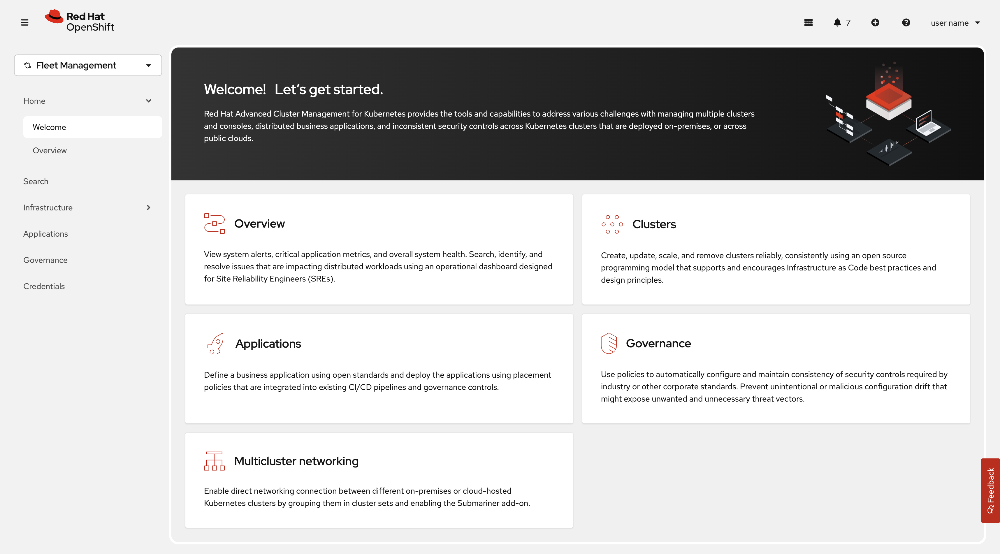

> Source: [Red Hat Advanced Cluster Management for Kubernetes 2.17](https://docs.redhat.com/en/documentation/red_hat_advanced_cluster_management_for_kubernetes/2.17/html/console/index). Copyright Red Hat.
> Adapted from AsciiDoc to Markdown for offline use; see [legal notice](LEGAL-NOTICE.md), [CC BY-SA 3.0](LICENSE.md) and SOURCE.json for source revisions and gaps.

# Web console

Learn how to access and use components of the Red Hat Advanced Cluster Management for Kubernetes console from the following documentation. Learn more about console components that you can use to view, manage, or customize your console.

See the following image of the *Navigation* from the Red Hat Advanced Cluster Management for Kubernetes console, which is described in more detail later in each section. See that the navigation represents major production function:

Home  
From the Red Hat Advanced Cluster Management for Kubernetes *Home* page in the *Fleet Management* perspective, you can access more information and you can search across the product. Click **Welcome** for more introductory information about each product function.

Infrastructure  
From *Clusters*, you can create new clusters or import existing clusters. From *Automation*, you can create an Ansible template.

Applications  
Create an application and edit a `.yaml` file. Access an overview or more advanced information about each application.

Governance  
Create and edit a `.yaml` file to create a policy. Use the *Governance* dashboard to manage policies and policy controllers.

Credentials  
The credential stores the access information for a cloud provider. Each provider account requires its own credential, as does each domain on a single provider.

Review your credentials or add a credential.

Additional resources

- [Overview page](console.md#overview-page)

- [Access command line tools](console.md#command-line-tools)

- [Access your console](console.md#accessing-your-console)

- [Enable or disable console plug-ins](console.md#console-plugins)

- [The multicluster engine operator cluster lifecycle overview](clusters.md)

- [Ansible Automation Platform for cluster management](clusters.md#ansible-intro)

- [Manage applications](applications.md#managing-applications)

- [Governance](governance.md#governance)

- [Managing credentials overview](clusters.md#credentials)

## Overview page

Click **Overview** to see summary information, or to access clickable *Cluster* percentage values for policy violations, and more.

From the *Overview* page, you can view the following information:

- Cluster and node counts across all clusters and for each provider

- Cluster status

- Cluster compliance

- Pod status

- Cluster add-ons

You can also access all APIs from the integrated console. Select the **Administrator** perspective, then navigate to **Home** \> **API Explorer** to explore API groups.

**Note:** For Red Hat OpenShift Container Platform versions earlier than version 4.20, select **local-cluster** from the cluster switcher. Then select **Home** \> **API Explorer** to explore API groups.

From the *Fleet Management* perspective, select **Overview** to access cluster resource metrics.

The following information is displayed from the Overview page:

- Number of clusters

- Application types

- Number of enabled policies on your cluster

- Cluster version

- Total number of nodes on your cluster

- Number of worker cores

The following information from Red Hat Lightspeed is displayed:

- Cluster recommendations

- Number of risk predictions

- Cluster health which includes the status and violations

- A view of your resources based on your custom query.

If observability is enabled, alert and failing operator metrics from across your fleet are also displayed.

Additional resources

- [Search](search.md#acm-search)

## Access command line tools

From the *Home* page, you can access Command Line Interface (CLI) downloads by using the following steps:

Procedure

1.  Click the `?` icon in the toolbar of the console.

2.  Click **Command Line Tools** from the drop-down menu.

3.  Find the **Advanced Cluster Management** header to find a list of tools that are available for Red Hat Advanced Cluster Management, which is specified with the operating system and architecture.

4.  Select the appropriate binary file to download and use on your local system.

## Access your console

The Red Hat Advanced Cluster Management for Kubernetes web console is integrated with the Red Hat OpenShift Container Platform web console as a console plug-in. You can access Red Hat Advanced Cluster Management within the OpenShift Container Platform console by selecting **Fleet Management** from the perspective selector.

Select the **Administrator** perspective when you want to use OpenShift Container Platform console features on the cluster where you installed Red Hat Advanced Cluster Management. Select **Fleet Management** from the perspective selector when you want to use Red Hat Advanced Cluster Management features to manage your fleet of clusters.

**Important:** For Red Hat OpenShift Container Platform versions earlier than version 4.20, select **All Clusters** from the cluster switcher. If the cluster switcher is not present, the required console plug-ins might not be enabled. Also select **`local-cluster`** from the cluster switcher to use OpenShift Container Platform console features.

Additional resources

- [Enable or disable console plug-ins](console.md#console-plugins)

- [Web console](console.md#web-console)

### Enable or disable console plug-ins

For new installations, the console plug-ins are enabled by default. If you updated from a previous version of Red Hat Advanced Cluster Management and want to enable the plug-ins, or if you want to disable the plug-ins, complete the following steps:

Procedure

1.  Be sure you are in the *Administrator* perspective in the OpenShift Container Platform console.

2.  Find **Administration** in the navigation and click **Cluster Settings**, then click the *Configuration* tab.

3.  From the list of *Configuration resources*, click the **Console** resource with the `operator.openshift.io` API group, which contains cluster-wide configuration for the web console.

4.  Select the *Console plug-ins* tab. Both the `acm` and `mce` plug-ins are listed.

5.  Modify plug-in status from the table. In a few moments, you are prompted to refresh the console.

Additional resources

- [MultiClusterHub advanced](get_started.md#advanced-config-hub)

