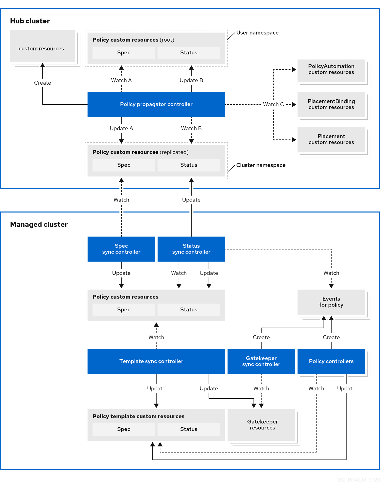

> Source: [Red Hat Advanced Cluster Management for Kubernetes 2.17](https://docs.redhat.com/en/documentation/red_hat_advanced_cluster_management_for_kubernetes/2.17/html/governance/index). Copyright Red Hat.
> Adapted from AsciiDoc to Markdown for offline use; see [legal notice](LEGAL-NOTICE.md), [CC BY-SA 3.0](LICENSE.md) and SOURCE.json for source revisions and gaps.

<a id="governance"></a>

# Governance framework overview

Use Red Hat Advanced Cluster Management governance to define and enforce security policies across private, multi, and hybrid cloud environments. The policy framework helps you meet internal standards for software engineering, security, resiliency, and regulatory compliance.

<div>

<div class="title">

Additional resources

</div>

- [Policy deployment strategy](governance.md#policy-deployment)

- [Policy controllers overview](governance.md#policy-controllers)

- [Template processing in policies](governance.md#template-processing)

- [Policy controller advanced configuration](governance.md#policy-controller-advanced-config)

- [Supported policies](governance.md#supported-policies)

- [Policy dependencies](governance.md#policy-dependencies)

- [Governance dashboard](governance.md#grc-dashboard)

- [Gatekeeper operator overview](governance.md#gk-operator-overview)

- [Policy Generator integration](governance.md#integrate-policy-generator)

</div>

<a id="governance-architecture"></a>

## Architecture and components

Enhance cluster security with the Red Hat Advanced Cluster Management for Kubernetes governance lifecycle. The governance lifecycle uses supported policies, processes, and procedures to manage security and compliance from a central interface.

The following diagram shows the governance architecture:



- Governance architecture components:

  - **Governance dashboard:** Provides a summary of your cloud governance and risk details, which include policy and cluster violations. See *Governance dashboard* to learn about the structure of an Red Hat Advanced Cluster Management for Kubernetes policy framework and how to use the Red Hat Advanced Cluster Management for Kubernetes *Governance* dashboard.

  - **Policy-based governance framework:** Supports policy creation and deployment to various managed clusters based on attributes associated with clusters, such as a geographical region. Predefined policy examples and deployment instructions are available in the *policy-collection* repository. When a policy becomes noncompliant, you can configure policy violation automation to run an action of your choice.

  - **Open source community:** Supports community contributions with a foundation of the Red Hat Advanced Cluster Management policy framework. Policy controllers and third-party policies are also part of the `open-cluster-management-io` project. You can contribute and deploy policies by using GitOps.

<div>

<div class="title">

Additional resources

</div>

- [Governance dashboard](governance.md#grc-dashboard)

- [policy-collection](https://github.com/open-cluster-management-io/policy-collection)

- [Policy controllers overview](governance.md#policy-controllers)

- [Manage policy definitions with Red Hat OpenShift GitOps](gitops.md#gitops-policies)

</div>

<a id="governance-architecture-components"></a>

## Governance architecture components

Review the governance component descriptions.

Governance policy framework  
The framework runs as the `governance-policy-framework` pod on managed clusters and has the following controllers:

- **spec sync controller:** Synchronizes the replicated policy in the managed cluster namespace on the hub cluster to the managed cluster namespace on the managed cluster.

- **Status sync controller:** Records compliance events from policy controllers in the replicated policies on the hub and managed cluster. The status only includes updates that are relevant to the current policy and does not consider past statuses if you delete and re-create the policy.

- **Template sync controller:** Creates, updates, and deletes objects in the managed cluster namespace on the managed cluster based on the definitions from the replicated policy `spec.policy-templates` entries.

- **Gatekeeper sync controller:** Records Gatekeeper constraint audit results as compliance events in corresponding Red Hat Advanced Cluster Management policies.

Policy propagator controller  
Runs on the Red Hat Advanced Cluster Management hub cluster and generates the replicated policies in the managed cluster namespaces on the hub based on the placements bound to the root policy. It also aggregates compliance status from replicated policies to the root policy status and initiates policy violation automation based on `PolicyAutomation` resources bound to the root policy.

Governance policy add-on controller  
Runs on the Red Hat Advanced Cluster Management hub cluster and manages the installation of policy controllers on managed clusters.

**Notes:**

- When the hub cluster propagates a policy to a managed cluster, the hub cluster first replicates the policy to the cluster namespace on the hub cluster and names and labels it with `namespaceName.policyName`. When you create a policy, ensure that the length of `namespaceName.policyName` does not exceed 63 characters because of the Kubernetes label value length limit.

- When you search for a policy in the hub cluster, you might also receive the name of the replicated policy in the managed cluster namespace. For example, if you search for `policy-dhaz-cert` in the `default` namespace, the following policy name from the hub cluster might also appear in the managed cluster namespace: `default.policy-dhaz-cert`.

<a id="policy-deployment"></a>

# Policy deployment strategy

The Kubernetes API is used to define and interact with policies. You are responsible for ensuring that the environment meets internal enterprise security standards for software engineering, secure engineering, resiliency, security, and regulatory compliance for workloads hosted on Kubernetes clusters.

- Deployment options

  The `CertificatePolicy`, `ConfigurationPolicy`, and `OperatorPolicy` policies and Gatekeeper constraints can be deployed to your managed clusters in two ways. You can deploy policies to your managed clusters by using the *Hub cluster policy framework* or *Deploying policies with external tools*. View the following descriptions of each option:

  Hub cluster policy framework  
  The first approach is to leverage the policy framework on the hub cluster. This involves defining the policies and Gatekeeper constraints within a `Policy` object on the hub cluster and leveraging a `Placement` and `PlacementBinding` to select which clusters the policies get deployed to. The policy framework handles the delivery to the managed cluster and the status aggregation back to the hub cluster. The `Policy` objects are represented in the *Policies* table in the Red Hat Advanced Cluster Management for Kubernetes console.

  Deploying policies with external tools  
  Alternatively, you can use an external tool, such as Red Hat OpenShift GitOps, to deliver the policies and Gatekeeper constraints directly to the managed cluster. Your policies are shown in the *Discovered policies* table in the Red Hat Advanced Cluster Management console and can be a helpful option if a configuration management strategy is already in place, but there is a desire to supplement the strategy with Red Hat Advanced Cluster Management policies.

See the following comparison table to learn which option supports specific features, which helps you make a decision on which deployment strategy is more suitable for your use case:

<table>
<caption>Policy deployment comparison table</caption>
<colgroup>
<col style="width: 33%" />
<col style="width: 33%" />
<col style="width: 33%" />
</colgroup>
<thead>
<tr>
<th style="text-align: left;">Feature</th>
<th style="text-align: left;">Policy framework</th>
<th style="text-align: left;">Deployed with external tools</th>
</tr>
</thead>
<tbody>
<tr>
<td style="text-align: left;"><p>Hub cluster templating</p></td>
<td style="text-align: left;"><p>Yes</p></td>
<td style="text-align: left;"><p>Yes, but requires additional setup.</p></td>
</tr>
<tr>
<td style="text-align: left;"><p>Managed cluster templating</p></td>
<td style="text-align: left;"><p>Yes</p></td>
<td style="text-align: left;"><p>Yes</p></td>
</tr>
<tr>
<td style="text-align: left;"><p>Red Hat Advanced Cluster Management console support</p></td>
<td style="text-align: left;"><p>Yes</p></td>
<td style="text-align: left;"><p>Yes, you can view policies that are deployed by external tools from the <em>Discover policies</em> table. Policies that are deployed with external tools are not displayed from the Governance <em>Overview</em> dashboard. You must enable the search service on your managed cluster.</p></td>
</tr>
<tr>
<td style="text-align: left;"><p>Policy grouping</p></td>
<td style="text-align: left;"><p>Yes, you can have a combination of statuses and deployments through <code>Policy</code> and <code>PolicySet</code> resources.</p></td>
<td style="text-align: left;"><p>You can use Kubernetes labels on your policy resources to logically group related policies and view the <em>Discovered policies</em> table. You can also use Argo CD <code>Application</code> objects for grouping and to get a high-level status.</p></td>
</tr>
<tr>
<td style="text-align: left;"><p>Policy event history</p></td>
<td style="text-align: left;"><p>You can view the last 10 events per cluster per policy stored on your hub cluster.</p></td>
<td style="text-align: left;"><p>You can view the last 10 events in the status of the policy on your managed cluster.</p></td>
</tr>
<tr>
<td style="text-align: left;"><p>Policy dependencies</p></td>
<td style="text-align: left;"><p>Yes</p></td>
<td style="text-align: left;"><p>No. Alternatively, you can use the Argo CD sync waves feature to define dependencies.</p></td>
</tr>
<tr>
<td style="text-align: left;"><p>Policy Generator</p></td>
<td style="text-align: left;"><p>Yes</p></td>
<td style="text-align: left;"><p>No</p></td>
</tr>
<tr>
<td style="text-align: left;"><p>OpenShift GitOps health checks</p>
<p>You must complete extra configuration for Argo CD versions earlier than 2.13.</p></td>
<td style="text-align: left;"><p>Yes</p></td>
<td style="text-align: left;"><p>Yes</p></td>
</tr>
<tr>
<td style="text-align: left;"><p>OpenShift GitOps applying native Kubernetes manifests and Red Hat Advanced Cluster Management policy on the managed cluster</p></td>
<td style="text-align: left;"><p>No, you must deploy a policy on your Red Hat Advanced Cluster Management hub cluster.</p></td>
<td style="text-align: left;"><p>Yes</p></td>
</tr>
<tr>
<td style="text-align: left;"><p>Policy status metric on the hub cluster for alerts</p></td>
<td style="text-align: left;"><p>Yes</p></td>
<td style="text-align: left;"><p>Yes, <code>cluster_policy_governance_info</code>.</p></td>
</tr>
<tr>
<td style="text-align: left;"><p>Running Ansible jobs on violated policies</p></td>
<td style="text-align: left;"><p>Yes, use the <code>PolicyAutomation</code> resource.</p></td>
<td style="text-align: left;"><p>No</p></td>
</tr>
</tbody>
</table>

<div>

<div class="title">

Additional resources

</div>

- [Hub cluster policy framework](governance.md#hub-policy-framework)

- [Policy deployment with external tools](governance.md#policy-deploy-ext-tools)

</div>

<a id="policy-deploy-ext-tools"></a>

## Policy deployment with external tools

To deploy `CertificatePolicy`, `ConfigurationPolicy`, `OperatorPolicy` resources, and Gatekeeper constraints directly to your managed cluster, you can use an external tool such as Red Hat OpenShift GitOps.

- Deployment workflow

  Your `CertificatePolicy`, `ConfigurationPolicy`, `OperatorPolicy` policies must be in the `open-cluster-management-policies` namespace or the managed cluster namespace. Policies in other namespaces are ignored and do not receive a status. If you are using a Red Hat OpenShift GitOps version with an Argo CD version earlier than 2.13, you must configure Red Hat Advanced Cluster Management for Kubernetes policy health checks.

The OpenShift GitOps service account must have permission to manage Red Hat Advanced Cluster Management for Kubernetes policies. Deploy policies with OpenShift GitOps and view the policies from the *Discovered policies* table of the Governance dashboard. The policies are grouped by the policy `name` and `kind` fields.

<div>

<div class="title">

Additional resources

</div>

- [Manage policy definitions with Red Hat OpenShift GitOps](gitops.md#gitops-policies)

- [Advanced template processing](governance.md#adv-template-processing)

</div>

<a id="policy-controllers"></a>

# Policy controllers overview

Policy controllers monitor and report whether your cluster is compliant with a policy. Use the Red Hat Advanced Cluster Management for Kubernetes policy framework by using the supported policy templates to apply policies managed by these controllers. The policy controllers manage Kubernetes custom resource definition instances.

Policy controllers check for policy violations, and can make the cluster status compliant if the controller supports the enforcement feature. View the following topics to learn more about the following Red Hat Advanced Cluster Management for Kubernetes policy controllers:

- *Kubernetes configuration policy controller*

- *Certificate policy controller*

- *Policy set controller*

- *Operator policy controller*

<div>

<div class="title">

Additional resources

</div>

- [Configuration policy controller](governance.md#kubernetes-config-policy-controller)

- [Certificate policy controller](governance.md#certificate-policy-controller)

- [Policy set controller](governance.md#policy-set-controller)

- [Operator policy controller](governance.md#operator-policy-ctrl)

</div>

<a id="kubernetes-config-policy-controller"></a>

## Configuration policy controller

Use the configuration policy controller to configure any Kubernetes resource and apply security policies across your clusters. The configuration policy controller communicates with the local Kubernetes API server so that you can get a list of your configurations that are in your cluster.

During installation, the configuration policy controller is created on the managed cluster. The configuration policy is provided in the `policy-templates` field of the policy on the hub cluster, and is propagated to the selected managed clusters by the governance framework.

When the `remediationAction` for the configuration policy controller is set to `InformOnly`, the parent policy does not enforce the configuration policy, even if the `remediationAction` in the parent policy is set to `enforce`.

If you have existing Kubernetes manifests that you want to put in a policy, use the Policy Generator.

<div>

<div class="title">

Additional resources

</div>

- [Create configuration policies](governance.md#create-configuration-policies)

- [Hub cluster policy framework](governance.md#hub-policy-framework)

- [NIST Special Publication 800-53 (Rev. 4)](https://nvd.nist.gov/800-53/Rev4/control/CA-1)

- [`CM-Configuration-Management` folder](https://github.com/open-cluster-management-io/policy-collection/tree/main/stable/CM-Configuration-Management)

- [Dry-run](https://kubernetes.io/docs/reference/using-api/api-concepts/#dry-run)

- [Supported policies](governance.md#supported-policies)

- [Policy controllers overview](governance.md#policy-controllers)

- [Policy controller advanced configuration](governance.md#policy-controller-advanced-config)

- [Cleaning up resources that are created by policies](governance.md)

- [Policy Generator configuration](governance.md#policy-generator)

- [Governance dashboard](governance.md#grc-dashboard)

- [Template processing in policies](governance.md#template-processing)

</div>

<a id="config-policy-yaml-parameters"></a>

## Configuration policy YAML structure

Review the structural YAML file structure and parameter definitions required to configure custom resource definitions for the configuration policy.

- Find the description of a field on your managed cluster.

  Run the following command and replace `<field-path>` with the path to the field that you need:

  ``` bash
  oc explain --api-version=policy.open-cluster-management.io/v1 ConfigurationPolicy.<field-path>
  ```

- Configuration policy YAML file structure:

  ``` yaml
  apiVersion: policy.open-cluster-management.io/v1
  kind: ConfigurationPolicy
  metadata:
    name: policy-config
  spec:
    namespaceSelector:
      include: ["default"]
      exclude: []
      matchExpressions: []
      matchLabels: {}
    remediationAction: inform
    customMessage:
      compliant: {}
      noncompliant: {}
    severity: low
    evaluationInterval:
      compliant: ""
      noncompliant: ""
    object-templates-raw: ""
    object-templates:
     - complianceType: musthave
       metadataComplianceType:
       recordDiff: ""
       recreateOption: ""
       objectSelector:
         matchLabels: {}
         matchExpressions: []
       objectDefinition:
         apiVersion: v1
         kind: Pod
         metadata:
           name: pod
         spec:
           containers:
            - image: pod-image
              name: pod-name
              ports:
               - containerPort: 80
     - complianceType: mustonlyhave
       objectDefinition:
         apiVersion: v1
         kind: ConfigMap
         metadata:
           name: myconfig
           namespace: default
           data:
             testData: hello
  ```

- When the `remediationAction` for the configuration policy is set to `enforce`, the controller applies the specified configuration to the target managed cluster. However, configuration policies that specify an object without a name can only be set to `inform`, unless the `objectSelector` is also configured.

- A Kubernetes object is defined in the `object-templates` array in the configuration policy, where fields of the configuration policy controller is compared with objects on the managed cluster. You can also use templated values within configuration policies. For more advanced use cases, specify a string in `object-templates-raw` to create the `object-templates` that you want. For more information, see *Template processing*.

- Configuration policy YAML table

<table>
<caption>Parameter table</caption>
<colgroup>
<col style="width: 33%" />
<col style="width: 33%" />
<col style="width: 33%" />
</colgroup>
<thead>
<tr>
<th style="text-align: left;">Field</th>
<th style="text-align: left;">Optional or required</th>
<th style="text-align: left;">Description</th>
</tr>
</thead>
<tbody>
<tr>
<td style="text-align: left;"><p><code>apiVersion</code></p></td>
<td style="text-align: left;"><p>Required</p></td>
<td style="text-align: left;"><p>Set the value to <code>policy.open-cluster-management.io/v1</code>.</p></td>
</tr>
<tr>
<td style="text-align: left;"><p><code>kind</code></p></td>
<td style="text-align: left;"><p>Required</p></td>
<td style="text-align: left;"><p>Set the value to <code>ConfigurationPolicy</code> to indicate the type of policy.</p></td>
</tr>
<tr>
<td style="text-align: left;"><p><code>metadata.name</code></p></td>
<td style="text-align: left;"><p>Required</p></td>
<td style="text-align: left;"><p>The name of the policy.</p></td>
</tr>
<tr>
<td style="text-align: left;"><p><code>spec.namespaceSelector</code></p></td>
<td style="text-align: left;"><p>Required for namespaced objects that do not have a namespace specified</p></td>
<td style="text-align: left;"><p>Determines namespaces in the managed cluster that the object is applied to. The <code>include</code> and <code>exclude</code> parameters accept file path expressions to include and exclude namespaces by name. The <code>matchExpressions</code> and <code>matchLabels</code> parameters specify namespaces to include by label. See the <em>Kubernetes labels and selectors</em> documentation. The resulting list is compiled by using the intersection of results from all parameters.</p></td>
</tr>
<tr>
<td style="text-align: left;"><p><code>spec.remediationAction</code></p></td>
<td style="text-align: left;"><p>Required</p></td>
<td style="text-align: left;"><p>Specifies the action to take when the policy is non-compliant. Use the following parameter values: <code>inform</code>, <code>InformOnly</code>, or <code>enforce</code>.</p></td>
</tr>
<tr>
<td style="text-align: left;"><p><code>spec.customMessage</code></p></td>
<td style="text-align: left;"><p>Optional</p></td>
<td style="text-align: left;"><p>Configure the compliance message sent by the configuration policy based on the current compliance. Each message configuration is a string that can contain Go templates. The <code>.DefaultMessage</code> and <code>.Policy</code> context variables are available for use in the templates. You can access the default message by using the <code>.DefaultMessage</code> parameter. The <code>.Policy</code> context variable contains the current policy object, including its status. For example, you can access the state of each related object by specifying the <code>.Policy.status.relatedObjects[*].object</code> field. If you set a value for the <code>evaluationInterval</code> field other than <code>watch</code>, only the kind, name, and namespace of the related objects are available.</p></td>
</tr>
<tr>
<td style="text-align: left;"><p><code>spec.customMessage.compliant</code></p></td>
<td style="text-align: left;"><p>Optional</p></td>
<td style="text-align: left;"><p>Configure custom messages for configuration policies that are compliant. Go templates and UTF-8 encoded characters, including emoji and foreign characters, are supported values.</p></td>
</tr>
<tr>
<td style="text-align: left;"><p><code>spec.customMessage.noncompliant</code></p></td>
<td style="text-align: left;"><p>Optional</p></td>
<td style="text-align: left;"><p>Configure custom messages for configuration policies that are non-compliant. Go templates and UTF-8 encoded characters, including emoji and foreign characters, are supported values.</p></td>
</tr>
<tr>
<td style="text-align: left;"><p><code>spec.severity</code></p></td>
<td style="text-align: left;"><p>Required</p></td>
<td style="text-align: left;"><p>Specifies the severity when the policy is non-compliant. Use the following parameter values: <code>low</code>, <code>medium</code>, <code>high</code>, or <code>critical</code>.</p></td>
</tr>
<tr>
<td style="text-align: left;"><p><code>spec.evaluationInterval</code></p></td>
<td style="text-align: left;"><p>Optional</p></td>
<td style="text-align: left;"><p>Specifies the frequency for a policy to be evaluated when it is in a particular compliance state. Use the parameters <code>compliant</code> and <code>noncompliant</code>. The default value for the <code>compliant</code> and <code>noncompliant</code> parameters is <code>watch</code> to leverage Kubernetes API watches instead of polling the Kubernetes API server.</p>
<p>When managed clusters have low resources, the evaluation interval can be set to long polling intervals to reduce CPU and memory usage on the Kubernetes API and policy controller. These are in the format of durations. For example, <code>1h25m3s</code> represents 1 hour, 25 minutes, and 3 seconds. These can also be set to <code>never</code> to avoid evaluating the policy after it is in a particular compliance state.</p></td>
</tr>
<tr>
<td style="text-align: left;"><p><code>spec.evaluationInterval.compliant</code></p></td>
<td style="text-align: left;"><p>Optional</p></td>
<td style="text-align: left;"><p>Specifies the evaluation frequency for a compliant policy. To enable the previous polling behavior, set this parameter to <code>10s</code>.</p></td>
</tr>
<tr>
<td style="text-align: left;"><p><code>spec.evaluationInterval.noncompliant</code></p></td>
<td style="text-align: left;"><p>Optional</p></td>
<td style="text-align: left;"><p>Specifies the evaluation frequency for a non-compliant policy. To enable the previous polling behavior, set this parameter to <code>10s</code>.</p></td>
</tr>
<tr>
<td style="text-align: left;"><p><code>spec.object-templates</code></p></td>
<td style="text-align: left;"><p>Optional</p></td>
<td style="text-align: left;"><p>The array of Kubernetes objects (either fully defined or containing a subset of fields) for the controller to compare with objects on the managed cluster. <strong>Note:</strong> While <code>spec.object-templates</code> and <code>spec.object-templates-raw</code> are listed as optional, exactly one of the two parameter fields must be set.</p></td>
</tr>
<tr>
<td style="text-align: left;"><p><code>spec.object-templates-raw</code></p></td>
<td style="text-align: left;"><p>Optional</p></td>
<td style="text-align: left;"><p>Used to set object templates with a raw YAML string. Specify conditions for the object templates, where advanced functions like if-else statements and the <code>range</code> function are supported values. For example, add the following value to avoid duplication in your <code>object-templates</code> definition:</p>
<div class="sourceCode" id="cb1"><pre class="sourceCode yaml"><code class="sourceCode yaml"><span id="cb1-1"><a href="governance.md" aria-hidden="true" tabindex="-1"></a><span class="kw">{</span><span class="at">{- if eq .metadata.name </span><span class="st">&quot;policy-grc-your-meta-data-name&quot;</span><span class="at"> </span><span class="kw">}</span><span class="at">}</span></span>
<span id="cb1-2"><a href="governance.md" aria-hidden="true" tabindex="-1"></a><span class="at">                  </span><span class="fu">replicas</span><span class="kw">:</span><span class="at"> </span><span class="dv">2</span></span>
<span id="cb1-3"><a href="governance.md" aria-hidden="true" tabindex="-1"></a><span class="at"> </span><span class="kw">{</span><span class="at">{- else </span><span class="kw">}</span><span class="at">}</span></span>
<span id="cb1-4"><a href="governance.md" aria-hidden="true" tabindex="-1"></a><span class="at">                  </span><span class="fu">replicas</span><span class="kw">:</span><span class="at"> </span><span class="dv">1</span></span>
<span id="cb1-5"><a href="governance.md" aria-hidden="true" tabindex="-1"></a><span class="at"> </span><span class="kw">{</span><span class="at">{- end </span><span class="kw">}</span><span class="at">}</span></span></code></pre></div>
<p><strong>Note:</strong> While <code>spec.object-templates</code> and <code>spec.object-templates-raw</code> are listed as optional, exactly one of the two parameter fields must be set.</p></td>
</tr>
<tr>
<td style="text-align: left;"><p><code>spec.object-templates[].complianceType</code></p></td>
<td style="text-align: left;"><p>Required</p></td>
<td style="text-align: left;"><p>Use this parameter to define the desired state of the Kubernetes object on your managed clusters. Use one of the following verbs as the parameter value:</p>
<ul>
<li><p><code>mustonlyhave</code>: Indicates that an object must exist with the exact fields and values as defined in the <code>objectDefinition</code>.</p></li>
<li><p><code>musthave</code>: Indicates an object must exist with the same fields as specified in the <code>objectDefinition</code>. Any existing fields on the object that are not specified in the <code>object-template</code> are ignored. In general, array values are appended. The exception for the array to be patched is when the item contains a <code>name</code> key with a value that matches an existing item. Use a fully defined <code>objectDefinition</code> using the <code>mustonlyhave</code> compliance type, if you want to replace the array.</p></li>
<li><p><code>mustnothave</code>: Indicates that an object with the same fields as specified in the <code>objectDefinition</code> cannot exist.</p></li>
</ul></td>
</tr>
<tr>
<td style="text-align: left;"><p><code>spec.object-templates[].metadataComplianceType</code></p></td>
<td style="text-align: left;"><p>Optional</p></td>
<td style="text-align: left;"><p>Overrides <code>spec.object-templates[].complianceType</code> when comparing the manifest’s metadata section to objects on the cluster ("musthave", "mustonlyhave"). Default is unset to not override <code>complianceType</code> for metadata.</p></td>
</tr>
<tr>
<td style="text-align: left;"><p><code>spec.object-templates[].recordDiff</code></p></td>
<td style="text-align: left;"><p>Optional</p></td>
<td style="text-align: left;"><p>Use this parameter to specify if and where to display the difference between the object on the cluster and the <code>objectDefinition</code> in the policy. The following options are supported:</p>
<ul>
<li><p>Set to <code>InStatus</code> to store the difference in the <code>ConfigurationPolicy</code> status.</p></li>
<li><p>Set to <code>Log</code> to log the difference in the controller logs.</p></li>
<li><p>Set to <code>None</code> to not log the difference.</p></li>
</ul>
<p>By default, this parameter is set to <code>InStatus</code> if the controller does not detect sensitive data in the difference. Otherwise, the default is <code>None</code>. If sensitive data is detected, the <code>ConfigurationPolicy</code> status displays a message to set <code>recordDiff</code> to view the difference.</p></td>
</tr>
<tr>
<td style="text-align: left;"><p><code>spec.object-templates[].recreateOption</code></p></td>
<td style="text-align: left;"><p>Optional</p></td>
<td style="text-align: left;"><p>Describes when to delete and recreate an object when an update is required. When you set the object to <code>IfRequired</code>, the policy recreates the object when updating an immutable field. When you set the parameter to <code>Always</code>, the policy recreates the object on any update. When you set the <code>remediationAction</code> to <code>inform</code>, the parameter value, <code>recreateOption</code>, has no effect on the object. The <code>IfRequired</code> value has no effect on clusters without dry-run update support. The default value is <code>None</code>.</p></td>
</tr>
<tr>
<td style="text-align: left;"><p><code>spec.object-templates[].objectSelector</code></p></td>
<td style="text-align: left;"><p>Optional</p></td>
<td style="text-align: left;"><p><code>ObjectSelector</code> defines a label selector to select names of objects that are defined in an unnamed <code>objectDefinition</code>. The <code>matchExpressions</code> and <code>matchLabels</code> parameters specify objects to include by label. If there is an object name that is defined in the <code>objectDefinition</code>, the <code>objectSelector</code> is ignored. For more information, see <em>Kubernetes labels and selectors</em>.</p></td>
</tr>
<tr>
<td style="text-align: left;"><p><code>spec.object-templates[].objectDefinition</code></p></td>
<td style="text-align: left;"><p>Required</p></td>
<td style="text-align: left;"><p>A Kubernetes object (either fully defined or containing a subset of fields) for the controller to compare with objects on the managed cluster.</p></td>
</tr>
<tr>
<td style="text-align: left;"><p><code>spec.pruneObjectBehavior</code></p></td>
<td style="text-align: left;"><p>Optional</p></td>
<td style="text-align: left;"><p>Determines whether to clean up resources related to the policy when the policy is removed from a managed cluster.</p></td>
</tr>
</tbody>
</table>

<div>

<div class="title">

Additional resources

</div>

- [Kubernetes labels and selectors](https://kubernetes.io/docs/concepts/overview/working-with-objects/labels/)

</div>

<a id="object-selection-raw-templates"></a>

## Object selectors and raw templates

Configuration policies support advanced parameters like `objectSelector` and `object-templates-raw` to filter objects or process complex logic, such as loops and conditionals.

- Configuration policy objectSelector:

  To iterate over multiple objects filtered by a label within a `ConfigurationPolicy` resource, use the `objectSelector` parameter and specify the object `kind` in the `objectDefinition` parameter. The `objectSelector` parameter operates similarly to `namespaceSelector` but does not support name filtering. To filter by name, use the `skipObject` Go template function. Referencing `{{ skipObject }}` excludes that specific object from the selection.

  - Object selection configuration example

  ``` yaml
  ...
  object-templates:
    - objectSelector:
        matchExpressions:
        - key: foo
          operator: In
          values:
          - bar
      objectDefinition:
        apiVersion: v1
        kind: ConfigMap
        data:
          key: '{{ if (hasSuffix "-prod" .ObjectName) }}{{ skipObject }}{{ end }}{{ hasNodesWithExactRoles "infra" }}'
  ```

- Raw template processing

  The optional `object-templates-raw` parameter supports advanced templating use cases, such as the `if` conditional function and the `range` loop function. The `object-templates-raw` parameter accepts a string containing Go templates that must resolve to an `object-templates` array.

  **Note:** You must set exactly one of either `spec.object-templates` or `spec.object-templates-raw`.

  - Raw template configuration example with conditional labels

    ``` yaml
    object-templates-raw: |
      {{- range (lookup "v1" "ConfigMap" "default" "").items }}
      {{- if eq .data.name "Sea Otter" }}
      - complianceType: musthave
        objectDefinition:
          kind: ConfigMap
          apiVersion: v1
          metadata:
            name: {{ .metadata.name }}
            namespace: {{ .metadata.namespace }}
            labels:
              species-category: mammal
      {{- end }}
      {{- end }}
    ```

  - Policy configuration example creating infrastructure `MachineSet` objects

  ``` yaml
  apiVersion: policy.open-cluster-management.io/v1
  kind: ConfigurationPolicy
  metadata:
    name: create-infra-machineset
  spec:
    remediationAction: enforce
    severity: low
    object-templates-raw: |
      {{- /* Specify the parameters needed to create the MachineSet  */ -}}
      {{- $machineset_role := "infra" }}
      {{- $region := "ap-southeast-1" }}
      {{- $zones := list "ap-southeast-1a" "ap-southeast-1b" "ap-southeast-1c" }}
      {{- $infrastructure_id := (lookup "config.openshift.io/v1" "Infrastructure" "" "cluster").status.infrastructureName }}
      {{- $worker_ms := (index (lookup "machine.openshift.io/v1beta1" "MachineSet" "openshift-machine-api" "").items 0) }}
      {{- /* Generate the MachineSet for each zone as specified  */ -}}
      {{- range $zone := $zones }}
      - complianceType: musthave
        objectDefinition:
          apiVersion: machine.openshift.io/v1beta1
          kind: MachineSet
          metadata:
            labels:
              machine.openshift.io/cluster-api-cluster: {{ $infrastructure_id }}
            name: {{ $infrastructure_id }}-{{ $machineset_role }}-{{ $zone }}
            namespace: openshift-machine-api
          spec:
            replicas: 1
            selector:
              matchLabels:
                machine.openshift.io/cluster-api-cluster: {{ $infrastructure_id }}
                machine.openshift.io/cluster-api-machineset: {{ $infrastructure_id }}-{{ $machineset_role }}-{{ $zone }}
            template:
              metadata:
                labels:
                  machine.openshift.io/cluster-api-cluster: {{ $infrastructure_id }}
                  machine.openshift.io/cluster-api-machine-role: {{ $machineset_role }}
                  machine.openshift.io/cluster-api-machine-type: {{ $machineset_role }}
                  machine.openshift.io/cluster-api-machineset: {{ $infrastructure_id }}-{{ $machineset_role }}-{{ $zone }}
              spec:
                metadata:
                  labels:
                    node-role.kubernetes.io/{{ $machineset_role }}: ""
                taints:
                  - key: node-role.kubernetes.io/{{ $machineset_role }}
                    effect: NoSchedule
                providerSpec:
                  value:
                    ami:
                      id: {{ $worker_ms.spec.template.spec.providerSpec.value.ami.id }}
                    apiVersion: awsproviderconfig.openshift.io/v1beta1
                    blockDevices:
                      - ebs:
                          encrypted: true
                          iops: 2000
                          kmsKey:
                            arn: ''
                          volumeSize: 500
                          volumeType: io1
                    credentialsSecret:
                      name: aws-cloud-credentials
                    deviceIndex: 0
                    instanceType: {{ $worker_ms.spec.template.spec.providerSpec.value.instanceType }}
                    iamInstanceProfile:
                      id: {{ $infrastructure_id }}-worker-profile
                    kind: AWSMachineProviderConfig
                    placement:
                      availabilityZone: {{ $zone }}
                      region: {{ $region }}
                    securityGroups:
                      - filters:
                          - name: tag:Name
                            values:
                              - {{ $infrastructure_id }}-worker-sg
                    subnet:
                      filters:
                        - name: tag:Name
                          values:
                            - {{ $infrastructure_id }}-private-{{ $zone }}
                    tags:
                      - name: kubernetes.io/cluster/{{ $infrastructure_id }}
                        value: owned
                    userDataSecret:
                      name: worker-user-data
      {{- end }}
  ```

<div>

<div class="title">

Additional resources

</div>

- [Template functions](governance.md#template-functions)

- [Configuration policy controller](governance.md#kubernetes-config-policy-controller)

</div>

<a id="certificate-policy-controller"></a>

## Certificate policy controller

You can use the certificate policy controller to detect certificates that are close to expiring, time durations (hours) that are too long, or contain DNS names that fail to match specified patterns. You can add the certificate policy to the `policy-templates` field of the policy on the hub cluster, which propagates to the selected managed clusters by using the governance framework.

When you create the certificate policy controller on your hub cluster, a replicated policy is created on your managed cluster.

- Non-compliant scernarios

  A policy status changes to non-compliant when either of these situations occurs:

- When a certificate expires in less than the minimum duration of time or exceeds the maximum time.

- When DNS names fail to match the specified pattern.

The certificate policy controller runs on your managed cluster. The controller communicates with the local Kubernetes API server to get the list of secrets that contain certificates and find all non-compliant certificates.

**Notes:**

- Certificate policy controller does not support the `enforce` feature.

- The certificate policy controller automatically looks for a certificate in a secret in only the `tls.crt` key. If you store a secret in a different key, define the `certificate_key_name` parameter. For example, if you have a secret that contains a `sensor-cert.pem` certificate, add the following label to the secret: `certificate_key_name: sensor-cert.pem`.

<div>

<div class="title">

Additional resources

</div>

- [Hub cluster policy framework](governance.md#hub-policy-framework)

- [Certificate policy controller schema and parameters](governance.md#cert-policy-parameters)

- [Creating security policies](governance.md#creating-security-policies)

- [Policy controllers introduction](governance.md#policy-controllers)

- [Certificates](secure_clusters.md#certificates)

</div>

<a id="cert-policy-parameters"></a>

## Certificate policy controller schema and parameters

Review the structural YAML file composition and parameter definitions required to configure custom resource definitions for the certificate policy controller.

- Certificate policy YAML file structure

  ``` yaml
  apiVersion: policy.open-cluster-management.io/v1
  kind: CertificatePolicy
  metadata:
    name: certificate-policy-example
  spec:
    namespaceSelector:
      include: ["default"]
      exclude: []
      matchExpressions: []
      matchLabels: {}
    labelSelector:
      myLabelKey: myLabelValue
    remediationAction:
    severity:
    minimumDuration:
    minimumCADuration:
    maximumDuration:
    maximumCADuration:
    allowedSANPattern:
    disallowedSANPattern:
  ```

- Certificate policy controller YAML file table

<table>
<caption>Certificate policy controller parameters table</caption>
<colgroup>
<col style="width: 33%" />
<col style="width: 33%" />
<col style="width: 33%" />
</colgroup>
<thead>
<tr>
<th style="text-align: left;">Field</th>
<th style="text-align: left;">Optional or required</th>
<th style="text-align: left;">Description</th>
</tr>
</thead>
<tbody>
<tr>
<td style="text-align: left;"><p><code>apiVersion</code></p></td>
<td style="text-align: left;"><p>Required</p></td>
<td style="text-align: left;"><p>Set the value to <code>policy.open-cluster-management.io/v1</code>.</p></td>
</tr>
<tr>
<td style="text-align: left;"><p><code>kind</code></p></td>
<td style="text-align: left;"><p>Required</p></td>
<td style="text-align: left;"><p>Set the value to <code>CertificatePolicy</code> to indicate the type of policy.</p></td>
</tr>
<tr>
<td style="text-align: left;"><p><code>metadata.name</code></p></td>
<td style="text-align: left;"><p>Required</p></td>
<td style="text-align: left;"><p>The name to identify the policy.</p></td>
</tr>
<tr>
<td style="text-align: left;"><p><code>metadata.labels</code></p></td>
<td style="text-align: left;"><p>Optional</p></td>
<td style="text-align: left;"><p>In a <em>certificate</em> policy, the <code>category=system-and-information-integrity</code> label categorizes the policy and facilitates querying the certificate policies. If there is a different value for the <code>category</code> key in your certificate policy, the value is overridden by the certificate controller.</p></td>
</tr>
<tr>
<td style="text-align: left;"><p><code>spec.namespaceSelector</code></p></td>
<td style="text-align: left;"><p>Required</p></td>
<td style="text-align: left;"><p>Determines namespaces in the managed cluster where secrets are monitored. The <code>include</code> and <code>exclude</code> parameters accept file path expressions to include and exclude namespaces by name. The <code>matchExpressions</code> and <code>matchLabels</code> parameters specify namespaces to be included by label. See the <em>Kubernetes labels and selectors</em> documentation. The resulting list is compiled by using the intersection of results from all parameters.</p>
<p><strong>Note:</strong> If the <code>namespaceSelector</code> for the certificate policy controller does not match any namespace, the policy is considered compliant.</p></td>
</tr>
<tr>
<td style="text-align: left;"><p><code>spec.labelSelector</code></p></td>
<td style="text-align: left;"><p>Optional</p></td>
<td style="text-align: left;"><p>Specifies identifying attributes of objects. See the <em>Kubernetes labels and selectors</em> documentation.</p></td>
</tr>
<tr>
<td style="text-align: left;"><p><code>spec.remediationAction</code></p></td>
<td style="text-align: left;"><p>Required</p></td>
<td style="text-align: left;"><p>Specifies the remediation of your policy. Set the parameter value to <code>inform</code>. Certificate policy controller only supports <code>inform</code> feature.</p></td>
</tr>
<tr>
<td style="text-align: left;"><p><code>spec.severity</code></p></td>
<td style="text-align: left;"><p>Optional</p></td>
<td style="text-align: left;"><p>Informs the user of the severity when the policy is non-compliant. Use the following parameter values: <code>low</code>, <code>medium</code>, <code>high</code>, or <code>critical</code>.</p></td>
</tr>
<tr>
<td style="text-align: left;"><p><code>spec.minimumDuration</code></p></td>
<td style="text-align: left;"><p>Required</p></td>
<td style="text-align: left;"><p>When a value is not specified, the default value is <code>100h</code>. This parameter specifies the smallest duration (in hours) before a certificate is considered non-compliant. The parameter value uses the <em>Golang Parse Duration</em> format.</p></td>
</tr>
<tr>
<td style="text-align: left;"><p><code>spec.minimumCADuration</code></p></td>
<td style="text-align: left;"><p>Optional</p></td>
<td style="text-align: left;"><p>Set a value to identify signing certificates that might expire soon with a different value from other certificates. If the parameter value is not specified, the CA certificate expiration is the value used for the <code>minimumDuration</code>. The parameter value uses the <em>Golang Parse Duration</em> format.</p></td>
</tr>
<tr>
<td style="text-align: left;"><p><code>spec.maximumDuration</code></p></td>
<td style="text-align: left;"><p>Optional</p></td>
<td style="text-align: left;"><p>Set a value to identify certificates that have been created with a duration that exceeds your desired limit. The parameter uses the <em>Golang Parse Duration</em> format.</p></td>
</tr>
<tr>
<td style="text-align: left;"><p><code>spec.maximumCADuration</code></p></td>
<td style="text-align: left;"><p>Optional</p></td>
<td style="text-align: left;"><p>Set a value to identify signing certificates that have been created with a duration that exceeds your defined limit. The parameter uses the <em>Golang Parse Duration</em> format.</p></td>
</tr>
<tr>
<td style="text-align: left;"><p><code>spec.allowedSANPattern</code></p></td>
<td style="text-align: left;"><p>Optional</p></td>
<td style="text-align: left;"><p>A regular expression that must match every SAN entry that you have defined in your certificates. This parameter checks DNS names against patterns. See the <em>Golang Regular Expression syntax</em> documentation.</p></td>
</tr>
<tr>
<td style="text-align: left;"><p><code>spec.disallowedSANPattern</code></p></td>
<td style="text-align: left;"><p>Optional</p></td>
<td style="text-align: left;"><p>A regular expression that must not match any SAN entries you have defined in your certificates. This parameter checks DNS names against patterns.</p>
<p><strong>Note:</strong> To detect wild-card certificate, use the following SAN pattern: <code>disallowedSANPattern: "[\\*]"</code></p>
<p>See the <em>Golang Regular Expression syntax</em> documentation.</p></td>
</tr>
</tbody>
</table>

<div>

<div class="title">

Additional resources

</div>

- [Kubernetes labels and selectors](https://kubernetes.io/docs/concepts/overview/working-with-objects/labels/)

- [Golang Parse Duration](https://golang.org/pkg/time/#ParseDuration)

- [Golang Regular Expression syntax](https://golang.org/pkg/regexp/syntax/)

</div>

<a id="policy-set-controller"></a>

## Policy set controller

The policy set controller aggregates the policy status scoped to policies that are defined in the same namespace. Create a policy set (`PolicySet`) to group policies that are in the same namespace. All policies in the `PolicySet` are placed together in a selected cluster by creating a `PlacementBinding` to bind the `PolicySet` and `Placement`. The policy set is deployed to the hub cluster.

Additionally, when a policy is a part of multiple policy sets, existing and new `Placement` resources remain in the policy. When a user removes a policy from the policy set, the policy is not applied to the cluster that is selected in the policy set, but the placements remain. The policy set controller only checks for violations in clusters that include the policy set placement.

**Notes:**

- The Red Hat Advanced Cluster Management sample policy set uses cluster placement. If you use cluster placement, bind the namespace containing the policy to the managed cluster set. See *Deploying policies to your cluster* for more details on using cluster placement.

- To use a `Placement` resource, bind a `ManagedClusterSet` resource to the namespace of the `Placement` resource with a `ManagedClusterSetBinding` resource. See the *ManagedClusterSetBinding* resource overview for additional details.

- Policy set YAML structure

  Your policy set might resemble the following YAML file:

``` yaml
apiVersion: policy.open-cluster-management.io/v1beta1
kind: PolicySet
metadata:
  name: demo-policyset
spec:
  policies:
  - policy-demo

---
apiVersion: policy.open-cluster-management.io/v1
kind: PlacementBinding
metadata:
  name: demo-policyset-pb
placementRef:
  apiGroup: cluster.open-cluster-management.io
  kind: Placement
  name: demo-policyset-pr
subjects:
- apiGroup: policy.open-cluster-management.io
  kind: PolicySet
  name: demo-policyset
---
apiVersion: cluster.open-cluster-management.io/v1beta1
kind: Placement
metadata:
  name: demo-policyset-pr
spec:
  predicates:
  - requiredClusterSelector:
      labelSelector:
        matchExpressions:
          - key: name
            operator: In
            values:
              - local-cluster
    tolerations:
        - key: cluster.open-cluster-management.io/unavailable
          operator: Exists
        - key: cluster.open-cluster-management.io/unreachable
          operator: Exists
```

- Policy set table

  View the following parameter table for descriptions:

| Field | Optional or required | Description |
|----|----|----|
| `apiVersion` | Required | Set the value to `policy.open-cluster-management.io/v1beta1`. |
| `kind` | Required | Set the value to `PolicySet` to indicate the type of policy. |
| `metadata.name` | Required | The name for identifying the policy resource. |
| `spec` | Required | Add configuration details for your policy. |
| `spec.policies` | Optional | The list of policies that you want to group together in the policy set. |

Parameter table

- Policy set sample

  ``` yaml
  apiVersion: policy.open-cluster-management.io/v1beta1
  kind: PolicySet
  metadata:
    name: pci
    namespace: default
  spec:
    description: Policies for PCI compliance
    policies:
    - policy-pod
    - policy-namespace
  status:
    compliant: NonCompliant
    placement:
    - placementBinding: binding1
      placement: placement1
      policySet: policyset-ps
  ```

<div>

<div class="title">

Additional resources

</div>

- [Manage policy definitions with Red Hat OpenShift GitOps](gitops.md#gitops-policies)

- [*ManagedClusterSetBinding* resource overview](clusters.md#creating-managedclustersetbinding)

- [Red Hat OpenShift Platform Plus policy set](governance.md#opp-policy-set)

- [Create policy sets from the command line](governance.md#create-policy-set)

</div>

<a id="operator-policy-ctrl"></a>

## Operator policy controller

The operator policy controller allows you to monitor and install Operator Lifecycle Manager operators across your clusters. Use the operator policy controller to monitor the health of various pieces of the operator and to specify how you want to automatically handle updates to the operator.

You can also distribute an operator policy to managed clusters by using the governance framework and adding the policy to the `policy-templates` field of a policy on the hub cluster.

You can also use template values within the `operatorGroup` and `subscription` fields of an operator policy. For more information, see *Template processing*.

**Notes:**

- Operator Lifecycle Manager must be available on your managed cluster. This is enabled by default on Red Hat OpenShift Container Platform.

- **Required access:** Cluster administrator

- Operator policy YAML table

  <table>
  <colgroup>
  <col style="width: 33%" />
  <col style="width: 33%" />
  <col style="width: 33%" />
  </colgroup>
  <thead>
  <tr>
  <th style="text-align: left;">Field</th>
  <th style="text-align: left;">Optional or required</th>
  <th style="text-align: left;">Description</th>
  </tr>
  </thead>
  <tbody>
  <tr>
  <td style="text-align: left;"><p><code>apiVersion</code></p></td>
  <td style="text-align: left;"><p>Required</p></td>
  <td style="text-align: left;"><p>Set the value to <code>policy.open-cluster-management.io/v1beta1</code>.</p></td>
  </tr>
  <tr>
  <td style="text-align: left;"><p><code>kind</code></p></td>
  <td style="text-align: left;"><p>Required</p></td>
  <td style="text-align: left;"><p>Set the value to <code>OperatorPolicy</code> to indicate the type of policy.</p></td>
  </tr>
  <tr>
  <td style="text-align: left;"><p><code>metadata.name</code></p></td>
  <td style="text-align: left;"><p>Required</p></td>
  <td style="text-align: left;"><p>The name for identifying the policy resource.</p></td>
  </tr>
  <tr>
  <td style="text-align: left;"><p><code>spec.remediationAction</code></p></td>
  <td style="text-align: left;"><p>Required</p></td>
  <td style="text-align: left;"><p>If the <code>remediationAction</code> for the operator policy is set to <code>enforce</code>, the controller creates resources on the target managed cluster to communicate to OLM to install the operator and approve updates based on the versions specified in the policy. + If the <code>remediationAction</code> set to <code>inform</code>, the controller only reports the status of the operator, including if any upgrades are available.</p></td>
  </tr>
  <tr>
  <td style="text-align: left;"><p><code>spec.operatorGroup</code></p></td>
  <td style="text-align: left;"><p>Optional</p></td>
  <td style="text-align: left;"><p>By default, if the <code>operatorGroup</code> field is not specified, the controller generates an <code>AllNamespaces</code> type <code>OperatorGroup</code> resource in the same namespace as the subscription, if supported. The operator policy controller produces this resource. View the following parameter descriptions:</p>
  <ul>
  <li><p><code>name</code>: The name of the <code>OperatorGroup</code> resource.</p></li>
  <li><p><code>namespace</code>: The namespace of the <code>OperatorGroup</code> resource. This parameter must match the namespace where you install the operator.</p></li>
  <li><p><code>targetNamespaces</code>: A list of namespaces that the operator is configured to watch and operate.</p></li>
  </ul></td>
  </tr>
  <tr>
  <td style="text-align: left;"><p><code>spec.complianceType</code></p></td>
  <td style="text-align: left;"><p>Required</p></td>
  <td style="text-align: left;"><p>Specifies the desired state of the operator on the cluster. If set to <code>musthave</code>, the policy is compliant when the operator is found. If set to <code>mustnothave</code>, the policy is compliant when the operator is not found.</p></td>
  </tr>
  <tr>
  <td style="text-align: left;"><p><code>spec.removalBehavior</code></p></td>
  <td style="text-align: left;"><p>Optional</p></td>
  <td style="text-align: left;"><p>Determines which resource types need to be kept or removed when you enforce an <code>OperatorPolicy</code> resource with <code>complianceType: mustnothave</code> defined. There is no effect when <code>complianceType</code> is set to <code>musthave</code>. View the following parameter descriptions:</p>
  <ul>
  <li><p><code>operatorGroups</code> can be set to <code>Keep</code> or <code>DeleteIfUnused</code>. The default value is <code>DeleteIfUnusued</code> which only removes the <code>OperatorGroup</code> resource if it is not used by any other operators.</p></li>
  <li><p><code>subscriptions</code> can be set to <code>Keep</code> or <code>Delete</code>. The default value is <code>Delete</code>.</p></li>
  <li><p><code>clusterServiceVersions</code> can be set to <code>Keep</code> or <code>Delete</code>. The default value is <code>Delete</code>.</p></li>
  <li><p><code>customResourceDefinitions</code> can be set to <code>Keep</code> or <code>Delete</code>. The default value is <code>Keep</code>. If you set this to <code>Delete</code>, the <code>CustomResourceDefintion</code> resources on the managed cluster are removed and can cause data loss.</p></li>
  </ul></td>
  </tr>
  <tr>
  <td style="text-align: left;"><p><code>spec.subscription</code></p></td>
  <td style="text-align: left;"><p>Required</p></td>
  <td style="text-align: left;"><p>Define the configurations to create an operator subscription. Add information in the following fields to create an operator subscription. View the following parameter descriptions:</p>
  <ul>
  <li><p><code>channel</code>: If not specified, the default channel is selected from the operator catalog. The default can be different on different OpenShift Container Platform versions.</p></li>
  <li><p><code>name</code>: Specify the package name of the operator.</p></li>
  <li><p><code>namespace</code>: If not specified, the default namespaced that is used for OpenShift Container Platform managed clusters is <code>openshift-operators</code>.</p></li>
  <li><p><code>source</code>: If not specified, the catalog that contains the operator is chosen.</p></li>
  <li><p><code>sourceNamespace</code>: If not specified, the namespace of the catalog that contains the operator is chosen.</p></li>
  <li><p><code>config</code>: <strong>Optional.</strong> Specify extra configuration details for the operator subscription.</p></li>
  </ul>
  <p>The <code>name</code> field is the only required field. The other fields are populated based on the catalog information within the managed cluster.</p>
  <p><strong>Note:</strong> If you define a value for the <code>installPlanApproval</code> field in this parameter section, the policy becomes non-compliant. Use <code>spec.upgradeApproval</code> in the <code>OperatorPolicy</code> resource.</p></td>
  </tr>
  <tr>
  <td style="text-align: left;"><p><code>spec.complianceConfig</code></p></td>
  <td style="text-align: left;"><p>Optional</p></td>
  <td style="text-align: left;"><p>Use this parameter to define the compliance behavior for specific scenarios that are associated with operators. You can set each of the following options individually, where the supported values are <code>Compliant</code> and <code>NonCompliant</code>:</p>
  <ul>
  <li><p><code>catalogSourceUnhealthy</code>: Define the compliance when the catalog source for the operator is unhealthy. The default value is <code>Compliant</code> because this only affects possible upgrades.</p></li>
  <li><p><code>deploymentsUnavailable</code>: Define the compliance when at least one deployment of the operator is not fully available. The default value is <code>NonCompliant</code> because this reflects the availability of the service that the operator provides.</p></li>
  <li><p><code>upgradesAvailable</code>: Define the compliance when there is an upgrade available for the operator. The default value is <code>Compliant</code> because the existing operator installation might be running correctly.</p></li>
  <li><p><code>deprecationsPresent</code>: Specifies that the compliance of the policy is affected by the deprecations. For example, the default value is <code>Compliant</code>, but if the <code>deprecationsPresent=NonCompliant</code> configuration detects the deprecations, then the policy compliance status is set to <code>NonCompliant</code>.</p></li>
  <li><p><code>minorChannelUpgradeAvailable</code>: Detects if a minor version upgrade is available for the operator on different channels. The default value is <code>Compliant</code>.</p></li>
  </ul></td>
  </tr>
  <tr>
  <td style="text-align: left;"><p><code>spec.upgradeApproval</code></p></td>
  <td style="text-align: left;"><p>Required</p></td>
  <td style="text-align: left;"><p>If the <code>upgradeApproval</code> field is set to <code>Automatic</code>, version upgrades on the cluster are approved by the policy when the policy is set to <code>enforce</code>. If you set the field to <code>None</code>, version upgrades to the specific operator are not approved when the policy is set to <code>enforce</code>.</p></td>
  </tr>
  <tr>
  <td style="text-align: left;"><p><code>spec.versions</code></p></td>
  <td style="text-align: left;"><p>Optional</p></td>
  <td style="text-align: left;"><p>Declare which versions of the operator are compliant. The <code>versions</code> parameter is a list of templatable strings that specifies which installed <code>ClusterServiceVersion</code> names are compliant when in <code>inform</code> mode, and which <code>InstallPlans</code> are approved when in <code>enforce</code> mode. To give different versions in one entry, separate the versions with commas. If the field is empty, the strings are ignored and all <code>ClusterServiceVersion</code> names are approved. The default value is empty.</p></td>
  </tr>
  </tbody>
  </table>

<div>

<div class="title">

Additional resources

</div>

- [Template processing in policies](governance.md#template-processing)

- [Create an operator policy to install an operator](governance.md#install-operator-with-policy)

- [Deploy operators using policies](governance.md#managing-operator-policies-disconnected)

- [Subscription](https://docs.redhat.com/en/documentation/openshift_container_platform/4.20/html/operators/understanding-operators#olm-subscription_olm-understanding-olm)

- [Operator Lifecycle Manager (OLM)](https://docs.redhat.com/en/documentation/openshift_container_platform/4.20/html/operators/understanding-operators#operator-lifecycle-manager-olm)

- [Adding Operators to a cluster](https://docs.redhat.com/en/documentation/openshift_container_platform/4.20/html-single/operators/index#olm-adding-operators-to-a-cluster)

</div>

<a id="template-processing"></a>

# Template processing in policies

Configuration policies and operator policies support the inclusion of Golang text templates. These templates are resolved at runtime either on the hub cluster or the target managed cluster using configurations related to that cluster. This gives you the ability to define policies with dynamic content, and inform or enforce Kubernetes resources that are customized to the target cluster.

A policy definition can contain both hub cluster and managed cluster templates. Hub cluster templates are processed first on the hub cluster, then the policy definition with resolved hub cluster templates is propagated to the target clusters. A controller on the managed cluster processes any managed cluster templates in the policy definition and then enforces or verifies the fully resolved object definition.

The template must conform to the Golang template language specification, and the resource definition generated from the resolved template must be a valid YAML. See the Golang documentation about *Package templates* for more information. Any errors in template validation are recognized as policy violations. When you use a custom template function, the values are replaced at runtime.

**Important:**

- If you use hub cluster templates to propagate secrets or other sensitive data, the sensitive data exists in the managed cluster namespace on the hub cluster and on the managed clusters where that policy is distributed. The template content is expanded in the policy, and policies are not encrypted by the OpenShift Container Platform ETCD encryption support. To address this, use `fromSecret` or `copySecretData`, which automatically encrypts the values from the secret, or `protect` to encrypt other values.

- When you add multiline string values such as, certificates, always add `| toRawJson | toLiteral` syntax at the end of the template pipeline to handle line breaks. For example, if you are copying a certificate from a `Secret` resource and including it in a `ConfigMap` resource, your template pipeline might be similar to the following syntax:

      ca.crt: '{{ fromSecret "openshift-config" "ca-config-map-secret" "ca.crt"  | base64dec | toRawJson | toLiteral }}'

  The `toRawJson` template function converts the input value to a JSON string with new lines escaped to not affect the YAML structure. The `toLiteral` template function removes the outer single quotes from the output. For example, when templates are processed for the `key: '{{ 'hello\nworld' | toRawJson }}'` template pipeline, the output is `key: '"hello\nworld"'`. The output of the `key: '{{ 'hello\nworld' | toRawJson | toLiteral }}'` template pipeline is `key: "hello\nworld"`.

See the following table for a comparison of hub cluster and managed cluster templates:

- Comparison of hub cluster and managed cluster templates

  <table>
  <caption>Comparison table</caption>
  <colgroup>
  <col style="width: 33%" />
  <col style="width: 33%" />
  <col style="width: 33%" />
  </colgroup>
  <thead>
  <tr>
  <th style="text-align: left;">Templates</th>
  <th style="text-align: left;">Hub cluster</th>
  <th style="text-align: left;">Managed cluster</th>
  </tr>
  </thead>
  <tbody>
  <tr>
  <td style="text-align: left;"><p>Syntax</p></td>
  <td style="text-align: left;"><p>Golang text template specification</p></td>
  <td style="text-align: left;"><p>Golang text template specification</p></td>
  </tr>
  <tr>
  <td style="text-align: left;"><p>Delimiter</p></td>
  <td style="text-align: left;"><p>{{hub … hub}}</p></td>
  <td style="text-align: left;"><p>{{ … }}</p></td>
  </tr>
  <tr>
  <td style="text-align: left;"><p>Context</p></td>
  <td style="text-align: left;"><p>Context variables <code>.ManagedClusterName</code>, <code>.ManagedClusterLabels</code>, and <code>.PolicyMetadata</code> are available. <code>.ManagedClusterName</code> resolves to the name of the target cluster where the policy is propagated. <code>.ManagedClusterLabels</code> resolves to a map of keys and values of the labels on the managed cluster where the policy is propagated. <code>.PolicyMetadata</code> resolves to a map with the <code>name</code>, <code>namespace</code>, <code>labels</code>, and <code>annotations</code> keys with values from the root policy.</p></td>
  <td style="text-align: left;"><p>For <code>ConfigurationPolicy</code> resources, context variables <code>.ObjectName</code>, <code>.ObjectNamespace</code>, and <code>.Object</code> are available inside <code>objectDefinition</code>. If the object is not cluster-scoped, <code>ObjectNamespace</code> resolves to the name of the selected namespace from the <code>spec.namespaceSelector</code> or <code>metadata.namespace</code> that you specified. The <code>.ObjectName</code> resolves to the name of the object from the <code>objectSelector</code> or <code>metadata.name</code> that you specified. The <code>.Object</code> is the full target object that is currently on the cluster.</p></td>
  </tr>
  <tr>
  <td style="text-align: left;"><p>Access control</p></td>
  <td style="text-align: left;"><p>By default, you can only reference namespaced Kubernetes resources that are in the same namespace as the <code>Policy</code> object and the <code>ManagedCluster</code> object of the cluster that the policy propagates to.</p>
  <p>Alternatively, you can specify the <code>spec.hubTemplateOptions.serviceAccountName</code> field in the <code>Policy</code> object to a service account in the same namespace as the <code>Policy</code> resource. When you specify the field, the service account is used for all hub cluster template lookups.</p>
  <p><strong>Note:</strong> The service account must have <code>list</code> and <code>watch</code> permissions on any resource that is looked up in a hub cluster template.</p></td>
  <td style="text-align: left;"><p>You can reference any resource on the cluster.</p></td>
  </tr>
  <tr>
  <td style="text-align: left;"><p>Functions</p></td>
  <td style="text-align: left;"><p>A set of template functions that support dynamic access to Kubernetes resources and string manipulation. See <em>Template functions</em> for more information. See the Access control row for lookup restrictions.</p>
  <p>The <code>fromSecret</code> template function on the hub cluster stores the resulting value as an encrypted string on the replicated policy, in the managed cluster namespace.</p>
  <p>The equivalent call might use the following syntax: <code>{{hub "(lookup "v1" "Secret" "default" "my-hub-secret").data.message | protect hub}}</code></p></td>
  <td style="text-align: left;"><p>A set of template functions support dynamic access to Kubernetes resources and string manipulation. See <em>Template functions</em> for more information.</p></td>
  </tr>
  <tr>
  <td style="text-align: left;"><p>Function output storage</p></td>
  <td style="text-align: left;"><p>The output of template functions are stored in <code>Policy</code> resource objects in each applicable managed cluster namespace on the hub cluster, before it is synced to the managed cluster. This means that any sensitive results from template functions are readable by anyone with read access to the <code>Policy</code> resource objects on the hub cluster, and anyone with read access to the <code>ConfigurationPolicy</code> or <code>OperatorPolicy</code> resource objects on the managed clusters. Additionally, if etcd encryption is enabled, the policy resource objects are not encrypted. It is best to carefully consider this when using template functions that return sensitive output (e.g. from a secret).</p></td>
  <td style="text-align: left;"><p>The output of template functions are not stored in policy related resource objects.</p></td>
  </tr>
  <tr>
  <td style="text-align: left;"><p>Processing</p></td>
  <td style="text-align: left;"><p>Processing occurs at runtime on the hub cluster during propagation of replicated policies to clusters. Policies and the hub cluster templates within the policies are processed on the hub cluster only when templates are created or updated.</p></td>
  <td style="text-align: left;"><p>Processing occurs on the managed cluster. Configuration policies are processed periodically, which automatically updates the resolved object definition with data in the referenced resources. Operator policies automatically update whenever a referenced resource changes.</p></td>
  </tr>
  <tr>
  <td style="text-align: left;"><p>Processing errors</p></td>
  <td style="text-align: left;"><p>Errors from the hub cluster templates are displayed as violations on the managed clusters the policy applies to.</p></td>
  <td style="text-align: left;"><p>Errors from the managed cluster templates are displayed as violations on the specific target cluster where the violation occurred.</p></td>
  </tr>
  </tbody>
  </table>

<div>

<div class="title">

Additional resources

</div>

- [Package templates](https://pkg.go.dev/text/template)

- [Template functions](governance.md#template-functions)

- [Advanced template processing](governance.md#adv-template-processing)

</div>

<a id="template-functions"></a>

## Template functions

Reference Kubernetes resources such as resource-specific and generic template functions on your hub cluster by using the `{{hub …​ hub}}` delimiters, or on your managed cluster by using the `{{ …​ }}` delimiters. You can use resource-specific functions for convenience and to make the content of your resources more accessible.

If you use the generic function, `lookup`, which is more advanced, familiarize yourself with the YAML structure of the resource that is being looked up. In addition to these functions, utility functions such as `base64enc`, `base64dec`, `indent`, `autoindent`, `toInt`, `toBool`, and more are available.

Policy templates are expressed as strings in the YAML manifest, using quotes or a block scalar (`|` or `>`). After processing, the resolved value is also a string. The `toInt` and `toBool` functions convert template output to integer or boolean types when the enforced resource expects those data types.

<div>

<div class="title">

Additional resources

</div>

- [fromSecret](governance.md#from-secret)

- [fromConfigMap](governance.md#from-configmap)

- [fromClusterClaim](governance.md#from-cluster-claim)

- [lookupClusterClaim](governance.md#lookup-cluster-claim)

- [lookup](governance.md#lookup)

- [base64enc](governance.md#base64enc)

- [base64dec](governance.md#base64dec)

- [indent](governance.md#indent)

- [autoindent](governance.md#autoindent)

- [toInt](governance.md#to-int)

- [toBool](governance.md#to-bool)

- [fromYaml](governance.md#from-yaml)

- [toYaml](governance.md#to-yaml)

- [protect](governance.md#protect)

- [toLiteral](governance.md#to-literal)

- [copySecretData](governance.md#copy-secret-data)

- [copyConfigMapData](governance.md#copy-configmap-data)

- [getNodesWithExactRoles](governance.md#get-nodes-exact-roles)

- [hasNodesWithExactRoles](governance.md#has-nodes-exact-roles)

- [skipObject](governance.md#skip-object)

- [Sprig open source](governance.md#sprig-open-source)

- [Template processing in policies](governance.md#template-processing)

- [Advanced template processing](governance.md#adv-template-processing)

- [Command line *policytools* overview](governance.md#policy-cli-tool)

- [Kubernetes labels and selectors](https://kubernetes.io/docs/concepts/overview/working-with-objects/labels/)

- [Golang documentation - Package templates](https://golang.org/pkg/text/template)

</div>

<a id="from-secret"></a>

## fromSecret

The `fromSecret` function returns the value of the given data key in the secret.

View the following syntax for the function:

    func fromSecret (ns string, secretName string, datakey string) (dataValue string, err error)

When you use this function, enter the namespace, name, and data key of a Kubernetes `Secret` resource. You must use the same namespace that is used for the policy when using the function in a hub cluster template. See *Template processing* for more details.

View the following configuration policy that enforces a `Secret` resource on the target cluster:

``` yaml
apiVersion: policy.open-cluster-management.io/v1
kind: ConfigurationPolicy
metadata:
  name: demo-fromsecret
spec:
  object-templates:
  - objectDefinition:
      apiVersion: v1
      kind: Secret
      metadata:
        name: demosecret
        namespace: test
      type: Opaque
      data:
        USER_NAME: YWRtaW4=
        PASSWORD: '{{ fromSecret "default" "localsecret" "PASSWORD" }}'
```

\+ \* You receive a policy violation if the Kubernetes `Secret` resource does not exist on the target cluster. If the data key does not exist on the target cluster, the value becomes an empty string. \* When you use the `fromSecret` function with hub cluster templates, the output is automatically encrypted using the *protect* function to protect the value in flight to the managed cluster. \* The value for the `PASSWORD` data key is a template that references the secret on the target cluster.

**Important:** When you add multiline string values such as, certificates, always add `| toRawJson | toLiteral` syntax at the end of the template pipeline to handle line breaks. For example, if you are copying a certificate from a `Secret` resource and including it in a `ConfigMap` resource, your template pipeline might be similar to the following syntax:

    ca.crt: '{{ fromSecret "openshift-config" "ca-config-map-secret" "ca.crt"  | base64dec | toRawJson | toLiteral }}'

- The `toRawJson` template function converts the input value to a JSON string with new lines escaped to not affect the YAML structure.

- The `toLiteral` template function removes the outer single quotes from the output. For example, when templates are processed for the `key: '{{ 'hello\nworld' | toRawJson }}'` template pipeline, the output is `key: '"hello\nworld"'`. The output of the `key: '{{ 'hello\nworld' | toRawJson | toLiteral }}'` template pipeline is `key: "hello\nworld"`.

<div>

<div class="title">

Additional resources

</div>

- [Template processing](governance.md#template-processing)

- [protect](governance.md#protect)

</div>

<a id="from-configmap"></a>

## fromConfigMap

The `fromConfigMap` function returns the value of the given data key in the config map. When you use this function, enter the namespace, name, and data key of a Kubernetes `ConfigMap` resource. You must use the same namespace that is used for the policy using the function in a hub cluster template. See *Template processing* for more details.

View the following syntax for the function:

    func fromConfigMap (ns string, configmapName string, datakey string) (dataValue string, err Error)

View the following configuration policy that enforces a Kubernetes resource on the target managed cluster:

``` yaml
apiVersion: policy.open-cluster-management.io/v1
kind: ConfigurationPolicy
metadata:
  name: demo-fromcm-lookup
spec:
  object-templates:
  - objectDefinition:
      ...
      data:
        app-name: sampleApp
        app-description: "this is a sample app"
        log-file: '{{ fromConfigMap "default" "logs-config" "log-file" }}'
        log-level: '{{ fromConfigMap "default" "logs-config" "log-level" }}'
```

\+ \* If the `data` key does not exist on the target cluster, the value becomes an empty string. \* The `log-file` template value retrieves the value of the `log-file` data key from the `logs-config` `ConfigMap` in the `default` namespace. \* The `log-level` template value retrieves the value of the `log-level` data key from the `logs-config` `ConfigMap` in the `default` namespace.

<div>

<div class="title">

Additional resources

</div>

- [Template processing](governance.md#template-processing)

</div>

<a id="from-cluster-claim"></a>

## fromClusterClaim

The `fromClusterClaim` function returns the value of the `Spec.Value` in the `ClusterClaim` resource.

View the following syntax for the function:

    func fromClusterClaim (clusterclaimName string) (dataValue string, err Error)

View the following example of the configuration policy that enforces a Kubernetes resource on the target managed cluster:

``` yaml
apiVersion: policy.open-cluster-management.io/v1
kind: ConfigurationPolicy
metadata:
  name: demo-clusterclaims
spec:
  object-templates:
  - objectDefinition:
      ...
      data:
        platform: '{{ fromClusterClaim "platform.open-cluster-management.io" }}'
        product: '{{ fromClusterClaim "product.open-cluster-management.io" }}'
        version: '{{ fromClusterClaim "version.openshift.io" }}'
```

\+ \* When you use this function, enter the name of a Kubernetes `ClusterClaim` resource. You receive a policy violation if the `ClusterClaim` resource does not exist. \* Configuration values can be set as key-value properties. \* The value for the `platform` data key is a template that retrieves the value of the `platform.open-cluster-management.io` cluster claim. Similarly, it retrieves values for `product` and `version` from the `ClusterClaim` resource.

<a id="lookup-cluster-claim"></a>

## lookupClusterClaim

The `lookupClusterClaim` function is similar to the `fromClusterClaim` function. The only difference is that when the `lookupClusterClaim` function cannot find the `ClusterClaim` resource, `lookupClusterClaim` gives you an empty string. You can use your preferred templating function to detect when the response is an empty string, and then adjust the output. For example, when the `ClusterClaim` does not exist, you can define a default value or skip the object.

View the following example of the configuration policy that enforces a Kubernetes resource on the target managed cluster:

``` yaml
apiVersion: policy.open-cluster-management.io/v1
kind: ConfigurationPolicy
metadata:
  name: demo-clusterclaims
spec:
  object-templates:
  - objectDefinition:
      ...
      kind: ConfigMap
      data:
        something: '{{ default "empty" (lookupClusterClaim "possibly.nonexistent") }}'
```

\+ \* When the `possibly.nonexistent` `ClusterClaim` is found, its value gets used in the ConfigMap. If the `ClusterClaim` does not exist, `empty` gets used instead through the `default` function that is provided by Sprig.

<a id="lookup"></a>

## lookup

The `lookup` function returns the Kubernetes resource as a JSON compatible map. When you use this function, enter the API version, kind, namespace, name, and optional label selectors of the Kubernetes resource. You must use the same namespace that is used for the policy within the hub cluster template. See *Template processing* for more details.

If the requested resource does not exist, an empty map is returned. If the resource does not exist and the value is provided to another template function, you might get the following error: `invalid value; expected string`.

**Note:** Use the `default` template function, so the correct type is provided to later template functions. See *Sprig open source* for supported functions.

View the following syntax for the function:

    func lookup (apiversion string, kind string, namespace string, name string, labelselector ...string) (value string, err Error)

For label selector examples, see *Kubernetes labels and selectors*. View the following example of the configuration policy that enforces a Kubernetes resource on the target managed cluster:

``` yaml
apiVersion: policy.open-cluster-management.io/v1
kind: ConfigurationPolicy
metadata:
  name: demo-lookup
spec:
  object-templates:
  - objectDefinition:
      ...
      data:
        app-name: sampleApp
        app-description: "this is a sample app"
        metrics-url: >-
          http://{{ (lookup "v1" "Service" "default" "metrics").spec.clusterIP }}:8080
```

\+ \* Configuration values can be set as key-value properties. \* The value for the `metrics-url` data key is a template that retrieves the `v1/Service` Kubernetes resource `metrics` from the `default` namespace, and is set to the value of the `spec.clusterIP` in the queried resource.

<div>

<div class="title">

Additional resources

</div>

- [Template processing](governance.md#template-processing)

- [Sprig open source](governance.md#sprig-open-source)

- [Kubernetes labels and selectors](https://kubernetes.io/docs/concepts/overview/working-with-objects/labels/)

</div>

<a id="base64enc"></a>

## base64enc

The `base64enc` function returns a `base64` encoded value of the input `data string`. When you use this function, enter a string value.

View the following syntax for the function:

    func base64enc (data string) (enc-data string)

View the following example of the configuration policy that uses the `base64enc` function:

``` yaml
apiVersion: policy.open-cluster-management.io/v1
kind: ConfigurationPolicy
metadata:
  name: demo-fromsecret
spec:
  object-templates:
  - objectDefinition:
      ...
      data:
        USER_NAME: >-
          {{ fromConfigMap "default" "myconfigmap" "admin-user" | base64enc }}
```

<a id="base64dec"></a>

## base64dec

The `base64dec` function returns a `base64` decoded value of the input `enc-data string`. When you use this function, enter a string value.

View the following syntax for the function:

    func base64dec (enc-data string) (data string)

View the following example of the configuration policy that uses the `base64dec` function:

``` yaml
apiVersion: policy.open-cluster-management.io/v1
kind: ConfigurationPolicy
metadata:
  name: demo-fromsecret
spec:
  object-templates:
  - objectDefinition:
      ...
      data:
        app-name: >-
          {{ ( lookup "v1"  "Secret" "testns" "mytestsecret") .data.appname ) | base64dec }}
```

<a id="indent"></a>

## indent

The `indent` function returns the padded `data string`. When you use this function, enter a data string with the specific number of spaces.

View the following syntax for the function:

    func indent (spaces  int,  data string) (padded-data string)

View the following example of the configuration policy that uses the `indent` function:

``` yaml
apiVersion: policy.open-cluster-management.io/v1
kind: ConfigurationPolicy
spec:
  object-templates:
  - objectDefinition:
      ...
      data:
        Ca-cert: >-
          {{ ( index ( lookup "v1" "Secret" "default" "mycert-tls"  ).data  "ca.pem"  ) |  base64dec | indent 4  }}
```

<a id="autoindent"></a>

## autoindent

The `autoindent` function acts like the *indent* function that automatically determines the number of leading spaces based on the number of spaces before the template.

View the following example of the configuration policy that uses the `autoindent` function:

``` yaml
apiVersion: policy.open-cluster-management.io/v1
kind: ConfigurationPolicy
metadata:
  name: demo-fromsecret
spec:
  object-templates:
  - objectDefinition:
      ...
      data:
        Ca-cert: >-
          {{ ( index ( lookup "v1" "Secret" "default" "mycert-tls"  ).data  "ca.pem"  ) |  base64dec | autoindent }}
```

<div>

<div class="title">

Additional resources

</div>

- [indent](governance.md#indent)

</div>

<a id="to-int"></a>

## toInt

The `toInt` function casts and returns the integer value of the input value. When this is the last function in the template, there is further processing of the source content. This is to ensure that the value is interpreted as an integer by the YAML. When you use this function, enter the data that needs to be cast as an integer.

View the following syntax for the function:

    func toInt (input interface{}) (output int)

View the following example of the configuration policy that uses the `toInt` function:

``` yaml
apiVersion: policy.open-cluster-management.io/v1
kind: ConfigurationPolicy
metadata:
  name: demo-template-function
spec:
  object-templates:
  - objectDefinition:
      ...
      spec:
        vlanid: >-
          {{ (fromConfigMap "site-config" "site1" "vlan")  | toInt }}
```

<a id="to-bool"></a>

## toBool

The `toBool` function converts the input string into a boolean, and returns the boolean. When this is the last function in the template, there is further processing of the source content. This is to ensure that the value is interpreted as a boolean by the YAML. When you use this function, enter the string data that needs to be converted to a boolean.

View the following syntax for the function:

    func toBool (input string) (output bool)

View the following example of the configuration policy that uses the `toBool` function:

``` yaml
apiVersion: policy.open-cluster-management.io/v1
kind: ConfigurationPolicy
metadata:
  name: demo-template-function
spec:
  object-templates:
  - objectDefinition:
      ...
      spec:
        enabled: >-
          {{ (fromConfigMap "site-config" "site1" "enabled")  | toBool }}
```

<a id="from-yaml"></a>

## fromYaml

The `fromYaml`, or `fromYAML`, function parses a YAML string into a Golang object. You can use this function with a `ConfigMap` resource that has a YAML string value.

View the following example of the configuration policy that uses the `fromYaml` function:

``` yaml
apiVersion: policy.open-cluster-management.io/v1
kind: ConfigurationPolicy
metadata:
  name: demo-template-function
spec:
  object-templates:
  - objectDefinition:
      ...
      spec:
        replicas: >-
          {{ (fromConfigMap "default" "app-config" "config.yaml") | fromYaml | index "replicas" }}
```

<a id="to-yaml"></a>

## toYaml

The `toYaml`, or `toYAML`, function parses a Golang object into a YAML string. For a multiline result to be properly indented, you must pass the output to either the *autoindent* or *indent* function.

View the following example of the configuration policy that uses the `toYaml` function:

``` yaml
apiVersion: policy.open-cluster-management.io/v1
kind: ConfigurationPolicy
metadata:
  name: demo-template-function
spec:
  object-templates:
  - objectDefinition:
      ...
      data:
        config.yaml: |
          {{ dict "key1" "value1" "key2" "value2" | toYaml | autoindent }}
```

<div>

<div class="title">

Additional resources

</div>

- [autoindent](governance.md#autoindent)

- [indent](governance.md#indent)

</div>

<a id="protect"></a>

## protect

The `protect` function enables you to encrypt a string in a hub cluster policy template. It is automatically decrypted on the managed cluster when the policy is evaluated. Use this function to encrypt sensitive hub cluster template values in transit to managed clusters.

View the following example of the configuration policy that uses the `protect` function:

``` yaml
apiVersion: policy.open-cluster-management.io/v1
kind: ConfigurationPolicy
metadata:
  name: demo-template-function
spec:
  object-templates:
  - objectDefinition:
    ...
    spec:
      enabled: >-
        {{hub (lookup "v1" "Secret" "default" "my-hub-secret").data.message | protect hub}}
```

\+ \* In this example, a *lookup* hub cluster template encrypts the secret value. On the replicated policy, the value resembles `$ocm_encrypted:okrrBqt72oI+3WT/0vxeI3vGa+wpLD7Z0ZxFMLvL204=`. \* Encryption uses AES-CBC with 256-bit keys. \* Each managed cluster has a unique key, rotated every 30 days. \* The decrypted value is never stored in the policy on the managed cluster. \* To force immediate key rotation, delete the `policy.open-cluster-management.io/last-rotated` annotation on the `policy-encryption-key` Secret in the managed cluster namespace on the hub cluster. Policies are then reprocessed to use the new encryption key.

<div>

<div class="title">

Additional resources

</div>

- [lookup](governance.md#lookup)

- [Advanced template processing in policies](governance.md#adv-template-processing)

</div>

<a id="to-literal"></a>

## toLiteral

The `toLiteral` function removes any quotation marks around the template string after it is processed. You can use this function to convert a JSON string from a config map field to a JSON value in the manifest.

Run the following function to remove quotation marks from the `key` parameter value:

    key: '{{ "[\"10.10.10.10\", \"1.1.1.1\"]" | toLiteral }}'

After using the `toLiteral` function, the following update is displayed:

    key: ["10.10.10.10", "1.1.1.1"]

<a id="copy-secret-data"></a>

## copySecretData

The `copySecretData` function copies all of the `data` contents of the specified secret.

View the following sample of the function:

``` yaml
...
objectDefinition:
  apiVersion: v1
  kind: Secret
  metadata:
    name: my-secret-copy
  data: '{{ copySecretData "default" "my-secret" }}'
```

\+ \* When you use this function with hub cluster templates, the output is automatically encrypted using the *protect* function.

<div>

<div class="title">

Additional resources

</div>

- [protect](governance.md#protect)

</div>

<a id="copy-configmap-data"></a>

## copyConfigMapData

The `copyConfigMapData` function copies all of the `data` content of the specified config map.

View the following sample of the function:

``` yaml
...
objectDefinition:
  apiVersion: v1
  kind: ConfigMap
  metadata:
    name: my-secret-copy
  data: '{{ copyConfigMapData "default" "my-configmap" }}'
```

<a id="get-nodes-exact-roles"></a>

## getNodesWithExactRoles

The `getNodesWithExactRoles` function returns a list of nodes with only the roles that you specify, and ignores nodes that have any additional roles except the `node-role.kubernetes.io/worker` role.

View the following sample function where you are selecting `"infra"` nodes and ignoring the storage nodes:

``` yaml
...
objectDefinition:
  apiVersion: v1
  kind: ConfigMap
  metadata:
    name: my-configmap
    data:
      infraNode: |
        {{- range $i,$nd := (getNodesWithExactRoles "infra").items }}
        node{{ $i }}: {{ $nd.metadata.name }}
        {{- end }}
      replicas: {{ len ((getNodesWithExactRoles "infra").items) | toInt }}
```

<div>

<div class="title">

Additional resources

</div>

- [toInt](governance.md#to-int)

</div>

<a id="has-nodes-exact-roles"></a>

## hasNodesWithExactRoles

The `hasNodesWithExactRoles` function returns the `true` value if the cluster contains nodes with only the roles that you specify, and ignores nodes that have any additional roles except the `node-role.kubernetes.io/worker` role.

View the following sample of the function:

``` yaml
...
objectDefinition:
  apiVersion: v1
  kind: ConfigMap
  metadata:
    name: my-configmap
  data:
    key: '{{ hasNodesWithExactRoles "infra" }}'
```

<a id="skip-object"></a>

## skipObject

The `skipObject` function is only available in managed cluster templates in a `ConfigurationPolicy` resource. Calling `{{ skipObject }}` at any time inside a Go template signals to skip that particular object for the policy. When you use the `skipObject` with the `objectSelector`, you can further filter objects selected by name. You can call `skipObject` by itself inside a conditional or with an optional boolean argument.

View the following example that selects objects that have the label `foo: bar`, but skips objects that have a name with the suffix `-prod`:

``` yaml
...
object-templates:
  - objectSelector:
      matchExpressions:
      - key: foo
        operator: In
        values:
        - bar
    objectDefinition:
      apiVersion: v1
      kind: ConfigMap
      data:
        key: '{{ skipObject (hasSuffix "-prod" .ObjectName) }}{{ hasNodesWithExactRoles "infra" }}'
```

<div>

<div class="title">

Additional resources

</div>

- [hasNodesWithExactRoles](governance.md#has-nodes-exact-roles)

</div>

<a id="sprig-open-source"></a>

## Sprig open source

Red Hat Advanced Cluster Management supports most of the template functions from the `sprig` open source project, except for `env` and `expandenv`.

View the following table:

<table>
<caption>Table of supported, community Sprig functions</caption>
<colgroup>
<col style="width: 50%" />
<col style="width: 50%" />
</colgroup>
<thead>
<tr>
<th style="text-align: left;">Sprig library</th>
<th style="text-align: left;">Functions</th>
</tr>
</thead>
<tbody>
<tr>
<td style="text-align: left;"><p>Cryptographic and security</p></td>
<td style="text-align: left;"><p><code>htpasswd</code></p></td>
</tr>
<tr>
<td style="text-align: left;"><p>Date</p></td>
<td style="text-align: left;"><p><code>date</code>, <code>mustToDate</code>, <code>now</code>, <code>toDate</code></p></td>
</tr>
<tr>
<td style="text-align: left;"><p>Default</p></td>
<td style="text-align: left;"><p><code>default</code>, <code>empty</code>, <code>fromJson</code>, <code>mustFromJson</code>, <code>ternary</code>, <code>toJson</code>, <code>toRawJson</code>, <code>mustToRawJson</code></p>
<p>The <code>Json</code> functions listed are also aliased to an equivalent uppercase <code>JSON</code> function.</p></td>
</tr>
<tr>
<td style="text-align: left;"><p>Dictionaries and dict</p></td>
<td style="text-align: left;"><p><code>dict</code>, <code>dig</code>, <code>get</code>, <code>hasKey</code>, <code>keys</code>, <code>merge</code>, <code>mustMerge</code>, <code>set</code>, <code>unset</code>, <code>values</code></p></td>
</tr>
<tr>
<td style="text-align: left;"><p>Encoding</p></td>
<td style="text-align: left;"><p><code>b64dec</code>, <code>b64enc</code></p></td>
</tr>
<tr>
<td style="text-align: left;"><p>Flow control</p></td>
<td style="text-align: left;"><p><code>fail</code></p></td>
</tr>
<tr>
<td style="text-align: left;"><p>Integer math</p></td>
<td style="text-align: left;"><p><code>add</code>, <code>mul</code>, <code>div</code>, <code>round</code>, <code>sub</code></p></td>
</tr>
<tr>
<td style="text-align: left;"><p>Integer slice</p></td>
<td style="text-align: left;"><p><code>until</code>, <code>untilStep</code>,</p></td>
</tr>
<tr>
<td style="text-align: left;"><p>Lists</p></td>
<td style="text-align: left;"><p><code>append</code>, <code>has</code>, <code>list</code>, <code>mustAppend</code>, <code>mustHas</code>, <code>mustPrepend</code>, <code>mustSlice</code>, <code>prepend</code>, <code>slice</code></p></td>
</tr>
<tr>
<td style="text-align: left;"><p>String lists</p></td>
<td style="text-align: left;"><p><code>concat</code>, <code>join</code>, <code>sortAlpha</code>, <code>split</code>, <code>splitn</code>, <code>splitList</code></p></td>
</tr>
<tr>
<td style="text-align: left;"><p>Strings</p></td>
<td style="text-align: left;"><p><code>cat</code>, <code>contains</code>, <code>hasPrefix</code>, <code>hasSuffix</code>, <code>lower</code>, <code>mustRegexFind</code>, <code>mustRegexFindAll</code>, <code>mustRegexMatch</code>, <code>quote</code>, <code>regexFind</code>, <code>regexFindAll</code>, <code>regexMatch</code>, <code>regexQuoteMeta</code>, <code>replace</code>, <code>substr</code>, <code>trim</code>, <code>trimAll</code>, <code>trunc</code>, <code>upper</code></p></td>
</tr>
<tr>
<td style="text-align: left;"><p>Version comparison</p></td>
<td style="text-align: left;"><p><code>semver</code>, <code>semverCompare</code></p></td>
</tr>
</tbody>
</table>

<div>

<div class="title">

Additional resources

</div>

- [Sprig Function Documentation](https://masterminds.github.io/sprig/)

</div>

<a id="adv-template-processing"></a>

## Advanced template processing

Managed cluster and hub cluster templates reduce the need to create separate policies for each target cluster or hard code configuration values in policy definitions. For security, resource-specific and generic `lookup` functions in hub cluster templates are restricted to the policy namespace on the hub cluster.

**Important:** Using hub cluster templates to propagate secrets or other sensitive data exposes the data in the managed cluster namespace on the hub cluster, and on the managed clusters where that policy is distributed. Template content expands within the policy, and policies are not encrypted by the OpenShift Container Platform etcd encryption support. To address this, use `fromSecret` or `copySecretData` to automatically encrypt values from the secret, or use `protect` to encrypt other values.

Special annotation for reprocessing  
Hub cluster templates are resolved to the data in the referenced resources during policy creation, or when the referenced resources are updated.

If you need to manually initiate an update, use the `policy.open-cluster-management.io/trigger-update` annotation to indicate changes for the data referenced by the templates. Any change to the special annotation value automatically initiates template processing. Additionally, the latest contents of the referenced resource are read and updated in the policy definition that is propagated for processing on managed clusters. A way to use this annotation is to increment the value by one each time.

Template processing bypass methods  
By default, Red Hat Advanced Cluster Management processes all Go templates. To bypass template processing for a specific template, change `{{ template content }}` to `` {{ `{{ template content }}` }} ``. Then, the template returns a raw string to be processed by a subsequent templating engine.

To completely bypass the template resolution for a configuration policy, add the `policy.open-cluster-management.io/disable-templates: "true"` annotation to the relevant `ConfigurationPolicy` resource within the `Policy` resource.

<div>

<div class="title">

Additional resources

</div>

- [Template functions](governance.md#template-functions)

- [Template processing in policies](governance.md#template-processing)

- [Policy CLI](governance.md#creating-security-policies)

- [Configuration policy controller](governance.md#kubernetes-config-policy-controller)

- [Backing up etcd data](https://docs.redhat.com/en/documentation/openshift_container_platform/4.20/html/backup_and_restore/control-plane-backup-and-restore#backing-up-etcd-data_backup-etcd)

</div>

<a id="enabling-standalone-hub-templating"></a>

## Enable standalone hub cluster templating

Enable the `governance-standalone-hub-templating` add-on to resolve hub cluster templates on a managed cluster when you deploy configuration policies directly to managed clusters, for example, by using GitOps.

**Required access:** Cluster administrator

<div>

<div class="title">

Procedure

</div>

1.  Go to the managed cluster namespace on your hub cluster.

2.  Create a `ManagedClusterAddOn` resource named `governance-standalone-hub-templating` by applying the following YAML configuration:

    ``` yaml
    apiVersion: addon.open-cluster-management.io/v1alpha1
    kind: ManagedClusterAddOn
    metadata:
      name: governance-standalone-hub-templating
      namespace: <cluster_name>
      labels:
        cluster.open-cluster-management.io/backup: ''
    spec:
      installNamespace: open-cluster-management-agent-addon
    ```

    **Notes:**

    - The `spec.installNamespace` field is deprecated.

    - The agent on the managed cluster accesses the `ManagedCluster` resources on the hub cluster. You can use the `.ManagedClusterLabels` template variable in the hub cluster templates inside the `ConfigurationPolicies` that you deploy directly to the managed cluster.

3.  Grant specific permissions to the add-on group to allow the hub template to access other resources through functions like `lookup` or `fromConfigMap`.

</div>

<div>

<div class="title">

Additional resources

</div>

- [Grant permissions for standalone hub cluster templating](governance.md#granting-permissions-standalone-hub-templating)

</div>

<a id="granting-permissions-standalone-hub-templating"></a>

## Grant permissions for standalone hub cluster templating

Grant permissions to the add-on group using roles and role bindings to allow the standalone hub cluster templating add-on to access resources through functions like `lookup` or `fromConfigMap`.

The add-on group uses the naming format `system:open-cluster-management:cluster:<cluster_name>:addon:governance-standalone-hub-templating`, where `<cluster_name>` represents your managed cluster name.

The add-on resolves hub cluster templates and saves the policy state in a secret on the managed clusters, preventing operational interruptions if the hub cluster becomes temporarily unavailable.

<div>

<div class="title">

Prerequisites

</div>

- Enable the `governance-standalone-hub-templating` add-on on the managed cluster.

- Install the Red Hat OpenShift Container Platform command line interface and authenticate to the hub cluster.

</div>

<div>

<div class="title">

Procedure

</div>

1.  Create a `Role` resource to allow reading configuration maps in your managed cluster namespace on the hub cluster. Run the following command:

    ``` bash
    oc create role -n <cluster name> cm-reader --verb=get,list,watch --resource=configmaps
    ```

2.  Create a `Rolebinding` resource to assign the role to the add-on group. Run the following command:

    ``` bash
    oc create rolebinding -n <cluster name> cm-reader-binding --role=cm-reader --group=system:open-cluster-management:cluster:<cluster name>:addon:governance-standalone-hub-templating
    ```

3.  Add the `cluster.open-cluster-management.io/backup` label to each created resource.

</div>

<div>

<div class="title">

Additional resources

</div>

- [Advanced template processing in policies](governance.md#adv-template-processing)

- [Resources that are backed up](business_continuity.md#backed-up-resources)

</div>

<a id="integrate-policy-generator"></a>

# Policy Generator integration

By integrating the Policy Generator, you can use it to automatically build Red Hat Advanced Cluster Management for Kubernetes policies.

<div>

<div class="title">

Additional resources

</div>

- [Policy Generator configuration](governance.md#policy-generator)

- [Generate a policy that installs the Compliance Operator](governance.md#generate-policy-comp-operator)

</div>

<a id="policy-generator"></a>

## Policy Generator configuration

The Policy Generator is a part of the Red Hat Advanced Cluster Management for Kubernetes application lifecycle subscription Red Hat OpenShift GitOps workflow that generates Red Hat Advanced Cluster Management policies using Kustomize. The Policy Generator builds Red Hat Advanced Cluster Management policies from Kubernetes manifest YAML files, which are provided through a `PolicyGenerator` manifest YAML file that is used to configure it. The Policy Generator is implemented as a Kustomize generator plug-in. For more information on Kustomize, read the *Kustomize documentation*.

- Policy Generator capabilities

  The integration of the Policy Generator with the Red Hat Advanced Cluster Management application lifecycle subscription OpenShift GitOps workflow simplifies the distribution of Kubernetes resource objects to managed OpenShift Container Platform clusters, and Kubernetes clusters through Red Hat Advanced Cluster Management policies.

Use the Policy Generator to complete the following actions:

- Convert any Kubernetes manifest files to Red Hat Advanced Cluster Management configuration policies, including manifests that are created from a Kustomize directory.

- Patch the input Kubernetes manifests before they are inserted into a generated Red Hat Advanced Cluster Management policy.

- Generate additional configuration policies so you can report on Gatekeeper policy violations through Red Hat Advanced Cluster Management for Kubernetes.

- Generate policy sets on the hub cluster.

  - Policy Generator configuration structure

  The Policy Generator is a Kustomize generator plug-in that is configured with a manifest of the `PolicyGenerator` kind and `policy.open-cluster-management.io/v1` API version. Continue reading to learn about the configuration structure:

- To use the plug-in, add a `generators` section in a `kustomization.yaml` file. View the following example:

  ``` yaml
  generators:
    - policy-generator-config.yaml
  ```

  **Note:** The `policy-generator-config.yaml` file that is referenced in the previous example is a YAML file with the instructions of the policies to generate.

- A simple `PolicyGenerator` configuration file might resemble the following example, with `policyDefaults` and `policies`:

  ``` yaml
  apiVersion: policy.open-cluster-management.io/v1
  kind: PolicyGenerator
  metadata:
    name: config-data-policies
  policyDefaults:
    namespace: policies
    policySets: []
  policies:
    - name: config-data
      manifests:
        - path: configmap.yaml
  ```

  **Note:** The `configmap.yaml` file represents a Kubernetes manifest YAML file to be included in the policy. Alternatively, you can set the path to a Kustomize directory, or a directory with multiple Kubernetes manifest YAML files. View the following `ConfigMap` example:

  ``` yaml
  apiVersion: v1
  kind: ConfigMap
  metadata:
    name: my-config
    namespace: default
  data:
    key1: value1
    key2: value2
  ```

- You can use the `object-templates-raw` manifest to automatically generate a `ConfigurationPolicy` resource with the content you add. For example, you can create a manifest file with the following syntax:

  ``` yaml
  object-templates-raw: |
    {{- range (lookup "v1" "ConfigMap" "my-namespace" "").items }}
    - complianceType: musthave
      objectDefinition:
        kind: ConfigMap
        apiVersion: v1
        metadata:
          name: {{ .metadata.name }}
          namespace: {{ .metadata.namespace }}
          labels:
            i-am-from: template
    {{- end }}
  ```

- After you create a manifest file, you can create a `PolicyGenerator` configuration file. See the following YAML example and for `path`, enter the path to your `manifest.yaml` file:

  ``` yaml
  apiVersion: policy.open-cluster-management.io/v1
  kind: PolicyGenerator
  metadata:
    name: config-data-policies
  policyDefaults:
    namespace: policies
    policySets: []
  policies:
    - name: config-data
      manifests:
        - path: manifest.yaml
  ```

- The generated `Policy` resource, along with the generated `Placement` resource, and `PlacementBinding` resource, might resemble the following examples. **Note:** Specifications for resources are described in the *Policy Generator configuration reference table*.

  ``` yaml
  apiVersion: cluster.open-cluster-management.io/v1beta1
  kind: Placement
  metadata:
    name: placement-config-data
    namespace: policies
  spec:
    predicates:
    - requiredClusterSelector:
        labelSelector:
          matchExpressions: []
      tolerations:
          - key: cluster.open-cluster-management.io/unavailable
            operator: Exists
          - key: cluster.open-cluster-management.io/unreachable
            operator: Exists
  ---
  apiVersion: policy.open-cluster-management.io/v1
  kind: PlacementBinding
  metadata:
    name: binding-config-data
    namespace: policies
  placementRef:
    apiGroup: cluster.open-cluster-management.io
    kind: Placement
    name: placement-config-data
  subjects:
  - apiGroup: policy.open-cluster-management.io
    kind: Policy
    name: config-data
  ---
  apiVersion: policy.open-cluster-management.io/v1
  kind: Policy
  metadata:
    annotations:
      policy.open-cluster-management.io/categories: CM Configuration Management
      policy.open-cluster-management.io/controls: CM-2 Baseline Configuration
      policy.open-cluster-management.io/standards: NIST SP 800-53
      policy.open-cluster-management.io/description:
    name: config-data
    namespace: policies
  spec:
    disabled: false
    policy-templates:
    - objectDefinition:
        apiVersion: policy.open-cluster-management.io/v1
        kind: ConfigurationPolicy
        metadata:
          name: config-data
        spec:
          object-templates:
          - complianceType: musthave
            objectDefinition:
              apiVersion: v1
              data:
                key1: value1
                key2: value2
              kind: ConfigMap
              metadata:
                name: my-config
                namespace: default
          remediationAction: inform
          severity: low
  ```

  - Policy Generator configuration reference table

  All the fields in the `policyDefaults` section, except for `namespace`, can be overridden for each policy, and all the fields in the `policySetDefaults` section can be overridden for each policy set.

<table>
<caption>Parameter table</caption>
<colgroup>
<col style="width: 33%" />
<col style="width: 33%" />
<col style="width: 33%" />
</colgroup>
<thead>
<tr>
<th style="text-align: left;">Field</th>
<th style="text-align: left;">Optional or required</th>
<th style="text-align: left;">Description</th>
</tr>
</thead>
<tbody>
<tr>
<td style="text-align: left;"><p><code>apiVersion</code></p></td>
<td style="text-align: left;"><p>Required</p></td>
<td style="text-align: left;"><p>Set the value to <code>policy.open-cluster-management.io/v1</code>.</p></td>
</tr>
<tr>
<td style="text-align: left;"><p><code>kind</code></p></td>
<td style="text-align: left;"><p>Required</p></td>
<td style="text-align: left;"><p>Set the value to <code>PolicyGenerator</code> to indicate the type of policy.</p></td>
</tr>
<tr>
<td style="text-align: left;"><p><code>metadata.name</code></p></td>
<td style="text-align: left;"><p>Required</p></td>
<td style="text-align: left;"><p>The name for identifying the policy resource.</p></td>
</tr>
<tr>
<td style="text-align: left;"><p><code>placementBindingDefaults.name</code></p></td>
<td style="text-align: left;"><p>Optional</p></td>
<td style="text-align: left;"><p>If multiple policies use the same placement, this name is used to generate a unique name for the resulting <code>PlacementBinding</code>, binding the placement with the array of policies that reference it.</p></td>
</tr>
<tr>
<td style="text-align: left;"><p><code>policyDefaults</code></p></td>
<td style="text-align: left;"><p>Required</p></td>
<td style="text-align: left;"><p>Any default value listed here is overridden by an entry in the policies array except for <code>namespace</code>.</p></td>
</tr>
<tr>
<td style="text-align: left;"><p><code>policyDefaults.namespace</code></p></td>
<td style="text-align: left;"><p>Required</p></td>
<td style="text-align: left;"><p>The namespace of all the policies.</p></td>
</tr>
<tr>
<td style="text-align: left;"><p><code>policyDefaults.complianceType</code></p></td>
<td style="text-align: left;"><p>Optional</p></td>
<td style="text-align: left;"><p>Determines the policy controller behavior when comparing the manifest to objects on the cluster. The values that you can use are <code>musthave</code>, <code>mustonlyhave</code>, or <code>mustnothave</code>. The default value is <code>musthave</code>.</p></td>
</tr>
<tr>
<td style="text-align: left;"><p><code>policyDefaults.metadataComplianceType</code></p></td>
<td style="text-align: left;"><p>Optional</p></td>
<td style="text-align: left;"><p>Overrides <code>complianceType</code> when comparing the manifest metadata section to objects on the cluster. The values that you can use are <code>musthave</code>, and <code>mustonlyhave</code>. The default value is empty (<code>{}</code>) to avoid overriding the <code>complianceType</code> for metadata.</p></td>
</tr>
<tr>
<td style="text-align: left;"><p><code>policyDefaults.categories</code></p></td>
<td style="text-align: left;"><p>Optional</p></td>
<td style="text-align: left;"><p>Array of categories to be used in the <code>policy.open-cluster-management.io/categories</code> annotation. The default value is <code>CM Configuration Management</code>.</p></td>
</tr>
<tr>
<td style="text-align: left;"><p><code>policyDefaults.controls</code></p></td>
<td style="text-align: left;"><p>Optional</p></td>
<td style="text-align: left;"><p>Array of controls to be used in the <code>policy.open-cluster-management.io/controls</code> annotation. The default value is <code>CM-2 Baseline Configuration</code>.</p></td>
</tr>
<tr>
<td style="text-align: left;"><p><code>policyDefaults.standards</code></p></td>
<td style="text-align: left;"><p>Optional</p></td>
<td style="text-align: left;"><p>An array of standards to be used in the <code>policy.open-cluster-management.io/standards</code> annotation. The default value is <code>NIST SP 800-53</code>.</p></td>
</tr>
<tr>
<td style="text-align: left;"><p><code>policyDefaults.policyAnnotations</code></p></td>
<td style="text-align: left;"><p>Optional</p></td>
<td style="text-align: left;"><p>Annotations that the policy includes in the <code>metadata.annotations</code> section. It is applied for all policies unless specified in the policy. The default value is empty (<code>{}</code>).</p></td>
</tr>
<tr>
<td style="text-align: left;"><p><code>policyDefaults.configurationPolicyAnnotations</code></p></td>
<td style="text-align: left;"><p>Optional</p></td>
<td style="text-align: left;"><p>Key-value pairs of annotations to set on generated configuration policies. For example, you can disable policy templates by defining the following parameter: <code>{"policy.open-cluster-management.io/disable-templates": "true"}</code>. The default value is empty (<code>{}</code>).</p></td>
</tr>
<tr>
<td style="text-align: left;"><p><code>policyDefaults.copyPolicyMetadata</code></p></td>
<td style="text-align: left;"><p>Optional</p></td>
<td style="text-align: left;"><p>Copies the labels and annotations for all policies and adds them to a replica policy. Set to <code>true</code> by default. If set to <code>false</code>, only the policy framework specific policy labels and annotations are copied to the replicated policy.</p></td>
</tr>
<tr>
<td style="text-align: left;"><p><code>policyDefaults.customMessage</code></p></td>
<td style="text-align: left;"><p>Optional</p></td>
<td style="text-align: left;"><p>Configures the compliance messages emitted by the configuration policy to use one of the specified Go templates based on the current compliance.</p></td>
</tr>
<tr>
<td style="text-align: left;"><p><code>policyDefaults.severity</code></p></td>
<td style="text-align: left;"><p>Optional</p></td>
<td style="text-align: left;"><p>The severity of the policy violation. The default value is <code>low</code>.</p></td>
</tr>
<tr>
<td style="text-align: left;"><p><code>policyDefaults.disabled</code></p></td>
<td style="text-align: left;"><p>Optional</p></td>
<td style="text-align: left;"><p>Whether the policy is disabled, meaning it is not propagated and no status as a result. The default value is <code>false</code> to enable the policy.</p></td>
</tr>
<tr>
<td style="text-align: left;"><p><code>policyDefaults.remediationAction</code></p></td>
<td style="text-align: left;"><p>Optional</p></td>
<td style="text-align: left;"><p>The remediation mechanism of your policy. The parameter values are <code>enforce</code> and <code>inform</code>. The default value is <code>inform</code>.</p></td>
</tr>
<tr>
<td style="text-align: left;"><p><code>policyDefaults.namespaceSelector</code></p></td>
<td style="text-align: left;"><p>Required for namespaced objects that do not have a namespace specified</p></td>
<td style="text-align: left;"><p>Determines namespaces in the managed cluster that the object is applied to. The <code>include</code> and <code>exclude</code> parameters accept file path expressions to include and exclude namespaces by name. The <code>matchExpressions</code> and <code>matchLabels</code> parameters specify namespaces to include by label. Read the <em>Kubernetes labels and selectors</em> documentation. The resulting list is compiled by using the intersection of results from all parameters.</p></td>
</tr>
<tr>
<td style="text-align: left;"><p><code>policyDefaults.objectSelector</code></p></td>
<td style="text-align: left;"><p>Optional</p></td>
<td style="text-align: left;"><p>Defines the label selector for objects that are defined in the <code>objectDefinition</code>. If there is an object name that is defined in the <code>objectDefinition</code>, the <code>objectSelector</code> is ignored.</p></td>
</tr>
<tr>
<td style="text-align: left;"><p><code>policyDefaults.evaluationInterval</code></p></td>
<td style="text-align: left;"><p>Optional</p></td>
<td style="text-align: left;"><p>Specifies the frequency for a policy to be evaluated when it is in a particular compliance state. Use the parameters <code>compliant</code> and <code>noncompliant</code>. The default value for the <code>compliant</code> and <code>noncompliant</code> parameters is <code>watch</code> to leverage Kubernetes API watches instead of polling the Kubernetes API server.</p>
<p>When managed clusters have low resources, the evaluation interval can be set to long polling intervals to reduce CPU and memory usage on the Kubernetes API and policy controller. These are in the format of durations. For example, <code>1h25m3s</code> represents 1 hour, 25 minutes, and 3 seconds. These can also be set to <code>never</code> to avoid evaluating the policy after it is in a particular compliance state.</p></td>
</tr>
<tr>
<td style="text-align: left;"><p><code>policyDefaults.evaluationInterval.compliant</code></p></td>
<td style="text-align: left;"><p>Optional</p></td>
<td style="text-align: left;"><p>Specifies the evaluation frequency for a compliant policy. If you want to enable the previous polling behavior, set this parameter to <code>10s</code>.</p></td>
</tr>
<tr>
<td style="text-align: left;"><p><code>policyDefaults.evaluationInterval.noncompliant</code></p></td>
<td style="text-align: left;"><p>Optional</p></td>
<td style="text-align: left;"><p>Specifies the evaluation frequency for a non-compliant policy. If you want to enable the previous polling behavior, set this parameter to <code>10s</code>.</p></td>
</tr>
<tr>
<td style="text-align: left;"><p><code>policyDefaults.pruneObjectBehavior</code></p></td>
<td style="text-align: left;"><p>Optional</p></td>
<td style="text-align: left;"><p>Determines whether objects created or monitored by the policy should be deleted when the policy is deleted. Pruning only takes place if the remediation action of the policy has been set to <code>enforce</code>. Example values are <code>DeleteIfCreated</code>, <code>DeleteAll</code>, or <code>None</code>. The default value is <code>None</code>.</p></td>
</tr>
<tr>
<td style="text-align: left;"><p><code>policyDefaults.recreateOption</code></p></td>
<td style="text-align: left;"><p>Optional</p></td>
<td style="text-align: left;"><p>Describes whether to delete and recreate an object when an update is required. The <code>IfRequired</code> value recreates the object when you update an immutable field. Without dry run update support, the <code>IfRequired</code> has no effect on clusters. The <code>Always</code> value always recreate the object if a mismatch is detected.</p>
<p>When the <code>remediationAction</code> parameter is set to <code>inform</code> the <code>RecreateOption</code> value has no effect. The default value is <code>None</code>.</p></td>
</tr>
<tr>
<td style="text-align: left;"><p><code>policyDefaults.recordDiff</code></p></td>
<td style="text-align: left;"><p>Optional</p></td>
<td style="text-align: left;"><p>Specifies if and where to log the difference between the object on the cluster and the <code>objectDefinition</code> in the policy. Set to <code>Log</code> to log the difference in the controller logs or <code>None</code> to not log the difference. By default, this parameter is empty to not log the difference.</p></td>
</tr>
<tr>
<td style="text-align: left;"><p><code>policyDefaults.dependencies</code></p></td>
<td style="text-align: left;"><p>Optional</p></td>
<td style="text-align: left;"><p>A list of objects that must be in specific compliance states before this policy is applied. Cannot be specified when <code>policyDefaults.orderPolicies</code> is set to <code>true</code>.</p></td>
</tr>
<tr>
<td style="text-align: left;"><p><code>policyDefaults.dependencies[].name</code></p></td>
<td style="text-align: left;"><p>Required</p></td>
<td style="text-align: left;"><p>The name of the object being depended on.</p></td>
</tr>
<tr>
<td style="text-align: left;"><p><code>policyDefaults.dependencies[].namespace</code></p></td>
<td style="text-align: left;"><p>Optional</p></td>
<td style="text-align: left;"><p>The namespace of the object being depended on. The default is the namespace of policies set for the Policy Generator.</p></td>
</tr>
<tr>
<td style="text-align: left;"><p><code>policyDefaults.dependencies[].compliance</code></p></td>
<td style="text-align: left;"><p>Optional</p></td>
<td style="text-align: left;"><p>The compliance state the object needs to be in. The default value is <code>Compliant</code>.</p></td>
</tr>
<tr>
<td style="text-align: left;"><p><code>policyDefaults.dependencies[].kind</code></p></td>
<td style="text-align: left;"><p>Optional</p></td>
<td style="text-align: left;"><p>The kind of the object. By default, the kind is set to <code>Policy</code>, but can also be other kinds that have compliance state, such as <code>ConfigurationPolicy</code>.</p></td>
</tr>
<tr>
<td style="text-align: left;"><p><code>policyDefaults.dependencies[].apiVersion</code></p></td>
<td style="text-align: left;"><p>Optional</p></td>
<td style="text-align: left;"><p>The API version of the object. The default value is <code>policy.open-cluster-management.io/v1</code>.</p></td>
</tr>
<tr>
<td style="text-align: left;"><p><code>policyDefaults.description</code></p></td>
<td style="text-align: left;"><p>Optional</p></td>
<td style="text-align: left;"><p>The description of the policy you want to create.</p></td>
</tr>
<tr>
<td style="text-align: left;"><p><code>policyDefaults.extraDependencies</code></p></td>
<td style="text-align: left;"><p>Optional</p></td>
<td style="text-align: left;"><p>A list of objects that must be in specific compliance states before this policy is applied. The dependencies that you define are added to each policy template (for example, <code>ConfigurationPolicy</code>) separately from the <code>dependencies</code> list. Cannot be specified when <code>policyDefaults.orderManifests</code> is set to <code>true</code>.</p></td>
</tr>
<tr>
<td style="text-align: left;"><p><code>policyDefaults.extraDependencies[].name</code></p></td>
<td style="text-align: left;"><p>Required</p></td>
<td style="text-align: left;"><p>The name of the object being depended on.</p></td>
</tr>
<tr>
<td style="text-align: left;"><p><code>policyDefaults.extraDependencies[].namespace</code></p></td>
<td style="text-align: left;"><p>Optional</p></td>
<td style="text-align: left;"><p>The namespace of the object being depended on. By default, the value is set to the namespace of policies set for the Policy Generator.</p></td>
</tr>
<tr>
<td style="text-align: left;"><p><code>policyDefaults.extraDependencies[].compliance</code></p></td>
<td style="text-align: left;"><p>Optional</p></td>
<td style="text-align: left;"><p>The compliance state the object needs to be in. The default value is <code>Compliant</code>.</p></td>
</tr>
<tr>
<td style="text-align: left;"><p><code>policyDefaults.extraDependencies[].kind</code></p></td>
<td style="text-align: left;"><p>Optional</p></td>
<td style="text-align: left;"><p>The kind of the object. The default value is to <code>Policy</code>, but can also be other kinds that have a compliance state, such as <code>ConfigurationPolicy</code>.</p></td>
</tr>
<tr>
<td style="text-align: left;"><p><code>policyDefaults.extraDependencies[].apiVersion</code></p></td>
<td style="text-align: left;"><p>Optional</p></td>
<td style="text-align: left;"><p>The API version of the object. The default value is <code>policy.open-cluster-management.io/v1</code>.</p></td>
</tr>
<tr>
<td style="text-align: left;"><p><code>policyDefaults.ignorePending</code></p></td>
<td style="text-align: left;"><p>Optional</p></td>
<td style="text-align: left;"><p>Bypass compliance status checks when the Policy Generator is waiting for its dependencies to reach their desired states. The default value is <code>false</code>.</p></td>
</tr>
<tr>
<td style="text-align: left;"><p><code>policyDefaults.orderPolicies</code></p></td>
<td style="text-align: left;"><p>Optional</p></td>
<td style="text-align: left;"><p>Automatically generate <code>dependencies</code> on the policies so they are applied in the order you defined in the policies list. By default, the value is set to <code>false</code>. Cannot be specified at the same time as <code>policyDefaults.dependencies</code>.</p></td>
</tr>
<tr>
<td style="text-align: left;"><p><code>policyDefaults.orderManifests</code></p></td>
<td style="text-align: left;"><p>Optional</p></td>
<td style="text-align: left;"><p>Automatically generate <code>extraDependencies</code> on policy templates so that they are applied in the order you defined in the manifests list for that policy. Cannot be specified when <code>policyDefaults.consolidateManifests</code> is set to <code>true</code>. Cannot be specified at the same time as <code>policyDefaults.extraDependencies</code>.</p></td>
</tr>
<tr>
<td style="text-align: left;"><p><code>policyDefaults.consolidateManifests</code></p></td>
<td style="text-align: left;"><p>Optional</p></td>
<td style="text-align: left;"><p>This determines if a single configuration policy is generated for all the manifests being wrapped in the policy. If set to <code>false</code>, a configuration policy per manifest is generated. The default value is <code>true</code>.</p></td>
</tr>
<tr>
<td style="text-align: left;"><p><code>policyDefaults.informGatekeeperPolicies</code> (Deprecated)</p></td>
<td style="text-align: left;"><p>Optional</p></td>
<td style="text-align: left;"><p>Set <code>informGatekeeperPolicies</code> to false to use Gatekeeper manifests directly without defining it in a configuration policy. When the policy references a violated Gatekeeper policy manifest, an additional configuration policy is generated in order to receive policy violations in Red Hat Advanced Cluster Management. The default value is <code>true</code>.</p></td>
</tr>
<tr>
<td style="text-align: left;"><p><code>policyDefaults.informKyvernoPolicies</code></p></td>
<td style="text-align: left;"><p>Optional</p></td>
<td style="text-align: left;"><p>When the policy references a Kyverno policy manifest, this determines if an additional configuration policy is generated to receive policy violations in Red Hat Advanced Cluster Management, when the Kyverno policy is violated. The default value is <code>true</code>.</p></td>
</tr>
<tr>
<td style="text-align: left;"><p><code>policyDefaults.policyLabels</code></p></td>
<td style="text-align: left;"><p>Optional</p></td>
<td style="text-align: left;"><p>Labels that the policy includes in its <code>metadata.labels</code> section. The <code>policyLabels</code> parameter is applied for all policies unless specified in the policy.</p></td>
</tr>
<tr>
<td style="text-align: left;"><p><code>policyDefaults.gatekeeperEnforcementAction</code></p></td>
<td style="text-align: left;"><p>Optional</p></td>
<td style="text-align: left;"><p>Overrides the <code>spec.enforcementAction</code> field of a Gatekeeper constraint. This only applies to Gatekeeper constraints and is ignored by other manifests. If not set, the <code>spec.enforcementAction</code> field does not change.</p></td>
</tr>
<tr>
<td style="text-align: left;"><p><code>policyDefaults.policySets</code></p></td>
<td style="text-align: left;"><p>Optional</p></td>
<td style="text-align: left;"><p>Array of policy sets that the policy joins. Policy set details can be defined in the <code>policySets</code> section. When a policy is part of a policy set, a placement binding is not generated for the policy since one is generated for the set. Set <code>policies[].generatePlacementWhenInSet</code> or <code>policyDefaults.generatePlacementWhenInSet</code> to override <code>policyDefaults.policySets</code>.</p></td>
</tr>
<tr>
<td style="text-align: left;"><p><code>policyDefaults.generatePolicyPlacement</code></p></td>
<td style="text-align: left;"><p>Optional</p></td>
<td style="text-align: left;"><p>Generate placement manifests for policies. Set to <code>true</code> by default. When set to <code>false</code>, the placement manifest generation is skipped, even if a placement is specified.</p></td>
</tr>
<tr>
<td style="text-align: left;"><p><code>policyDefaults.generatePlacementWhenInSet</code></p></td>
<td style="text-align: left;"><p>Optional</p></td>
<td style="text-align: left;"><p>When a policy is part of a policy set, by default, the generator does not generate the placement for this policy since a placement is generated for the policy set. Set <code>generatePlacementWhenInSet</code> to <code>true</code> to deploy the policy with both policy placement and policy set placement. The default value is <code>false</code>.</p></td>
</tr>
<tr>
<td style="text-align: left;"><p><code>policyDefaults.placement</code></p></td>
<td style="text-align: left;"><p>Optional</p></td>
<td style="text-align: left;"><p>The placement configuration for the policies. This defaults to a placement configuration that matches all clusters.</p></td>
</tr>
<tr>
<td style="text-align: left;"><p><code>policyDefaults.placement.name</code></p></td>
<td style="text-align: left;"><p>Optional</p></td>
<td style="text-align: left;"><p>Specifying a name to consolidate placements that contain the same cluster label selectors.</p></td>
</tr>
<tr>
<td style="text-align: left;"><p><code>policyDefaults.placement.labelSelector</code></p></td>
<td style="text-align: left;"><p>Optional</p></td>
<td style="text-align: left;"><p>Specify a placement by defining a cluster label selector using either <code>key:value</code>, or providing a <code>matchExpressions</code>, <code>matchLabels</code>, or both, with appropriate values. See <code>placementPath</code> to specify an existing file.</p></td>
</tr>
<tr>
<td style="text-align: left;"><p><code>policyDefaults.placement.placementName</code></p></td>
<td style="text-align: left;"><p>Optional</p></td>
<td style="text-align: left;"><p>Define this parameter to use a placement that already exists on the cluster. A <code>Placement</code> is not created, but a <code>PlacementBinding</code> binds the policy to this <code>Placement</code>.</p></td>
</tr>
<tr>
<td style="text-align: left;"><p><code>policyDefaults.placement.placementPath</code></p></td>
<td style="text-align: left;"><p>Optional</p></td>
<td style="text-align: left;"><p>To reuse an existing placement, specify the path relative to the location of the <code>kustomization.yaml</code> file. If provided, this placement is used by all policies by default. See <code>labelSelector</code> to generate a new <code>Placement</code>.</p></td>
</tr>
<tr>
<td style="text-align: left;"><p><code>policyDefaults.placement.clusterSelector</code> (Deprecated)</p></td>
<td style="text-align: left;"><p>Optional</p></td>
<td style="text-align: left;"><p><code>PlacementRule</code> is deprecated. Use <code>labelSelector</code> instead to generate a placement. Specify a placement rule by defining a cluster selector using either <code>key:value</code> or by providing <code>matchExpressions</code>, <code>matchLabels</code>, or both, with appropriate values. See <code>placementRulePath</code> to specify an existing file.</p></td>
</tr>
<tr>
<td style="text-align: left;"><p><code>policyDefaults.placement.placementRuleName</code> (Deprecated)</p></td>
<td style="text-align: left;"><p>Optional</p></td>
<td style="text-align: left;"><p><code>PlacementRule</code> is deprecated. Alternatively, use <code>placementName</code> to specify a placement. To use an existing placement rule on the cluster, specify the name for this parameter. A <code>PlacementRule</code> is not created, but a <code>PlacementBinding</code> binds the policy to the existing <code>PlacementRule</code>.</p></td>
</tr>
<tr>
<td style="text-align: left;"><p><code>policyDefaults.placement.placementRulePath</code> (Deprecated)</p></td>
<td style="text-align: left;"><p>Optional</p></td>
<td style="text-align: left;"><p><code>PlacementRule</code> is deprecated. Alternatively, use <code>placementPath</code> to specify a placement. To reuse an existing placement rule, specify the path relative to the location of the <code>kustomization.yaml</code> file. If provided, this placement rule is used by all policies by default. See <code>clusterSelector</code> to generate a new <code>PlacementRule</code>.</p></td>
</tr>
<tr>
<td style="text-align: left;"><p><code>policySetDefaults</code></p></td>
<td style="text-align: left;"><p>Optional</p></td>
<td style="text-align: left;"><p>Default values for policy sets. Any default value listed for this parameter is overridden by an entry in the <code>policySets</code> array.</p></td>
</tr>
<tr>
<td style="text-align: left;"><p><code>policySetDefaults.placement</code></p></td>
<td style="text-align: left;"><p>Optional</p></td>
<td style="text-align: left;"><p>The placement configuration for the policies. This defaults to a placement configuration that matches all clusters. See <code>policyDefaults.placement</code> for description of this field.</p></td>
</tr>
<tr>
<td style="text-align: left;"><p><code>policySetDefaults.generatePolicySetPlacement</code></p></td>
<td style="text-align: left;"><p>Optional</p></td>
<td style="text-align: left;"><p>Generate placement manifests for policy sets. Set to <code>true</code> by default. When set to <code>false</code> the placement manifest generation is skipped, even if a placement is specified.</p></td>
</tr>
<tr>
<td style="text-align: left;"><p><code>policies</code></p></td>
<td style="text-align: left;"><p>Required</p></td>
<td style="text-align: left;"><p>The list of policies to create along with overrides to either the default values, or the values that are set in <code>policyDefaults</code>. See <code>policyDefaults</code> for additional fields and descriptions.</p></td>
</tr>
<tr>
<td style="text-align: left;"><p><code>policies.description</code></p></td>
<td style="text-align: left;"><p>Optional</p></td>
<td style="text-align: left;"><p>The description of the policy you want to create.</p></td>
</tr>
<tr>
<td style="text-align: left;"><p><code>policies[].name</code></p></td>
<td style="text-align: left;"><p>Required</p></td>
<td style="text-align: left;"><p>The name of the policy to create.</p></td>
</tr>
<tr>
<td style="text-align: left;"><p><code>policies[].manifests</code></p></td>
<td style="text-align: left;"><p>Required</p></td>
<td style="text-align: left;"><p>The list of Kubernetes object manifests to include in the policy, along with overrides to either the default values, the values set in this <code>policies</code> item, or the values set in <code>policyDefaults</code>. See <code>policyDefaults</code> for additional fields and descriptions. When <code>consolidateManifests</code> is set to <code>true</code>, only <code>complianceType</code>, <code>metadataComplianceType</code>, and <code>recordDiff</code> can be overridden at the <code>policies[].manifests</code> level.</p></td>
</tr>
<tr>
<td style="text-align: left;"><p><code>policies[].manifests[].path</code></p></td>
<td style="text-align: left;"><p>Required</p></td>
<td style="text-align: left;"><p>Path to a single file, a flat directory of files, or a Kustomize directory relative to the <code>kustomization.yaml</code> file. If the directory is a Kustomize directory, the generator runs Kustomize against the directory before generating the policies. If there is a requirement to process Helm charts for the Kustomize directory, set <code>POLICY_GEN_ENABLE_HELM</code> to <code>true</code> in the environment where the policy generator is running to enable Helm for the Policy Generator.</p>
<p>The following manifests are supported:</p>
<ul>
<li><p>Non-root policy type manifests such as <code>CertificatePolicy</code>, <code>ConfigurationPolicy</code>, <code>OperatorPolicy</code> that have a <code>Policy</code> suffix. The previous manifests are not modified except for patches and are directly added as a <code>policy-templates</code> entry of the <code>Policy</code> resource. Gatekeeper constraints are also directly included if <code>informGatekeeperPolicies</code> is set to <code>false</code>.</p></li>
<li><p>Manifests containing only an <code>object-templates-raw</code> key. The corresponding value is used directly in a generated <code>ConfigurationPolicy</code> resource without modification, which is added as a <code>policy-templates</code> entry of the <code>Policy</code> entry.</p></li>
<li><p>For everything else, <code>ConfigurationPolicy</code> objects are generated to wrap the previously mentioned manifests. The resulting <code>ConfigurationPolicy</code> manifest is added as a <code>policy-templates</code> entry of the <code>Policy</code> resource.</p></li>
</ul></td>
</tr>
<tr>
<td style="text-align: left;"><p><code>policies[].manifests[].name</code></p></td>
<td style="text-align: left;"><p>Optional</p></td>
<td style="text-align: left;"><p>Serves as the <code>ConfigurationPolicy</code> resource name when <code>ConsolidateManifests</code> is set to <code>false</code>. If multiple manifests are present in the path, an index number is appended. If multiple manifests are present and their names are provided, with <code>consolidateManifests</code> set to <code>true</code>, the name of the first manifest is used for all manifest paths.</p></td>
</tr>
<tr>
<td style="text-align: left;"><p><code>policies[].manifests[].patches</code></p></td>
<td style="text-align: left;"><p>Optional</p></td>
<td style="text-align: left;"><p>A list of Kustomize patches to apply to the manifest at the path. If there are multiple manifests, the patch requires the following fields: <code>apiVersion</code>, <code>kind</code>, <code>metadata.name</code>, and <code>metadata.namespace</code>. To ensure a Kustomize patch is applied to the correct manifest, set values for the fields specified earlier. If there is a single manifest, you can patch the <code>metadata.name</code> and <code>metadata.namespace</code> parameters. For more details, see the <em>Kustomize documentation on strategic merge patches</em>.</p></td>
</tr>
<tr>
<td style="text-align: left;"><p><code>policies[].manifests[].openapi.path</code></p></td>
<td style="text-align: left;"><p>Optional</p></td>
<td style="text-align: left;"><p>Use the <code>openapi.path</code> field to specify the path to an OpenAPI schema file to be used when patching the manifest. This is useful when patching the arrays of a custom resource. See the <em>Kustomize documentation on openapi</em> for details.</p></td>
</tr>
<tr>
<td style="text-align: left;"><p><code>policies.policyLabels</code></p></td>
<td style="text-align: left;"><p>Optional</p></td>
<td style="text-align: left;"><p>Labels that the policy includes in its <code>metadata.labels</code> section. The <code>policyLabels</code> parameter is applied for all policies unless specified in the policy.</p></td>
</tr>
<tr>
<td style="text-align: left;"><p><code>policySets</code></p></td>
<td style="text-align: left;"><p>Optional</p></td>
<td style="text-align: left;"><p>The list of policy sets to create, along with overrides to either the default values or the values that are set in <code>policySetDefaults</code>. To include a policy in a policy set, use <code>policyDefaults.policySets</code>, <code>policies[].policySets</code>, or <code>policySets.policies</code>. See <code>policySetDefaults</code> for additional fields and descriptions.</p></td>
</tr>
<tr>
<td style="text-align: left;"><p><code>policySets[].name</code></p></td>
<td style="text-align: left;"><p>Required</p></td>
<td style="text-align: left;"><p>The name of the policy set to create.</p></td>
</tr>
<tr>
<td style="text-align: left;"><p><code>policySets[].description</code></p></td>
<td style="text-align: left;"><p>Optional</p></td>
<td style="text-align: left;"><p>The description of the policy set to create.</p></td>
</tr>
<tr>
<td style="text-align: left;"><p><code>policySets[].policies</code></p></td>
<td style="text-align: left;"><p>Optional</p></td>
<td style="text-align: left;"><p>The list of policies to be included in the policy set. If <code>policyDefaults.policySets</code> or <code>policies[].policySets</code> is also specified, the lists are merged.</p></td>
</tr>
</tbody>
</table>

<div>

<div class="title">

Additional resources

</div>

- [Policy set controller](governance.md#policy-set-controller)

- [Apply Kustomize](applications.md#applying-kustomize)

- [GitOps overview](gitops.md#gitops-overview)

- [Governance framework overview](governance.md#governance)

- [kustomization.yaml file](https://kubectl.docs.kubernetes.io/references/kustomize/kustomization/)

- [Kubernetes labels and selectors](https://kubernetes.io/docs/concepts/overview/working-with-objects/labels/)

- [Gatekeeper](https://open-policy-agent.github.io/gatekeeper/website/docs/)

- [Kustomize documentation](https://kustomize.io/)

- [Kustomize documentation on strategic merge patches](https://kubectl.docs.kubernetes.io/guides/example/inline_patch/#patchesstrategicmerge)

- [Kustomize documentation on openapi](https://kubectl.docs.kubernetes.io/references/kustomize/kustomization/openapi/)

</div>

<a id="generate-policy-comp-operator"></a>

## Generate a policy that installs the Compliance Operator

Generate a policy that installs the Compliance Operator onto your clusters. For an operator that uses the *namespaced* installation mode, such as the Compliance Operator, an `OperatorGroup` manifest is also required.

<div>

<div class="title">

Procedure

</div>

1.  Create a YAML file with a `Namespace`, a `Subscription`, and an `OperatorGroup` manifest called `compliance-operator.yaml`. The following example installs these manifests in the `compliance-operator` namespace. Replace `<release-0.x>` with the correct channel:

    ``` yaml
    apiVersion: v1
    kind: Namespace
    metadata:
      name: openshift-compliance
    ---
    apiVersion: operators.coreos.com/v1
    kind: OperatorGroup
    metadata:
      name: compliance-operator
      namespace: openshift-compliance
    spec:
      targetNamespaces:
        - openshift-compliance
    ---
    apiVersion: operators.coreos.com/v1alpha1
    kind: Subscription
    metadata:
      name: compliance-operator
      namespace: openshift-compliance
    spec:
      channel: <release-0.x>
      name: compliance-operator
      source: redhat-operators
      sourceNamespace: openshift-marketplace
    ```

2.  Create a `PolicyGenerator` configuration file. View the following `PolicyGenerator` policy example that installs the Compliance Operator on all OpenShift Container Platform managed clusters:

    ``` yaml
    apiVersion: policy.open-cluster-management.io/v1
    kind: PolicyGenerator
    metadata:
      name: install-compliance-operator
    policyDefaults:
      namespace: policies
      placement:
        labelSelector:
          matchExpressions:
            - key: vendor
              operator: In
              values:
                - "OpenShift"
    policies:
      - name: install-compliance-operator
        manifests:
          - path: compliance-operator.yaml
    ```

3.  Add the policy generator to your `kustomization.yaml` file. The `generators` section might resemble the following configuration:

    ``` yaml
    generators:
      - policy-generator-config.yaml
    ```

    As a result, the generated policy resembles the following file:

    ``` yaml
    apiVersion: cluster.open-cluster-management.io/v1beta1
    kind: Placement
    metadata:
      name: placement-install-compliance-operator
      namespace: policies
    spec:
      predicates:
      - requiredClusterSelector:
          labelSelector:
            matchExpressions:
            - key: vendor
              operator: In
              values:
              - OpenShift
        tolerations:
            - key: cluster.open-cluster-management.io/unavailable
              operator: Exists
            - key: cluster.open-cluster-management.io/unreachable
              operator: Exists
    ---
    apiVersion: policy.open-cluster-management.io/v1
    kind: PlacementBinding
    metadata:
      name: binding-install-compliance-operator
      namespace: policies
    placementRef:
      apiGroup: cluster.open-cluster-management.io
      kind: Placement
      name: placement-install-compliance-operator
    subjects:
      - apiGroup: policy.open-cluster-management.io
        kind: Policy
        name: install-compliance-operator
    ---
    apiVersion: policy.open-cluster-management.io/v1
    kind: Policy
    metadata:
      annotations:
        policy.open-cluster-management.io/categories: CM Configuration Management
        policy.open-cluster-management.io/controls: CM-2 Baseline Configuration
        policy.open-cluster-management.io/standards: NIST SP 800-53
        policy.open-cluster-management.io/description:
      name: install-compliance-operator
      namespace: policies
    spec:
      disabled: false
      policy-templates:
        - objectDefinition:
            apiVersion: policy.open-cluster-management.io/v1
            kind: ConfigurationPolicy
            metadata:
              name: install-compliance-operator
            spec:
              object-templates:
                - complianceType: musthave
                  objectDefinition:
                    apiVersion: v1
                    kind: Namespace
                    metadata:
                      name: openshift-compliance
                - complianceType: musthave
                  objectDefinition:
                    apiVersion: operators.coreos.com/v1alpha1
                    kind: Subscription
                    metadata:
                      name: compliance-operator
                      namespace: openshift-compliance
                    spec:
                      channel: <release-0.x>
                      name: compliance-operator
                      source: redhat-operators
                      sourceNamespace: openshift-marketplace
                - complianceType: musthave
                  objectDefinition:
                    apiVersion: operators.coreos.com/v1
                    kind: OperatorGroup
                    metadata:
                      name: compliance-operator
                      namespace: openshift-compliance
                    spec:
                      targetNamespaces:
                        - compliance-operator
              remediationAction: enforce
              severity: low
    ```

</div>

<a id="hub-policy-framework"></a>

# Hub cluster policy framework

To create and manage policies, gain visibility and remediate configurations to meet standards, use the Red Hat Advanced Cluster Management for Kubernetes Governance security policy framework. Red Hat Advanced Cluster Management for Kubernetes governance provides an extensible policy framework for enterprises to introduce their own security policies.

You can create a `Policy` resource in any namespace on the hub cluster except the managed cluster namespaces. If you create a policy in a managed cluster namespace, it is deleted by Red Hat Advanced Cluster Management. Each Red Hat Advanced Cluster Management policy can be organized into one or more policy template definitions.

- Requirements

  - Each policy requires a `Placement` resource that defines the clusters that the policy document is applied to, and a `PlacementBinding` resource that binds the Red Hat Advanced Cluster Management for Kubernetes policy.

    Policy resources are applied to clusters based on an associated `Placement` definition, where you can view a list of managed clusters that match certain criteria. A sample `Placement` resource that matches all clusters that have the `environment=dev` label resembles the following YAML file:

    ``` yaml
    apiVersion: cluster.open-cluster-management.io/v1beta1
    kind: Placement
    metadata:
      name: placement-policy-role
    spec:
      predicates:
      - requiredClusterSelector:
        labelSelector:
        matchExpressions:
          - {key: environment, operator: In, values: ["dev"]}
        tolerations:
            - key: cluster.open-cluster-management.io/unavailable
              operator: Exists
            - key: cluster.open-cluster-management.io/unreachable
              operator: Exists
    ```

  - In addition to the `Placement` resource, you must create a `PlacementBinding` to bind your `Placement` resource to a policy. A sample `PlacementBinding` resource that matches all clusters that have the `environment=dev` label resembles the following YAML file:

  ``` yaml
  apiVersion: policy.open-cluster-management.io/v1
  kind: PlacementBinding
  metadata:
    name: binding-policy-role
  placementRef:
    name: placement-policy-role
    kind: Placement
    apiGroup: cluster.open-cluster-management.io
  subjects:
  - name: policy-role
    kind: Policy
    apiGroup: policy.open-cluster-management.io
  ```

  - If you use the previous sample, make sure you update the name of the `Placement` resource in the `placementRef` section to match your placement name.

  - You must update the name of the policy in the `subjects` section to match your policy name. Use the `oc apply -f resource.yaml -n namespace` command to apply both the `Placement` and the `PlacementBinding` resources. Make sure the policy, placement, and placement binding are all created in the same namespace.

  - To use a `Placement` resource, you must bind a `ManagedClusterSet` resource to the namespace of the `Placement` resource with a `ManagedClusterSetBinding` resource.

  - When you create a `Placement` resource for your policy from the console, the status of the placement toleration is automatically added to the `Placement` resource. See [Placement tolerations](clusters.md#placement-tolerations) for more details.

**Best practice:** Use the command line interface to make updates to the policies when you use the `Placement` resource.

Review the YAML structure, parameter definitions, and a sample manifest for hub cluster policies in the Red Hat Advanced Cluster Management Governance policy framework.

- Hub cluster policy YAML structure

  ``` yaml
  apiVersion: policy.open-cluster-management.io/v1
  kind: Policy
  metadata:
    name:
    annotations:
      policy.open-cluster-management.io/standards:
      policy.open-cluster-management.io/categories:
      policy.open-cluster-management.io/controls:
      policy.open-cluster-management.io/description:
  spec:
    disabled:
    remediationAction:
    dependencies:
    - apiVersion: policy.open-cluster-management.io/v1
      compliance:
      kind: Policy
      name:
      namespace:
    policy-templates:
      - objectDefinition:
          apiVersion:
          kind:
          metadata:
            name:
          spec:
  ```

- Placement and PlacementBinding YAML structure

  ``` yaml
  apiVersion: policy.open-cluster-management.io/v1
  kind: PlacementBinding
  metadata:
  bindingOverrides:
    remediationAction:
  subFilter:
    name:
  placementRef:
    name:
    kind: Placement
    apiGroup: cluster.open-cluster-management.io
  subjects:
  - name:
    kind:
    apiGroup:
  ---
  apiVersion: cluster.open-cluster-management.io/v1beta1
  kind: Placement
  metadata:
    name:
  spec:
  ```

- Policy YAML file table

  | Field | Optional or required | Description |
  |----|----|----|
  | `apiVersion` | Required | Set the value to `policy.open-cluster-management.io/v1`. |
  | `kind` | Required | Set the value to `Policy` to indicate the type of policy. |
  | `metadata.name` | Required | The name for identifying the policy resource. |
  | `metadata.annotations` | Optional | Used to specify a set of security details that describes the set of standards the policy is trying to validate. All annotations documented here are represented as a string that contains a comma-separated list. |
  | `bindingOverrides.remediationAction` | Optional | When this parameter is set to `enforce`, it provides a way for you to override the remediation action of the related `PlacementBinding` resources for configuration policies. The default value is `null`. |
  | `subFilter` | Optional | Set this parameter to `restriction` to select a subset of bound policies. The default value is `null`. |
  | `annotations.policy.open-cluster-management.io/standards` | Optional | The name or names of security standards the policy is related to. For example, National Institute of Standards and Technology (NIST) and Payment Card Industry (PCI). |
  | `annotations.policy.open-cluster-management.io/categories` | Optional | A security control category represents specific requirements for one or more standards. For example, a System and Information Integrity category might indicate that your policy contains a data transfer protocol to protect personal information, as required by the HIPAA and PCI standards. |
  | `annotations.policy.open-cluster-management.io/controls` | Optional | The name of the security control that is checked. For example, Access Control or System and Information Integrity. |
  | `spec.disabled` | Required | Set the value to `true` or `false`. The `disabled` parameter provides the ability to enable and disable your policies. |
  | `spec.remediationAction` | Optional | Specifies the remediation of your policy. The parameter values are `enforce` and `inform`. If specified, the `spec.remediationAction` value that is defined overrides any `remediationAction` parameter defined in the child policies in the `policy-templates` section. For example, if the `spec.remediationAction` value is set to `enforce`, then the `remediationAction` in the `policy-templates` section is set to `enforce` during runtime. |
  | `spec.copyPolicyMetadata` | Optional | Specifies whether the labels and annotations of a policy should be copied when replicating the policy to a managed cluster. If you set to `true`, all of the labels and annotations of the policy are copied to the replicated policy. If you set to `false`, only the policy framework specific policy labels and annotations are copied to the replicated policy. |
  | `spec.dependencies` | Optional | Used to create a list of dependency objects detailed with extra considerations for compliance. |
  | `spec.policy-templates` | Required | Used to create one or more policies to apply to a managed cluster. |
  | `spec.policy-templates.extraDependencies` | Optional | For policy templates, this is used to create a list of dependency objects detailed with extra considerations for compliance. |
  | `spec.policy-templates.ignorePending` | Optional | Used to mark a policy template as compliant until the dependency criteria is verified. |

  Parameter table

  **Notes:**

  - Some policy kinds might not support the `enforce` feature.

  - You can view policy violations based on the standards and categories that you define for your policy on the *Policies* page, in the console.

- Policy sample file for roles

  ``` yaml
  apiVersion: policy.open-cluster-management.io/v1
  kind: Policy
  metadata:
    name: policy-role
    annotations:
      policy.open-cluster-management.io/standards: NIST SP 800-53
      policy.open-cluster-management.io/categories: AC Access Control
      policy.open-cluster-management.io/controls: AC-3 Access Enforcement
      policy.open-cluster-management.io/description:
  spec:
    remediationAction: inform
    disabled: false
    policy-templates:
      - objectDefinition:
          apiVersion: policy.open-cluster-management.io/v1
          kind: ConfigurationPolicy
          metadata:
            name: policy-role-example
          spec:
            remediationAction: inform # the policy-template spec.remediationAction is overridden by the preceding parameter value for spec.remediationAction.
            severity: high
            namespaceSelector:
              include: ["default"]
            object-templates:
              - complianceType: mustonlyhave # role definition should exact match
                objectDefinition:
                  apiVersion: rbac.authorization.k8s.io/v1
                  kind: Role
                  metadata:
                    name: sample-role
                  rules:
                    - apiGroups: ["extensions", "apps"]
                      resources: ["deployments"]
                      verbs: ["get", "list", "watch", "delete","patch"]
  ---
  apiVersion: policy.open-cluster-management.io/v1
  kind: PlacementBinding
  metadata:
    name: binding-policy-role
  placementRef:
    name: placement-policy-role
    kind: Placement
    apiGroup: cluster.open-cluster-management.io
  subjects:
  - name: policy-role
    kind: Policy
    apiGroup: policy.open-cluster-management.io
  ---
  apiVersion: cluster.open-cluster-management.io/v1beta1
  kind: Placement
  metadata:
    name: placement-policy-role
  spec:
    predicates:
    - requiredClusterSelector:
        labelSelector:
          matchExpressions:
          - {key: environment, operator: In, values: ["dev"]}
      tolerations:
          - key: cluster.open-cluster-management.io/unavailable
            operator: Exists
          - key: cluster.open-cluster-management.io/unreachable
            operator: Exists
  ```

<div>

<div class="title">

Additional resources

</div>

- [Architecture and components](governance.md#governance-architecture)

- [Policy controllers overview](governance.md#policy-controllers)

- [Governance dashboard](governance.md#grc-dashboard)

- [Creating security policies](governance.md#creating-security-policies)

- [Policy dependencies](governance.md#policy-dependencies)

- [Policy deployment strategy](governance.md#policy-deployment)

- [Placement overview](clusters.md#placement-overview)

- [*ManagedClusterSetBinding* resource overview](clusters.md#creating-managedclustersetbinding)

</div>

<a id="policy-dependencies"></a>

## Policy dependencies

Dependencies can be used to activate a policy only when other policies on your cluster are in a certain state. When the dependency criteria is not met, the policy is labeled as `Pending` and resources are not created on your managed cluster. There are more details about the criteria status in the policy status.

You can use policy dependencies to control the ordering of how objects are applied. For example, if you have a policy for an operator and another policy for a resource that the operator manages, you can set a dependency on the second policy so that it does not attempt to create the resource until the operator is installed. This can help with the performance on the managed cluster.

**Required access:** Policy administrator

**Important:**

- You cannot use a dependency to apply a policy on one cluster based on the status of a policy in another cluster.

- If you create a policy dependency with a period, `.`, in the name, you must also add the namespace to the start of the name in the dependency section and follow with a period. For example, a policy in the `default` namespace that is named, `my-4.17-policy` must be written as it is in the following example: `default.my-4.17-policy`.

View the following policy dependency example, where the `ScanSettingBinding` is only created if the `upstream-compliance-operator` policy is already compliant on the managed cluster:

``` yaml
apiVersion: policy.open-cluster-management.io/v1
kind: Policy
metadata:
  annotations:
    policy.open-cluster-management.io/categories: CM Configuration Management
    policy.open-cluster-management.io/controls: CM-2 Baseline Configuration
    policy.open-cluster-management.io/standards: NIST SP 800-53
    policy.open-cluster-management.io/description:
  name: moderate-compliance-scan
  namespace: default
spec:
  dependencies:
  - apiVersion: policy.open-cluster-management.io/v1
    compliance: Compliant
    kind: Policy
    name: upstream-compliance-operator
    namespace: default
  disabled: false
  policy-templates:
  - extraDependencies:
    - apiVersion: policy.open-cluster-management.io/v1
      kind: ConfigurationPolicy
      name: scan-setting-prerequisite
      compliance: Compliant
    ignorePending: false
    objectDefinition:
      apiVersion: policy.open-cluster-management.io/v1
      kind: ConfigurationPolicy
      metadata:
        name: moderate-compliance-scan
      spec:
        object-templates:
        - complianceType: musthave
          objectDefinition:
            apiVersion: compliance.openshift.io/v1alpha1
            kind: ScanSettingBinding
            metadata:
              name: moderate
              namespace: openshift-compliance
            profiles:
            - apiGroup: compliance.openshift.io/v1alpha1
              kind: Profile
              name: ocp4-moderate
            - apiGroup: compliance.openshift.io/v1alpha1
              kind: Profile
              name: ocp4-moderate-node
            settingsRef:
              apiGroup: compliance.openshift.io/v1alpha1
              kind: ScanSetting
              name: default
        remediationAction: enforce
        severity: low
```

- The `dependencies` field is set on a `Policy` object, and the requirements apply to all policy templates in the policy.

- The `extraDependencies` field can be set on individual policy template. For example the parameter can be set for a configuration policy, and defines criteria that must be satisfied in addition to any `dependencies` set in the policy.

- The `ignorePending` field can be set on each individual policy template, and configures whether the `Pending` status on that template is considered as `Compliant` or `NonCompliant` when the overall policy compliance is calculated. By default, this is set to `false` and a `Pending` template causes the policy to be `NonCompliant`. When you set this to `true` the policy can still be `Compliant` when this template is `Pending`, which is useful when that is expected status of the template.

<a id="create-configuration-policies"></a>

## Create configuration policies

You can create a YAML file for your configuration policy from the command line interface or from the console. As you create a configuration policy from the console, a YAML file is displayed in the YAML editor.

**Required access**: Cluster administrator

<div>

<div class="title">

Prerequisites

</div>

- If you have an existing Kubernetes manifest, consider using the Policy Generator to automatically include the manifests in a policy. See the [Policy Generator configuration](governance.md#policy-generator) documentation.

</div>

<div>

<div class="title">

Procedure

</div>

1.  Create a configuration policy from the command line interface:

    1.  Create a YAML file for your configuration policy. Run the following command:

        ``` bash
        oc create -f configpolicy-1.yaml
        ```

        Your configuration policy might resemble the following policy:

        ``` yaml
        apiVersion: policy.open-cluster-management.io/v1
        kind: Policy
        metadata:
          name: policy-1
          namespace: my-policies
        policy-templates:
        - apiVersion: policy.open-cluster-management.io/v1
          kind: ConfigurationPolicy
          metadata:
            name: mustonlyhave-configuration
          spec:
            namespaceSelector:
              include: ["default"]
              exclude: ["kube-system"]
            remediationAction: inform
            disabled: false
            complianceType: mustonlyhave
            object-templates:
        ```

    2.  Apply the policy by running the following command:

        ``` bash
        oc apply -f <policy-file-name>  --namespace=<namespace>
        ```

    3.  Verify and list the policies by running the following command:

    ``` bash
    oc get policies.policy.open-cluster-management.io --namespace=<namespace>
    ```

2.  View details for a specific configuration policy by running the following command:

    ``` bash
    oc get policies.policy.open-cluster-management.io <policy-name> -n <namespace> -o yaml
    ```

3.  View a description of your configuration policy by running the following command:

    ``` bash
    oc describe policies.policy.open-cluster-management.io <name> -n <namespace>
    ```

4.  View your configuration policy from the console:

    1.  Log in to your cluster from the console.

    2.  Select **Governance** to view a table list of your policies.

    3.  Filter the table list of your policies by selecting the *All policies* tab or *Cluster violations* tab.

    4.  Select one of your policies to view more details. The *Details*, *Clusters*, and *Templates* tabs are displayed.

    5.  To disable your configuration policy, select **Disable policy** from the *Actions* menu of the policy. The policy is disabled, but not deleted.

</div>

<div>

<div class="title">

Additional resources

</div>

- [Table of sample configuration policies](governance.md#supported-policies)

- [Delete configuration policies](governance.md#delete-configuration-policy)

</div>

<a id="delete-configuration-policy"></a>

## Delete configuration policies

Delete a configuration policy from the command line interface or the console.

**Required access**: Cluster administrator

<div>

<div class="title">

Procedure

</div>

1.  To delete the policy from your target cluster or clusters, run the following command:

    ``` bash
    oc delete policies.policy.open-cluster-management.io <policy-name> -n <namespace>
    ```

2.  Verify that your policy is removed by running the following command:

    ``` bash
    oc get policies.policy.open-cluster-management.io <policy-name> -n <namespace>
    ```

3.  To delete a configuration policy from the console, click the **Actions** icon \> **Delete** for the policy you want to delete in the policy violation table.

</div>

<a id="managing-operator-policies-disconnected"></a>

# Deploy operators using policies

You might need to deploy Red Hat Advanced Cluster Management for Kubernetes policies on Red Hat OpenShift Container Platform clusters that are not connected to the internet (disconnected).

<div>

<div class="title">

Prerequisites

</div>

- If the policies you deploy are used to deploy policies that install an Operator Lifecycle Manager operator, you must follow the procedure for [Mirroring an Operator catalog](https://docs.redhat.com/en/documentation/openshift_container_platform/4.20/html-single/operators/index#olm-mirror-catalog_olm-restricted-networks).

</div>

<div>

<div class="title">

Procedure

</div>

1.  Verify required packages are available to validate that packages you require to use with policies are available. You must validate availability for each image registry used by any managed cluster that the following policies are deployed to:

    - `container-security-operator`

    - **Deprecated:** `gatekeeper-operator-product`

    - `compliance-operator`

2.  Configure image content source policies to validate that the sources are available. The image content source policies must exist on each of the disconnected managed clusters and can be deployed using a policy to simplify the process. See the following table of image source locations:

    | Governance policy type | Image source location           |
    |------------------------|---------------------------------|
    | Container security     | `registry.redhat.io/quay`       |
    | Compliance             | `registry.redhat.io/compliance` |
    | Gatekeeper             | `registry.redhat.io/rhacm2`     |

</div>

<div>

<div class="title">

Additional resources

</div>

- [Verify required packages are available](get_started.md#install-on-disconnected-networks)

- [Configure image content source policies](get_started.md#install-on-disconnected-networks)

</div>

<a id="install-opp-policy-set"></a>

## Red Hat OpenShift Platform Plus installation

Continue reading for guidance to apply the Red Hat Openshift Platform Plus policy set. When you apply the Red Hat OpenShift policy set, the Red Hat Advanced Cluster Security secured cluster services and the Compliance Operator are deployed onto all of your OpenShift Container Platform managed clusters.

<div>

<div class="title">

Procedure

</div>

1.  To allow for subscriptions to be applied to your cluster, you must apply the `policy-configure-subscription-admin-hub.yaml` policy and set the remediation action to `enforce`. Copy and paste the following YAML into the YAML editor of the console:

    ``` yaml
    apiVersion: policy.open-cluster-management.io/v1
    kind: Policy
    metadata:
      name: policy-configure-subscription-admin-hub
      annotations:
        policy.open-cluster-management.io/standards: NIST SP 800-53
        policy.open-cluster-management.io/categories: CM Configuration Management
        policy.open-cluster-management.io/controls: CM-2 Baseline Configuration
    spec:
      remediationAction: inform
      disabled: false
      policy-templates:
        - objectDefinition:
            apiVersion: policy.open-cluster-management.io/v1
            kind: ConfigurationPolicy
            metadata:
              name: policy-configure-subscription-admin-hub
            spec:
              remediationAction: inform
              severity: low
              object-templates:
                - complianceType: musthave
                  objectDefinition:
                    apiVersion: rbac.authorization.k8s.io/v1
                    kind: ClusterRole
                    metadata:
                      name: open-cluster-management:subscription-admin
                    rules:
                    - apiGroups:
                      - app.k8s.io
                      resources:
                      - applications
                      verbs:
                      - '*'
                    - apiGroups:
                      - apps.open-cluster-management.io
                      resources:
                      - '*'
                      verbs:
                      - '*'
                    - apiGroups:
                      - ""
                      resources:
                      - configmaps
                      - secrets
                      - namespaces
                      verbs:
                      - '*'
                - complianceType: musthave
                  objectDefinition:
                    apiVersion: rbac.authorization.k8s.io/v1
                    kind: ClusterRoleBinding
                    metadata:
                      name: open-cluster-management:subscription-admin
                    roleRef:
                      apiGroup: rbac.authorization.k8s.io
                      kind: ClusterRole
                      name: open-cluster-management:subscription-admin
                    subjects:
                    - apiGroup: rbac.authorization.k8s.io
                      kind: User
                      name: kube:admin
                    - apiGroup: rbac.authorization.k8s.io
                      kind: User
                      name: system:admin
    ---
    apiVersion: policy.open-cluster-management.io/v1
    kind: PlacementBinding
    metadata:
      name: binding-policy-configure-subscription-admin-hub
    placementRef:
      name: placement-policy-configure-subscription-admin-hub
      kind: Placement
      apiGroup: cluster.open-cluster-management.io
    subjects:
    - name: policy-configure-subscription-admin-hub
      kind: Policy
      apiGroup: policy.open-cluster-management.io
    ---
    apiVersion: cluster.open-cluster-management.io/v1beta1
    kind: Placement
    metadata:
      name: placement-policy-configure-subscription-admin-hub
    spec:
      predicates:
      - requiredClusterSelector:
          labelSelector:
            matchExpressions:
            - {key: name, operator: In, values: ["local-cluster"]}
        tolerations:
            - key: cluster.open-cluster-management.io/unavailable
              operator: Exists
            - key: cluster.open-cluster-management.io/unreachable
              operator: Exists
    ```

2.  To apply the previous YAML from the command line interface, run the following command:

        oc apply -f policy-configure-subscription-admin-hub.yaml

3.  Install the Policy Generator kustomize plugin. Use Kustomize v4.5 or newer. See *Generating a policy to install an Operator* for more details.

4.  Policies are installed to the `policies` namespace. You must bind that namespace to a `ClusterSet`. For example, copy and apply the following example YAML to bind the namespace to the default `ClusterSet`:

    ``` yaml
    apiVersion: cluster.open-cluster-management.io/v1beta2
    kind: ManagedClusterSetBinding
    metadata:
        name: default
        namespace: policies
    spec:
        clusterSet: default
    ```

5.  Run the following command to apply the `ManagedClusterSetBinding` resource from the command line interface:

        oc apply -f managed-cluster.yaml

6.  After you meet the prerequisite requirements, use the `openshift-plus/policyGenerator.yaml` file that includes the prerequisite configuration for Red Hat OpenShift Plus.

7.  Apply the policies to your hub cluster by using the `kustomize` command:

        kustomize build --enable-alpha-plugins  | oc apply -f -

    **Note:** For any components of OpenShift Platform Plus that you do not want to install, edit the `policyGenerator.yaml` file and remove or comment out the policies for those components.

</div>

<div>

<div class="title">

Additional resources

</div>

- [Manage policy definitions with Red Hat OpenShift GitOps](gitops.md#gitops-policies)

- [Red Hat OpenShift Platform Plus policy set](governance.md#opp-policy-set)

</div>

<a id="install-operator-with-policy"></a>

## Create an operator policy to install an operator

To install Operator Lifecycle Manager (OLM) managed operators on your managed clusters, use an `OperatorPolicy` policy template in a `Policy` definition.

<div>

<div class="title">

Procedure

</div>

1.  Create an `OperatorPolicy` resource to install Quay. See the following operator policy sample that installs the latest Quay operator in the stable `channel` using the Red Hat operator catalog:

    ``` yaml
    apiVersion: policy.open-cluster-management.io/v1
    kind: Policy
    metadata:
      name: install-quay
      namespace: open-cluster-management-global-set
    spec:
      disabled: false
      policy-templates:
        - objectDefinition:
            apiVersion: policy.open-cluster-management.io/v1beta1
            kind: OperatorPolicy
            metadata:
              name: install-quay
            spec:
              remediationAction: enforce
              severity: critical
              complianceType: musthave
              upgradeApproval: None
              subscription:
                channel: <stable-version>
                name: quay-operator
                source: redhat-operators
                sourceNamespace: openshift-marketplace
    ```

    **Note:** After you add the `OperatorPolicy` policy template, the `operatorGroup` and `subscription` objects are created on the cluster by using the controller. As a result, the rest of the installation is completed by Operator Lifecycle Manager.

2.  View the health of owned resources in the `.status.Conditions` and `.status.relatedObjects` fields of the `OperatorPolicy` resource on your managed cluster.

3.  To verify the operator policy status, run the following command on your managed cluster:

    ``` bash
    oc -n <managed cluster namespace> get operatorpolicy install-quay
    ```

</div>

<div>

<div class="title">

Additional resources

</div>

- [Operator policy controller](governance.md#operator-policy-ctrl)

</div>

<a id="supported-policies"></a>

# Supported Red Hat Advanced Cluster Management for Kubernetes policies catalog

View the supported policies to learn how to define rules, processes, and controls on the hub cluster when you create and manage policies in Red Hat Advanced Cluster Management for Kubernetes.

- Table of sample configuration policies

  View the following sample configuration policies:

| Policy sample | Description |
|----|----|
| Namespace policy | Ensure consistent environment isolation and naming with namespaces. |
| Pod policy | Ensure cluster workload configuration. |
| Memory usage policy | Limit workload resource usage using limit ranges. |
| Pod security policy (Deprecated) | Ensure consistent workload security. |
| Role policy and Role binding policy | Manage role permissions and bindings using roles and role bindings. |
| Security content constraints (SCC) policy | Manage workload permissions with Security Context Constraints. |
| ETCD encryption policy | Ensure data security with etcd encryption. |
| Compliance operator policy | Deploy the Compliance Operator to scan and enforce the compliance state of clusters leveraging OpenSCAP. |
| Compliance operator E8 scan | After applying the Compliance operator policy, deploy an Essential 8 (E8) scan to check for compliance with E8 security profiles. |
| Compliance operator CIS scan | After applying the Compliance operator policy, deploy a Center for Internet Security (CIS) scan to check for compliance with CIS security profiles. |
| Image vulnerability policy | Deploy the Container Security Operator and detect known image vulnerabilities in pods running on the cluster. |
| Gatekeeper operator deployment | Gatekeeper is an admission webhook that enforces custom resource definition-based policies that are run by the Open Policy Agent (OPA) policy engine. The Gatekeeper operator is available for installing Gatekeeper. |
| Gatekeeper compliance policy | After deploying Gatekeeper to the clusters, deploy this sample Gatekeeper policy that ensures namespaces that are created on the cluster are labeled as specified. |
| Red Hat OpenShift Platform Plus policy set | Red Hat OpenShift Platform Plus is a hybrid-cloud suite of products to securely build, deploy, run, and manage applications for multiple infrastructures. You can deploy Red Hat OpenShift Platform Plus to managed clusters using `PolicySets` delivered through a Red Hat Advanced Cluster Management application. |

Table list of configuration policies

Red Hat OpenShift Container Platform 4.x also supports the Red Hat Advanced Cluster Management configuration policies.

<div>

<div class="title">

Additional resources

</div>

- [Kubernetes RBAC documentation](https://kubernetes.io/docs/reference/access-authn-authz/rbac/)

- [Managing Security Context Constraints](https://docs.redhat.com/en/documentation/openshift_container_platform/4.20/html/authentication_and_authorization/managing-pod-security-policies)

- [Enabling etcd encryption](https://docs.redhat.com/en/documentation/openshift_container_platform/4.20/html-single/etcd/index#enabling-etcd-encryption_etcd-encrypt)

- [Understanding the Compliance Operator](https://docs.redhat.com/en/documentation/openshift_container_platform/4.20/html/security_and_compliance/compliance-operator#understanding-compliance-operator)

- [Quay GitHub repository](https://github.com/quay/container-security-operator#readme)

- [Gatekeeper operator overview](governance.md#gk-operator-overview)

- [Gatekeeper documentation](https://open-policy-agent.github.io/gatekeeper/website/docs/)

- [OpenShift Platform Plus](https://docs.redhat.com/en/documentation/openshift_platform_plus/4)

- [Integrate Ansible Automation Platform with governance](governance.md#ansible-integration-grc)

- [Governance](governance.md#governance)

</div>

<a id="namespace-policy"></a>

## Namespace policy

The Kubernetes configuration policy controller monitors the status of your namespace policy. Apply the namespace policy to define specific rules for your namespace.

- Namespace policy YAML sample:

  ``` yaml
  apiVersion: policy.open-cluster-management.io/v1
  kind: Policy
  metadata:
    name:
    namespace:
    annotations:
      policy.open-cluster-management.io/standards:
      policy.open-cluster-management.io/categories:
      policy.open-cluster-management.io/controls:
      policy.open-cluster-management.io/description:
  spec:
    remediationAction:
    disabled:
    policy-templates:
      - objectDefinition:
          apiVersion: policy.open-cluster-management.io/v1
          kind: ConfigurationPolicy
          metadata:
            name:
          spec:
            remediationAction:
            severity:
            object-templates:
              - complianceType:
                objectDefinition:
                  kind: Namespace
                  apiVersion: v1
                  metadata:
                    name:
                  ...
  ```

- The `Policy` resource defines policy metadata, remediation action, and policy templates.

- The `ConfigurationPolicy` template enforces `Namespace` resources on managed clusters.

- The `object-templates` section defines the namespace rules to enforce.

- Namespace policy table:

| Field | Optional or required | Description |
|----|----|----|
| `apiVersion` | Required | Set the value to `policy.open-cluster-management.io/v1`. |
| `kind` | Required | Set the value to `Policy` to indicate the type of policy. |
| `metadata.name` | Required | The name for identifying the policy resource. |
| `metadata.namespace` | Required | The namespace of the policy. |
| `spec.remediationAction` | Optional | Specifies the remediation of your policy. The parameter values are `enforce` and `inform`. This value is optional because it overrides any values provided in `spec.policy-templates`. |
| `spec.disabled` | Required | Set the value to `true` or `false`. The `disabled` parameter provides the ability to enable and disable your policies. |
| `spec.policy-templates[].objectDefinition` | Required | Used to list configuration policies containing Kubernetes objects that must be evaluated or applied to the managed clusters. |

<div>

<div class="title">

Additional resources

</div>

- [Creating security policies](governance.md#creating-security-policies)

- [Hub cluster policy framework](governance.md#hub-policy-framework)

- [Kubernetes configuration policy controller](governance.md#kubernetes-config-policy-controller)

</div>

<a id="pod-policy"></a>

## Pod policy

The Kubernetes configuration policy controller monitors the status of your pod policies. Apply the pod policy to define the container rules for your pods. A pod must exist in your cluster to use this information.

- Pod policy YAML sample:

  ``` yaml
  apiVersion: policy.open-cluster-management.io/v1
  kind: Policy
  metadata:
    name:
    namespace:
    annotations:
      policy.open-cluster-management.io/standards:
      policy.open-cluster-management.io/categories:
      policy.open-cluster-management.io/controls:
      policy.open-cluster-management.io/description:
  spec:
    remediationAction:
    disabled:
    policy-templates:
      - objectDefinition:
          apiVersion: policy.open-cluster-management.io/v1
          kind: ConfigurationPolicy
          metadata:
            name:
          spec:
            remediationAction:
            severity:
            namespaceSelector:
              exclude:
              include:
              matchLabels:
              matchExpressions:
            object-templates:
              - complianceType:
                objectDefinition:
                  apiVersion: v1
                  kind: Pod
                  metadata:
                    name:
                  spec:
                    containers:
                    - image:
                      name:
                  ...
  ```

- The `Policy` resource defines policy metadata, remediation action, and policy templates.

- The `ConfigurationPolicy` template enforces `Pod` resources on managed clusters.

- Use `namespaceSelector` to limit which namespaces are evaluated.

- The `object-templates` section defines the `Pod` spec rules to enforce.

- Pod policy table:

| Field | Optional or required | Description |
|----|----|----|
| `apiVersion` | Required | Set the value to `policy.open-cluster-management.io/v1`. |
| `kind` | Required | Set the value to `Policy` to indicate the type of policy. |
| `metadata.name` | Required | The name for identifying the policy resource. |
| `metadata.namespace` | Required | The namespace of the policy. |
| `spec.remediationAction` | Optional | Specifies the remediation of your policy. The parameter values are `enforce` and `inform`. This value is optional because the value overrides any values provided in `spec.policy-templates`. |
| `spec.disabled` | Required | Set the value to `true` or `false`. The `disabled` parameter provides the ability to enable and disable your policies. |
| `spec.policy-templates[].objectDefinition` | Required | Used to list configuration policies containing Kubernetes objects that must be evaluated or applied to the managed clusters. |

Parameter table

<div>

<div class="title">

Additional resources

</div>

- [Creating security policies](governance.md#creating-security-policies)

- [Hub cluster policy framework](governance.md#hub-policy-framework)

- [Kubernetes configuration policy controller](governance.md#kubernetes-config-policy-controller)

- [Creating configuration policies](governance.md#create-configuration-policies)

</div>

<a id="memory-usage-policy"></a>

## Memory usage policy

A memory usage policy is a configuration policy for container memory limits in selected namespaces through Kubernetes `LimitRange` resources. Use the memory usage policy to limit or restrict your memory and compute usage.

- Memory usage policy YAML sample:

  ``` yaml
  apiVersion: policy.open-cluster-management.io/v1
  kind: Policy
  metadata:
    name:
    namespace:
    annotations:
      policy.open-cluster-management.io/standards:
      policy.open-cluster-management.io/categories:
      policy.open-cluster-management.io/controls:
      policy.open-cluster-management.io/description:
  spec:
    remediationAction:
    disabled:
    policy-templates:
      - objectDefinition:
          apiVersion: policy.open-cluster-management.io/v1
          kind: ConfigurationPolicy
          metadata:
            name:
          spec:
            remediationAction:
            severity:
            namespaceSelector:
              exclude:
              include:
              matchLabels:
              matchExpressions:
            object-templates:
              - complianceType: mustonlyhave
                objectDefinition:
                  apiVersion: v1
                  kind: LimitRange
                  metadata:
                    name:
                  spec:
                    limits:
                    - default:
                        memory:
                      defaultRequest:
                        memory:
                      type:
          ...
  ```

- The `Policy` resource defines policy metadata, remediation action, and policy templates.

- The `ConfigurationPolicy` template enforces `LimitRange` resources on managed clusters.

- Use `namespaceSelector` to limit which namespaces are evaluated.

- The `object-templates` section defines container memory limits.

- Memory usage policy table:

| Field | Optional or required | Description |
|----|----|----|
| `apiVersion` | Required | Set the value to `policy.open-cluster-management.io/v1`. |
| `kind` | Required | Set the value to `Policy` to indicate the type of policy. |
| `metadata.name` | Required | The name for identifying the policy resource. |
| `metadata.namespace` | Required | The namespace of the policy. |
| `spec.remediationAction` | Optional | Specifies the remediation of your policy. The parameter values are `enforce` and `inform`. This value is optional because the value overrides any values provided in `spec.policy-templates`. |
| `spec.disabled` | Required | Set the value to `true` or `false`. The `disabled` parameter provides the ability to enable and disable your policies. |
| `spec.policy-templates[].objectDefinition` | Required | Used to list configuration policies containing Kubernetes objects that must be evaluated or applied to the managed clusters. |

Parameter table

<div>

<div class="title">

Additional resources

</div>

- [Kubernetes documentation](https://kubernetes.io/docs/concepts/policy/limit-range/)

- [Creating security policies](governance.md#creating-security-policies)

- [Hub cluster policy framework](governance.md#hub-policy-framework)

- [Kubernetes configuration policy controller](governance.md#kubernetes-config-policy-controller)

</div>

<a id="pod-security-policy"></a>

## Pod security policy (Deprecated)

The Kubernetes configuration policy controller monitors the status of the pod security policy. Apply a pod security policy to secure pods and containers.

- Pod security policy YAML sample:

  ``` yaml
  apiVersion: policy.open-cluster-management.io/v1
  kind: Policy
  metadata:
    name:
    namespace:
    annotations:
      policy.open-cluster-management.io/standards:
      policy.open-cluster-management.io/categories:
      policy.open-cluster-management.io/controls:
      policy.open-cluster-management.io/description:
  spec:
    remediationAction:
    disabled:
    policy-templates:
      - objectDefinition:
          apiVersion: policy.open-cluster-management.io/v1
          kind: ConfigurationPolicy
          metadata:
            name:
          spec:
            remediationAction:
            severity:
            namespaceSelector:
              exclude:
              include:
              matchLabels:
              matchExpressions:
            object-templates:
              - complianceType:
                objectDefinition:
                  apiVersion: policy/v1beta1
                  kind: PodSecurityPolicy
                  metadata:
                    name:
                    annotations:
                      seccomp.security.alpha.kubernetes.io/allowedProfileNames:
                  spec:
                    privileged:
                    allowPrivilegeEscalation:
                    allowedCapabilities:
                    volumes:
                    hostNetwork:
                    hostPorts:
                    hostIPC:
                    hostPID:
                    runAsUser:
                    seLinux:
                    supplementalGroups:
                    fsGroup:
                  ...
  ```

- The `PodSecurityPolicy` resource in `object-templates` defines pod security constraints for the managed cluster.

- Pod security policies are removed from OpenShift Container Platform and Kubernetes v1.25 and later.

- If you apply a `PodSecurityPolicy` resource, you might receive the following non-compliant message:

      violation - couldn't find mapping resource with kind PodSecurityPolicy, please check if you have CRD deployed

- Pod security policy table:

| Field | Optional or required | Description |
|----|----|----|
| `apiVersion` | Required | Set the value to `policy.open-cluster-management.io/v1`. |
| `kind` | Required | Set the value to `Policy` to indicate the type of policy. |
| `metadata.name` | Required | The name for identifying the policy resource. |
| `metadata.namespace` | Required | The namespace of the policy. |
| `spec.remediationAction` | Optional | Specifies the remediation of your policy. The parameter values are `enforce` and `inform`. This value is optional because the value overrides any values provided in `spec.policy-templates`. |
| `spec.disabled` | Required | Set the value to `true` or `false`. The `disabled` parameter provides the ability to enable and disable your policies. |
| `spec.policy-templates[].objectDefinition` | Required | Used to list configuration policies containing Kubernetes objects that must be evaluated or applied to the managed clusters. |

Parameter table

<div>

<div class="title">

Additional resources

</div>

- [Kubernetes documentation](https://kubernetes.io/docs/concepts/policy/pod-security-policy/)

- [Creating security policies](governance.md#creating-security-policies)

- [Creating configuration policies](governance.md#create-configuration-policies)

- [Hub cluster policy framework](governance.md#hub-policy-framework)

- [Kubernetes configuration policy controller](governance.md#kubernetes-config-policy-controller)

</div>

<a id="role-policy"></a>

## Role policy

The Kubernetes configuration policy controller monitors the status of role policies. Define roles in the `object-template` to set rules and permissions for specific roles in your cluster.

- Role policy YAML sample:

  ``` yaml
  apiVersion: policy.open-cluster-management.io/v1
  kind: Policy
  metadata:
    name:
    namespace:
    annotations:
      policy.open-cluster-management.io/standards:
      policy.open-cluster-management.io/categories:
      policy.open-cluster-management.io/controls:
      policy.open-cluster-management.io/description:
  spec:
    remediationAction:
    disabled:
    policy-templates:
      - objectDefinition:
          apiVersion: policy.open-cluster-management.io/v1
          kind: ConfigurationPolicy
          metadata:
            name:
          spec:
            remediationAction:
            severity:
            namespaceSelector:
              exclude:
              include:
              matchLabels:
              matchExpressions:
            object-templates:
              - complianceType:
                objectDefinition:
                  apiVersion: rbac.authorization.k8s.io/v1
                  kind: Role
                  metadata:
                    name:
                  rules:
                    - apiGroups:
                      resources:
                      verbs:
                  ...
  ```

- The `Policy` resource defines policy metadata, remediation action, and policy templates.

- The `ConfigurationPolicy` template enforces `Role` resources on managed clusters.

- Use `namespaceSelector` to limit which namespaces are evaluated.

- The `rules` field in the `Role` object defines API groups, resources, and verbs for the role.

- Role policy table:

| Field | Optional or required | Description |
|----|----|----|
| `apiVersion` | Required | Set the value to `policy.open-cluster-management.io/v1`. |
| `kind` | Required | Set the value to `Policy` to indicate the type of policy. |
| `metadata.name` | Required | The name for identifying the policy resource. |
| `metadata.namespace` | Required | The namespace of the policy. |
| `spec.remediationAction` | Optional | Specifies the remediation of your policy. The parameter values are `enforce` and `inform`. This value is optional because the value overrides any values provided in `spec.policy-templates`. |
| `spec.disabled` | Required | Set the value to `true` or `false`. The `disabled` parameter provides the ability to enable and disable your policies. |
| `spec.policy-templates[].objectDefinition` | Required | Used to list configuration policies containing Kubernetes objects that must be evaluated or applied to the managed clusters. |

Parameter table

<div>

<div class="title">

Additional resources

</div>

- [Role-based access control](secure_clusters.md#rbac-rhacm)

- [Creating security policies](governance.md#creating-security-policies)

- [Creating configuration policies](governance.md#create-configuration-policies)

- [Hub cluster policy framework](governance.md#hub-policy-framework)

- [Kubernetes configuration policy controller](governance.md#kubernetes-config-policy-controller)

</div>

<a id="role-binding-policy"></a>

## Role binding policy

The Kubernetes configuration policy controller monitors the status of your role binding policy. Apply a role binding policy to bind a policy to a namespace in your managed cluster.

- Role binding policy YAML sample:

  ``` yaml
  apiVersion: policy.open-cluster-management.io/v1
  kind: Policy
  metadata:
    name:
    namespace:
    annotations:
      policy.open-cluster-management.io/standards:
      policy.open-cluster-management.io/categories:
      policy.open-cluster-management.io/controls:
      policy.open-cluster-management.io/description:
  spec:
    remediationAction:
    disabled:
    policy-templates:
      - objectDefinition:
          apiVersion: policy.open-cluster-management.io/v1
          kind: ConfigurationPolicy
          metadata:
            name:
          spec:
            remediationAction:
            severity:
            namespaceSelector:
              exclude:
              include:
              matchLabels:
              matchExpressions:
            object-templates:
              - complianceType:
                objectDefinition:
                  kind: RoleBinding # role binding must exist
                  apiVersion: rbac.authorization.k8s.io/v1
                  metadata:
                    name:
                  subjects:
                  - kind:
                    name:
                    apiGroup:
                  roleRef:
                    kind:
                    name:
                    apiGroup:
                  ...
  ```

- The `Policy` resource defines policy metadata, remediation action, and policy templates.

- The `ConfigurationPolicy` template enforces `RoleBinding` resources on managed clusters.

- A `RoleBinding` must exist before you apply this policy.

- The `subjects` and `roleRef` fields bind a role to users, groups, or service accounts.

- Role binding policy table:

| Field | Optional or required | Description |
|----|----|----|
| `apiVersion` | Required | Set the value to `policy.open-cluster-management.io/v1`. |
| `kind` | Required | Set the value to `Policy` to indicate the type of policy. |
| `metadata.name` | Required | The name for identifying the policy resource. |
| `metadata.namespace` | Required | The namespace of the policy. |
| `spec.remediationAction` | Optional | Specifies the remediation of your policy. The parameter values are `enforce` and `inform`. This value is optional since it overrides any values provided in `spec.policy-templates`. |
| `spec.disabled` | Required | Set the value to `true` or `false`. The `disabled` parameter provides the ability to enable and disable your policies. |
| `spec.policy-templates[].objectDefinition` | Required | Used to list configuration policies containing Kubernetes objects that must be evaluated or applied to the managed clusters. |

<div>

<div class="title">

Additional resources

</div>

- [Creating security policies](governance.md#creating-security-policies)

- [Hub cluster policy framework](governance.md#hub-policy-framework)

- [Kubernetes configuration policy controller](governance.md#kubernetes-config-policy-controller)

</div>

<a id="security-context-constraints-policy"></a>

## Security Context Constraints policy

The Kubernetes configuration policy controller monitors the status of your Security Context Constraints (SCC) policy. Apply an Security Context Constraints (SCC) policy to control permissions for pods by defining conditions in the policy.

- SCC policy YAML sample:

  ``` yaml
  apiVersion: policy.open-cluster-management.io/v1
  kind: Policy
  metadata:
    name:
    namespace:
    annotations:
      policy.open-cluster-management.io/standards:
      policy.open-cluster-management.io/categories:
      policy.open-cluster-management.io/controls:
      policy.open-cluster-management.io/description:
  spec:
    remediationAction:
    disabled:
    policy-templates:
      - objectDefinition:
          apiVersion: policy.open-cluster-management.io/v1
          kind: ConfigurationPolicy
          metadata:
            name:
          spec:
            remediationAction:
            severity:
            namespaceSelector:
              exclude:
              include:
              matchLabels:
              matchExpressions:
            object-templates:
              - complianceType:
                objectDefinition:
                  apiVersion: security.openshift.io/v1
                  kind: SecurityContextConstraints
                  metadata:
                    name:
                  allowHostDirVolumePlugin:
                  allowHostIPC:
                  allowHostNetwork:
                  allowHostPID:
                  allowHostPorts:
                  allowPrivilegeEscalation:
                  allowPrivilegedContainer:
                  fsGroup:
                  readOnlyRootFilesystem:
                  requiredDropCapabilities:
                  runAsUser:
                  seLinuxContext:
                  supplementalGroups:
                  users:
                  volumes:
                  ...
  ```

- The `Policy` resource defines policy metadata, remediation action, and policy templates.

- The `ConfigurationPolicy` template enforces `SecurityContextConstraints` resources on managed clusters.

- Use `namespaceSelector` to limit which namespaces are evaluated.

- The `SecurityContextConstraints` object defines pod permission conditions such as `allowPrivilegedContainer` and `runAsUser`.

- SCC policy table:

| Field | Optional or required | Description |
|----|----|----|
| `apiVersion` | Required | Set the value to `policy.open-cluster-management.io/v1`. |
| `kind` | Required | Set the value to `Policy` to indicate the type of policy. |
| `metadata.name` | Required | The name for identifying the policy resource. |
| `metadata.namespace` | Required | The namespace of the policy. |
| `spec.remediationAction` | Optional | Specifies the remediation of your policy. The parameter values are `enforce` and `inform`. This value is optional since it overrides any values provided in `spec.policy-templates`. |
| `spec.disabled` | Required | Set the value to `true` or `false`. The `disabled` parameter provides the ability to enable and disable your policies. |
| `spec.policy-templates[].objectDefinition` | Required | Used to list configuration policies containing Kubernetes objects that must be evaluated or applied to the managed clusters. |

<div>

<div class="title">

Additional resources

</div>

- [Managing Security Context Constraints](https://docs.redhat.com/en/documentation/openshift_container_platform/4.20/html/authentication_and_authorization/managing-pod-security-policies)

- [Creating security policies](governance.md#creating-security-policies)

- [Hub cluster policy framework](governance.md#hub-policy-framework)

- [Kubernetes configuration policy controller](governance.md#kubernetes-config-policy-controller)

</div>

<a id="etcd-encryption-policy"></a>

## etcd encryption policy

Apply the `etcd-encryption` policy to detect or enable encryption of sensitive data in the etcd data store. The Kubernetes configuration policy controller monitors the status of the `etcd-encryption` policy.

**Note:** The etcd encryption policy only supports OpenShift Container Platform 4 and later.

Review the YAML structure of the `etcd-encryption` policy. The `etcd-encryption` policy is a Kubernetes configuration policy in Red Hat Advanced Cluster Management that detects or enables encryption of sensitive data in the etcd data store.

- etcd encryption policy YAML structure

  ``` yaml
  apiVersion: policy.open-cluster-management.io/v1
  kind: Policy
  metadata:
    name:
    namespace:
    annotations:
      policy.open-cluster-management.io/standards:
      policy.open-cluster-management.io/categories:
      policy.open-cluster-management.io/controls:
      policy.open-cluster-management.io/description:
  spec:
    remediationAction:
    disabled:
    policy-templates:
      - objectDefinition:
          apiVersion: policy.open-cluster-management.io/v1
          kind: ConfigurationPolicy
          metadata:
            name:
          spec:
            remediationAction:
            severity:
            object-templates:
              - complianceType:
                objectDefinition:
                  apiVersion: config.openshift.io/v1
                  kind: APIServer
                  metadata:
                    name:
                  spec:
                    encryption:
                  ...
  ```

- etcd encryption policy table

  | Field | Optional or required | Description |
  |----|----|----|
  | `apiVersion` | Required | Set the value to `policy.open-cluster-management.io/v1`. |
  | `kind` | Required | Set the value to `Policy` to indicate the type of policy. |
  | `metadata.name` | Required | The name for identifying the policy resource. |
  | `metadata.namespace` | Required | The namespace of the policy. |
  | `spec.remediationAction` | Optional | Specifies the remediation of your policy. The parameter values are `enforce` and `inform`. This value is optional because it overrides any values provided in `spec.policy-templates`. |
  | `spec.disabled` | Required | Set the value to `true` or `false`. The `disabled` parameter provides the ability to enable and disable your policies. |
  | `spec.policy-templates[].objectDefinition` | Required | Lists configuration policies that contain Kubernetes objects to evaluate or apply on the managed clusters. |

  Parameter table

<div>

<div class="title">

Additional resources

</div>

- [Hub cluster policy framework](governance.md#hub-policy-framework)

- [Kubernetes configuration policy controller](governance.md#kubernetes-config-policy-controller)

- [Enabling etcd encryption](https://docs.redhat.com/en/documentation/openshift_container_platform/4.20/html-single/etcd/index#enabling-etcd-encryption_etcd-encrypt)

</div>

<a id="compliance-operator-policy"></a>

## Compliance Operator policy

You can install the Compliance Operator on your managed cluster by using the Compliance Operator policy. The Compliance operator policy is created as a Kubernetes configuration policy in Red Hat Advanced Cluster Management. OpenShift Container Platform supports the compliance operator policy.

The Compliance Operator automates the inspection of numerous technical implementations and compare those against certain aspects of industry standards, benchmarks, and baselines. The Compliance Operator is not an auditing tool. To be compliant or certified with these various standards, you need to engage an authorized auditor such as a Qualified Security Assessor (QSA), Joint Authorization Board (JAB), or other industry recognized regulatory authority to assess your environment.

Recommendations that are generated from the Compliance Operator are based on generally available information and practices regarding such standards, and might assist you with remediations, but actual compliance is your responsibility. Work with an authorized auditor to achieve compliance with a standard.

**Note:** The Compliance operator policy relies on the OpenShift Container Platform Compliance Operator, which is not supported on the IBM Power or IBM Z architectures.

Review the following resources that are created when you create a compliance operator policy:

- A compliance operator namespace (`openshift-compliance`) for the operator installation:

  ``` yaml
  apiVersion: policy.open-cluster-management.io/v1
  kind: ConfigurationPolicy
  metadata:
    name: comp-operator-ns
  spec:
    remediationAction: inform # will be overridden by remediationAction in parent policy
    severity: high
    object-templates:
      - complianceType: musthave
        objectDefinition:
          apiVersion: v1
          kind: Namespace
          metadata:
            name: openshift-compliance
  ```

- An operator group (`compliance-operator`) to specify the target namespace:

  ``` yaml
  apiVersion: policy.open-cluster-management.io/v1
  kind: ConfigurationPolicy
  metadata:
    name: comp-operator-operator-group
  spec:
    remediationAction: inform # will be overridden by remediationAction in parent policy
    severity: high
    object-templates:
      - complianceType: musthave
        objectDefinition:
          apiVersion: operators.coreos.com/v1
          kind: OperatorGroup
          metadata:
            name: compliance-operator
            namespace: openshift-compliance
          spec:
            targetNamespaces:
              - openshift-compliance
  ```

- A subscription (`comp-operator-subscription`) to reference the name and channel. The subscription pulls the profile, as a container, that it supports. See the following sample, with the current version replacing `4.x`:

  ``` yaml
  apiVersion: policy.open-cluster-management.io/v1
  kind: ConfigurationPolicy
  metadata:
    name: comp-operator-subscription
  spec:
    remediationAction: inform  # will be overridden by remediationAction in parent policy
    severity: high
    object-templates:
      - complianceType: musthave
        objectDefinition:
          apiVersion: operators.coreos.com/v1alpha1
          kind: Subscription
          metadata:
            name: compliance-operator
            namespace: openshift-compliance
          spec:
            channel: "4.x"
            installPlanApproval: Automatic
            name: compliance-operator
            source: redhat-operators
            sourceNamespace: openshift-marketplace
  ```

  After you install the compliance operator policy, the following pods are created: `compliance-operator`, `ocp4`, and `rhcos4`.

<div>

<div class="title">

Additional resources

</div>

- [Compliance Operator release notes](https://docs.redhat.com/en/documentation/openshift_container_platform/4.20/html/security_and_compliance/compliance-operator#compliance-operator-release-notes)

- [Understanding the Compliance Operator](https://docs.redhat.com/en/documentation/openshift_container_platform/4.20/html/security_and_compliance/compliance-operator#understanding-compliance-operator)

- [Compliance operator policy](https://github.com/open-cluster-management/grc-ui/blob/main/src-web/components/common/templates/spec-comp-operator.yaml)

- [Managing the Compliance Operator](https://docs.redhat.com/en/documentation/openshift_container_platform/4.20/html-single/security_and_compliance/index#compliance-operator-understanding)

- [E8 scan policy](governance.md#e8-scan-policy)

- [OpenShift CIS scan policy](governance.md#ocp-cis-policy)

- [Creating security policies](governance.md#creating-security-policies)

- [Kubernetes configuration policy controller](governance.md#kubernetes-config-policy-controller)

</div>

<a id="e8-scan-policy"></a>

## E8 scan policy

The Essential 8 (E8) scan policy contains references to the E8 security profiles for evaluating master and worker nodes. You must install the Compliance Operator to apply the E8 scan policy.

The E8 scan policy is a Kubernetes configuration policy in Red Hat Advanced Cluster Management. OpenShift Container Platform supports the E8 scan policy.

Review the policy manifests and resources of the E8 scan policy.

- A `ScanSettingBinding` resource to identify which profiles to scan:

  ``` yaml
  apiVersion: policy.open-cluster-management.io/v1
  kind: ConfigurationPolicy
  metadata:
    name: compliance-suite-e8
  spec:
    remediationAction: inform
    severity: high
    object-templates:
      - complianceType: musthave
        objectDefinition:
          apiVersion: compliance.openshift.io/v1alpha1
          kind: ScanSettingBinding
          metadata:
            name: e8
            namespace: openshift-compliance
          profiles:
          - apiGroup: compliance.openshift.io/v1alpha1
            kind: Profile
            name: ocp4-e8
          - apiGroup: compliance.openshift.io/v1alpha1
            kind: Profile
            name: rhcos4-e8
          settingsRef:
            apiGroup: compliance.openshift.io/v1alpha1
            kind: ScanSetting
            name: default
  ```

- A `ComplianceSuite` resource to verify if the scan is complete by checking the `status` field:

  ``` yaml
  apiVersion: policy.open-cluster-management.io/v1
  kind: ConfigurationPolicy
  metadata:
    name: compliance-suite-e8
  spec:
    remediationAction: inform
    severity: high
    object-templates:
      - complianceType: musthave
        objectDefinition:
          apiVersion: compliance.openshift.io/v1alpha1
          kind: ComplianceSuite
          metadata:
            name: e8
            namespace: openshift-compliance
          status:
            phase: DONE
  ```

  **Note:** After you delete the E8 policy, it is removed from your target cluster or clusters.

- A `ComplianceCheckResult` resource that reports the results of the scan suite by checking the `ComplianceCheckResult` custom resources:

  ``` yaml
  apiVersion: policy.open-cluster-management.io/v1
  kind: ConfigurationPolicy
  metadata:
    name: compliance-suite-e8-results
  spec:
    remediationAction: inform
    severity: high
    object-templates:
      - complianceType: mustnothave
        objectDefinition:
          apiVersion: compliance.openshift.io/v1alpha1
          kind: ComplianceCheckResult
          metadata:
            namespace: openshift-compliance
            labels:
              compliance.openshift.io/check-status: FAIL
              compliance.openshift.io/suite: e8
  ```

  **Note:** Automatic remediation is supported. To create the `ScanSettingBinding` resource, set the remediation action to `enforce`.

<div>

<div class="title">

Additional resources

</div>

- [Creating security policies](governance.md#creating-security-policies)

- [Managing the Compliance Operator](https://docs.redhat.com/en/documentation/openshift_container_platform/4.20/html-single/security_and_compliance/index#compliance-operator-understanding)

</div>

<a id="ocp-cis-policy"></a>

## OpenShift CIS scan policy

An OpenShift CIS scan policy is a configuration policy for Center for Internet Security (CIS) benchmark scanning of master and worker nodes on managed clusters. The Compliance Operator is a prerequisite for this policy type.

An OpenShift CIS scan policy is a Kubernetes configuration policy in Red Hat Advanced Cluster Management. OpenShift Container Platform supports OpenShift CIS scan policies.

Review the policy manifests and resources of the OpenShift CIS scan policy. When you create an OpenShift CIS scan policy the following resources are created: `ScanSettingBinding`, `ComplianceSuite`, and `ComplianceCheckResult`.

- A `ScanSettingBinding` resource (`cis`) to identify which profiles to scan:

  ``` yaml
  apiVersion: policy.open-cluster-management.io/v1
  kind: ConfigurationPolicy
  metadata:
    name: compliance-cis-scan
  spec:
    remediationAction: inform
    severity: high
    object-templates:
      - complianceType: musthave
        objectDefinition:
          apiVersion: compliance.openshift.io/v1alpha1
          kind: ScanSettingBinding
          metadata:
            name: cis
            namespace: openshift-compliance
          profiles:
          - apiGroup: compliance.openshift.io/v1alpha1
            kind: Profile
            name: ocp4-cis
          - apiGroup: compliance.openshift.io/v1alpha1
            kind: Profile
            name: ocp4-cis-node
          settingsRef:
            apiGroup: compliance.openshift.io/v1alpha1
            kind: ScanSetting
            name: default
  ```

- A `ComplianceSuite` resource (`compliance-suite-cis`) to verify if the scan is complete by checking the `status` field:

  ``` yaml
  apiVersion: policy.open-cluster-management.io/v1
  kind: ConfigurationPolicy
  metadata:
    name: compliance-suite-cis
  spec:
    remediationAction: inform
    severity: high
    object-templates:
      - complianceType: musthave
        objectDefinition:
          apiVersion: compliance.openshift.io/v1alpha1
          kind: ComplianceSuite
          metadata:
            name: cis
            namespace: openshift-compliance
          status:
            phase: DONE
  ```

- A `ComplianceCheckResult` resource (`compliance-suite-cis-results`) which reports the results of the scan suite by checking the `ComplianceCheckResult` custom resources (CR):

  ``` yaml
  apiVersion: policy.open-cluster-management.io/v1
  kind: ConfigurationPolicy
  metadata:
    name: compliance-suite-cis-results
  spec:
    remediationAction: inform
    severity: high
    object-templates:
      - complianceType: mustnothave # this template reports the results for scan suite: cis by looking at ComplianceCheckResult CRs
        objectDefinition:
          apiVersion: compliance.openshift.io/v1alpha1
          kind: ComplianceCheckResult
          metadata:
            namespace: openshift-compliance
            labels:
              compliance.openshift.io/check-status: FAIL
              compliance.openshift.io/suite: cis
  ```

<div>

<div class="title">

Additional resources

</div>

- [Understanding the Compliance Operator](https://docs.redhat.com/en/documentation/openshift_container_platform/4.20/html/security_and_compliance/compliance-operator#understanding-compliance-operator)

- [Creating security policies](governance.md#creating-security-policies)

</div>

<a id="image-vulnerability-policy"></a>

## Image vulnerability policy

Apply the image vulnerability policy to detect if container images have vulnerabilities by leveraging the Container Security Operator. The policy installs the Container Security Operator on your managed cluster if it is not installed.

The image vulnerability policy is checked by the Kubernetes configuration policy controller.

**Notes:**

- Image vulnerability policy is not functional during a disconnected installation.

- The Image vulnerability policy is not supported on the ARM architecture.

Review the policy manifests for the image vulnerability policy, including the `OperatorPolicy` and `ConfigurationPolicy` samples.

- Operator policy subscription

  A policy that creates the subscription (`container-security-operator`) to reference the name and channel. This operator policy must have `spec.remediationAction` set to `enforce` to create the resources. View the following example:

  ``` yaml
  apiVersion: policy.open-cluster-management.io/v1beta1
  kind: OperatorPolicy
  metadata:
    name: operatorpolicy-imagemanifestvuln
  spec:
    remediationAction: enforce
    severity: high
    complianceType: musthave
    upgradeApproval: Automatic
    subscription:
      name: container-security-operator
      namespace: openshift-operators
      source: redhat-operators
      sourceNamespace: openshift-marketplace
  ```

- Configuration policy audit

  An `inform` configuration policy to audit whether any `ImageManifestVuln` objects were created by the image vulnerability scans. View the following example:

  ``` yaml
  apiVersion: policy.open-cluster-management.io/v1
  kind: ConfigurationPolicy
  metadata:
    name: policy-imagemanifestvuln-example-imv
  spec:
    remediationAction: inform
    severity: high
    namespaceSelector:
      exclude: ["kube-*"]
      include: ["*"]
    object-templates:
      - complianceType: mustnothave
        objectDefinition:
          apiVersion: secscan.quay.redhat.com/v1alpha1
          kind: ImageManifestVuln
  ```

<div>

<div class="title">

Additional resources

</div>

- [Creating security policies](governance.md#creating-security-policies)

- [Kubernetes configuration policy controller](governance.md#kubernetes-config-policy-controller)

- [Quay repository](https://github.com/quay/container-security-operator)

</div>

<a id="opp-policy-set"></a>

## Red Hat OpenShift Platform Plus policy set

Configure and apply the OpenShift Platform Plus policy set (`openshift-plus`) to install Red Hat OpenShift Platform Plus.

The OpenShift Platform Plus policy set contains two `PolicySets` that are deployed. The OpenShift Plus policy set applies multiple policies that are set to install OpenShift Platform Plus products. The Red Hat Advanced Cluster Security secured cluster services and the Compliance Operator are deployed onto all of your OpenShift Container Platform managed clusters.

- Install Red Hat OpenShift Container Platform on Amazon Web Services (AWS) environment.

- Install Red Hat Advanced Cluster Management for Kubernetes.

- Install the Policy Generator Kustomize plugin. See the *Policy Generator* documentation for more information.

  - OpenShift Platform Plus policy set components

  When you apply the policy set to the hub cluster, the following OpenShift Platform Plus components are installed:

| Component | Policy | Description |
|----|----|----|
| Red Hat Advanced Cluster Security | `policy-acs-central-ca-bundle` | Policy used to install the central server onto the Red Hat Advanced Cluster Management for Kubernetes hub cluster and the managed clusters. |
| `policy-acs-central-status` | Deployments to receive Red Hat Advanced Cluster Security status. |  |
| `policy-acs-operator-central` | Configuration for the Red Hat Advanced Cluster Security central operator. |  |
| `policy-acs-sync-resources` | Policy used to verify that the Red Hat Advanced Cluster Security resources are created. |  |
| OpenShift Container Platform | `policy-advanced-managed-cluster-status` | The managed hub cluster. Manager of the managed cluster. |
| Compliance operator | `policy-compliance-operator-install` | Policy used to install the Compliance operator. |
| Red Hat Quay | `policy-config-quay` | Configuration policy for Red Hat Quay. |
| `policy-install-quay` | Policy used to install Red Hat Quay. |  |
| `policy-quay-status` | Installed onto the Red Hat Advanced Cluster Management hub cluster. |  |
| Red Hat Advanced Cluster Management | `policy-ocm-observability` | Sets up the Red Hat Advanced Cluster Management observability service. |
| Red Hat OpenShift Data Platform | `policy-odf` | Available storage for the hub cluster components that is used by Red Hat Advanced Cluster Management observability and Quay. |
| `policy-odf-status` | Policy used to configure the Red Hat OpenShift Data Platform status. |  |

Component table

<div>

<div class="title">

Additional resources

</div>

- [Policy Generator configuration](governance.md#policy-generator)

- [Red Hat OpenShift Platform Plus installation](governance.md#install-opp-policy-set)

- [Policy set controller](governance.md#policy-set-controller)

</div>

<a id="creating-security-policies"></a>

# Create security policies

Create a security policy to report and validate your cluster compliance based on your specified security standards, categories, and controls.

**Required access:** Cluster administrator

<div>

<div class="title">

Prerequisites

</div>

- You must define a placement and placement binding to apply your policy to a specific cluster. The `PlacementBinding` resource binds the placement. Enter a valid value for the cluster *Label selector* field to define a `Placement` and `PlacementBinding` resource.

- To use a `Placement` resource, a `ManagedClusterSet` resource must be bound to the namespace of the `Placement` resource with a `ManagedClusterSetBinding` resource. Refer to [*ManagedClusterSetBinding* resource overview](clusters.md#creating-managedclustersetbinding) for additional details.

</div>

<div>

<div class="title">

Procedure

</div>

1.  Create a policy by running the following command:

    ``` bash
    oc create -f policy.yaml -n <policy-namespace>
    ```

2.  Edit your YAML file by adding a `policy-templates` field to define the template the policy uses. Your policy might resemble the following YAML file:

    ``` yaml
    apiVersion: policy.open-cluster-management.io/v1
    kind: Policy
    metadata:
      name: policy1
    spec:
      remediationAction: "enforce"
      disabled: false
      namespaceSelector:
        include:
        - "default"
        - "my-namespace"
      policy-templates:
        - objectDefinition:
            apiVersion: policy.open-cluster-management.io/v1
            kind: ConfigurationPolicy
            metadata:
              name: operator
               namespace:
            spec:
              remediationAction: "inform"
              object-templates:
              - complianceType: "musthave" # at this level, it means the role must exist and must have the following rules
                apiVersion: rbac.authorization.k8s.io/v1
                kind: Role
                metadata:
                  name: example
                objectDefinition:
                  rules:
                    - complianceType: "musthave" # at this level, it means if the role exists the rule is a musthave
                      apiGroups: ["extensions", "apps"]
                      resources: ["deployments"]
                      verbs: ["get", "list", "watch", "create", "delete","patch"]
    ```

    **Note:** The `namespace` parameter is optional within the template metadata configuration. The `namespaceSelector` parameter defines the target namespaces for the deployed policy.

3.  Define a `PlacementBinding` resource to bind your policy to your `Placement` resource. Your `PlacementBinding` resource might resemble the following YAML sample:

    ``` yaml
    apiVersion: policy.open-cluster-management.io/v1
    kind: PlacementBinding
    metadata:
      name: binding1
    placementRef:
      name: placement1
      apiGroup: cluster.open-cluster-management.io
      kind: Placement
    subjects:
    - name: policy1
      apiGroup: policy.open-cluster-management.io
      kind: Policy
    ```

</div>

<div>

<div class="title">

Additional resources

</div>

- [View your security policy from the command line](governance.md#view-policy-cli)

- [Create a cluster security policy from the console](governance.md#create-policy-console)

- [View your security policy from the console](governance.md#view-policy-console)

- [Create policy sets from the command line](governance.md#create-policy-set)

- [Add a policy to a policy set](governance.md#add-policy-policy-set)

- [Disable security policies](governance.md#disable-policy)

- [Delete a security policy](governance.md#delete-policy)

- [Delete policy sets](governance.md#delete-policy-sets)

- [Cleaning up resources that are created by policies](governance.md#cleanup-resources)

- [Hub cluster policy framework](governance.md#hub-policy-framework)

- [Resources that support support set-based requirements](https://kubernetes.io/docs/concepts/overview/working-with-objects/labels/#resources-that-support-set-based-requirements)

- [PolicySets-- Stable](https://github.com/open-cluster-management-io/policy-collection/tree/main/policygenerator/policy-sets/stable)

- [Governance](governance.md#governance)

</div>

<a id="create-policy-console"></a>

## Create a cluster security policy from the console

Create a cluster security policy from the console with placement resources.

<div>

<div class="title">

Procedure

</div>

1.  Log in to your Red Hat Advanced Cluster Management.

2.  Go to the *Governance* page and click **Create policy**. As you create your new policy from the console, a YAML file is also created in the YAML editor.

3.  To view the YAML editor, select the toggle at the beginning of the *Create policy* form to enable it.

4.  Complete the *Create policy* form, then select the **Submit** button. If you choose to create a pod policy, your YAML file might resemble the following policy:

    ``` yaml
    apiVersion: policy.open-cluster-management.io/v1
    kind: Policy
    metadata:
      name: policy-pod
      annotations:
        policy.open-cluster-management.io/categories: 'SystemAndCommunicationsProtections,SystemAndInformationIntegrity'
        policy.open-cluster-management.io/controls: 'control example'
        policy.open-cluster-management.io/standards: 'NIST,HIPAA'
        policy.open-cluster-management.io/description:
    spec:
      complianceType: musthave
      namespaces:
        exclude: ["kube*"]
        include: ["default"]
        pruneObjectBehavior: None
      object-templates:
      - complianceType: musthave
        objectDefinition:
          apiVersion: v1
          kind: Pod
          metadata:
            name: pod1
          spec:
            containers:
            - name: pod-name
              image: 'pod-image'
              ports:
              - containerPort: 80
      remediationAction: enforce
      disabled: false
    ```

5.  Create the following `PlacementBinding` example:

    ``` yaml
    apiVersion: policy.open-cluster-management.io/v1
    kind: PlacementBinding
    metadata:
      name: binding-pod
    placementRef:
      name: placement-pod
      kind: Placement
      apiGroup: cluster.open-cluster-management.io
    subjects:
    - name: policy-pod
      kind: Policy
      apiGroup: policy.open-cluster-management.io
    ```

6.  Create the following `Placement` example:

    ``` yaml
    apiVersion: cluster.open-cluster-management.io/v1beta1
     kind: Placement
     metadata:
       name: placement-pod
    spec:
      predicates:
      - requiredClusterSelector:
          labelSelector:
            matchLabels:
              cloud: "IBM"
        tolerations:
            - key: cluster.open-cluster-management.io/unavailable
              operator: Exists
            - key: cluster.open-cluster-management.io/unreachable
              operator: Exists
    ```

7.  **Optional:** Add a description for your policy.

8.  Click **Create Policy**.

</div>

<a id="view-policy-console"></a>

## View your security policy from the console

View policy details and violations on the *Governance* page.

<div>

<div class="title">

Procedure

</div>

1.  Navigate to the *Governance* page to view a table list of your policies. **Note:** You can filter the table list of your policies by selecting the *Policies* tab or *Cluster violations* tab.

2.  Select one of your policies to view more details. The *Details*, *Clusters*, and *Templates* tabs are displayed. When the cluster or policy status cannot be determined, the following message is displayed: `No status`.

3.  Alternatively, select the *Policies* tab to view the list of policies. Expand a policy row to view the *Description*, *Standards*, *Controls*, and *Categories* details.

</div>

<a id="view-policy-cli"></a>

## View your security policy from the command line

View policy details from the command line.

<div>

<div class="title">

Procedure

</div>

1.  View details for a specific security policy by running the following command:

    ``` bash
    oc get policies.policy.open-cluster-management.io <policy-name> -n <policy-namespace> -o yaml
    ```

2.  View a description of your security policy by running the following command:

    ``` bash
    oc describe policies.policy.open-cluster-management.io <policy-name> -n <policy-namespace>
    ```

</div>

<a id="policy-cli-tool"></a>

## Command line *policytools* overview

Review the `policytools` command-line tool. You can interact with policies locally to help with creating and debugging. The `policytools` command-line tool is available for download from the hub cluster console.

`template-resolver`  
The `template-resolver` is a subcommand for `policytools` that resolves managed cluster and hub cluster templates that are embedded in policies. The `template-resolver` reads from either a file, or from standard input.

To resolve a policy with hub cluster templates, you must provide the `--cluster-name` argument with the name of a managed cluster that is imported into Red Hat Advanced Cluster Management, and you must provide the `--hub-kubeconfig` argument with the path to a `kubeconfig` file that references the hub cluster.

If the input policy uses the `.ObjectName` or `.ObjectNamespace` template variables, you need to set the values with the `--object-name` and `--object-namespace` arguments.

The `template-resolver` subcommand connects to the managed cluster and hub cluster to retrieve information that is necessary to resolve the templates. Provide paths by using the `--save-resources` and `--save-hub-resources` arguments to save the resources that the `template-resolver` retrieves. Those saved files can be used as inputs for the `dryrun` subcommand.

**Technology Preview:** The `policytools` command-line interface introduces a `--lint` argument for the `template-resolver` subcommand to print any linting issues, along with the resolved Go templates from the input policy. To generate a Static Analysis Results Interchange Format (SARIF) report of the linter results, specify a file path with the `--sarif` argument.

`dryrun`  
The `dryrun` is a subcommand for `policytools` that evaluates a `ConfigurationPolicy` resource locally by using static input resources for the cluster state.

To run a policy, add the path to the `ConfigurationPolicy` YAML by using the `--policy` flag. You can provide additional resource YAML files, which are used as the current cluster state. For example, if your policy defines a specific configuration for a namespace, provide the current namespace state to see what the policy does. Multiple resources can be in the same resource file.

To evaluate a policy against the current state of a live cluster, use the `--from-cluster` flag or set the `DRYRUN_FROM_CLUSTER` environment variable to `true`.

The `dryrun` subcommand reads the current state of resources directly from the cluster that you configured in your `kubeconfig` file or from the cluster that is specified by the `KUBECONFIG` environment variable. In both these scenarios, the `dryun` subcommand does not gather information from the resource files.

When you enable the `--from-cluster` flag, it ignores any YAML resource files that are provided as input. Enabling the `--from-cluster` flag allows you to test a policy against your actual cluster state without manually exporting and supporting resource files.

\+ By default, `dryrun` prints the differences between the desired states of objects that are defined in the policy and the current state of those resources, as well as compliance messages that the `ConfigurationPolicy` creates.

To save the compliance messages to a separate file, use the `--messages-path` argument. To save the full policy status, including additional information about the related objects, use the `--status-path` argument.

\+ If the policy is `NonCompliant` based on the input, the tool returns a non-zero exit code. To compare the resulting status against a known status, use the `--desired-status` argument. For example, to verify that the policy reports a missing resource, provide a YAML file with the missing resource inside a `.relatedObjects` list. To verify that the policy is `NonCompliant`, create a YAML file with the `compliant: NonCompliant` line.

<div>

<div class="title">

Additional resources

</div>

- [Access command line tools](console.md#command-line-tools)

</div>

<a id="create-policy-set"></a>

## Create policy sets from the command line

Create a policy set from the CLI or console and assign policies. By default, the policy set is created with no policies or placements.

**Important:** You must create a placement for the policy set and have at least one policy that exists on your cluster. When you create a policy set, you can add numerous policies.

<div>

<div class="title">

Procedure

</div>

1.  Run the following command to create a policy set from the command line:

    ``` bash
    oc apply -f <policyset-filename>
    ```

2.  To create a policy set from the console, log in and select **Governance**.

3.  Select the *Policy sets* tab.

4.  Select the **Create policy set** button and complete the form.

5.  Add the details for your policy set and select the **Submit** button.

</div>

<a id="add-policy-policy-set"></a>

## Add a policy to a policy set

Add an existing policy to a policy set from the command-line interface or console.

<div>

<div class="title">

Procedure

</div>

1.  Add a policy to a policy set from the command-line interface:

    1.  Run the following command to edit your policy set:

    ``` bash
    oc edit policysets <your-policyset-name>
    ```

2.  Add the policy name to the list in the `policies` section of the policy set.

3.  Apply your added policy in the placement section of your policy set with the following command:

    ``` bash
    oc apply -f <your-added-policy.yaml>
    ```

    **Note:** If you delete the placement binding, the policy is still placed by the policy set.

4.  Add a policy to a policy set from the console:

    1.  Add a policy to the policy set by selecting the *Policy sets* tab.

    2.  Select the Actions icon and select **Edit**. The *Edit policy set* form appears.

    3.  Navigate to the *Policies* section of the form to select a policy to add to the policy set.

</div>

<a id="delete-policy-sets"></a>

## Delete policy sets

Delete a policy set from the console.

<div>

<div class="title">

Procedure

</div>

1.  Delete policy sets from the console

2.  From the *Policy sets* tab, select the **Actions** icon for the policy set. When you click **Delete**, the *Permanently delete Policyset?* dialogue box appears.

3.  Click the **Delete** button.

</div>

<a id="disable-policy"></a>

## Disable security policies

Your policy is enabled by default. Disable a policy from the console without deleting it.

<div>

<div class="title">

Procedure

</div>

1.  Log in to your console, navigate to the *Governance* page to view a table list of your policies.

2.  Select the **Actions** icon \> **Disable policy**. The *Disable Policy* dialog box appears.

3.  Click **Disable policy**.

</div>

<a id="delete-policy"></a>

## Delete a security policy

Delete a security policy from the command line or the console.

<div>

<div class="title">

Procedure

</div>

- Delete a security policy from the command line interface:

  1.  Delete a security policy by running the following command:

      ``` bash
      oc delete policies.policy.open-cluster-management.io <policy-name> -n <policy-namespace>
      ```

  2.  Verify that your policy is removed by running the following command:

  ``` bash
  oc get policies.policy.open-cluster-management.io <policy-name> -n <policy-namespace>
  ```

- Delete a security policy from the console:

  1.  From the navigation menu, click **Governance** to view a table list of your policies.

  2.  Click the **Actions** icon for the policy you want to delete in the policy violation table.

  3.  Click **Remove**.

  4.  From the *Remove policy* dialog box, click **Remove policy**.

</div>

<a id="cleanup-resources"></a>

## Resource clean up for policies

Use the `pruneObjectBehavior` parameter in a configuration policy to clean up resources that are created by the policy. When `pruneObjectBehavior` is set, the related objects are only cleaned up after the configuration policy (or parent policy) associated with them is deleted.

View the following descriptions of the values that can be used for the parameter:

`DeleteIfCreated`  
Cleans up any resources created by the policy.

`DeleteAll`  
Cleans up all resources managed by the policy.

`None`  
This is the default value and maintains the same behavior from previous releases, where no related resources are deleted.

You can set the value directly in the YAML file as you create a policy from the command line.

From the console, you can select the value in the *Prune Object Behavior* section of the *Policy templates* step.

**Notes:**

- If a policy that installs an operator has the `pruneObjectBehavior` parameter defined, then additional clean up is needed to complete the operator uninstall. You might need to delete the operator `ClusterServiceVersion` object as part of this cleanup.

- As you disable the `config-policy-addon` resource on the managed cluster, the `pruneObjbectBehavior` is ignored. To automatically clean up the related resources on the policies, you must remove the policies from the managed cluster before the add-on is disabled.

<a id="gk-operator-overview"></a>

# Gatekeeper operator overview

The Gatekeeper operator installs Gatekeeper, which is a validating webhook with auditing capabilities. Install the Gatekeeper operator on a Red Hat OpenShift Container Platform cluster from the Operator Lifecycle Manager operator catalog. With Red Hat Advanced Cluster Management for Kubernetes, you can install Gatekeeper on your hub cluster by using the Gatekeeper operator policy. After you install Gatekeeper, use it for the following benefits:

- Deploy and check Gatekeeper `ConstraintTemplates` and constraints on managed clusters by using the Red Hat Advanced Cluster Management policy integration.

- Enforce Kubernetes custom resource definition-based policies that run with your Open Policy Agent (OPA).

- Evaluate Kubernetes resource compliance requests for the Kubernetes API by using the Gatekeeper constraints.

- Use OPA as the policy engine and use Rego as the policy language.

**Important:**

\+ \* By default, the Gatekeeper operator automatically excludes OpenShift Container Platform system namespaces (matching `openshift-`) and Kubernetes system namespaces (matching `kube-`) from Gatekeeper constraint and mutation enforcement. Constraints, `ConstraintTemplates`, and `Assign` mutations that you create are *not* applied to resources in those namespaces unless you explicitly override this behavior.

- To allow Gatekeeper to enforce policies in `openshift-` or `kube-` namespaces, set `spec.config.disableDefaultMatches: true` in the `Gatekeeper` custom resource.

<div>

<div class="title">

Additional resources

</div>

- [General support](governance.md#general-support)

- [Operator channels](governance.md#operator-channels)

- [Configure the Gatekeeper operator](governance.md#config-gk-operator)

- [Managing the Gatekeeper operator installation policies](governance.md#managing-gk-policies)

- [Integrating Gatekeeper constraints and constraint templates](governance.md#integrate-gk-constraints-templates)

</div>

<a id="general-support"></a>

## General support

Red Hat supports only the Gatekeeper Operator and does not support individual Gatekeeper policies. Support ensures that the operator is functioning. To receive support, you need a Red Hat Advanced Cluster Management for Kubernetes or Red Hat OpenShift Container Platform Plus subscription.

To understand the support you receive from the Gatekeeper operator, see the following list:

- Supports current version of the Gatekeeper operator, preceding versions, and all z-stream releases of those versions.

- Receive maintenance support and relevant security vulnerability fixes for preceding and current versions.

- Support for all Red Hat OpenShift Container Platform versions that receive standard support. **Note**: The Gatekeeper operator is not supported on end-of-life OpenShift Container Platform versions or versions that receive extended support.

To view the release notes for the Gatekeeper operator, see *gatekeeper-operator-bundle*.

<div>

<div class="title">

Additional resources

</div>

- [gatekeeper-operator-bundle](https://catalog.redhat.com/software/containers/gatekeeper/gatekeeper-operator-bundle/64ba9da52b6048f1d6695232)

</div>

<a id="operator-channels"></a>

## Operator channels

With the Gatekeeper operator, you have access to two types of channels to help you make upgrades. These channels are the `stable` channel and the `y-stream version` channel.

With the `stable` channel, you can access the latest available version, whether it is an `x-stream`, `y-stream`, or `z-stream`. The `stable` channel includes the latest version of the latest `y-stream` channel.

With the `y-stream version` channel, you can access all the `z-stream` versions for a particular `y-stream`.

<a id="config-gk-operator"></a>

## Configure the Gatekeeper operator

Install the Gatekeeper operator from the Operator Lifecycle Manager catalog to install Gatekeeper on your cluster. With Red Hat Advanced Cluster Management you can use a policy to install the Gatekeeper operator by using the governance framework. After you install the Gatekeeper operator, configure the Gatekeeper operator custom resource to install Gatekeeper.

**Required access**: Cluster administrator

<div>

<div class="title">

Prerequisites

</div>

- You need a Red Hat Advanced Cluster Management for Kubernetes or Red Hat OpenShift Container Platform Plus subscription to install Gatekeeper and apply Gatekeeper policies to your cluster.

- Understand how to use the Operator Lifecycle Manager and the Red Hat OpenShift Software Catalog by completing the *Adding Operators to a cluster* and the *Additional resources* section in the [OpenShift Container Platform documentation](https://access.redhat.com/documentation/en-us/openshift_container_platform/4.20/html/operators/administrator-tasks#olm-adding-operators-to-a-cluster).

</div>

<div class="formalpara">

<div class="title">

Procedure

</div>

The Gatekeeper operator custom resource is a cluster-scoped resource and must be named `gatekeeper`. Both the validating and mutating webhooks are enabled by default. Use the `validatingWebhook` and `mutatingWebhook` parameters to enable or disable the webhooks. Complete the following steps to configure the Gatekeeper operator custom resource:

</div>

1.  Enable the `validatingWebhook` and `mutatingWebhook` parameters. Your YAML file might resemble the following example:

    ``` yaml
    apiVersion: operator.gatekeeper.sh/v1alpha1
    kind: Gatekeeper
    metadata:
     name: gatekeeper
    spec:
     validatingWebhook: Enabled
     mutatingWebhook: Enabled
    ```

2.  Enable the `auditEventsInvolvedNamespace` parameter to manage the namespace audit event you want to create. When you enable this parameter, the Gatekeeper controller deployment runs with the following argument: `--audit-events-involved-namespace=true`. See the following example:

    ``` yaml
    ...
    spec:
      audit:
        auditEventsInvolvedNamespace: Enabled
    ```

3.  Specify `containerArguments` in the `audit` and `webhook` specification by providing a list of argument names and values to pass to the container. Omit leading dashes from the argument name. An omitted value is treated as `true`. Arguments that you provide are ignored if the argument is set previously by the operator or configurations from other fields. See the following list of flags that are deny-listed and are not currently supported:

    - `port`

    - `prometheus-port`

    - `health-addr`

    - `validating-webhook-configuration-name`

    - `mutating-webhook-configuration-name`

    - `disable-cert-rotation`

    - `client-cert-name`

    - `tls-min-version`

      View the following partial YAML file example:

    ``` yaml
    ...
    spec:
      webhook:
        containerArguments:
        - name: exempt-namespace-prefix
          value: sample-test-
    ```

4.  For Gatekeeper version 3.20 and later, specify `audit.podAnnotations` that are specific to the audit pod by providing a list of annotation names and values to add to the pod. View the following example:

    ``` yaml
    ...
    spec:
      audit:
        podAnnotations:
          foo: bar
    ```

5.  Enable the `admissionEventsInvolvedNamespace` parameter to manage the namespace admission event you want to create. When you enable this parameter, the Gatekeeper controller deployment runs with the following argument: `--admission-events-involved-namespace=true`. See the following example:

    ``` yaml
    ...
    spec:
      webhook:
        admissionEventsInvolvedNamespace: Enabled
    ```

6.  **Optional:** If you want to enforce your Gatekeeper constraints, set the `failurePolicy` parameter to `Fail`. By default, the `failurePolicy` parameter for Gatekeeper is set to `Ignore`. If the Gatekeeper webhook becomes unavailable, constraints are not enforced.

    ``` yaml
    ...
    spec:
      webhook:
        failurePolicy: Fail
    ```

7.  Define `operations` for your webhook. Use one or more of the following supported values: `CREATE`, `UPDATE`, `CONNECT`, and `DELETE`. By default, the operations are `CREATE` and `UPDATE`. See the following example:

    ``` yaml
    ...
    spec:
      webhook:
         operations:
         - CREATE
         - UPDATE
         - CONNECT
    ```

8.  For version 3.20 and later, specify `rules` to overwrite the `rules` in the `webhook` and `mutatingWebhookConfig` specifications. The `rules` parameter supersedes the `operations` field. See the following example:

    ``` yaml
    ...
    spec:
      webhook:
        rules:
        - apiGroups:
          - ""
          apiVersions:
          - v1
          operations:
          - CREATE
          - UPDATE
          resources:
          - Pods
          - Deployments
    ```

9.  For version 3.20 and later, specify a custom timeout for the webhook configuration by defining a value for the `timeoutSeconds` parameter.

    ``` yaml
    ...
    spec:
      webhook:
        timeoutSeconds: 10
    ```

10. For version 3.20 and later, configure the mutating webhook by adding configurations for the `mutatingWebhookConfig` specification. The configurations override the values from `spec.webhook` or are specific to the mutating webhook. See the following example:

    ``` yaml
    ...
    spec:
      mutatingWebhookConfig:
        failurePolicy: Ignore
        logMutations: Disabled
        mutationAnnotations: Disabled
        namespaceSelector: {}
        operations: []
        rules: []
        timeoutSeconds: 1
    ```

11. Use the `config` section to exclude namespaces from certain processes for all constraints on your cluster using the Gatekeeper `Config` custom resource.

    **Note:** The Gatekeeper operator automatically appends OpenShift Container Platform system namespaces (`openshift-`) and Kubernetes system namespaces (`kube-`) to the exclusion list by default. As a result, Gatekeeper constraints and mutations are *not* enforced in those namespaces unless you set `disableDefaultMatches: true`. See the following example:

    ``` yaml
    ...
    spec:
      config:
        matches:
          - excludedNamespaces: ["test-*", "my-namespace"]
            processes: ["*"]
    ```

12. The `disableDefaultMatches` parameter is a boolean parameter that disables appending the default exempt namespaces provided by the Gatekeeper operator. The default exempt namespaces are OpenShift Container Platform or Kubernetes system namespaces. By default, this parameter is set to `false` to allow the default namespaces to be appended. See the following example:

    ``` yaml
    ...
    spec:
      config:
        disableDefaultMatches: false
    ```

    See the following sample YAML file:

    ``` yaml
    apiVersion: operator.gatekeeper.sh/v1alpha1
    kind: Gatekeeper
    metadata:
      name: gatekeeper
    spec:
      audit:
        auditChunkSize: 66
        auditEventsInvolvedNamespace: Enabled
        auditFromCache: Enabled
        auditInterval: 10s
        constraintViolationLimit: 55
        containerArguments:
        - name: ""
          value: ""
        resources:
          limits:
            cpu: 500m
            memory: 150Mi
          requests:
            cpu: 500m
            memory: 130Mi
        emitAuditEvents: Enabled
        logLevel: DEBUG
        podAnnotations: {}
        replicas: 1
      validatingWebhook: Enabled
      mutatingWebhook: Enabled
      webhook:
        admissionEventsInvolvedNamespace: Enabled
        containerArguments:
        - name: ""
          value: ""
        disabledBuiltins:
         - http.send
        emitAdmissionEvents: Enabled
        failurePolicy: Fail
        operations:
         - CREATE
         - UPDATE
         - CONNECT
        replicas: 3
        resources:
          limits:
            cpu: 480m
            memory: 140Mi
          requests:
            cpu: 400m
            memory: 120Mi
        rules:
        - operations: []
          resources: []
        timeoutSeconds: 3
      mutatingWebhookConfig:
        failurePolicy: ""
        logMutations: Disabled
        mutationAnnotations: Disabled
        namespaceSelector: {}
        operations: []
        rules:
        - operations: []
          resources: []
        timeoutSeconds: 1
      config:
        matches:
          - excludedNamespaces: ["test-*", "my-namespace"]
            processes: ["*"]
        disableDefaultMatches: false
      nodeSelector:
        region: "EMEA"
      affinity:
        podAffinity:
          requiredDuringSchedulingIgnoredDuringExecution:
            - labelSelector:
                matchLabels:
                  auditKey: "auditValue"
              topologyKey: topology.kubernetes.io/zone
      tolerations:
        - key: "Example"
          operator: "Exists"
          effect: "NoSchedule"
      podAnnotations:
        some-annotation: "this is a test"
        other-annotation: "another test"
    ```

    - Configuring `auditFromCache` for sync details

    The Gatekeeper operator exposes a setting in the Gatekeeper operator custom resource for the audit configuration with the `auditFromCache` parameter, which is disabled by default. Configure the `auditFromCache` parameter to collect resources from constraints.

When you set the `auditFromCache` parameter to `Automatic`, the Gatekeeper operator collects resources from constraints and inserts those resources into your Gatekeeper `Config` resource. If the resource does not exist, the Gatekeeper operator creates the `Config` resource.

To configure the `auditFromCache` parameter for resource collection from constraints, complete the following steps:

1.  Set `auditFromCache` to `Automatic` in the `Gatekeeper` resource. See the following example:

    ``` yaml
    apiVersion: operator.gatekeeper.sh/v1alpha1
    kind: Gatekeeper
    metadata:
      name: gatekeeper
    spec:
      audit:
        replicas: 2
        logLevel: DEBUG
        auditFromCache: Automatic
    ```

    **Note:** If you set the `auditFromCache` parameter to `Enabled`, you need to manually set the Gatekeeper `Config` resource with the objects to sync to the cache. For more information, see *Configuring Audit* in the Gatekeeper documentation.

2.  To verify that the resources are added to your `Config` resource, view that the `syncOnly` parameter section is added. Run the following command:

    ``` bash
    oc get configs.config.gatekeeper.sh config -n openshift-gatekeeper-system
    ```

    Your `Config` resource might resemble the following example:

    ``` yaml
    apiVersion: config.gatekeeper.sh/v1alpha1
    kind: Config
    metadata:
     name: config
     namespace: "openshift-gatekeeper-system"
    spec:
     sync:
       syncOnly:
       - group: ""
         version: "v1"
         kind: "Namespace"
       - group: ""
         version: "v1"
         kind: "Pod"
    ```

3.  **Optional:** You can view the explanation of the `auditFromCache` setting from the description of the Gatekeeper operator custom resource by running the following command:

    ``` bash
    oc explain gatekeeper.spec.audit.auditFromCache
    ```

<div>

<div class="title">

Additional resources

</div>

- [Configuring Audit](https://open-policy-agent.github.io/gatekeeper/website/docs/audit/#configuring-audit)

- [Gatekeeper documentation](https://open-policy-agent.github.io/gatekeeper/website/docs/failing-closed)

- [Runtime Flags](https://open-policy-agent.github.io/gatekeeper/website/docs/runtime-flags)

- [Exempting Namespaces](https://open-policy-agent.github.io/gatekeeper/website/docs/exempt-namespaces/)

</div>

<a id="managing-gk-policies"></a>

## Manage the Gatekeeper operator installation policies

Use the Red Hat Advanced Cluster Management policy to install the Gatekeeper operator and Gatekeeper on a managed cluster.

**Required access**: Cluster administrator

<div>

<div class="title">

Procedure

</div>

1.  Install Gatekeeper by using a Gatekeeper operator policy. Use the configuration policy controller.

    **Note:** During the install, the operator group and subscription pull the Gatekeeper operator to install it on your managed cluster. Then, the policy creates a Gatekeeper custom resource to configure Gatekeeper.

2.  Set the remediation action to `enforce` on the Gatekeeper operator policy.

    **Note:** The Red Hat Advanced Cluster Management configuration policy controller supports the `enforce` remediation action and automatically creates the Gatekeeper operator objects on the managed cluster.

</div>

<div>

<div class="title">

Additional resources

</div>

- [Create a Gatekeeper policy from the console](governance.md#creating-gk-operator-console)

- [View the Gatekeeper operator policy](governance.md#view-gk-policy)

- [Update Gatekeeper and the Gatekeeper operator](governance.md#updating-gk-and-gk-operator)

- [Disable Gatekeeper operator policy](governance.md#disabling-gk-operator-policy)

- [Delete Gatekeeper operator policy](governance.md#deleting-gk-operator-policy)

- [Remove Gatekeeper constraints](governance.md#removing-gk-constraint)

- [Remove Gatekeeper instance](governance.md#removing-gk-instance)

- [Remove the Gatekeeper operator](governance.md#removing-gk-operator)

- [Integrate Gatekeeper constraints and constraint templates](governance.md#integrate-gk-constraints-templates)

</div>

<a id="creating-gk-operator-console"></a>

### Create a Gatekeeper policy from the console

Create a Gatekeeper policy from the console and set remediation to `enforce` to install Gatekeeper.

**Required access**: Cluster administrator

<div>

<div class="title">

Procedure

</div>

1.  Log in to the Red Hat Advanced Cluster Management console.

2.  Navigate to the *Governance* page and create a Gatekeeper policy.

3.  Set remediation to `enforce` to install Gatekeeper.

</div>

<div>

<div class="title">

Additional resources

</div>

- [Viewing the Gatekeeper operator policy](governance.md#view-gk-policy)

- [Managing the Gatekeeper operator installation policies](governance.md#managing-gk-policies)

</div>

<a id="view-gk-policy"></a>

### View the Gatekeeper operator policy

View your Gatekeeper operator policy and its status from the console.

**Required access**: Cluster administrator

<div>

<div class="title">

Procedure

</div>

1.  Select the `policy-gatekeeper-operator` policy to view more details.

2.  Select the *Clusters* tab to view the policy violations.

</div>

<div>

<div class="title">

Additional resources

</div>

- [Managing the Gatekeeper operator installation policies](governance.md#managing-gk-policies)

</div>

<a id="updating-gk-and-gk-operator"></a>

### Update Gatekeeper and the Gatekeeper operator

Update Gatekeeper and the Gatekeeper operator on managed clusters by using the `upgradeApproval` setting in the Gatekeeper operator policy.

**Required access**: Cluster administrator

<div>

<div class="title">

Procedure

</div>

1.  Upgrade Gatekeeper operator automatically by setting `upgradeApproval` to `Automatic`.

2.  Approve Gatekeeper operator upgrades manually by setting `upgradeApproval` to `Manual`.

    **Note:** You must manually approve the upgrade for each cluster where the Gatekeeper operator is installed.

</div>

<div>

<div class="title">

Additional resources

</div>

- [Managing the Gatekeeper operator installation policies](governance.md#managing-gk-policies)

</div>

<a id="disabling-gk-operator-policy"></a>

### Disable Gatekeeper operator policy

Disable your `policy-gatekeeper-operator` policy from the console or command line interface.

**Required access**: Cluster administrator

<div>

<div class="title">

Procedure

</div>

1.  To disable your policy from the console, select the **Disable** option from the *Actions* menu for the `policy-gatekeeper-operator` policy.

2.  To disable your policy from the command line interface, set `spec.disabled: true` on the policy resource.

</div>

<div>

<div class="title">

Additional resources

</div>

- [Managing the Gatekeeper operator installation policies](governance.md#managing-gk-policies)

</div>

<a id="deleting-gk-operator-policy"></a>

### Delete Gatekeeper operator policy

Delete your Gatekeeper operator policy from the command line interface or the console.

**Required access**: Cluster administrator

<div>

<div class="title">

Procedure

</div>

1.  Delete the Gatekeeper operator policy by running the following command:

    ``` bash
    oc delete policies.policy.open-cluster-management.io <policy-gatekeeper-operator-name> -n <namespace>
    ```

2.  Verify that you deleted your policy by running the following command:

    ``` bash
    oc get policies.policy.open-cluster-management.io <policy-gatekeeper-operator-name> -n <namespace>
    ```

3.  To delete your Gatekeeper operator policy from the console, click the **Actions** icon for the `policy-gatekeeper-operator` policy and select **Delete**.

</div>

<div>

<div class="title">

Additional resources

</div>

- [Managing the Gatekeeper operator installation policies](governance.md#managing-gk-policies)

</div>

<a id="removing-gk-constraint"></a>

### Remove Gatekeeper constraints

Remove Gatekeeper constraints and `ConstraintTemplates` from a managed cluster by editing the parent policy.

**Required access**: Cluster administrator

<div>

<div class="title">

Procedure

</div>

1.  Edit your Gatekeeper constraint or `ConstraintTemplate` policy.

2.  Locate the template that you used to create the Gatekeeper `Constraint` and `ConstraintTemplate`.

3.  Delete the entries from the list of templates, or delete the policy if they are the only templates.

4.  Save and apply the policy.

    **Note:** The constraint and `ConstraintTemplate` are provided directly in the `policy-templates` instead of within a `ConfigurationPolicy`.

</div>

<div>

<div class="title">

Additional resources

</div>

- [Integrating Gatekeeper constraints and constraint templates](governance.md#integrate-gk-constraints-templates)

- [Managing the Gatekeeper operator installation policies](governance.md#managing-gk-policies)

</div>

<a id="removing-gk-instance"></a>

### Remove Gatekeeper instance

Remove the Gatekeeper instance from a managed cluster by changing the compliance type on the Gatekeeper operator policy.

**Required access**: Cluster administrator

<div>

<div class="title">

Procedure

</div>

1.  Edit your Gatekeeper operator policy.

2.  Locate the `ConfigurationPolicy` template that you used to create the Gatekeeper operator custom resource.

3.  Change the value for `complianceType` of the `ConfigurationPolicy` template to `mustnothave`. Changing the value deletes the Gatekeeper operator custom resource, signaling to the Gatekeeper operator to clean up the Gatekeeper deployment.

</div>

<div>

<div class="title">

Additional resources

</div>

- [Managing the Gatekeeper operator installation policies](governance.md#managing-gk-policies)

</div>

<a id="removing-gk-operator"></a>

### Remove the Gatekeeper operator

Remove the Gatekeeper operator from a managed cluster by changing the compliance type on the operator policy template.

**Required access**: Cluster administrator

<div>

<div class="title">

Procedure

</div>

1.  Edit your Gatekeeper operator policy.

2.  Locate the `OperatorPolicy` template that you used to create the Subscription CR.

3.  Change the value for `complianceType` of the `OperatorPolicy` template to `mustnothave`.

</div>

<div>

<div class="title">

Additional resources

</div>

- [Policy Gatekeeper](https://github.com/open-cluster-management-io/policy-collection/blob/main/stable/CM-Configuration-Management/policy-gatekeeper-operator-downstream.yaml)

- [Gatekeeper Helm Chart](https://github.com/open-policy-agent/gatekeeper/blob/master/charts/gatekeeper/README.md)

- [Managing the Gatekeeper operator installation policies](governance.md#managing-gk-policies)

</div>

<a id="integrate-gk-constraints-templates"></a>

## Integrate Gatekeeper constraints and constraint templates

Integrate Gatekeeper constraints and constraint templates to create `Gatekeeper` policies for multicluster distribution of Gatekeeper constraints and audit results. Add templates and constraints to the `policy-templates` of a `Policy` resource.

<div class="formalpara">

<div class="title">

Procedure

</div>

Review the following YAML examples that use Gatekeeper constraints in Red Hat Advanced Cluster Management policies:

</div>

- `ConstraintTemplates` and constraints: Use the Gatekeeper integration feature by using Red Hat Advanced Cluster Management policies for multicluster distribution of Gatekeeper constraints and Gatekeeper audit results aggregation on the hub cluster. The following example defines a Gatekeeper `ConstraintTemplate` and constraint (`K8sRequiredLabels`) to ensure the `gatekeeper` label is set on all namespaces:

  ``` yaml
  apiVersion: policy.open-cluster-management.io/v1
  kind: Policy
  metadata:
    name: require-gatekeeper-labels-on-ns
  spec:
    remediationAction: inform 
    disabled: false
    policy-templates:
      - objectDefinition:
          apiVersion: templates.gatekeeper.sh/v1beta1
          kind: ConstraintTemplate
          metadata:
            name: k8srequiredlabels
            annotations:
              policy.open-cluster-management.io/severity: low 
          spec:
            crd:
              spec:
                names:
                  kind: K8sRequiredLabels
                validation:
                  openAPIV3Schema:
                    properties:
                      labels:
                        type: array
                        items: string
            targets:
              - target: admission.k8s.gatekeeper.sh
                rego: |
                  package k8srequiredlabels
                  violation[{"msg": msg, "details": {"missing_labels": missing}}] {
                    provided := {label | input.review.object.metadata.labels[label]}
                    required := {label | label := input.parameters.labels[_]}
                    missing := required - provided
                    count(missing) > 0
                    msg := sprintf("you must provide labels: %v", [missing])
                  }
      - objectDefinition:
          apiVersion: constraints.gatekeeper.sh/v1beta1
          kind: K8sRequiredLabels
          metadata:
            name: ns-must-have-gk
            annotations:
              policy.open-cluster-management.io/severity: low 
          spec:
            enforcementAction: dryrun
            match:
              kinds:
                - apiGroups: [""]
                  kinds: ["Namespace"]
            parameters:
              labels: ["gatekeeper"]
  ```

  - Since the `remediationAction` is set to `inform`, the `enforcementAction` field of the Gatekeeper constraint is overridden to `warn`. This means that Gatekeeper detects and warns you about creating or updating a namespace that is missing the `gatekeeper` label. If the policy `remediationAction` is set to `enforce`, the Gatekeeper constraint `enforcementAction` field is overridden to `deny`. In this context, this configuration prevents any user from creating or updating a namespace that is missing the `gatekeeper` label.

  - **Optional:** Set a severity value for the `policy.open-cluster-management.io/severity` annotation for each Gatekeeper constraint or constraint template. Valid values are the same as for other Red Hat Advanced Cluster Management policy types: `low`, `medium`, `high`, or `critical`.

    With the previous policy, you might receive the following policy status message: `warn - you must provide labels: {"gatekeeper"} (on Namespace default); warn - you must provide labels: {"gatekeeper"} (on Namespace gatekeeper-system)`. When you delete Gatekeeper constraints or `ConstraintTemplates` from a policy, the constraints and `ConstraintTemplates` are also deleted from your managed cluster.

    To view the Gatekeeper audit results for a specific managed cluster from the console, go to to the policy template *Results* page. If search is enabled, view the YAML of the Kubernetes objects that failed the audit.

    **Notes:**

    - The *Related resources* section is only available when Gatekeeper generates audit results.

    - The Gatekeeper audit runs every minute by default. Audit results are sent back to the hub cluster to be viewed in the Red Hat Advanced Cluster Management policy status of the managed cluster.

- `policy-gatekeeper-admission`: Use the `policy-gatekeeper-admission` configuration policy within a Red Hat Advanced Cluster Management policy to check for Kubernetes API requests denied by the Gatekeeper admission webhook. View the following example:

  ``` yaml
  apiVersion: policy.open-cluster-management.io/v1
  kind: ConfigurationPolicy
  metadata:
    name: policy-gatekeeper-admission
  spec:
    remediationAction: inform 
    severity: low
    object-templates:
      - complianceType: mustnothave
        objectDefinition:
          apiVersion: v1
          kind: Event
          metadata:
            namespace: openshift-gatekeeper-system 
            annotations:
              constraint_action: deny
              constraint_kind: K8sRequiredLabels
              constraint_name: ns-must-have-gk
              event_type: violation
  ```

  - The `ConfigurationPolicy` `remediationAction` parameter is overwritten by `remediationAction` in the parent policy.

  - Set to the actual namespace where Gatekeeper is running if it is different.

<div class="formalpara">

<div class="title">

Additional resources

</div>

For more details, see the following resources:

</div>

- [`policy-gatekeeper-operator.yaml`](https://github.com/open-cluster-management-io/policy-collection/blob/main/stable/CM-Configuration-Management/policy-gatekeeper-operator-downstream.yaml)

- [What is OPA Gatekeeper?](https://www.openpolicyagent.org/docs/latest/kubernetes#what-is-opa-gatekeeper)

- [Creating configuration policies](governance.md#create-configuration-policies)

- [Governance](governance.md#governance)

<a id="grc-dashboard"></a>

# Governance dashboard

Use the Governance dashboard in the Red Hat Advanced Cluster Management console to manage policies and policy set violations, and review fleet compliance from a single view.

- Governance page

  The following tabs are displayed on the *Governance* page: *Overview*, *Policy sets*, and *Policies*. Read the following descriptions to know which information is displayed:

  - **Overview**

    The following summary cards are displayed from the *Overview* tab: *Policy set violations*, *Policy violations*, *Clusters*, *Categories*, *Controls*, and *Standards*.

  - **Policy sets**

    Create and manage hub cluster policy sets.

  - **Policies**

    - Create and manage security policies. The policy table displays the *Name*, *Namespace*, and *Cluster violations* of each policy.

    - You can edit, enable or disable, set remediation to inform or enforce, or remove a policy by selecting the **Actions** icon. You can view the categories and standards of a specific policy by selecting the drop-down arrow to expand the row.

    - Reorder your table columns in the *Manage column* dialog box. Select the *Manage column* icon for the dialog box to be displayed. To reorder your columns, select the *Reorder* icon and move the column name. For columns that you want to appear in the table, click the checkbox for specific column names and select the **Save** button.

- Complete bulk actions by selecting multiple policies and clicking the **Actions** button. You can also customize your policy table by clicking the **Filter** button.

  When you select a policy in the table list, the following tabs of information are displayed from the console:

  - *Details*: Select the *Details* tab to view policy details and placement details. In the *Placement* table, the *Compliance* column provides links to view the compliance of the clusters that are displayed.

  - *Results*: Select the *Results* tab to view a table list of all clusters that are associated to the policy. From the *Message* column, click the **View details** link to view the template details, template YAML, and related resources. You can also view related resources. Click the **View history** link to view the violation message and a time of the last report.

<div>

<div class="title">

Additional resources

</div>

- [Create security policies](governance.md#creating-security-policies)

- [Creating configuration policies](governance.md#create-configuration-policies)

- [Managing the Gatekeeper operator installation policies](governance.md#managing-gk-policies)

- [Governance automation configuration](governance.md#grc-automation-config)

- [Integrate Ansible Automation Platform with governance](governance.md#ansible-integration-grc)

- [Governance](governance.md#governance)

</div>

<a id="policy-adv-config-governance-metrics"></a>

## Governance metrics

The policy framework exposes metrics that show policy distribution and status on the hub cluster and managed clusters.

Use these metrics to monitor policy compliance across the fleet and to assess configuration policy evaluation performance on managed clusters. Hub metrics (`policy_governance_info`) track root and propagated policies. Managed cluster metrics (`cluster_policy_governance_info`) track policy status on each cluster. The evaluation duration histogram helps you tune concurrency and evaluation intervals. If you enable observability, you can query these metrics from the Grafana *Explore* page.

The policy framework exposes the following metrics:

- `policy_governance_info`

  The `policy_governance_info` metric records compliance status for root and propagated policies on the hub cluster.

The OpenShift Container Platform monitoring component collects this metric. If you enable observability, the component collects some aggregate data.

When you create a policy, you create a *root* policy. The framework watches for root policies, `Placement` resources, and `PlacementBindings` resources for information about where to create *propagated* policies on managed clusters.

For both root and propagated policies, the metric records the following values:

- `0`: compliant

- `1`: non-compliant

- `-1`: unknown or pending

The `policy_governance_info` metric uses the following labels:

- `type`: `root` or `propagated`

- `policy`: name of the associated root policy

- `policy_namespace`: namespace on the hub cluster where the root policy is defined

- `cluster_namespace`: namespace for the cluster where the policy is distributed

These labels and values enable queries that show policy activity in the cluster that might otherwise be difficult to track.

\+ \* If you do not need these metrics and have performance or security concerns, disable collection by setting the `DISABLE_REPORT_METRICS` environment variable to `true` in the propagator deployment. \* You can add `policy_governance_info` to the observability allowlist as a custom metric. See *Adding custom metrics* for more details.

- `cluster_policy_governance_info`

  The `cluster_policy_governance_info` metric records compliance status for policies on managed clusters.

The OpenShift Container Platform monitoring component collects this metric. If you enable observability, the component collects the data.

For managed cluster policies, the metric records the following values:

- `0`: compliant

- `1`: non-compliant

- `-1`: unknown or pending

The `cluster_policy_governance_info` metric uses the following labels:

- `kind`: kind of the policy

- `policy`: name of the policy

- `policy_namespace`: namespace on the managed cluster where the policy is defined

- `severity`: severity specified on the policy

Use these labels and values to enable detailed queries on changes in the cluster that might be difficult to track.

\+ \* You can add `cluster_policy_governance_info` to the observability `allowlist` as a custom metric. See *Adding custom metrics* for more details.

- `config_policies_evaluation_duration_seconds`

  The `config_policies_evaluation_duration_seconds` histogram tracks how long the configuration policy controller takes to evaluate policies that are ready on a managed cluster.

Use this metric to determine whether to change the `ConfigurationPolicy` `evaluationInterval` for resource-intensive policies that do not need frequent evaluation. You can also increase concurrency at the cost of higher resource utilization on the Kubernetes API server. See *Configure configuration policy controller concurrency* for more details.

Query the histogram with the following metrics:

- `config_policies_evaluation_duration_seconds_bucket`: cumulative buckets in seconds (1, 3, 9, 10.5, 15, 30, 60, 90, 120, 180, 300, 450, 600, and greater)

- `config_policies_evaluation_duration_seconds_count`: count of all events

- `config_policies_evaluation_duration_seconds_sum`: sum of all values

To calculate average evaluation time, use a Prometheus query similar to the following expression:

`rate(config_policies_evaluation_duration_seconds_sum[10m])/rate(config_policies_evaluation_duration_seconds_count[10m])`

The `config-policy-controller` pod in the `open-cluster-management-agent-addon` namespace on managed clusters calculates this metric. The controller does not send this metric to observability by default.

<div>

<div class="title">

Additional resources

</div>

- [Add custom metrics](observability.md#adding-custom-metrics)

- [Configure configuration policy controller concurrency](governance.md#policy-adv-config-config-policy-concurrency)

</div>

<a id="ansible-integration-grc"></a>

# Integrate Ansible Automation Platform with governance

Integrate Red Hat Advanced Cluster Management for Kubernetes governance capabilities with Red Hat Ansible Automation Platform to enable automated remediation when policy violations occur.

<div>

<div class="title">

Prerequisites

</div>

- A supported version of Red Hat OpenShift Container Platform installed.

- Install the latest supported version of Ansible Automation Platform. Red Hat Advanced Cluster Management supports Ansible Automation Platform version 3.7.3 and later.

</div>

<div>

<div class="title">

Procedure

</div>

1.  Log in to the OpenShift Container Platform cluster console.

2.  Navigate to the Operator Lifecycle Manager and select the **Ansible Automation Platform Resource Operator**.

3.  In the *Update Channel* section, select **stable-2.x-cluster-scoped**.

4.  Select the **All namespaces on the cluster (default)** installation mode to complete installation.

5.  **Optional:** You can install the Ansible Automation Platform Resource Operator on a cluster other than the hub cluster. If you install the Ansible Automation Platform Resource Operator on the hub cluster, the operator version must match the Ansible Automation Platform Tower version.

6.  Ensure that the Ansible Automation Platform job template is idempotent when you run it. If you do not have Ansible Automation Platform Resource Operator, you can find it from the Red Hat OpenShift Software Catalog.

</div>

<div>

<div class="title">

Additional resources

</div>

- [Create a policy violation automation from the command line interface](governance.md#creating-policy-automation-cli)

- [Create a policy violation automation from the console](governance.md#creating-policy-automation-console)

- [Set up Ansible tasks](applications.md#setting-up-ansible)

- [Red Hat Ansible Automation Platform documentation](https://docs.ansible.com/ansible-tower/)

</div>

<a id="creating-policy-automation-console"></a>

## Create a policy violation automation from the console

Configure a policy violation automation from the Red Hat Advanced Cluster Management console to begin automation tasks when a policy becomes non-compliant.

**Required access:** Cluster administrator

<div>

<div class="title">

Prerequisites

</div>

- Access to the Red Hat Advanced Cluster Management console.

- An active Red Hat Ansible Automation Platform credential configured in Red Hat Advanced Cluster Management.

</div>

<div>

<div class="title">

Procedure

</div>

1.  Log in to your Red Hat Advanced Cluster Management hub cluster.

2.  From the navigation menu, select **Governance** and click the *Policies* tab.

3.  Find the target policy in the table and click **Configure** in the *Automation* column.

4.  In the *Ansible credential* section, select your Ansible Automation Platform credential from the list.

    **Note:** This credential is copied to the same namespace as the policy. The generated `AnsibleJob` resource uses the Ansible Automation Platform credential to run the automation. Changes to the Ansible Automation Platform credential update automatically.

5.  Select an Ansible Automation Platform job template.

6.  In the *Extra variables* section, define parameter values in the `extra_vars` section of the `PolicyAutomation` resource.

7.  Select the automation frequency:

    - Run once mode

    - Run everyEvent mode

    - Disable automation

8.  Save your policy violation automation by selecting **Submit**. Clicking the **View Job** link from the Ansible job details side panel, naviagates to the job template on the *Search* page.

9.  Check to see that the automation is in the *Automation* column.

    **Note:** When you delete a policy that has an associated policy automation, the policy automation is automatically deleted as part of clean up.

</div>

<div>

<div class="title">

Additional resources

</div>

- [Managing credentials](clusters.md#credentials)

</div>

<a id="creating-policy-automation-cli"></a>

## Create a policy violation automation from the command line interface

Configure a policy violation automation from the command line interface by defining and applying a `PolicyAutomation` custom resource.

<div>

<div class="title">

Prerequisites

</div>

- Red Hat OpenShift Container Platform command line interface installed and authenticated to the hub cluster.

- A target policy deployed on the hub cluster.

</div>

<div>

<div class="title">

Procedure

</div>

1.  Log in to your hub cluster. Run the following command:

    ``` bash
    oc login <hub_cluster_url>
    ```

2.  Find the name and namespace of the policy that you want to automate.

3.  Create a `PolicyAutomation` resource. Your YAML file might resemble the following example:

    ``` yaml
    apiVersion: policy.open-cluster-management.io/v1beta1
    kind: PolicyAutomation
    metadata:
      name: policyname-policy-automation
    spec:
      automationDef:
        extra_vars:
          your_var: your_value
        name: Policy Compliance Template
        secret: ansible-tower
        type: AnsibleJob
      mode: disabled
      policyRef: policyname
    ```

4.  Update the following fields within your resource definition:

    - `spec.automationDef.name`: Match your exact Red Hat Ansible Automation Platform job template name.

    - `spec.automationDef.extra_vars`: Add parameters passed directly to the automation template.

    - `spec.mode`: Set to `once`, `everyEvent`, or `disabled`.

    - `spec.policyRef`: Reference the exact target policy name.

5.  Create an Ansible Automation Platform credential secret containing the Ansible Tower token in the same namespace as the `PolicyAutomation` resource.

6.  Apply the configuration file the cluster. Run the following command:

    ``` bash
    oc apply -f <filename>.yaml
    ```

7.  To configure an immediate run of the policy automation, add the following annotation to the `PolicyAutomation` resource:

    ``` yaml
    metadata:
      annotations:
        policy.open-cluster-management.io/rerun: "true"
    ```

</div>

<div>

<div class="title">

Additional resources

</div>

- [Create a policy violation automation from the console](governance.md#creating-policy-automation-console)

- [Configure Ansible Automation Platform](applications.md#ansible_config)

</div>

<a id="grc-automation-config"></a>

## Governance automation configuration

If there is a configured automation for a specific policy, you can select the automation to view more details. View the following descriptions of the schedule frequency options for your automation:

Manual run  
Manually set this automation to run once. After the automation runs, it is set to `disabled`. **Note:** You can only select Manual run mode when the schedule frequency is disabled.

Run once mode  
When a policy is violated, the automation runs one time. After the automation runs, it is set to `disabled`. After the automation is set to `disabled`, you must continue to run the automation manually. When you run once mode, the extra variable of `target_clusters` is automatically supplied with the list of clusters that violated the policy. The Ansible Automation Platform Job template must have `PROMPT ON LAUNCH` enabled for the `EXTRA VARIABLES` section (also known as `extra_vars`).

Run everyEvent mode  
When a policy is violated, the automation runs every time for each unique policy violation per managed cluster. Use the `DelayAfterRunSeconds` parameter to set the minimum seconds before an automation can be restarted on the same cluster. If the policy is violated multiple times during the delay period and kept in the violated state, the automation runs one time after the delay period. The default is 0 seconds and is only applicable for the `everyEvent` mode. When you run `everyEvent` mode, the extra variable of `target_clusters` and Ansible Automation Platform Job template is the same as once mode.

Disable automation  
When the scheduled automation is set to `disabled`, the automation does not run until the setting is updated.

The following variables are automatically provided in the `extra_vars` of the Ansible Automation Platform Job:

`policy_name`  
The name of the noncompliant root policy that initiates the Ansible Automation Platform job on the hub cluster.

`policy_namespace`  
The namespace of the root policy.

`hub_cluster`  
The name of the hub cluster, which is determined by the value in the `clusters` `DNS` object.

`policy_sets`  
This parameter contains all associated policy set names of the root policy. If the policy is not within a policy set, the `policy_set` parameter is empty.

`policy_violations`  
This parameter contains a list of noncompliant cluster names, and the value is the policy `status` field for each noncompliant cluster.

<a id="policy-controller-advanced-config"></a>

# Policy controller advanced configuration

You can customize policy controller configurations on your managed clusters by using the `ManagedClusterAddOn` custom resources. The following `ManagedClusterAddOns` configure the policy framework, Kubernetes configuration policy controller, and the Certificate policy controller.

<div>

<div class="title">

Additional resources

</div>

- [Configure governance framework concurrency](governance.md#policy-adv-config-framework-concurrency)

- [Configure configuration policy controller concurrency](governance.md#policy-adv-config-config-policy-concurrency)

- [Configure API server request rate](governance.md#policy-adv-config-api-server-rate)

- [Configure debug log](governance.md#policy-adv-config-debug-log)

- [Governance metrics](governance.md#policy-adv-config-governance-metrics)

- [Verify configuration changes](governance.md#policy-adv-config-verify-changes)

- [Kubernetes configuration policy controller](governance.md#kubernetes-config-policy-controller)

</div>

<a id="policy-adv-config-framework-concurrency"></a>

## Configure governance framework concurrency

The governance framework `ManagedClusterAddOn` supports `policy-evaluation-concurrency`, `client-qps`, and `client-burst` annotations to control evaluation concurrency and API client rate on each managed cluster.

The `policy-evaluation-concurrency` annotation controls how many policies the governance framework evaluates concurrently on each managed cluster. Apply this annotation to the `ManagedClusterAddOn` named `governance-policy-framework` in the managed cluster namespace on the hub cluster. The default value is `2`. Valid values are nonzero integers specified as quoted strings.

The following YAML example sets concurrency to `2` on the managed cluster named `cluster1`:

``` yaml
apiVersion: addon.open-cluster-management.io/v1alpha1
kind: ManagedClusterAddOn
metadata:
  name: governance-policy-framework
  namespace: cluster1
  annotations:
    policy-evaluation-concurrency: "2"
spec:
  installNamespace: open-cluster-management-agent-addon
```

The `client-qps` and `client-burst` annotations control the rate of API client requests the governance framework makes on each managed cluster. Apply these annotations to the `ManagedClusterAddOn` named `governance-policy-framework` in the managed cluster namespace on the hub cluster. Valid values are nonzero integers specified as quoted strings.

The following YAML example sets QPS to `30` and burst to `45` on the managed cluster named `cluster1`:

``` yaml
apiVersion: addon.open-cluster-management.io/v1alpha1
kind: ManagedClusterAddOn
metadata:
  name: governance-policy-framework
  namespace: cluster1
  annotations:
    client-qps: "30"
    client-burst: "45"
spec:
  installNamespace: open-cluster-management-agent-addon
```

<a id="policy-adv-config-config-policy-concurrency"></a>

## Configure configuration policy controller concurrency

The configuration policy controller `ManagedClusterAddOn` supports a `policy-evaluation-concurrency` annotation to control how many configuration policies are evaluated concurrently on each managed cluster.

The `policy-evaluation-concurrency` annotation controls how many configuration policies the controller evaluates concurrently on each managed cluster. Apply this annotation to the `ManagedClusterAddOn` named `config-policy-controller` in the managed cluster namespace on the hub cluster. The default value is `2`. Valid values are nonzero integers specified as quoted strings.

**Note:** Increased concurrency values increase CPU and memory utilization on the `config-policy-controller` pod, Kubernetes API server, and OpenShift API server.

The following YAML example sets concurrency to `5` on the managed cluster named `cluster1`:

``` yaml
apiVersion: addon.open-cluster-management.io/v1alpha1
kind: ManagedClusterAddOn
metadata:
  name: config-policy-controller
  namespace: cluster1
  annotations:
    policy-evaluation-concurrency: "5"
spec:
  installNamespace: open-cluster-management-agent-addon
```

<a id="policy-adv-config-api-server-rate"></a>

## Configure API server request rate

The configuration policy controller `ManagedClusterAddOn` supports `client-qps` and `client-burst` annotations to control the rate of requests to the Kubernetes API server on each managed cluster.

The `client-qps` and `client-burst` annotations control the rate of requests the configuration policy controller makes to the Kubernetes API server on each managed cluster. Apply these annotations to the `ManagedClusterAddOn` named `config-policy-controller` in the managed cluster namespace on the hub cluster. By default, the request rate scales with the `policy-evaluation-concurrency` setting at `30` queries per second (QPS) with a burst value of `45`. Valid values are nonzero integers specified as quoted strings.

**Note:** Increased request rates improve configuration policy controller responsiveness and increase CPU and memory utilization on the Kubernetes API server and OpenShift API server.

The following YAML example sets QPS to `20` and burst to `100` on the managed cluster named `cluster1`:

``` yaml
apiVersion: addon.open-cluster-management.io/v1alpha1
kind: ManagedClusterAddOn
metadata:
  name: config-policy-controller
  namespace: cluster1
  annotations:
    client-qps: "20"
    client-burst: "100"
spec:
  installNamespace: open-cluster-management-agent-addon
```

<a id="policy-adv-config-debug-log"></a>

## Configure debug log

You can adjust policy controller log levels through `log-level` annotations on `ManagedClusterAddOn` resources and use `recordDiff: Log` on `ConfigurationPolicy` object templates for diff logging.

When you configure and collect debug logs for each policy controller, you can adjust the log level.

**Note:** Reducing the volume of debug logs means there is less information displayed from the logs.

You can reduce the debug logs emitted by the policy controllers to be display error-only bugs in the logs. To reduce the debug logs, set the debug log value to `-1` in the annotation. See what each value represents:

- `-1`: error logs only

- `0`: informative logs

- `1`: debug logs

- `2`: verbose debugging logs

To receive the second level of debugging information for the Kubernetes configuration controller, add the `log-level` annotation with the value of `2` to the `ManagedClusterAddOn` custom resource. By default, the `log-level` is set to `0`, which means you receive informative messages. View the following example:

``` yaml
apiVersion: addon.open-cluster-management.io/v1alpha1
kind: ManagedClusterAddOn
metadata:
  name: config-policy-controller
  namespace: cluster1
  annotations:
    log-level: "2"
spec:
  installNamespace: open-cluster-management-agent-addon
```

Additionally, for each `spec.object-template[]` in a `ConfigurationPolicy` resource, you can set the parameter `recordDiff` to `Log`. The difference between the `objectDefinition` and the object on the managed cluster is logged in the `config-policy-controller` pod on the managed cluster. View the following example:

This `ConfigurationPolicy` resource with `recordDiff: Log`:

``` yaml
apiVersion: policy.open-cluster-management.io/v1
kind: ConfigurationPolicy
metadata:
  name: my-config-policy
spec:
  object-templates:
  - complianceType: musthave
    recordDiff: Log
    objectDefinition:
      apiVersion: v1
      kind: ConfigMap
      metadata:
        name: my-configmap
      data:
        fieldToUpdate: "2"
```

If the `ConfigMap` resource on the cluster lists `fieldToUpdate: "1"`, then the diff appears in the `config-policy-controller` pod logs with the following information:

    Logging the diff:
    --- default/my-configmap : existing
    +++ default/my-configmap : updated
    @@ -2,3 +2,3 @@
     data:
    -  fieldToUpdate: "1"
    +  fieldToUpdate: "2"
     kind: ConfigMap

\+ \* Avoid logging the difference for a secure object. The difference is logged in plain text.

<a id="policy-adv-config-verify-changes"></a>

## Verify configuration changes

After you apply configuration changes, the `ManifestApplied` condition on `ManagedClusterAddOn` confirms the controller received the update.

<div>

<div class="title">

Procedure

</div>

1.  Verify that the controller applied your configuration by running the following command:

    ``` bash
    oc get -n <your-local-cluster-name> managedclusteraddon cert-policy-controller | grep -B4 'type: ManifestApplied'
    ```

    You might receive output similar to the following example:

         - lastTransitionTime: "2023-01-26T15:42:22Z"
            message: manifests of addon are applied successfully
            reason: AddonManifestApplied
            status: "True"
            type: ManifestApplied

</div>
