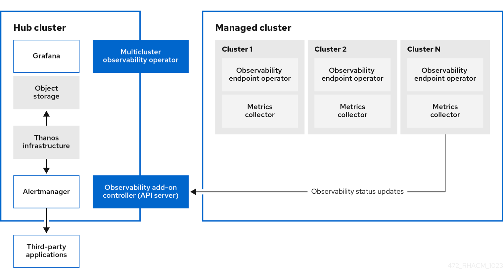

> Source: [Red Hat Advanced Cluster Management for Kubernetes 2.17](https://docs.redhat.com/en/documentation/red_hat_advanced_cluster_management_for_kubernetes/2.17/html/observability/index). Copyright Red Hat.
> Adapted from AsciiDoc to Markdown for offline use; see [legal notice](LEGAL-NOTICE.md), [CC BY-SA 3.0](LICENSE.md) and SOURCE.json for source revisions and gaps.

<a id="observing-environments-intro"></a>

# Observability service

Observability can help you identify and assess performance problems without additional tests and support. The Red Hat Advanced Cluster Management for Kubernetes observability component is a service you can use to understand the health and utilization of clusters, and workloads across your fleet. By using the observability service, you are able to automate and manage the components that are within observability.

Observability service uses existing and widely-adopted observability tools from the open source community. By default, multicluster observability operator is enabled during the installation of Red Hat Advanced Cluster Management. Thanos is deployed within the hub cluster for long-term metrics storage. The `observability-endpoint-operator` is automatically deployed to each imported or created managed cluster. This controller starts a metrics collector that collects the data from Red Hat OpenShift Container Platform Prometheus, then sends the data to the Red Hat Advanced Cluster Management hub cluster.

Read the following documentation for more details about the observability component:

- [Observability architecture](observability.md#observability-arch)

- [Observability open source components](observability.md#obs-open-source-components)

- [Observability component versions](observability.md#obs-component-versions)

- [Thanos Compactor default alerts](observability.md#obs-thanos-compact-alerts)

- [Persistent stores used in the observability service](observability.md#obs-persistent-stores)

- [Observability support](observability.md#obs-support)

- [Observability metric types](observability.md#obs-metric-types)

- [Observability pod capacity requests](observability.md#obs-pod-capacity)

- [Enable the observability service](observability.md#enabling-observability-service)

- [Set up the Grafana developer instance](observability.md#setting-up-grafana-developer-instance)

- [Use observability](observability.md#using-observability)

- [Configure alerts for observability](observability.md#configure-obs-alerts)

- [Observability advanced configuration](observability.md#adv-config-obs)

- [Use observability with OpenShift Lightspeed](observability.md#obs-insights)

- [`RightSizingRecommendation` guides (Technology Preview)](observability.md#right-size-intro)

- [Multicluster observability add-on](observability.md#obs-mcoa-intro)

- [Managed cluster workloads for the multicluster observability add-on](observability.md#obs-mcoa-managed-workloads)

- [Configurable APIs for the multicluster observability add-on](observability.md#obs-mcoa-api-resources)

- [Default platform metrics for the multicluster observability add-on](observability.md#obs-mcoa-default-platform-metrics)

- [Health status of the multicluster observability add-on](observability.md#obs-mcoa-health)

<a id="observability-arch"></a>

## Observability architecture

Learn how the observability operators, Thanos components, Grafana, and Alertmanager work together on the hub and managed clusters.

When the observability service is enabled, the hub cluster is always configured to collect and send metrics to the configured Thanos instance, regardless of whether `disableHubSelfManagement` is set to `true` (enabled) or set to `false` (disabled). When the hub cluster is self-managed as a `local-cluster`, the `disableHubSelfManagement` parameter is set to `false`, which is the default setting. The `multiclusterhub-operator` enables the `multicluster-observability-operator` pod by default. You must configure the `multicluster-observability-operator` pod.

Metrics and alerts for the hub cluster appear in the `<your-local-cluster-name>` namespace. The local cluster is only available if `disableHubSelfManagement` is enabled. You can query the `<your-local-cluster-name>` metrics in the Grafana explorer.

The following diagram shows the components of observability:



The components of the observability architecture include the following items:

- The multicluster hub operator, also known as the `multiclusterhub-operator` pod, deploys the `multicluster-observability-operator` pod. It is the root component that deploys resources for the Red Hat Advanced Cluster Management observability service, such as the metrics store on the hub cluster and collectors on managed clusters through the generation of `ManifestWorks` resources.

- The *observability add-on controller* is the API server that automatically updates the log of the managed cluster.

- The Thanos infrastructure includes the Thanos Compactor, which is deployed by the `multicluster-observability-operator` pod. The Thanos Compactor ensures that queries are performing well by using the retention configuration, and compaction of the data in storage. To monitor Compactor health, see [Thanos Compactor default alerts](observability.md#obs-thanos-compact-alerts).

- The observability component deploys an instance of *Grafana* to enable data visualization with dashboards (static) or data exploration. You can also design your Grafana dashboard. For more information, see [View and explore data with Grafana dashboards](observability.md#view-explore-data-grafana).

- The *Prometheus Alertmanager* enables alerts to be forwarded with third-party applications. You can customize the observability service by creating custom recording rules or alerting rules.

<div>

<div class="title">

Additional resources

</div>

- [Observability open source components](observability.md#obs-open-source-components)

- [Observability component versions](observability.md#obs-component-versions)

- [Thanos Compactor default alerts](observability.md#obs-thanos-compact-alerts)

- [Persistent stores used in the observability service](observability.md#obs-persistent-stores)

- [Observability support](observability.md#obs-support)

- [Enable the observability service](observability.md#enabling-observability-service)

- [Set up the Grafana developer instance](observability.md#setting-up-grafana-developer-instance)

- [Back up and restore the observability service](business_continuity.md#backup-restore-obs)

- [Thanos documentation](https://thanos.io/v0.36/thanos/getting-started.md/)

- [Prometheus Overview](https://prometheus.io/docs/introduction/overview/)

- [Alertmanager documentation](https://prometheus.io/docs/alerting/latest/alertmanager/)

</div>

<a id="obs-open-source-components"></a>

## Observability open source components

The observability service uses open source observability tools from the community. Review the following descriptions of the tools that are part of the product observability service.

Thanos  
A toolkit of components that you can use to perform global querying across multiple Prometheus instances. For long-term storage of Prometheus data, persist it in any S3-compatible storage. You can also compose a highly available and scalable metrics system.

Prometheus  
A monitoring and alerting tool that you can use to collect metrics from your application and store these metrics as time-series data. Store all scraped samples locally, run rules to aggregate and record new time series from existing data, and generate alerts.

Alertmanager  
A tool to manage and receive alerts from Prometheus. Deduplicate, group, and route alerts to your integrations such as email, Slack, and PagerDuty. Configure Alertmanager to silence and inhibit specific alerts.

<div>

<div class="title">

Additional resources

</div>

- [Observability architecture](observability.md#observability-arch)

- [Observability component versions](observability.md#obs-component-versions)

- [Thanos documentation](https://thanos.io/v0.36/thanos/getting-started.md/)

- [Prometheus Overview](https://prometheus.io/docs/introduction/overview/)

- [Alertmanager documentation](https://prometheus.io/docs/alerting/latest/alertmanager/)

</div>

<a id="obs-component-versions"></a>

## Observability component versions

See the following list of component versions that observability uses in Red Hat Advanced Cluster Management for Kubernetes 2.17.

| Component               | Version |
|-------------------------|---------|
| Grafana                 | 12.4.0  |
| Thanos                  | 0.41.0  |
| Prometheus Alertmanager | 0.31.1  |
| Prometheus              | 3.10.0  |
| Prometheus operator     | 0.89.0  |
| Kube State Metrics      | 2.18.0  |
| Node Exporter           | 1.10.2  |
| Memcached Exporter      | 0.15.5  |

Table list of component versions

<div>

<div class="title">

Additional resources

</div>

- [Observability architecture](observability.md#observability-arch)

- [Observability open source components](observability.md#obs-open-source-components)

</div>

<a id="obs-thanos-compact-alerts"></a>

## Thanos Compactor default alerts

Use the following default alerts to identify when the Thanos Compactor is experiencing issues.

| Alert | Severity | Description |
|----|----|----|
| `ACMThanosCompactHalted` | critical | An alert is sent when the compactor stops. |
| `ACMThanosCompactHighCompactionFailures` | warning | An alert is sent when the compaction failure rate is greater than 5 percent. |
| `ACMThanosCompactBucketHighOperationFailures` | warning | An alert is sent when the bucket operation failure rate is greater than 5 percent. |
| `ACMThanosCompactHasNotRun` | warning | An alert is sent when the compactor has not uploaded anything in last 24 hours. |

Table of default Thanos alerts

<div>

<div class="title">

Additional resources

</div>

- [Observability architecture](observability.md#observability-arch)

- [Configure alerts for observability](observability.md#configure-obs-alerts)

- [Forward your alerts](observability.md#obs-forward-alerts)

</div>

<a id="obs-persistent-stores"></a>

## Persistent stores used in the observability service

Review the persistent volumes that the observability service requires and the purpose of each volume.

**Important:** Do not use the local storage operator or a storage class that uses local volumes for persistent storage. You can lose data if the pod relaunched on a different node after a restart. When this happens, the pod can no longer access the local storage on the node. Be sure that you can access the persistent volumes of the `receive` and `rules` pods to avoid data loss.

When you install Red Hat Advanced Cluster Management the following persistent volumes (PV) must be created so that Persistent Volume Claims (PVC) can attach to it automatically. As a reminder, you must define a storage class in the `MultiClusterObservability` custom resource when there is no default storage class specified or you want to use a non-default storage class to host the PVs. It is recommended to use Block Storage, similar to what Prometheus uses. Also each replica of `alertmanager`, `thanos-compactor`, `thanos-ruler`, `thanos-receive-default` and `thanos-store-shard` must have its own PV. View the following table:

| Component name | Purpose |
|----|----|
| alertmanager | Alertmanager stores the `nflog` data and silenced alerts in its storage. `nflog` is an append-only log of active and resolved notifications along with the notified receiver, and a hash digest of contents that the notification identified. |
| observability-thanos-compactor | The compactor needs local disk space to store intermediate data for its processing, as well as bucket state cache. The required space depends on the size of the underlying blocks. The compactor must have enough space to download all of the source blocks, then build the compacted blocks on the disk. On-disk data is safe to delete between restarts and should be the first attempt to get crash-looping compactors unstuck. However, it is recommended to give the compactor persistent disks in order to effectively use bucket state cache in between restarts. |
| observability-thanos-rule | The thanos ruler evaluates Prometheus recording and alerting rules against a chosen query API by issuing queries at a fixed interval. Rule results are written back to the disk in the Prometheus 2.0 storage format. The amount of hours or days of data retained in this stateful set was fixed in the API version `observability.open-cluster-management.io/v1beta1`. It has been exposed as an API parameter in `observability.open-cluster-management.io/v1beta2`: `RetentionInLocal` |
| observability-thanos-receive-default | Thanos receiver accepts incoming data (Prometheus remote-write requests) and writes these into a local instance of the Prometheus TSDB. Periodically (every 2 hours), TSDB blocks are uploaded to the object storage for long term storage and compaction. The amount of hours or days of data retained in this stateful set, which acts a local cache was fixed in API Version `observability.open-cluster-management.io/v1beta`. It has been exposed as an API parameter in `observability.open-cluster-management.io/v1beta2`: `RetentionInLocal` |
| observability-thanos-store-shard | It acts primarily as an API gateway and therefore does not need a significant amount of local disk space. It joins a Thanos cluster on startup and advertises the data it can access. It keeps a small amount of information about all remote blocks on local disk and keeps it in sync with the bucket. This data is generally safe to delete across restarts at the cost of increased startup times. |

Table list of persistent volumes

**Note:** The time series historical data is stored in object stores. Thanos uses object storage as the primary storage for metrics and metadata related to them. For more details about the object storage and downsampling, see [Enable the observability service](observability.md#enabling-observability-service).

<div>

<div class="title">

Additional resources

</div>

- [Observability support](observability.md#obs-support)

- [Observability pod capacity requests](observability.md#obs-pod-capacity)

- [Enable the observability service](observability.md#enabling-observability-service)

- [Migrate observability storage](observability.md#obs-migrate-storage)

- [Back up and restore the observability service](business_continuity.md#backup-restore-obs)

</div>

<a id="obs-support"></a>

## Observability support

Review the support information for the observability service and supported object storage options.

- Red Hat Advanced Cluster Management is tested with and fully supported by Red Hat OpenShift Data Foundation.

- Red Hat Advanced Cluster Management supports the function of the multicluster observability operator on user-provided third-party object storage that is S3 API compatible. The observability service uses Thanos supported, stable object stores.

- Red Hat Advanced Cluster Management support efforts include reasonable efforts to identify root causes. If you open a support ticket and the root cause is the S3 compatible object storage that you provided, then you must open an issue using the customer support channels.

<div>

<div class="title">

Additional resources

</div>

- [Persistent stores used in the observability service](observability.md#obs-persistent-stores)

- [Enable the observability service](observability.md#enabling-observability-service)

- [Observability architecture](observability.md#observability-arch)

</div>

<a id="obs-metric-types"></a>

## Observability metric types

Review the metric types that the observability framework supports. By default, OpenShift Container Platform sends metrics to Red Hat by using the Telemetry service.

The `acm_managed_cluster_info` metric is available with Red Hat Advanced Cluster Management and is included with telemetry, but it is *not* displayed on the Red Hat Advanced Cluster Management *Observe environments overview* dashboard.

| Metric name | Metric type | Labels/tags | Status |
|----|----|----|----|
| `acm_managed_cluster_info` | Gauge | `hub_cluster_id`, `managed_cluster_id`, `vendor`, `cloud`, `version`, `available`, `created_via`, `core_worker`, `socket_worker` | Stable |
| `config_policies_evaluation_duration_seconds_bucket` | Histogram | None | Stable. See [Policy controller advanced configuration](governance.md#policy-controller-advanced-config). |
| `config_policies_evaluation_duration_seconds_count` | Histogram | None | Stable. See [Policy controller advanced configuration](governance.md#policy-controller-advanced-config). |
| `config_policies_evaluation_duration_seconds_sum` | Histogram | None | Stable. See [Policy controller advanced configuration](governance.md#policy-controller-advanced-config). |
| `policy_governance_info` | Gauge | `type`, `policy`, `policy_namespace`, `cluster_namespace` | Stable. See [Policy controller advanced configuration](governance.md#policy-controller-advanced-config). |
| `cluster_policy_governance_info` | Gauge | `kind`, `policy`, `policy_namespace`, `severity` | Stable. See [Policy controller advanced configuration](governance.md#policy-controller-advanced-config). |
| `policyreport_info` | Gauge | `managed_cluster_id`, `category`, `policy`, `result`, `severity` | Stable. See [Use observability with OpenShift Lightspeed](observability.md#obs-insights). |
| `search_api_db_connection_failed_total` | Counter | None | Stable. See the *Search components* section in the *Searching in the console* documentation. |
| `search_api_dbquery_duration_seconds` | Histogram | None | Stable. See the *Search components* section in the *Searching in the console* documentation. |
| `search_api_requests` | Histogram | None | Stable. See the *Search components* section in the *Searching in the console* documentation. |
| `search_indexer_request_count` | Counter | None | Stable. See the *Search components* section in the *Searching in the console* documentation. |
| `search_indexer_request_duration` | Histogram | None | Stable. See the *Search components* section in the *Searching in the console* documentation. |
| `search_indexer_requests_in_flight` | Gauge | None | Stable. See the *Search components* section in the *Searching in the console* documentation. |
| `search_indexer_request_size` | Histogram | None | Stable. See the *Search components* section in the *Searching in the console* documentation. |

Parameter table

<div>

<div class="title">

Additional resources

</div>

- [View default metrics](observability.md#view-default-metrics)

- [Add custom metrics](observability.md#adding-custom-metrics)

- [Information collected by Telemetry](https://docs.redhat.com/en/documentation/openshift_container_platform/4.19/html-single/support/index#about-remote-health-monitoring)

- [Prometheus recording rules](https://prometheus.io/docs/prometheus/latest/configuration/recording_rules/)

- [Prometheus alerting rules](https://prometheus.io/docs/prometheus/latest/configuration/alerting_rules/)

</div>

<a id="view-default-metrics"></a>

## View default metrics

View the default metrics that the observability service collects from the `observability-metrics-allowlist` config map.

**Required access:** Cluster administrator

<div>

<div class="title">

Procedure

</div>

- To view the default metrics, run the following command:

  ``` bash
  oc -n open-cluster-management-observability get cm observability-metrics-allowlist -o yaml
  ```

  **Note:** You cannot change the default metrics in the allowlist.

</div>

<div>

<div class="title">

Additional resources

</div>

- [Observability metric types](observability.md#obs-metric-types)

- [Add custom metrics](observability.md#adding-custom-metrics)

- [Remove default metrics](observability.md#removing-default-metrics)

</div>

<a id="obs-pod-capacity"></a>

## Observability pod capacity requests

Review the CPU and memory capacity requests for observability components. Use this information to plan resources before you enable the observability service.

Observability components require 2701mCPU and 11972Mi memory to install the observability service. The following table lists the pod capacity requests for five managed clusters with `observability-addons` enabled:

| Deployment or StatefulSet | Container name | CPU (mCPU) | Memory (Mi) | Replicas | Pod total CPU | Pod total memory |
|----|----|----|----|----|----|----|
| observability-alertmanager | alertmanager | 4 | 200 | 3 | 12 | 600 |
| config-reloader | 4 | 25 | 3 | 12 | 75 |  |
| alertmanager-proxy | 1 | 20 | 3 | 3 | 60 |  |
| observability-grafana | grafana | 4 | 100 | 2 | 8 | 200 |
| grafana-dashboard-loader | 4 | 50 | 2 | 8 | 100 |  |
| observability-observatorium-api | observatorium-api | 20 | 128 | 2 | 40 | 256 |
| observability-observatorium-operator | observatorium-operator | 100 | 100 | 1 | 10 | 50 |
| observability-rbac-query-proxy | rbac-query-proxy | 20 | 100 | 2 | 40 | 200 |
| oauth-proxy | 1 | 20 | 2 | 2 | 40 |  |
| observability-thanos-compact | thanos-compact | 500 | 1024 | 1 | 100 | 512 |
| observability-thanos-query | thanos-query | 300 | 1024 | 2 | 600 | 2048 |
| observability-thanos-query-frontend | thanos-query-frontend | 100 | 256 | 2 | 200 | 512 |
| observability-thanos-query-frontend-memcached | memcached | 45 | 128 | 3 | 135 | 384 |
| exporter | 5 | 50 | 3 | 15 | 150 |  |
| observability-thanos-receive-controller | thanos-receive-controller | 4 | 32 | 1 | 4 | 32 |
| observability-thanos-receive-default | thanos-receive | 300 | 512 | 3 | 900 | 1536 |
| observability-thanos-rule | thanos-rule | 50 | 512 | 3 | 150 | 1536 |
| configmap-reloader | 4 | 25 | 3 | 12 | 75 |  |
| observability-thanos-store-memcached | memcached | 45 | 128 | 3 | 135 | 384 |
| exporter | 5 | 50 | 3 | 15 | 150 |  |
| observability-thanos-store-shard | thanos-store | 100 | 1024 | 3 | 300 | 3072 |

Observability pod capacity requests

<div>

<div class="title">

Additional resources

</div>

- [Enable the observability service](observability.md#enabling-observability-service)

- [Observability instance sizes](observability.md#obs-instance-sizes)

- [Persistent stores used in the observability service](observability.md#obs-persistent-stores)

- [Observability architecture](observability.md#observability-arch)

</div>

<a id="adv-config-obs"></a>

## Observability advanced configuration

After you enable observability, you can further customize the observability configuration to the specific needs of your environment. Manage and view cluster fleet data that the observability service collects.

View the following application advanced configuration topics:

- [Platform and user workload metrics](observability.md#obs-platform-uw-metrics)

- [Add custom metrics](observability.md#adding-custom-metrics)

- [Scale metrics collection (Technology Preview)](observability.md#obs-scale-metrics)

- [Configure proxy settings for observability add-ons](observability.md#config-proxy-obs)

- [Customize route certificate](observability.md#customizing-route-cert)

- [Create custom rules](observability.md#creating-custom-rules)

- [Update the *MultiClusterObservability* custom resource replicas from the console](observability.md#updating-mco-custom-replicas)

- [Increase and decrease persistent volumes and persistent volume claims](observability.md#increase-decrease-pv-pvc)

- [Customize the managed cluster Observatorium API and Alertmanager URLs (Technology Preview)](observability.md#custom-obervatorium-alert-url)

- [Configure fine-grain RBAC (Technology Preview)](observability.md#configure-fine-grain-rbac)

<a id="obs-platform-uw-metrics"></a>

### Platform and user workload metrics

Before you collect custom metrics from a remote cluster with Red Hat Advanced Cluster Management, determine whether the metric is exported as a platform metric or a user workload metric.

Use one of the following methods to find the metric type:

- Find the metric type in the documentation of the solution you want to monitor.

- Find the metric type by contacting the support for your product.

- Find the metric type by checking the annotation that the `ServiceMonitor` for the observed resource uses.

  - Platform metrics use `operator.prometheus.io/controller-id: openshift-platform-monitoring/prometheus-operator`.

  - User workload metrics use `operator.prometheus.io/controller-id: openshift-user-workload-monitoring/prometheus-operator`.

You can also find `ServiceMonitors` in the console by going to **Observe** \> **Targets** and choosing Platform or User from the **Source** filter in the top right.

**Note:** The **Source** filter provides service monitor or target information, not a list of metrics.

<div>

<div class="title">

Additional resources

</div>

- [Add custom metrics](observability.md#adding-custom-metrics)

- [Add user workload metrics](observability.md#add-uw-metrics)

- [Observability metric types](observability.md#obs-metric-types)

</div>

<a id="adding-custom-metrics"></a>

### Add custom metrics

Add custom platform metrics from your managed clusters by creating an `observability-metrics-custom-allowlist` `ConfigMap` resource on the hub cluster or on a managed cluster.

**Required access:** Cluster administrator

<div>

<div class="title">

Prerequisites

</div>

- Determine whether the metric is a platform metric or a user workload metric. For more information, see [Platform and user workload metrics](observability.md#obs-platform-uw-metrics).

</div>

<div>

<div class="title">

Procedure

</div>

1.  Add Platform metrics by creating a `ConfigMap` resource on the hub cluster in the `open-cluster-management-observability` namespace. Use `observability-metrics-custom-allowlist` as the name. See the following `ConfigMap` example that you can use to monitor Platform metrics:

    ``` yaml
    kind: ConfigMap
    apiVersion: v1
    metadata:
      name: observability-metrics-custom-allowlist
      namespace: open-cluster-management-observability
    data:
      metrics_list.yaml: |
        names:
          - node_memory_MemTotal_bytes
        recording_rules:
          - record: apiserver_request_duration_seconds:histogram_quantile_90
            expr: histogram_quantile(0.90,sum(rate(apiserver_request_duration_seconds_bucket {job=\"apiserver\", verb!=\"WATCH\"}[5m])) by (verb,le))
    ```

2.  **Optional:** Add the names of the custom metrics you want to collect from your managed cluster.

3.  **Optional:** Add one value for the `expr` and `record` parameter pair to define the query expression.

    **Note:** The name for the metrics you collect is the same name that you define in your managed cluster `record` parameter. After you run the query expression, you get the metric value results. You can use one section or both sections, which applies to every cluster with monitoring enabled.

4.  If you only want to collect custom metrics from a single managed cluster, use the following example and apply the config map on your managed cluster in the `open-cluster-management-addon-observability` namespace:

    ``` yaml
    kind: ConfigMap
    apiVersion: v1
    metadata:
      name: observability-metrics-custom-allowlist
      namespace: open-cluster-management-addon-observability
    data:
      metrics_list.yaml: |
        names:
          - node_memory_MemTotal_bytes
            recording_rules:
          - record: apiserver_request_duration_seconds:histogram_quantile_90
            expr: histogram_quantile(0.90,sum(rate(apiserver_request_duration_seconds_bucket{job="apiserver", verb!="WATCH"}[5m])) by (verb,le))
    ```

    - **Optional:** Add the names of the custom metrics you want to collect from your managed cluster.

    - **Optional:** Enter only one value for the `expr` and `record` parameter pair to define the query expression.

      **Note:** The name for the metrics you collect is the same name that you define in your managed cluster `record` parameter. After you run the query expression, you get the metric value results. You can use one section or both sections.

</div>

<div>

<div class="title">

Additional resources

</div>

- [Platform and user workload metrics](observability.md#obs-platform-uw-metrics)

- [View default metrics](observability.md#view-default-metrics)

- [Add user workload metrics](observability.md#add-uw-metrics)

- [Export metrics to external endpoints](observability.md#obs-exporting-metrics)

- [Dynamic metrics for single-node OpenShift clusters](observability.md#dynamic-metrics-sno)

</div>

<a id="add-uw-metrics"></a>

### Add user workload metrics

To collect custom workload metrics from managed clusters, create `ConfigMap` resource named `observability-metrics-custom-allowlist` in a namespace.

After creating the `ConfigMap` resource, the observability collector collects and pushes the metrics from the target namespace to the hub cluster.

<div>

<div class="title">

Prerequisites

</div>

- Determine whether the metric is a platform metric or a user workload metric. For more information, see [Platform and user workload metrics](observability.md#obs-platform-uw-metrics).

</div>

<div>

<div class="title">

Procedure

</div>

1.  Set the configuration on the managed cluster in namespace where you want to capture the user workload metrics. The name must be `observability-metrics-custom-allowlist`.

2.  The following example monitors the User workload metric `sample_metrics` from the namespace `monitored_namespace`. If you create the configuration in the `open-cluster-management-addon-observability` namespace instead, the metrics are collected from all the namespaces of the managed cluster. See the following example:

    ``` yaml
    kind: ConfigMap
    apiVersion: v1
    metadata:
      name: observability-metrics-custom-allowlist
      namespace: <monitored_namespace>
    data:
      uwl_metrics_list.yaml:
        names:
          - <sample_metrics>
    ```

    - For the `data` parameter, add the value of the config map data in YAML format. List the metric names that you want to collect from the `test` namespace to the `names` section.

</div>

<div>

<div class="title">

Additional resources

</div>

- [Platform and user workload metrics](observability.md#obs-platform-uw-metrics)

- [Add custom metrics](observability.md#adding-custom-metrics)

</div>

<a id="removing-default-metrics"></a>

### Remove default metrics

Remove default metrics from the `observability-metrics-custom-allowlist.yaml` file if you do not want to collect data for a specific metric from your managed cluster.

<div>

<div class="title">

Procedure

</div>

1.  Verify that `mco observability` is enabled by using the following command:

    ``` bash
    oc get mco observability -o yaml
    ```

2.  Add the name of the default metric to the `metrics_list.yaml` parameter with a hyphen `-` at the start of the metric name. View the following metric example:

    ``` bash
    -cluster_infrastructure_provider
    ```

3.  Create the `observability-metrics-custom-allowlist` config map in the `open-cluster-management-observability` namespace with the following command:

    ``` bash
    oc apply -n open-cluster-management-observability -f observability-metrics-custom-allowlist.yaml
    ```

4.  Verify that the observability service is not collecting the specific metric from your managed clusters. When you query the metric from the Grafana dashboard, the metric is not displayed.

</div>

<div>

<div class="title">

Additional resources

</div>

- [View default metrics](observability.md#view-default-metrics)

- [Add custom metrics](observability.md#adding-custom-metrics)

</div>

<a id="dynamic-metrics-sno"></a>

### Dynamic metrics for single-node OpenShift clusters

Dynamic metrics collection supports automatic metric collection based on certain conditions. By default, a single-node OpenShift cluster does not collect pod and container resource metrics. Once a single-node OpenShift cluster reaches a specific level of resource consumption, the defined granular metrics are collected dynamically. When the cluster resource consumption is consistently less than the threshold for a period of time, granular metric collection stops.

The metrics are collected dynamically based on the conditions on the managed cluster specified by a collection rule. Because these metrics are collected dynamically, the following Red Hat Advanced Cluster Management Grafana dashboards do not display any data. When a collection rule is activated and the corresponding metrics are collected, the following panels display data for the duration of the time that the collection rule is initiated:

- Kubernetes/Compute Resources/Namespace (Pods)

- Kubernetes/Compute Resources/Namespace (Workloads)

- Kubernetes/Compute Resources/Nodes (Pods)

- Kubernetes/Compute Resources/Pod

- Kubernetes/Compute Resources/Workload

A collection rule includes the following conditions:

- A set of metrics to collect dynamically.

- Conditions written as a PromQL expression.

- A time interval for the collection, which must be set to `true`.

- A match expression to select clusters where the collect rule must be evaluated.

By default, collection rules are evaluated continuously on managed clusters every 30 seconds, or at a specific time interval. The lowest value between the collection interval and time interval takes precedence.

Once the collection rule condition persists for the duration specified by the `for` attribute, the collection rule starts and the metrics specified by the rule are automatically collected on the managed cluster. Metrics collection stops automatically after the collection rule condition no longer exists on the managed cluster, at least 15 minutes after it starts.

The collection rules are grouped together as a parameter section named `collect_rules`, where it can be enabled or disabled as a group. Red Hat Advanced Cluster Management installation includes the collection rule group, `SNOResourceUsage` with two default collection rules: `HighCPUUsage` and `HighMemoryUsage`. The `HighCPUUsage` collection rule begins when the node CPU usage exceeds 70%.

The `HighMemoryUsage` collection rule begins if the overall memory utilization of the single-node OpenShift cluster exceeds 70% of the available node memory. Currently, the previously mentioned thresholds are fixed and cannot be changed. When a collection rule begins for more than the interval specified by the `for` attribute, the system automatically starts collecting the metrics that are specified in the `dynamic_metrics` section.

View the list of dynamic metrics that from the `collect_rules` section, in the following YAML file:

``` yaml
collect_rules:
  - group: SNOResourceUsage
    annotations:
      description: >
        By default, a {sno} cluster does not collect pod and container resource metrics. Once a {sno} cluster
        reaches a level of resource consumption, these granular metrics are collected dynamically.
        When the cluster resource consumption is consistently less than the threshold for a period of time,
        collection of the granular metrics stops.
    selector:
      matchExpressions:
        - key: clusterType
          operator: In
          values: ["{sno}"]
    rules:
    - collect: SNOHighCPUUsage
      annotations:
        description: >
          Collects the dynamic metrics specified if the cluster cpu usage is constantly more than 70% for 2 minutes
      expr: (1 - avg(rate(node_cpu_seconds_total{mode=\"idle\"}[5m]))) * 100 > 70
      for: 2m
      dynamic_metrics:
        names:
          - container_cpu_cfs_periods_total
          - container_cpu_cfs_throttled_periods_total
          - kube_pod_container_resource_limits
          - kube_pod_container_resource_requests
          - namespace_workload_pod:kube_pod_owner:relabel
          - node_namespace_pod_container:container_cpu_usage_seconds_total:sum_irate
          - node_namespace_pod_container:container_cpu_usage_seconds_total:sum_rate
    - collect: SNOHighMemoryUsage
      annotations:
        description: >
          Collects the dynamic metrics specified if the cluster memory usage is constantly more than 70% for 2 minutes
      expr: (1 - sum(:node_memory_MemAvailable_bytes:sum) / sum(kube_node_status_allocatable{resource=\"memory\"})) * 100 > 70
      for: 2m
      dynamic_metrics:
        names:
          - kube_pod_container_resource_limits
          - kube_pod_container_resource_requests
          - namespace_workload_pod:kube_pod_owner:relabel
        matches:
          - __name__="container_memory_cache",container!=""
          - __name__="container_memory_rss",container!=""
          - __name__="container_memory_swap",container!=""
          - __name__="container_memory_working_set_bytes",container!=""
```

A `collect_rules.group` can be disabled in the `custom-allowlist` as shown in the following example. When a `collect_rules.group` is disabled, metrics collection reverts to the previous behavior. These metrics are collected at regularly, specified intervals:

``` yaml
collect_rules:
  - group: -SNOResourceUsage
```

The data is only displayed in Grafana when the rule is initiated.

<a id="obs-scale-metrics"></a>

### Scale metrics collection (Technology Preview)

To enhance performance in high-scale deployments, you can configure the `metrics-collector` to collect metrics in parallel with multiple workers. The default configuration uses a single worker to federate metrics. By increasing the number of workers in the metric collection process, you enable internal workers to shard `/federate` endpoint requests that are made to Prometheus on your managed cluster.

**Required access:** Cluster administrator

<div>

<div class="title">

Prerequisites

</div>

- You have the observability service enabled on your hub and managed clusters. See [Enable the observability service](observability.md#enabling-observability-service).

</div>

<div>

<div class="title">

Procedure

</div>

1.  To increase and decrease metrics collection on your clusters, edit the `workers` parameter in the `multicluster-observability-operator` resource.

2.  If you want to use the same `workers` value for each of your managed clusters, set the value in your `MultiClusterObservability` custom resource definition. By default, the value is set to `1`. For example, change the `workers` parameter value to `4`. Your YAML file might resemble the following resource:

    ``` yaml
    apiVersion: observability.open-cluster-management.io/v1beta2
    kind: MultiClusterObservability
    metadata:
      name: observability
    spec:
      observabilityAddonSpec:
        enableMetrics: true
        workers: 4
    ```

3.  **Optional:** If you want to override the `workers` parameter for specific clusters, add the `observability.open-cluster-management.io/addon-source: "override"` annotation to the `ObservabilityAddOn` specification of your managed cluster.

    1.  To revert the override, use the `observability.open-cluster-management.io/addon-source: "mco"` annotation.

4.  To verify the value of the `workers` parameter, check the values in the `MultiClusterObservability` custom resource.

</div>

<a id="config-proxy-obs"></a>

### Configure proxy settings for observability add-ons

Configure the proxy settings to allow the communications from the managed cluster to access the hub cluster through a HTTP and HTTPS proxy server. Typically, add-ons do not need any special configuration to support HTTP and HTTPS proxy servers between a hub cluster and a managed cluster. But if you enabled the observability add-on, you must complete the proxy configuration.

<div>

<div class="title">

Prerequisites

</div>

- You have a hub cluster.

- You have enabled the proxy settings between the hub cluster and managed cluster.

</div>

<div>

<div class="title">

Procedure

</div>

1.  Configure proxy settings by navigating to the cluster namespace on your hub cluster.

2.  Create an `AddOnDeploymentConfig` resource with the proxy settings by adding a `spec.proxyConfig` parameter. View the following YAML example:

    ``` yaml
    apiVersion: addon.open-cluster-management.io/v1alpha1
    kind: AddOnDeploymentConfig
    metadata:
      name: <addon-deploy-config-name>
      namespace: <managed-cluster-name>
    spec:
      agentInstallNamespace: open-cluster-management-addon-observability
      proxyConfig:
        httpsProxy: "http://<username>:<password>@<ip>:<port>"
        noProxy: ".cluster.local,.svc,172.30.0.1"
    ```

    - For the `httpsProxy` parameter, specify either a HTTP proxy or a HTTPS proxy.

    - For the `noProxy` parameter, include the IP address of the `kube-apiserver`.

3.  To get the IP address, run following command on your managed cluster:

    ``` bash
    oc -n default describe svc kubernetes | grep IP:
    ```

4.  Go to the `ManagedClusterAddOn` resource and update it by referencing the `AddOnDeploymentConfig` resource that you made. View the following YAML example:

    ``` yaml
    apiVersion: addon.open-cluster-management.io/v1alpha1
    kind: ManagedClusterAddOn
    metadata:
      name: observability-controller
      namespace: <managed-cluster-name>
    spec:
      installNamespace: open-cluster-management-addon-observability
      configs:
      - group: addon.open-cluster-management.io
        resource: addondeploymentconfigs
        name: <addon-deploy-config-name>
        namespace: <managed-cluster-name>
    ```

    **Note:** The `spec.installNamespace` field is deprecated.

5.  Verify the proxy settings. If you successfully configured the proxy settings, the metric collector deployed by the observability add-on agent on the managed cluster sends the data to the hub cluster. Complete the following steps:

    1.  Go to the hub cluster then the managed cluster on the Grafana dashboard.

    2.  View the metrics for the proxy settings.

6.  Disable proxy settings for observability add-ons if you need to make development changes.

    1.  Go to the `ManagedClusterAddOn` resource.

    2.  Remove the referenced `AddOnDeploymentConfig` resource.

</div>

<a id="customizing-route-cert"></a>

### Customize route certificate

If you want to customize the OpenShift Container Platform route certification, you must add the routes in the `alt_names` section. Configure secure connections with the observability object store by creating a `Secret` resource that contains the certificate authority and configuring the `MultiClusterObservability` custom resource.

To ensure your OpenShift Container Platform routes are accessible, add the following information: `alertmanager.apps.<domainname>`, `observatorium-api.apps.<domainname>`, `rbac-query-proxy.apps.<domainname>`.

**Note:** Users are responsible for certificate rotations and updates.

<div>

<div class="title">

Procedure

</div>

1.  Customize certificates for accessing the object store. To validate the object store connection, create the `Secret` object in the file that contains the certificate authority by using the following command:

    ``` bash
    oc create secret generic <tls_secret_name> --from-file=ca.crt=<path_to_file> -n open-cluster-management-observability
    ```

2.  Alternatively, you can apply the following YAML to create the secret:

    ``` yaml
    apiVersion: v1
    kind: Secret
    metadata:
      name: <tls_secret_name>
      namespace: open-cluster-management-observability
    type: Opaque
    data:
      ca.crt: <base64_encoded_ca_certificate>
    ```

    **Optional:** If you want to enable mutual TLS, you need to add the `public.crt` and `private.key` keys in the previous secret.

3.  Add the TLS secret details to the `metricObjectStorage` section by using the following command:

    ``` bash
    oc edit mco observability -o yaml
    ```

    Your file might resemble the following YAML:

    ``` yaml
    metricObjectStorage:
      key: thanos.yaml
      name: thanos-object-storage
      tlsSecretName: tls-certs-secret
      tlsSecretMountPath: /etc/<s3-directory>/certs
    ```

    - The value for `tlsSecretName` is the name of the `Secret` object that you previously created.

    - The `/etc/<s3-directory>/certs/` path defined for the `tlsSecretMountPath` parameter specifies where the certificates are mounted in the observability components. This path is required for the next step.

4.  Update the `thanos.yaml` definition in the `thanos-object-storage` secret by adding the `http_config.tls_config` section with the certificate details. View the following example. Replace values where needed:

    ``` yaml
    thanos.yaml: |
       type: s3
       config:
         bucket: <bucket-name>
         endpoint: <s3.port>
         insecure: false
         access_key: <s3-access>
         secret_key: <s3-secret>
         http_config:
           tls_config:
             ca_file: /etc/<s3-directory>/certs/ca.crt
             insecure_skip_verify: false
    ```

    - Set the `insecure` parameter to `false` to enable HTTPS.

    - The path for the `ca_file` parameter must match the `tlsSecretMountPath` from the `MultiClusterObservability` custom resource. The `ca.crt` must match the key in the `<tls_secret_name>` `Secret` resource.

      **Optional:** If you want to enable mutual TLS, you need to add the `cert_file` and `key_file` keys to the `tls_config` section. See the following example. Replace values where needed:

    ``` yaml
     thanos.yaml: |
        type: s3
        config:
          bucket: <bucket-name>
          endpoint: <s3.port>
          insecure: false
          access_key: <s3-access>
          secret_key: <s3-secret>
          http_config:
            tls_config:
              ca_file: /etc/<s3-directory>/certs/ca.crt
              cert_file: /etc/<s3-directory>/certs/public.crt
              key_file: /etc/<s3-directory>/certs/private.key
              insecure_skip_verify: false
    ```

    - The path for `ca_file`, `cert_file`, and `key_file` must match the `tlsSecretMountPath` from the `MultiClusterObservability` custom resource. The `ca.crt`, `public.crt`, and `private.crt` must match the respective key in the `tls_secret_name>` `Secret` resource.

5.  To verify that you can access the object store, check that the pods are deployed. Run the following command:

    ``` bash
    oc -n open-cluster-management-observability get pods -l app.kubernetes.io/name=thanos-store
    ```

</div>

<div>

<div class="title">

Additional resources

</div>

- [Replacing certificates for Alertmanager](secure_clusters.md#replacing-cert-alertmanager)

</div>

<a id="creating-custom-rules"></a>

### Create custom rules

Create custom rules for the observability installation by adding Prometheus recording rules and alerting rules to the observability resource.

To precalculate expensive expressions, use the recording rules abilities with Prometheus to create alert conditions and send notifications based on how you want to send an alert to an external service. The results are saved as a new set of time series.

<div>

<div class="title">

Procedure

</div>

1.  Create the following custom alert rule to get a notification for when your CPU usage passes your defined value:

    ``` yaml
    data:
      custom_rules.yaml: |
        groups:
          - name: cluster-health
            rules:
            - alert: ClusterCPUHealth-jb
              annotations:
                summary: Notify when CPU utilization on a cluster is greater than the defined utilization limit
                description: "The cluster has a high CPU usage: {{ $value }} core for {{ $labels.cluster }} {{ $labels.clusterID }}."
              expr: |
                max(cluster:cpu_usage_cores:sum) by (clusterID, cluster, prometheus) > 0
              for: 5s
              labels:
                cluster: "{{ $labels.cluster }}"
                prometheus: "{{ $labels.prometheus }}"
                severity: critical
    ```

    **Notes:**

    - When you update your custom rules, `observability-thanos-rule` pods restart automatically.

    - You can create multiple rules in the configuration.

    - The default alert rules are in the `observability-thanos-rule-default-rules` config map of the `open-cluster-management-observability` namespace.

2.  Create a custom recording rule to get the sum of the container memory cache of a pod. See the following example:

    ``` yaml
    data:
      custom_rules.yaml: |
        groups:
          - name: container-memory
            rules:
            - record: pod:container_memory_cache:sum
              expr: sum(container_memory_cache{pod!=""}) BY (pod, container)
    ```

    **Note:** After you make changes to the config map, the configuration automatically reloads. The configuration reloads because of the `config-reload` within the `observability-thanos-rule` sidecar.

3.  Verify that the alert rules are functioning correctly. Navigate to the Grafana dashboard by selecting the **Explore** page and query `ALERTS`. The alert is only available in Grafana if you created the alert.

</div>

<div>

<div class="title">

Additional resources

</div>

- [Prometheus recording rules](https://prometheus.io/docs/prometheus/latest/configuration/recording_rules/)

- [Prometheus alerting rules](https://prometheus.io/docs/prometheus/latest/configuration/alerting_rules/)

- [Prometheus configuration](https://prometheus.io/docs/prometheus/latest/configuration/configuration/)

- [Prometheus documentation](https://prometheus.io/docs/prometheus/latest/configuration/recording_rules/)

</div>

<a id="obs-secure-alertmanager"></a>

### Secure communication from Alertmanager to third-party endpoints

Secure external communication from Alertmanager to third-party endpoints such as Slack, email, and PagerDuty for access to authorization credentials. Create `Secret` resources with arbitrary content that you can mount within your `alertmanager` pods.

<div>

<div class="title">

Procedure

</div>

1.  To reference secrets within your Alertmanager configuration, add the `Secret` resource content within the `open-cluster-management-observability` namespace and mount the content within the `alertmanager` pods.

2.  To create a `tls` secret with TLS certificates, run the following command:

    ``` bash
    oc create secret tls tls --cert=</path/to/cert.crt> --key=</path/to/cert.key> -n open-cluster-management-observability
    ```

3.  To mount the `tls` secret to your `MultiClusterObservability` resource, add it to the `advanced` section. Your resource might resemble the following content:

    ``` yaml
    ...
    advanced:
     alertmanager:
       secrets: ['tls']
    ```

4.  To add a reference of your `tls` secret within your Alertmanager configuration, add the path of your secret to the configuration. Your resource might resemble the following configuration:

    ``` yaml
    tls_config:
     cert_file: '/etc/alertmanager/secrets/tls/tls.crt'
     key_file: '/etc/alertmanager/secrets/tls/tls.key'
    ```

5.  To verify that the secrets are within your `alertmanager` pods, run the following command:

    ``` bash
    oc -n open-cluster-management-observability get secret alertmanager-config --template='{{ index .data "alertmanager.yaml" }}' |base64 -d > alertmanager.yaml
    ```

    Your YAML might resemble the following contents:

    ``` yaml
    "global":
      "http_config":
        "tls_config":
          "cert_file": "/etc/alertmanager/secrets/storyverify/tls.crt"
          "key_file": "/etc/alertmanager/secrets/storyverify/tls.key"
    ```

6.  To save the `alertmanager.yaml` configuration in the `alertmanager-config` secret, run the following command:

    ``` bash
    oc -n open-cluster-management-observability create secret generic alertmanager-config --from-file=alertmanager.yaml --dry-run -o=yaml
    ```

7.  To replace the previous secret with your new secret, run the following command:

    ``` bash
    oc -n open-cluster-management-observability replace secret --filename=-
    ```

</div>

<div>

<div class="title">

Additional resources

</div>

- [Configure alerts for observability](observability.md#configure-obs-alerts)

</div>

<a id="obs-forward-alerts"></a>

### Forward your alerts

After you enable observability, alerts from your OpenShift Container Platform managed clusters are automatically sent to Alertmanager on your hub cluster. By default, all platform alerts are sent to Alertmanager on your hub cluster. Enable user workload alerts on your OpenShift Container Platform managed clusters to get user workload alerts forwarded to your hub cluster.

<div>

<div class="title">

Procedure

</div>

1.  Create the `alertmanager-config` YAML file to configure alerts with an external notification system. View the following example of the `alertmanager-config` YAML file:

    ``` yaml
    global:
      slack_api_url: '<slack_webhook_url>'

    route:
      receiver: 'slack-notifications'
      group_by: [alertname, datacenter, app]

    receivers:
    - name: 'slack-notifications'
      slack_configs:
      - channel: '#alerts'
        text: 'https://internal.myorg.net/wiki/alerts/{{ .GroupLabels.app }}/{{ .GroupLabels.alertname }}'
    ```

2.  If you want to configure a proxy for alert forwarding, add the following `global` entry to the `alertmanager-config` YAML file:

</div>

``` yaml
global:
  slack_api_url: '<slack_webhook_url>'
  http_config:
    proxy_url: http://****
```

1.  To forward user workload alerts, configure the alerts to be processed by the user workload Prometheus instance and not by Thanos ruler. See the following example of the `PrometheusRule` resource:

    ``` yaml
    apiVersion: monitoring.coreos.com/v1
    kind: PrometheusRule
    metadata:
      labels:
        openshift.io/prometheus-rule-evaluation-scope: leaf-prometheus
    ```

<a id="obs-disable-alert-forwarding"></a>

### Disable alert forwarding for managed clusters

Disable alert forwarding for managed clusters to stop updates for the `cluster-monitoring-reverted` `ConfigMap` from the observability operator endpoint. To disable alert forwarding for managed clusters, set the `mco-disable-alerting` parameter to `"true"` in the `MultiClusterObservability` custom resource. When you disable alert forwarding for managed clusters, both the platform and user workload alerts are not forwarded to the Alertmanager on your hub cluster. The configuration updates for the `cluster-monitoring-config` config map in the `openshift-monitoring` namespace are reverted.

When the changes are reverted, the `cluster-monitoring-reverted` `ConfigMap` is created in the `open-cluster-management-addon-observability` namespace. Any new, alert forward configurations that are manually added are not reverted from the `ConfigMap` resource. After you update the configuration, both platform and user workload Prometheus instances on your managed cluster restarts. Complete the following steps:

**Important:** You lose metrics when a persistent volume is not configured for Prometheus on your managed cluster.

<div>

<div class="title">

Procedure

</div>

1.  Run the following command to set the `mco-disable-alerting` parameter to `"true"`:

    ``` bash
    oc annotate MultiClusterObservability observability mco-disable-alerting=true
    ```

2.  Verify that the hub cluster alert manager is no longer propagating managed cluster alerts to third-party messaging tools.

</div>

<a id="updating-mco-custom-replicas"></a>

### Update the *MultiClusterObservability* custom resource replicas from the console

If your workload increases, increase the number of replicas of your observability pods.

**Required access:** Cluster administrator

<div>

<div class="title">

Procedure

</div>

1.  Navigate to the console from your hub cluster.

2.  Locate the `MultiClusterObservability` custom resource, and update the `replicas` parameter value for the component where you want to change the replicas. Your updated YAML might resemble the following content:

    ``` yaml
    spec:
       advanced:
          receive:
             replicas: 6
    ```

</div>

For more information about the parameters within the `mco observability` custom resource, use the *API Explorer* in the console, or an `oc` command.

<a id="increase-decrease-pv-pvc"></a>

### Increase and decrease persistent volumes and persistent volume claims

Increase and decrease the persistent volume and persistent volume claims to change the amount of storage in your storage class.

<div>

<div class="title">

Procedure

</div>

1.  To increase the size of the persistent volume, update the `MultiClusterObservability` custom resource if the storage class support expanding volumes.

2.  To decrease the size of the persistent volumes remove the pods using the persistent volumes, delete the persistent volume and re-create them. You might experience data loss in the persistent volume. Complete the following steps:

    1.  Pause the `MultiClusterObservability` operator by adding the annotation `mco-pause: "true"` to the `MultiClusterObservability` custom resource.

    2.  Look for the stateful sets or deployments of the desired component. Change their replica count to `0`. This initiates a shutdown, which involves uploading local data when applicable to avoid data loss. For example, the Thanos `Receive` stateful set is named `observability-thanos-receive-default` and has three replicas by default. Therefore, you are looking for the following persistent volume claims:

        - `data-observability-thanos-receive-default-0`

        - `data-observability-thanos-receive-default-1`

        - `data-observability-thanos-receive-default-2`

    3.  Delete the persistent volumes and persistent volume claims used by the desired component.

    4.  In the `MultiClusterObservability` custom resource, edit the storage size in the configuration of the component to the desired amount in the storage size field. Prefix with the name of the component.

    5.  Unpause the `MultiClusterObservability` operator by removing the previously added annotation.

    6.  To initiate a reconcilation after having the operator paused, delete the `multicluster-observability-operator` and `observatorium-operator` pods. The pods are recreated and reconciled immediately.

3.  Verify that persistent volume and volume claims are updated by checking the `MultiClusterObservability` custom resource.

</div>

<a id="custom-obervatorium-alert-url"></a>

### Customize the managed cluster Observatorium API and Alertmanager URLs (Technology Preview)

You can customize the Observatorium API and Alertmanager URLs that the managed cluster uses to communicate with the hub cluster to maintain all Red Hat Advanced Cluster Management functions when you use a load balancer or reserve proxy.

<div>

<div class="title">

Procedure

</div>

1.  Add your URLs to the `advanced` section of the `MultiClusterObservability` `spec`. See the following example:

    ``` yaml
    spec:
      advanced:
        customObservabilityHubURL: <yourURL>
        customAlertmanagerHubURL: <yourURL>
    ```

    **Notes:**

    - Only HTTPS URLs are supported. If you do not add `https://` to your URL, the scheme is added automatically.

    - You can include the standard path for the Remote Write API, `/api/metrics/v1/default/api/v1/receive` in the `customObservabilityHubURL` `spec`. If you do not include the path, the observability service automatically adds the path at runtime.

    - Any intermediate component you use for the custom observability hub cluster URL cannot use TLS termination because the component relies on MTLS authentication. The custom Alertmanager hub cluster URL supports intermediate component TLS termination by using your own existing certificate instructions.

2.  If you are using a `customObservabilityHubURL`, create a route object by using the following template. Replace `<intermediate_component_url>` with the intermediate component URL:

    ``` yaml
    apiVersion: route.openshift.io/v1
    kind: Route
    metadata:
      name: proxy-observatorium-api
      namespace: open-cluster-management-observability
    spec:
      host: <intermediate_component_url>
      port:
        targetPort: public
      tls:
        insecureEdgeTerminationPolicy: None
        termination: passthrough
      to:
        kind: Service
        name: observability-observatorium-api
        weight: 100
      wildcardPolicy: None
    ```

3.  If you are using a `customAlertmanagerHubURL`, create a route object by using the following template. Replace `<intermediate_component_url>` with the intermediate component URL:

    ``` yaml
    apiVersion: route.openshift.io/v1
    kind: Route
    metadata:
      name: alertmanager-proxy
      namespace: open-cluster-management-observability
    spec:
      host: <intermediate_component_url>
      path: /api/v2
      port:
        targetPort: oauth-proxy
      tls:
        insecureEdgeTerminationPolicy: Redirect
        termination: reencrypt
      to:
        kind: Service
        name: alertmanager
        weight: 100
      wildcardPolicy: None
    ```

</div>

<div>

<div class="title">

Additional resources

</div>

- [Configure alerts for observability](observability.md#configure-obs-alerts)

- [Prometheus Alertmanager documentation](https://prometheus.io/docs/alerting/latest/alertmanager/)

- [Observability service](observability.md#observing-environments-intro)

</div>

<a id="silence-alerts"></a>

### Silence alerts

Silence alerts by the alert name, match label, or time duration. After you add the alert that you want to silence, an ID is created. Your ID for your silenced alert might resemble the following string, `d839aca9-ed46-40be-84c4-dca8773671da`.

<div>

<div class="title">

Procedure

</div>

1.  To silence a Red Hat Advanced Cluster Management alert, you must have access to the `alertmanager` pods in the `open-cluster-management-observability` namespace. Run the following command in the `observability-alertmanager-0` pod terminal to silence `SampleAlert`:

    ``` bash
    amtool silence add --alertmanager.url="http://localhost:9093" --author="user" --comment="Silencing sample alert" alertname="SampleAlert"
    ```

2.  Silence an alert by using multiple match labels. The following command uses `match-label-1` and `match-label-2`:

    ``` bash
    amtool silence add --alertmanager.url="http://localhost:9093" --author="user" --comment="Silencing sample alert" <match-label-1>=<match-value-1> <match-label-2>=<match-value-2>
    ```

3.  If you want to silence an alert for a specific period of time, use the `--duration` flag. Run the following command to silence the `SampleAlert` for an hour:

    ``` bash
    amtool silence add --alertmanager.url="http://localhost:9093" --author="user" --comment="Silencing sample alert" --duration="1h" alertname="SampleAlert"
    ```

4.  Define a start or end time for the silenced alert. Run the following command to silence the `SampleAlert` at a specific start time:

    ``` bash
    amtool silence add --alertmanager.url="http://localhost:9093" --author="user" --comment="Silencing sample alert" --start="2023-04-14T15:04:05-07:00" alertname="SampleAlert"
    ```

5.  To view all silenced alerts that are created, run the following command:

    ``` bash
    amtool silence --alertmanager.url="http://localhost:9093"
    ```

6.  If you no longer want to silence an alert, end the silencing by running the following command:

    ``` bash
    amtool silence expire --alertmanager.url="http://localhost:9093" "d839aca9-ed46-40be-84c4-dca8773671da"
    ```

7.  To end the silencing of all alerts, run the following command:

    ``` bash
    amtool silence expire --alertmanager.url="http://localhost:9093" $(amtool silence query --alertmanager.url="http://localhost:9093" -q)
    ```

</div>

<a id="suppress-alerts"></a>

### Suppress alerts

Suppress low-severity Red Hat Advanced Cluster Management alerts across your clusters globally to reduce alert notifications. Configure the `alertmanager-config` `Secret` resource in the `open-cluster-management-observability` namespace by adding alert inhibition rules.

<div>

<div class="title">

Procedure

</div>

1.  Mute an alert when there is a set of parameter matches that match another set of existing matchers. In order for the rule to take effect, both the target and source alerts must have the same label values for the label names in the `equal` list. Your `inhibit_rules` might resemble the following:

    ``` yaml
    global:
      resolve_timeout: 1h
    inhibit_rules:
      - equal:
          - namespace
        source_match
          severity: critical
        target_match_re:
          severity: warning|info
    ```

    - The `inhibit_rules` parameter section is defined to look for alerts in the same namespace. When a `critical` alert is initiated within a namespace and if there are any other alerts that contain the severity level `warning` or `info` in that namespace, only the `critical` alerts are routed to the Alertmanager receiver. The following alerts might be displayed when there are matches:

          ALERTS{alertname="foo", namespace="ns-1", severity="critical"}
          ALERTS{alertname="foo", namespace="ns-1", severity="warning"}

    - If the value of the `source_match` and `target_match_re` parameters do not match, the alert is routed to the receiver:

    <!-- -->

        ALERTS{alertname="foo", namespace="ns-1", severity="critical"}
        ALERTS{alertname="foo", namespace="ns-2", severity="warning"}

2.  View suppressed alerts in Red Hat Advanced Cluster Management. Run the following command:

    ``` bash
    amtool alert --alertmanager.url="http://localhost:9093" --inhibited
    ```

</div>

<a id="configure-fine-grain-rbac"></a>

### Configure fine-grain RBAC (Technology Preview)

To restrict metric access to specific namespaces within the cluster, use fine-grain role-based access control (RBAC). Using fine-grain RBAC, you can allow application teams to only view the metrics for the namespaces that you give them permission to access.

You must configure metric access control on the hub cluster for the users of that hub cluster. On this hub cluster, a `ManagedCluster` custom resource represents every managed cluster. To configure RBAC and to select the allowed namespaces, use the rules and action verbs specified in the `ManagedCluster` custom resources.

For example, you have an application named, `my-awesome-app`, and this application is on two different managed clusters, `devcluster1` and `devcluster2`. Both clusters are in the `AwesomeAppNS` namespace. You have an `admin` user group named, `my-awesome-app-admins`, and you want to restrict this user group to only have access to metrics from only these two namespaces on the hub cluster.

<div>

<div class="title">

Procedure

</div>

1.  Define a `ClusterRole` resource with permissions to access metrics. Your resource might resemble the following YAML:

    ``` yaml
    apiVersion: rbac.authorization.k8s.io/v1
    kind: ClusterRole
    metadata:
     name: awesome-app-metrics-role
    rules:
     - apiGroups:
         - "cluster.open-cluster-management.io"
       resources:
         - managedclusters:
       resourceNames:
         - devcluster1
         - devcluster2
       verbs:
         - metrics/AwesomeAppNS
    ```

    - `managedclusters` represents the parameter values for the managed clusters.

    - `resourceNames` represents the list of managed clusters.

    - `verbs` represents the namespace of the managed clusters.

2.  Define a `ClusterRoleBinding` resource that binds the group, `my-awesome-app-admins`, with the `ClusterRole` resource for the `awesome-app-metrics-role`. Your resource might resemble the following YAML:

    ``` yaml
    kind: ClusterRoleBinding
    apiVersion: rbac.authorization.k8s.io/v1
    metadata:
     name: awesome-app-metrics-role-binding
    subjects:
     - kind: Group
       apiGroup: rbac.authorization.k8s.io
       name: my-awesome-app-admins
    roleRef:
     apiGroup: rbac.authorization.k8s.io
     kind: ClusterRole
     name: awesome-app-metrics-role
    ```

    **Note:** When the users in the `my-awesome-app-admins` namespace log in to the Grafana console, they have the following restrictions:

    - Users see no data for dashboards that summarize fleet level data.

    - Users can only select managed clusters and namespaces specified in the `ClusterRole` resource.

3.  To set up different types of user access, define separate `ClusterRoles` and `ClusterRoleBindings` resources to represent the different managed clusters in the namespaces.

</div>

<a id="enabling-observability-service"></a>

## Enable the observability service

When you enable the observability service on your hub cluster, the `multicluster-observability-operator` watches for new managed clusters and automatically deploys metric and alert collection services to the managed clusters. You can use metrics and configure Grafana dashboards to make cluster resource information visible, help you save cost, and prevent service disruptions.

Monitor the status of your managed clusters with the observability component, also known as the `multicluster-observability-operator` pod. Enable the observability service by creating a `MultiClusterObservability` custom resource instance. After you enable the observability service, the following functions are initiated:

- All the alert managers from the managed clusters are forwarded to the Red Hat Advanced Cluster Management hub cluster.

- All the managed clusters that are connected to the Red Hat Advanced Cluster Management hub cluster are enabled to send alerts back to the Red Hat Advanced Cluster Management observability service. You can configure the Red Hat Advanced Cluster Management Alertmanager to take care of deduplicating, grouping, and routing the alerts to the correct receiver integration such as email, PagerDuty, or OpsGenie. You can also handle silencing and inhibition of the alerts.

  **Note:** Alert forwarding to the Red Hat Advanced Cluster Management hub cluster feature is only supported by managed clusters on a supported OpenShift Container Platform version. After you install Red Hat Advanced Cluster Management with observability enabled, alerts are automatically forwarded to the hub cluster. See [Forward your alerts](observability.md#obs-forward-alerts) to learn more.

**Required access:** Cluster administrator, the `open-cluster-management:cluster-manager-admin` role, or S3 administrator.

<div>

<div class="title">

Prerequisites

</div>

- You must install Red Hat Advanced Cluster Management for Kubernetes. See [Get started with Red Hat Advanced Cluster Management](get_started.md#get-started-acm) for more information.

- You must specify the `storageConfig.storageClass` field in the `MultiClusterObservability` custom resource if you do not want to use the platform default `storageClass`.

- Direct network access to the hub cluster is required. Network access to load balancers and proxies are not supported. For more information, see [Networking](networking.md#networking).

- Before you enable observability, see [Observability pod capacity requests](observability.md#obs-pod-capacity) for more information.

- You must configure an object store to create a storage solution.

  **Important:**

  - When you configure your object store, ensure that you meet the encryption requirements that are necessary when sensitive data is persisted. The observability service uses Thanos supported, stable object stores.

  - You must use a separate object storage bucket for each hub cluster. Each observability installation requires a dedicated, unique bucket. Multiple writes to the same storage path at the same time causes data corruption, historical metrics loss, and stops the Thanos Compactor.

- Red Hat Advanced Cluster Management supports the following cloud providers with stable object stores:

  - Amazon Web Services S3 (AWS S3)

  - Red Hat Ceph (S3 compatible API)

  - Google Cloud Storage

  - Azure storage

  - Red Hat OpenShift Data Foundation, formerly known as Red Hat OpenShift Container Storage

  - Red Hat OpenShift on IBM Cloud

- When observability is enabled or disabled on OpenShift Container Platform managed clusters that are managed by Red Hat Advanced Cluster Management, the observability endpoint operator updates the `cluster-monitoring-config` config map by adding additional `alertmanager` configuration that automatically restarts the local Prometheus.

- The observability endpoint operator updates the `cluster-monitoring-config` config map by adding additional `alertmanager` configurations that automatically restart the local Prometheus. When you insert the `alertmanager` configuration in the OpenShift Container Platform managed cluster, the configuration removes the settings that relate to the retention field of the Prometheus metrics.

</div>

<div>

<div class="title">

Procedure

</div>

1.  Log in to your Red Hat Advanced Cluster Management hub cluster.

2.  Create a namespace for the observability service with the following command:

    ``` bash
    oc create namespace open-cluster-management-observability
    ```

3.  Generate your pull-secret. If Red Hat Advanced Cluster Management is installed in the `open-cluster-management` namespace, run the following command:

    ``` bash
    DOCKER_CONFIG_JSON=`oc extract secret/multiclusterhub-operator-pull-secret -n open-cluster-management --to=-`
    ```

    1.  If the `multiclusterhub-operator-pull-secret` is not defined in the namespace, copy the `pull-secret` from the `openshift-config` namespace into the `open-cluster-management-observability` namespace by running the following command:

        ``` bash
        DOCKER_CONFIG_JSON=`oc extract secret/pull-secret -n openshift-config --to=-`
        ```

    2.  Create the pull-secret in the `open-cluster-management-observability` namespace by running the following command:

        ``` bash
        oc create secret generic multiclusterhub-operator-pull-secret \
            -n open-cluster-management-observability \
            --from-literal=.dockerconfigjson="$DOCKER_CONFIG_JSON" \
            --type=kubernetes.io/dockerconfigjson
        ```

    **Important:** If you modify the global pull secret for your cluster by using the OpenShift Container Platform documentation, be sure to also update the global pull secret in the observability namespace.

4.  Create a secret object storage for your cloud provider. Your secret must contain the credentials to your storage solution. Run the following command to create a secret for the following cloud providers:

    ``` bash
    oc create -f thanos-object-storage.yaml -n open-cluster-management-observability
    ```

    1.  Create the following secret for Amazon S3 or S3 compatible:

        ``` yaml
        apiVersion: v1
        kind: Secret
        metadata:
          name: thanos-object-storage
          namespace: open-cluster-management-observability
        type: Opaque
        stringData:
          thanos.yaml: |
            type: s3
            config:
              bucket: YOUR_S3_BUCKET
              endpoint: YOUR_S3_ENDPOINT
              insecure: true
              access_key: YOUR_ACCESS_KEY
              secret_key: YOUR_SECRET_KEY
        ```

        - For the `endpoint` parameter, enter the URL without the protocol. Enter the URL for your Amazon S3 endpoint that might resemble the following URL: `s3.us-east-1.amazonaws.com`.

    2.  Create the following secret for Google Cloud Platform:

        ``` yaml
        apiVersion: v1
        kind: Secret
        metadata:
          name: thanos-object-storage
          namespace: open-cluster-management-observability
        type: Opaque
        stringData:
          thanos.yaml: |
            type: GCS
            config:
              bucket: YOUR_GCS_BUCKET
              service_account: YOUR_SERVICE_ACCOUNT
        ```

    3.  Create the following secret for Microsoft Azure:

        ``` yaml
        apiVersion: v1
        kind: Secret
        metadata:
          name: thanos-object-storage
          namespace: open-cluster-management-observability
        type: Opaque
        stringData:
          thanos.yaml: |
            type: AZURE
            config:
              storage_account: YOUR_STORAGE_ACCT
              storage_account_key: YOUR_STORAGE_KEY
              container: YOUR_CONTAINER
              endpoint: blob.core.windows.net
              max_retries: 0
        ```

        - If you use the `msi_resource` path for the `endpoint` parameter, the endpoint authentication is complete by using the system-assigned managed identity. Your value must resemble the following endpoint: `https://<storage-account-name>.blob.core.windows.net`.

        - If you use the `user_assigned_id` path for the `endpoint` parameter, endpoint authentication is complete by using the user-assigned managed identity. When you use the `user_assigned_id`, the `msi_resource` endpoint default value is `https:<storage_account>.<endpoint>`. For more details, see [Azure Storage documentation](https://docs.microsoft.com/en-us/azure/storage/).

          **Note:** If you use Microsoft Azure as an object storage for a Red Hat OpenShift Container Platform cluster, the storage account associated with the cluster is not supported. You must create a new storage account.

    4.  Create the following secret for Red Hat OpenShift Data Foundation:

        ``` yaml
        apiVersion: v1
        kind: Secret
        metadata:
          name: thanos-object-storage
          namespace: open-cluster-management-observability
        type: Opaque
        stringData:
          thanos.yaml: |
            type: s3
            config:
              bucket: YOUR_RH_DATA_FOUNDATION_BUCKET
              endpoint: YOUR_RH_DATA_FOUNDATION_ENDPOINT
              insecure: false
              access_key: YOUR_RH_DATA_FOUNDATION_ACCESS_KEY
              secret_key: YOUR_RH_DATA_FOUNDATION_SECRET_KEY
        ```

        - For the `endpoint` parameter, enter the URL without the protocol. Enter the URL for your Red Hat OpenShift Data Foundation endpoint that might resemble the following URL: `example.redhat.com:443`.

          For more details, see [Red Hat OpenShift Data Foundation](https://www.redhat.com/en/technologies/cloud-computing/openshift-data-foundation).

    5.  Create the following secret for Red Hat OpenShift on IBM:

    ``` yaml
    apiVersion: v1
    kind: Secret
    metadata:
      name: thanos-object-storage
      namespace: open-cluster-management-observability
    type: Opaque
    stringData:
      thanos.yaml: |
        type: s3
        config:
          bucket: YOUR_ROKS_S3_BUCKET
          endpoint: YOUR_ROKS_S3_ENDPOINT
          insecure: true
          access_key: YOUR_ROKS_ACCESS_KEY
          secret_key: YOUR_ROKS_SECRET_KEY
    ```

    - Enter the URL without the protocol. Enter the URL for your Red Hat OpenShift Data Foundation endpoint that might resemble the following URL: `example.redhat.com:443`.

5.  Verify that observability is enabled by checking the pods for the following deployments and stateful sets. You might receive the following information:

        observability-thanos-query (deployment)
        observability-thanos-compact (statefulset)
        observability-thanos-receive-default  (statefulset)
        observability-thanos-rule   (statefulset)
        observability-thanos-store-shard-x  (statefulsets)

</div>

<div>

<div class="title">

Additional resources

</div>

- [Amazon Web Services S3 (AWS S3)](https://aws.amazon.com/getting-started/hands-on/lightsail-object-storage/)

- [Red Hat Ceph (S3 compatible API)](https://www.redhat.com/en/technologies/storage/ceph)

- [Google Cloud Storage](https://cloud.google.com/storage)

- [Microsoft Azure storage](https://docs.microsoft.com/en-us/azure/storage/blobs/storage-blobs-introduction)

- [Red Hat OpenShift Data Foundation (formerly known as Red Hat OpenShift Container Storage)](https://www.redhat.com/en/technologies/cloud-computing/openshift-data-foundation)

- [Red Hat OpenShift on IBM](https://www.ibm.com/docs/en/baw/20.x?topic=storage-preparing-cloud-public-roks)

- [Updating the global pull secret](https://docs.redhat.com/en/documentation/openshift_container_platform/4.20/html/images/managing-images#images-update-global-pull-secret_using-image-pull-secrets)

- [Cloud Object Storage](https://cloud.ibm.com/objectstorage/create)

- [Cloud Object Store](https://cloud.ibm.com/objectstorage/create)

- [Service Credentials](https://cloud.ibm.com/docs/cloud-object-storage/iam?topic=cloud-object-storage-service-credentials)

- [Use observability](observability.md#using-observability)

- [Observability advanced configuration](observability.md#adv-config-obs)

- [Observability service](observability.md#observing-environments-intro)

</div>

<a id="create-mco-resource"></a>

### Create the *MultiClusterObservability* custom resource

Create the `MultiClusterObservability` custom resource to define the persistent volume storage sizes for various components. You must set the storage size during the initial creation of the `MultiClusterObservability` custom resource. Post-deployment changes take effect only if the storage class supports dynamic volume expansion.

<div>

<div class="title">

Procedure

</div>

1.  Create the `MultiClusterObservability` custom resource YAML file named `multiclusterobservability_cr.yaml`. View the following default YAML file for observability:

    ``` yaml
    apiVersion: observability.open-cluster-management.io/v1beta2
    kind: MultiClusterObservability
    metadata:
      name: observability
    spec:
      observabilityAddonSpec: {}
      storageConfig:
        metricObjectStorage:
          name: thanos-object-storage
          key: thanos.yaml
    ```

    **Note:** You might want to modify the value for the `retentionConfig` parameter in the `advanced` section. Depending on the number of managed clusters, you might want to update the amount of storage for stateful sets. If your S3 bucket is configured to use STS tokens, annotate the service accounts to use STS with S3 role. View the following configuration:

    ``` yaml
    spec:
      advanced:
        compact:
           serviceAccountAnnotations:
               eks.amazonaws.com/role-arn: $S3_ROLE
        store:
           serviceAccountAnnotations:
              eks.amazonaws.com/role-arn: $S3_ROLE
        rule:
           serviceAccountAnnotations:
              eks.amazonaws.com/role-arn: $S3_ROLE
        receive:
           serviceAccountAnnotations:
              eks.amazonaws.com/role-arn: $S3_ROLE
        query:
           serviceAccountAnnotations:
              eks.amazonaws.com/role-arn: $S3_ROLE
    ```

    For more information, use the *API Explorer* in the console, or an `oc` command.

2.  To deploy on infrastructure machine sets, you must set a label for your set by updating the `nodeSelector` in the `MultiClusterObservability` YAML file. Your YAML file might resemble the following content:

    ``` yaml
      nodeSelector:
        node-role.kubernetes.io/infra: ""
    ```

3.  Apply the observability YAML to your cluster by running the following command:

    ``` bash
    oc apply -f multiclusterobservability_cr.yaml
    ```

    **Note:** By default, if you do not define the `storageConfig.storageClass` field in the `MultiClusterObservability` custom resource, platform default `StorageClass` fields are populated in the `storageConfig` section of the `MultiClusterObservability` resource. For example, AWS default `storageClass` is set to `gp2`.

4.  Verify default `storageClass` by running the following command:

    ``` bash
    oc get storageClass
    ```

    See the following example output:

    ``` bash
    NAME                PROVISIONER       RECLAIMPOLICY   VOLUMEBINDINGMODE      ALLOWVOLUMEEXPANSION   AGE
    gp2-csi             ebs.csi.aws.com   Delete          WaitForFirstConsumer   true                   151m
    gp3-csi (default)   ebs.csi.aws.com   Delete          WaitForFirstConsumer   true                   151m
    ```

5.  Validate that the observability service is enabled and the data is populated by launching the Grafana dashboards.

6.  Click the **Grafana link** that is near the console header, from either the console *Overview* page or the *Clusters* page.

7.  Access the `multicluster-observability-operator` deployment to verify that the `multicluster-observability-operator` pod is being deployed by the `multiclusterhub-operator` deployment. Run the following command:

    ``` bash
    oc get deploy multicluster-observability-operator -n open-cluster-management --show-labels
    ```

    You might receive the following results:

        NAME                                  READY   UP-TO-DATE   AVAILABLE   AGE   LABELS
        multicluster-observability-operator   1/1     1            1           35m   installer.name=multiclusterhub,installer.namespace=open-cluster-management

8.  View the `labels` section of the `multicluster-observability-operator` deployment for labels that are associated with the resource. The `labels` section might contain the following details:

    ``` yaml
     labels:
        installer.name: multiclusterhub
        installer.namespace: open-cluster-management
    ```

9.  **Optional:** Add the `observability: disabled` cluster label to your clusters if you want to exclude specific managed clusters from collecting the observability data.

</div>

<div>

<div class="title">

Additional resources

</div>

- [Expanding persistent volumes from the Red Hat OpenShift Container Platform documentation](https://docs.redhat.com/en/documentation/openshift_container_platform/4.19/html/storage/expanding-persistent-volumes)

- [Creating infrastructure machine sets](https://docs.redhat.com/en/documentation/openshift_container_platform/4.20/html-single/machine_management/index#creating-infrastructure-machinesets)

- [Thanos Downsampling resolution and retention](https://thanos.io/v0.8/components/compact/#downsampling-resolution-and-retention)

</div>

<a id="enable-obs-ocp-console"></a>

### Enable observability from the Red Hat OpenShift Container Platform console

Enable observability from the Red Hat OpenShift Container Platform console. Create a project that is named `open-cluster-management-observability`.

<div>

<div class="title">

Procedure

</div>

1.  Create an image pull-secret named, `multiclusterhub-operator-pull-secret` in the `open-cluster-management-observability` project.

2.  Create your object storage secret named, `thanos-object-storage` in the `open-cluster-management-observability` project.

3.  Enter the object storage secret details, then click **Create**. See step four of the *Enabling observability* section to view an example of a secret.

4.  Create the `MultiClusterObservability` custom resource instance. When you receive the following message, the observability service is enabled successfully from OpenShift Container Platform: `Observability components are deployed and running`.

5.  Verify the Thanos version from the command line interface (CLI). From your hub cluster, run the following command in the observability pods to receive the Thanos version:

    ``` bash
    thanos --version
    ```

</div>

<a id="generate-access-keys-aws"></a>

### Generate access keys with the AWS Security Service

Generate access keys for your cloud provider using AWS Security to authenticate and interact with your S3 bucket.

<div>

<div class="title">

Procedure

</div>

1.  Set up the AWS environment. Run the following commands:

    ``` bash
    export POLICY_VERSION=$(date +"%m-%d-%y")
    export TRUST_POLICY_VERSION=$(date +"%m-%d-%y")
    export CLUSTER_NAME=<my-cluster>
    export S3_BUCKET=$CLUSTER_NAME-acm-observability
    export REGION=us-east-2
    export NAMESPACE=open-cluster-management-observability
    export SA=tbd
    export SCRATCH_DIR=/tmp/scratch
    export OIDC_PROVIDER=$(oc get authentication.config.openshift.io cluster -o json | jq -r .spec.serviceAccountIssuer| sed -e "s/^https:\/\///")
    export AWS_ACCOUNT_ID=$(aws sts get-caller-identity --query Account --output text)
    export AWS_PAGER=""
    rm -rf $SCRATCH_DIR
    mkdir -p $SCRATCH_DIR
    ```

2.  Create an S3 bucket with the following command:

    ``` bash
    aws s3 mb s3://$S3_BUCKET
    ```

3.  Create a `s3-policy` JSON file for access to your S3 bucket. Run the following command:

    ``` json
    {
        "Version": "$POLICY_VERSION",
        "Statement": [
            {
                "Sid": "Statement",
                "Effect": "Allow",
                "Action": [
                    "s3:ListBucket",
                    "s3:GetObject",
                    "s3:DeleteObject",
                    "s3:PutObject",
                    "s3:PutObjectAcl",
                    "s3:CreateBucket",
                    "s3:DeleteBucket"
                ],
                "Resource": [
                    "arn:aws:s3:::$S3_BUCKET/*",
                    "arn:aws:s3:::$S3_BUCKET"
                ]
            }
        ]
     }
    ```

4.  Apply the policy with the following command:

    ``` bash
    S3_POLICY=$(aws iam create-policy --policy-name $CLUSTER_NAME-acm-obs \
    --policy-document file://$SCRATCH_DIR/s3-policy.json \
    --query 'Policy.Arn' --output text)
    echo $S3_POLICY
    ```

5.  Create a `TrustPolicy` JSON file. Run the following command:

    ``` json
    {
     "Version": "$TRUST_POLICY_VERSION",
     "Statement": [
       {
         "Effect": "Allow",
         "Principal": {
           "Federated": "arn:aws:iam::${AWS_ACCOUNT_ID}:oidc-provider/${OIDC_PROVIDER}"
         },
         "Action": "sts:AssumeRoleWithWebIdentity",
         "Condition": {
           "StringEquals": {
             "${OIDC_PROVIDER}:sub": [
               "system:serviceaccount:${NAMESPACE}:observability-thanos-query",
               "system:serviceaccount:${NAMESPACE}:observability-thanos-store-shard",
               "system:serviceaccount:${NAMESPACE}:observability-thanos-compact",
               "system:serviceaccount:${NAMESPACE}:observability-thanos-rule",
               "system:serviceaccount:${NAMESPACE}:observability-thanos-receive"
             ]
           }
         }
       }
     ]
    }
    ```

6.  Create a role for AWS Prometheus and CloudWatch with the following command:

    ``` bash
    S3_ROLE=$(aws iam create-role \
      --role-name "$CLUSTER_NAME-acm-obs-s3" \
      --assume-role-policy-document file://$SCRATCH_DIR/TrustPolicy.json \
      --query "Role.Arn" --output text)
    echo $S3_ROLE
    ```

7.  Attach the policies to the role. Run the following command:

    ``` bash
    aws iam attach-role-policy \
      --role-name "$CLUSTER_NAME-acm-obs-s3" \
      --policy-arn $S3_POLICY
    ```

    Your secret might resemble the following file. The `config` section specifies `signature_version2: false` and does not specify `access_key` and `secret_key`:

    ``` yaml
    apiVersion: v1
    kind: Secret
    metadata:
      name: thanos-object-storage
      namespace: open-cluster-management-observability
    type: Opaque
    stringData:
      thanos.yaml: |
        type: s3
        config:
          bucket: $S3_BUCKET
          endpoint: s3.$REGION.amazonaws.com
          signature_version2: false
    ```

8.  Specify the service account annotations in the `MultiClusterObservability` custom resource as described in *Creating the MultiClusterObservability custom resource* section.

9.  Retrieve the S3 access key and secret key for your cloud providers with the following commands. You must decode, edit, and encode your `base64` string in the secret:

    1.  To edit and decode the S3 access key for your cloud provider, run the following command:

        ``` bash
        YOUR_CLOUD_PROVIDER_ACCESS_KEY=$(oc -n open-cluster-management-observability get secret <object-storage-secret> -o jsonpath="{.data.thanos\.yaml}" | base64 --decode | grep access_key | awk '{print $2}')
        ```

    2.  To view the access key for your cloud provider, run the following command:

        ``` bash
        echo $YOUR_CLOUD_PROVIDER_ACCESS_KEY
        ```

    3.  To edit and decode the secret key for your cloud provider, run the following command:

        ``` bash
        YOUR_CLOUD_PROVIDER_SECRET_KEY=$(oc -n open-cluster-management-observability get secret <object-storage-secret> -o jsonpath="{.data.thanos\.yaml}" | base64 --decode | grep secret_key | awk '{print $2}')
        ```

    4.  Run the following command to view the secret key for your cloud provider:

    ``` bash
    echo $YOUR_CLOUD_PROVIDER_SECRET_KEY
    ```

</div>

<a id="obs-config-storage-aws"></a>

### Configure storage for AWS Security Token Service

Configure Amazon Simple Storage Service (Amazon S3) or S3-compatible object storage by using short-term, limited-privilege credentials generated by the AWS Security Token Service (AWS STS).

<div>

<div class="title">

Procedure

</div>

1.  Create an AWS Identity and Acess Management (IAM) policy that restricts access to your target Amazon S3 bucket.

2.  Create an IAM role containing a trust policy that generate JWT tokens for OpenShift Container Platform service accounts.

3.  Annotate the observability service accounts that require access to the Amazon S3 bucket.

</div>

<div>

<div class="title">

Additional resources

</div>

- [AWS Security Token Service documentation](https://docs.aws.amazon.com/STS/latest/APIReference/welcome.html)

- [Red Hat OpenShift Service on AWS (ROSA)](https://www.rosaworkshop.io/)

- [ROSA with STS explained](https://www.rosaworkshop.io/rosa/15-sts_explained/)

</div>

<a id="using-observability"></a>

## Use observability

Use the observability service to view the utilization of clusters across your fleet. There are lists of alerts affecting the health of the operator and separately includes all OpenShift Virtualization alerts, even those not impacting the health of the operator.

To access your endpoint by using the mutual TLS, which verifies the identities of both parties in a network connection, query metrics through the Red Hat OpenShift Container Platform `rbac-query-proxy` route with the observability external API.

**Required access:** Cluster administrator

<div>

<div class="title">

Procedure

</div>

1.  Query metrics using the observability API. Get the details of the route with the following command:

    ``` bash
    export PROXY_ROUTE_URL=$(oc get route rbac-query-proxy -n open-cluster-management-observability -o jsonpath='{.spec.host}')
    ```

2.  To access the `rbac-query-proxy` route with your OpenShift Container Platform OAuth access token, run the following command to get the token. The token must be associated with a user or service account, which has permission to get namespaces:

    ``` bash
    MY_TOKEN=$(oc whoami --show-token)
    ```

3.  To access the `openshift-ingress` route, get the default CA certificate and store the content of the `tls.crt` key in a local file. Run the following command:

    ``` bash
    oc -n openshift-ingress get secret router-certs-default -o jsonpath="{.data.tls\.crt}" | base64 -d > ca.crt
    ```

    **Note:** The `router-certs-default` secret does not exist if your hub cluster is running on OpenShift Service on AWS. Instead, use the CA certificate that `spec.defaultCertificate.name` points to in the default ingress controller object. Store the content of the `tls.crt` key in a local file. Complete the following steps:

    1.  Get the name of the `spec.defaultCertificate.name` by running the following command:

    ``` bash
    SECRET_NAME=$(oc get ingresscontroller default -n openshift-ingress-operator -o jsonpath=" {.spec.defaultCertificate.name}")
    ```

    1.  Extract the certificate from the secret by running the following command:

        ``` bash
        oc get secret $SECRET_NAME -n openshift-ingress -o jsonpath=" {.data.tls\.crt}" | base64 -d > ca.crt
        ```

4.  To query metrics from the API, run the following command:

    ``` bash
    curl --cacert ./ca.crt -H "Authorization: Bearer ${MY_TOKEN}" https://${PROXY_ROUTE_URL}/api/v1/query?query=${QUERY_EXPRESSION}
    ```

    **Note:** The `QUERY_EXPRESSION` is the standard Prometheus query expression. For example, query the metrics `cluster_infrastructure_provider` by replacing the URL in the previous command with the following URL: `https://{PROXY_ROUTE_URL}/api/v1/query?query=cluster_infrastructure_provider`. For more details, see [Querying Prometheus](https://prometheus.io/docs/prometheus/latest/querying/basics/).

</div>

<div class="formalpara">

<div class="title">

Next step

</div>

If you want to configure custom certificates for the `rbac-query-proxy` route, see [Replacing certificates for *rbac-query-proxy* route](secure_clusters.md#replace-cert-rbac).

</div>

<div>

<div class="title">

Additional resources

</div>

- [View and explore data with Grafana dashboards](observability.md#view-explore-data-grafana)

- [Enable the observability service](observability.md#enabling-observability-service)

- [Observability service](observability.md#observing-environments-intro)

- [Prometheus Remote-Write specification](https://prometheus.io/docs/concepts/remote_write_spec/)

- [Managing user-owned OAuth access tokens](https://docs.redhat.com/en/documentation/openshift_container_platform/4.19/html/authentication_and_authorization/managing-oauth-access-tokens)

</div>

<a id="setting-up-grafana-developer-instance"></a>

### Set up the Grafana developer instance

Use Grafana dashboards to view hub cluster and managed cluster metrics. The data displayed in the Grafana alerts dashboard relies on `alerts` metrics originating from managed clusters. The `alerts` metric does not affect managed clusters forwarding alerts to the Red Hat Advanced Cluster Management alert manager on the hub cluster. Therefore, the metrics and alerts have distinct propagation mechanisms and follow separate code paths.

Even if you see data in the Grafana alerts dashboard, that does not guarantee that the managed cluster alerts are successfully forwarding to the Red Hat Advanced Cluster Management hub cluster alert manager. If the metrics are propagated from the managed clusters, you can view the data displayed in the Grafana alerts dashboard.

**Required access:** Cluster administrator

<div>

<div class="title">

Prerequisites

</div>

- You must clone the `multicluster-observability-operator` repository to access the required tools and scripts.

</div>

<div>

<div class="title">

Procedure

</div>

1.  Clone the `multicluster-observability-operator` repository so that you are able to run the scripts that are in the `tools` folder:

    ``` bash
    git clone https://github.com/open-cluster-management/multicluster-observability-operator.git
    cd multicluster-observability-operator/tools
    ```

2.  Run the `setup-grafana-dev.sh` script to set up your Grafana instance. When you run the script with the `--deploy` flag, the following resources are created: `secret/grafana-dev-config`, `deployment.apps/grafana-dev`, `service/grafana-dev`, `ingress.extensions/grafana-dev`, and `persistentvolumeclaim/grafana-dev`:

    ``` bash
    ./setup-grafana-dev.sh --deploy
    ```

    Your output might resemble the following content:

    ``` bash
    secret/grafana-dev-config created
    deployment.apps/grafana-dev created
    service/grafana-dev created
    serviceaccount/grafana-dev created
    clusterrolebinding.rbac.authorization.k8s.io/open-cluster-management:grafana-crb-dev created
    route.route.openshift.io/grafana-dev created
    persistentvolumeclaim/grafana-dev created
    oauthclient.oauth.openshift.io/grafana-proxy-client-dev created
    deployment.apps/grafana-dev patched
    service/grafana-dev patched
    route.route.openshift.io/grafana-dev patched
    oauthclient.oauth.openshift.io/grafana-proxy-client-dev patched
    clusterrolebinding.rbac.authorization.k8s.io/open-cluster-management:grafana-crb-dev patched
    ```

3.  Switch your user role to Grafana administrator by using the `switch-to-grafana-admin.sh` script:

    1.  Select the Grafana URL, `https:grafana-dev-open-cluster-management-observability.{OPENSHIFT_INGRESS_DOMAIN}`, then log in.

    2.  From the CLI, run the following command to add the logged-in user as a Grafana administrator. For example, log in as the `kubeadmin` by running the following command:

        ``` bash
        ./switch-to-grafana-admin.sh kube:admin
        ```

        Your output might resemble the following content:

    ``` bash
    User <kube:admin> switched to be grafana admin
    ```

</div>

<div>

<div class="title">

Additional resources

</div>

- [Verify the Grafana version](observability.md#verify-grafana-version)

- [Design Grafana dashboards](observability.md#designing-grafana-dashboard)

- [Exporting Grafana dashboards with a config map](observability.md#design-dashboards-configmaps)

- [Uninstall the Grafana instance](observability.md#uninstalling-grafana-instance)

</div>

<a id="verify-grafana-version"></a>

### Verify the Grafana version

Verify the Grafana version that is currently deployed within the cluster environment. You can verify from the command line interface (CLI) or from the Grafana user interface.

**Required access:** Cluster administrator

<div>

<div class="title">

Procedure

</div>

1.  Verify the Grafana version from the CLI:

    1.  Log in to your hub cluster.

    2.  Access the terminal for the `observability-grafana` pod.

2.  To display the current Grafana version that is deployed within the cluster environment, run the following command:

    ``` bash
    grafana-cli --version
    ```

3.  Verify the Grafana version from the Grafana console:

    1.  Log in to the Grafana console dashboard.

    2.  Navigate to the *Manage* tab.

    3.  To view the version, scroll to the end of the page.

</div>

<div>

<div class="title">

Additional resources

</div>

- [Design Grafana dashboards](observability.md#designing-grafana-dashboard)

- [Design Grafana dashboards with a config map](observability.md#design-dashboards-configmaps)

- [Export metrics to external endpoints for the multicluster observability add-on](observability.md#export-metrics-external-mcoa)

- [uuidegen](https://man7.org/linux/man-pages/man1/uuidgen.1.html)

- [Enable managed cluster labels in Grafana](observability.md#enabling-managed-cluster-labels)

- [Observability service](observability.md#observing-environments-intro)

</div>

<a id="designing-grafana-dashboard"></a>

### Design Grafana dashboards

After you set up the Grafana instance, you can design the dashboard. Complete the following steps to refresh the Grafana console and design your dashboard.

**Required access:** Cluster administrator

<div>

<div class="title">

Prerequisites

</div>

- You must have an active and configured `grafana-dev` instance.

</div>

<div>

<div class="title">

Procedure

</div>

1.  From the Grafana console, create a dashboard by selecting the **Create** icon from the navigation panel.

2.  Select **Dashboard**, and then click **Add new panel**.

3.  From the *New Dashboard/Edit Panel* view, navigate to the *Query* tab.

4.  Configure your query by selecting `Observatorium` from the data source selector.

5.  Enter a valid Prometheus Query Language (PromQL) query.

6.  From the Grafana dashboard header, click the **Save** icon that is in the dashboard header.

7.  Add a descriptive name for the dashbard and click **Save**.

</div>

<div>

<div class="title">

Additional resources

</div>

- [Design Grafana dashboards with a config map](observability.md#design-dashboards-configmaps)

</div>

<a id="design-dashboards-configmaps"></a>

### Design Grafana dashboards with a config map

Design your Grafana dashboard with a Kubernetes config map. Wrapping your dashboard layout into a config map ensures reproducibility and persistence across environments. Use the `generate-dashboard-configmap-yaml.sh` script to generate the dashboard config map, and save the config map locally.

<div>

<div class="title">

Prerequisites

</div>

- You must have created a dashboard within your `grafana-dev` instance.

- You must have permissions to apply configurations to the `open-cluster-management-observability` namespace.

</div>

<div>

<div class="title">

Procedure

</div>

1.  If you have permissions to run the automation scripts, run the following command and replace the dashboard name:

    ``` bash
    ./generate-dashboard-configmap-yaml.sh "Example dashboard name"
    ```

    Your might receive the following output:

    ``` bash
    Save dashboard <demo-dashboard> to ./demo-dashboard.yaml
    ```

2.  If you do not have permissions to run the previously mentioned script, complete the following steps:

    1.  Open your custom dashboard from the Grafana console and click the **Dashboard settings** icon.

    2.  Click the **JSON Model** icon from the side navigation panel.

    3.  Copy the dashboard JSON data and paste it in the `data` section.

    4.  Modify the `name` and replace `$your-dashboard-name`.

    5.  Generate and enter a universally unique identifier (UUID) in the `uid` field in `data.$your-dashboard-name.json.$$your_dashboard_json`. You can use a program such as *uuidegen* to create a UUID.

    6.  Create a YAML file Your `ConfigMap` might resemble the following file:

        ``` yaml
        kind: ConfigMap
        apiVersion: v1
        metadata:
          name: $your-dashboard-name
          namespace: open-cluster-management-observability
          labels:
            grafana-custom-dashboard: "true"
        data:
          $your-dashboard-name.json: |-
            $your_dashboard_json
        ```

        **Note:** If your dashboard is not located in the *General* folder, use the `observability.open-cluster-management.io/dashboard-folder` annotation to specify the target folder name. See the following example:

    ``` yaml
    annotations:
      observability.open-cluster-management.io/dashboard-folder: Custom
    ```

3.  Apply the YAML file from the CLI or OpenShift Container Platform console to create the config map. Run the following command:

    ``` bash
    oc apply -f demo-dashboard.yaml
    ```

4.  To apply the YAML from the console, navigate to the OpenShift Container Platform console.

5.  Open the YAML editor and paste the config map definition.

6.  Click **Create** to make the dashboard available in the folder.

</div>

<div>

<div class="title">

Additional resources

</div>

- [View and explore data with Grafana dashboards](observability.md#view-explore-data-grafana)

</div>

<a id="enabling-managed-cluster-labels"></a>

### Enable managed cluster labels in Grafana

Enable managed cluster labels to use them with Grafana dashboards. When observability is enabled in the hub cluster, the `observability-managed-cluster-label-allowlist` ConfigMap is created in the `open-cluster-management-observability` namespace. The ConfigMap contains a list of managed cluster labels maintained by the `observabilty-rbac-query-proxy` pod, to populate a list of label names to filter from within the *ACM - Cluster Overview* Grafana dashboard. By default, observability ignores a subset of labels in the `observability-managed-cluster-label-allowlist` ConfigMap.

<div>

<div class="title">

Procedure

</div>

1.  Import or modify a cluster into the managed cluster fleet. The `observability-rbac-query-proxy` pod watches for any changes in reference to the managed cluster labels and automatically updates the `observability-managed-cluster-label-allowlist` config map to reflect the changes. The config map contains only unique label names, which are either included in the `ignore_labels` or `labels` list. Your `observability-managed-cluster-label-allowlist` ConfigMap might resemble the following YAML file:

    ``` yaml
    data:
      managed_cluster.yaml: |
        ignore_labels:
          - clusterID
          - cluster.open-cluster-management.io/clusterset
          - feature.open-cluster-management.io/addon-application-manager
          - feature.open-cluster-management.io/addon-cert-policy-controller
          - feature.open-cluster-management.io/addon-cluster-proxy
          - feature.open-cluster-management.io/addon-config-policy-controller
          - feature.open-cluster-management.io/addon-governance-policy-framework
          - feature.open-cluster-management.io/addon-observability-controller
          - feature.open-cluster-management.io/addon-search-collector
          - feature.open-cluster-management.io/addon-work-manager
          - installer.name
          - installer.namespace
          - local-cluster
          - name
        labels:
          - cloud
          - vendor
    ```

    - Any label that is listed in the `ignore_labels` keylist of the ConfigMap is removed from the drop-down filter on the *ACM - Clusters Overview* Grafana dashboard.

    - The labels that are enabled are displayed in the drop-down filter on the *ACM - Clusters Overview* Grafana dashboard. The values are from the `acm_managed_cluster_labels` metric, depending on the `label` key value that is selected.

2.  Add a managed cluster label to the `observability-managed-cluster-label-allowlist` config map for the label to appear available as a filter option in Grafana. Be sure to add a unique label to the hub cluster, or managed cluster object that is associated with the managed cluster fleet. For example, if you add the label, `department=finance` to a managed cluster, the config map is updated and might resemble the following changes:

    ``` yaml
    data:
      managed_cluster.yaml: |
        ignore_labels:
          - clusterID
          - cluster.open-cluster-management.io/clusterset
          - feature.open-cluster-management.io/addon-application-manager
          - feature.open-cluster-management.io/addon-cert-policy-controller
          - feature.open-cluster-management.io/addon-cluster-proxy
          - feature.open-cluster-management.io/addon-config-policy-controller
          - feature.open-cluster-management.io/addon-governance-policy-framework
          - feature.open-cluster-management.io/addon-observability-controller
          - feature.open-cluster-management.io/addon-search-collector
          - feature.open-cluster-management.io/addon-work-manager
          - installer.name
          - installer.namespace
          - local-cluster
          - name
        labels:
          - cloud
          - department
          - vendor
    ```

3.  Enable a managed cluster label that is in the `ignore_labels` parameter section. From the `observability-managed-cluster-label-allowlist` config map, move the label to the `labels` parameter section.

    1.  Enable the `local-cluster` and `name` labels. The config map resyncs after 30 seconds to ensure that the cluster labels are updated. Your `observability-managed-cluster-label-allowlist` config map might resemble the following content:

    ``` yaml
    data:
      managed_cluster.yaml: |
        ignore_labels:
          - clusterID
          - installer.name
          - installer.namespace
        labels:
          - cloud
          - vendor
          - local-cluster
          - name
    ```

4.  Check the `observability-rbac-query-proxy` pod logs in the `open-cluster-management-observability` namespace to verify where the label is listed. Run the following command:

    ``` bash
    oc logs -n open-cluster-management-observability deployment/observability-rbac-query-proxy | grep -i "label"
    ```

    The following information might be displayed in the pod log:

        enabled managedcluster labels: <label>

5.  To remove the managed cluster labels from the *Label* drop-down filter in Grafana, add the label name to the `ignore_labels` list.

6.  Check the `observability-rbac-query-proxy` pod logs in the `open-cluster-management-observability` namespace to verify that the label is disabled. Run the following command:

    ``` bash
    oc logs -n open-cluster-management-observability deployment/observability-rbac-query-proxy | grep -i "label"
    ```

    The following information might be displayed in the pod log:

</div>

    disabled managedcluster label: <label>

<div>

<div class="title">

Additional resources

</div>

- [Set up the Grafana developer instance](observability.md#setting-up-grafana-developer-instance)

- [Verify the Grafana version](observability.md#verify-grafana-version)

- [Design Grafana dashboards](observability.md#designing-grafana-dashboard)

- [Design Grafana dashboards with a config map](observability.md#design-dashboards-configmaps)

- [Uninstall the Grafana instance](observability.md#uninstalling-grafana-instance)

- [Observability service](observability.md#observing-environments-intro)

</div>

<a id="view-explore-data-grafana"></a>

### View and explore data with Grafana dashboards

View the data from your managed clusters by accessing Grafana from the hub cluster. You can query specific alerts and add filters for the query. When you query historical data, manually set your query parameter options to control how much data is displayed from the dashboard.

**Note:** Do not set the `ObservabilitySpec.resources.CPU.limits` parameter if observability is enabled on single node managed clusters. When you set the CPU limits, it causes the observability pod to be counted against the capacity for your managed cluster. See the reference for *Management Workload Partitioning* in the *Additional resources* section.

Viewing Red Hat Advanced Cluster Management dashboards  
When you enable the Red Hat Advanced Cluster Management observability service, three dashboards become available. View the following dashboard descriptions:

- *Alert Analysis*: Overview dashboard of the alerts being generated within the managed cluster fleet.

- *Clusters by Alert*: Alert dashboard where you can filter by the alert name.

- *Alerts by Cluster*: Alert dashboard where you can filter by cluster, and view real-time data for alerts that are initiated or pending within the cluster environment.

<div>

<div class="title">

Procedure

</div>

1.  Explore the *cluster_infrastructure_provider* alert from a single-node OpenShift cluster, run the following query expression: `cluster_infrastructure_provider{clusterType="SNO"}`

2.  From your hub cluster, select the **Grafana link** that is in the console header.

3.  Edit your cluster dashboard by selecting **Edit Panel**.

4.  From the Query front-end data source in Grafana, click the *Query* tab.

5.  Select `$datasource`.

6.  If you want to see more data, increase the value of the *Step* parameter section. If the *Step* parameter section is empty, it is automatically calculated.

7.  Find the *Custom query parameters* field and select **max_source_resolution=auto**.

8.  To verify that the data is displayed, refresh your Grafana page.

9.  View the etcd table from the hub cluster dashboard in Grafana to learn the stability of the etcd as a data store. Select the Grafana link from your hub cluster to view the *etcd* table data, which is collected from your hub cluster. The *Leader election changes* across managed clusters are displayed.

10. View the Kubernetes API server dashboards to see the total number of clusters that are exceeding or meeting the targeted *service-level objective* (SLO) value for the past seven or 30-day period, offending and non-offending clusters, and API Server Request Duration.

11. View the cluster fleet Kubernetes API service-level overview from the hub cluster dashboard in Grafana:

    1.  Navigate to the Grafana dashboard.

    2.  Access the managed dashboard menu by selecting **Kubernetes** \> **Service-Level Overview** \> **API Server**. The *Fleet Overview* and *Top Cluster* details are displayed.

12. View the Kubernetes API service-level overview table from the hub cluster dashboard in Grafana to see the error budget for the past seven or 30-day period, the remaining downtime, and trend.

    1.  Navigate to the Grafana dashboard from your hub cluster.

    2.  Access the managed dashboard menu by selecting **Kubernetes** \> **Service-Level Overview** \> **API Server**. The *Fleet Overview* and *Top Cluster* details are displayed.

13. View the OpenShift Virtualization dashboard to see comprehensive insights for each cluster with the OpenShift Virtualization operator installed. The state of the operator is displayed, which is determined by active OpenShift Virtualization alerts and the conditions of the Hyperconverged Cluster Operator.

14. View the number of running virtual machines and the operator version for each cluster.

15. Filter the dashboard by cluster name, operator health alerts, health impact of alerts, and alert severity.

</div>

<a id="uninstalling-grafana-instance"></a>

### Uninstall the Grafana instance

When you do not need the Grafana instance, clean up the environment by running the uninstallation script.

**Required access:** Cluster administrator

<div>

<div class="title">

Procedure

</div>

- Run the `setup-grafana-dev.sh` script with the `--clean` flag to uninstall the Grafana instance and clean up the environment:

  ``` bash
  ./setup-grafana-dev.sh --clean
  ```

  When you run the script with the `--clean` flag, the following resources are deleted: `secret/grafana-dev-config`, `deployment.apps/grafana-dev`, `service/grafana-dev`, `ingress.extensions/grafana-dev`, and `persistentvolumeclaim/grafana-dev`. You might receive the following output:

  ``` bash
  secret "grafana-dev-config" deleted
  deployment.apps "grafana-dev" deleted
  serviceaccount "grafana-dev" deleted
  route.route.openshift.io "grafana-dev" deleted
  persistentvolumeclaim "grafana-dev" deleted
  oauthclient.oauth.openshift.io "grafana-proxy-client-dev" deleted
  clusterrolebinding.rbac.authorization.k8s.io "open-cluster-management:grafana-crb-dev" deleted
  ```

</div>

<div>

<div class="title">

Additional resources

</div>

- [Use observability](observability.md#using-observability)

- [Enable managed cluster labels in Grafana](observability.md#enabling-managed-cluster-labels)

- [Observability service](observability.md#observing-environments-intro)

- [uuidgen(1) man page](https://man7.org/linux/man-pages/man1/uuidgen.1.html)

</div>

<a id="disable-obs"></a>

## Disable observability

Disable observability to stop data collection on the Red Hat Advanced Cluster Management hub cluster. Disable observability by removing observability components on all managed clusters.

<div>

<div class="title">

Procedure

</div>

1.  Update the `multicluster-observability-operator` resource by setting `enableMetrics` to `false`. Your updated resource might resemble the following change:

</div>

``` yaml
spec:
  imagePullPolicy: Always
  imagePullSecret: multiclusterhub-operator-pull-secret
  observabilityAddonSpec:
    enableMetrics: false
  workers: 1
```

- Use the `observabilityAddonSpec` parameter to define the global settings for all managed clusters that have the observability add-on enabled.

- Use the `enableMetrics` parameter to indicate that the observability add-on is enabled to push metrics to hub cluster server.

  1.  Disable observability on a single cluster.

      1.  Add the `observability: disabled` label to the `managedclusters.cluster.open-cluster-management.io` custom resource.

      2.  From the Red Hat Advanced Cluster Management console *Clusters* page, add the `observability=disabled` label to the specified cluster.

          **Note:** When a managed cluster with the observability component is detached, the `metrics-collector` deployments are removed.

  2.  Remove observability to disable and uninstall the observability service.

      1.  From the OpenShift Container Platform console navigation, select **Operators** \> **Installed Operators** \> **Advanced Cluster Manager for Kubernetes**.

      2.  Click **Remove** for the `MultiClusterObservability` custom resource.

<a id="configure-obs-alerts"></a>

## Configure alerts for observability

Configure alerts for observability to track the activity of both the hub cluster and managed cluster, forward platform and user workload alerts to the Alertmanager on your hub cluster, and route notifications to external systems such as Slack, email or PagerDuty. To add integrations and configure routes for Alertmanager, override the `alertmanager-config` secret in the `open-cluster-management-observability` namespace.

<div>

<div class="title">

Prerequisites

</div>

- Enable observability on your hub cluster.

- Have the create permission for `Secret` resources in the `open-cluster-management-observability` namespace.

- Have edit permission on the `MultiClusterObservability` resource.

- Configure the Prometheus instances on your managed cluster to help prevent metric loss during restart. For help, see [Configuring persistent storage](https://docs.redhat.com/en/documentation/monitoring_stack_for_red_hat_openshift/4.19/html-single/configuring_user_workload_monitoring/index#configuring-persistent-storage_storing-and-recording-data-uwm) in the OpenShift Container Platform documentation.

- Enable user workload monitoring and alerts on your managed clusters. For help, see [Configuring user workload monitoring](https://docs.redhat.com/en/documentation/monitoring_stack_for_red_hat_openshift/4.19/html-single/configuring_user_workload_monitoring/index) and [Managing alerts](https://docs.redhat.com/en/documentation/monitoring_stack_for_red_hat_openshift/4.19/html-single/managing_alerts/index) in the OpenShift Container Platform documentation.

- For the user workload for Prometheus, add a label to alerting rules to force only user workload Prometheus that are deployed in the `openshift-user-workload-monitoring` namespace to evaluate the alerting rule and prevents the Thanos Ruler instance from processing them. For help, see [Enabling alert routing for user-defined projects](https://docs.redhat.com/en/documentation/monitoring_stack_for_red_hat_openshift/4.19/html-single/configuring_user_workload_monitoring/index#enabling-alert-routing-for-user-defined-projects_preparing-to-configure-the-monitoring-stack-uwm) in the OpenShift Container Platform documentation.

</div>

<div>

<div class="title">

Procedure

</div>

1.  Configure Alertmanager by extracting the data from the `alertmanager-config` secret. Run the following command:

    ``` bash
    oc -n open-cluster-management-observability get secret alertmanager-config --template='{{ index .data "alertmanager.yaml" }}' |base64 -d > alertmanager.yaml
    ```

2.  Edit and save the `alertmanager.yaml` file configuration by running the following command:

    ``` bash
    oc -n open-cluster-management-observability create secret generic alertmanager-config --from-file=alertmanager.yaml --dry-run -o=yaml |  oc -n open-cluster-management-observability replace secret --filename=-
    ```

    Your updated secret might resemble the following content:

    ``` yaml
    global
      smtp_smarthost: 'localhost:25'
      smtp_from: 'alertmanager@example.org'
      smtp_auth_username: 'alertmanager'
      smtp_auth_password: 'password'
    templates:
    - '/etc/alertmanager/template/*.tmpl'
    route:
      group_by: ['alertname', 'cluster', 'service']
      group_wait: 30s
      group_interval: 5m
      repeat_interval: 3h
      receiver: team-X-mails
      routes:
      - match_re:
          service: ^(foo1|foo2|baz)$
        receiver: team-X-mails
    ```

    After you modify the secret, your changes are applied immediately. For an example of Alertmanager, see [prometheus/alertmanager](https://github.com/prometheus/alertmanager/blob/main/doc/examples/simple.yml).

</div>

<div>

<div class="title">

Additional resources

</div>

- [Observability advanced configuration](observability.md#adv-config-obs)

- [Observability service](observability.md#observing-environments-intro)

</div>

<a id="right-size-intro"></a>

## *RightSizingRecommendation* guides

The `RightSizingRecommendation` feature compares real-time CPU and memory usage with the resource configuration that you set, and offers guides to optimize workloads on a namespace and cluster level.

With `RightSizingRecommendation`, you can use infrastructure more efficiently, reduce costs, and ensure better performance across workloads by identifying over-provisioned or under-utilized resources across managed clusters.

After you enable the observability service, the `RightSizingRecommendation` feature is enabled by default for namespaces and virtual machines. View the following descriptions of your `RightSizingRecommendation` options:

Namespace right-sizing  
Optimize workloads at the namespace and cluster level based on your pod CPU or memory usage.

Virtualization right-sizing  
Optimize workloads at the virtual machine level and cluster level based on your virtual machine CPU or memory usage.

**Notes:**

- Prometheus rules are based on the cluster name, not on the cluster ID.

- The CPU and memory request, utilization, and guide metrics show maximum values based on the last number of aggregated days you select.

- Historical data points are not backfilled. After you install the `RightSizingRecommendation` feature, you need to wait to investigate longer aggregation periods.

- After you enable the `RightSizingRecommendation` feature, it might take about 30 minutes for data to appear in the dashboard. The metric collection and aggregation with Thanos causes the delay.

See the following topics to learn about optimizing workloads by using `RightSizingRecommendation` specification:

- [Optimize workloads with `RightSizingRecommendation` for namespaces](observability.md#optimize-work-right-size)

- [Configure `RightSizingRecommendation` for namespaces](observability.md#config-right-size-ns)

- [Disable *RightSizingRecommendation* for Virtualization workloads](observability.md#disable-right-size-virt)

- [Configure `RightSizingRecommendation` for Virtualization](observability.md#config-right-size-virt)

<a id="optimize-work-right-size"></a>

### Enable *RightSizingRecommendation* for namespaces

Enable the `RightSizingRecommendation` feature to view a comparison of real-time CPU and memory usage with the resource configuration that you set. After you enable the observability service, the `RightSizingRecommendation` feature for namespaces is enabled by default. You can disable the feature by editing the `MultiClusterObservability` custom resource on the hub cluster.

The `RightSizingRecommendation` feature uses the following resources:

The `rs-namespace-config` `ConfigMap`  
Stores configurations for placement and `PrometheusRule`.

The `rs-prom-rules-policy` `Policy`  
Contains the Prometheus rules to evaluate resource usage.

The `rs-placement` `Placement`  
Determines target clusters based on label selectors.

The `rs-policyset-binding` `PlacementBinding`  
Binds the policy and placement together.

**Required access:** Editor

<div>

<div class="title">

Prerequisites

</div>

- You have `MultiClusterObservability` operator enabled on your hub cluster. To learn how to enable the observability, see [Enable the observability service](observability.md#enabling-observability-service).

</div>

<div>

<div class="title">

Procedure

</div>

1.  Open the `observability` instance configuration. Run the following command:

    ``` bash
    oc edit multiclusterobservability observability
    ```

2.  Add the following lines to the `spec` section of your `MultiClusterObservability` custom resource:

    ``` yaml
    apiVersion: observability.open-cluster-management.io/v1beta2
    kind: MultiClusterObservability
    metadata:
      name: observability
    spec:
      capabilities:
        platform:
          analytics:
            namespaceRightSizingRecommendation:
              enabled: false
    . . .
    ```

3.  To enable `RightSizingRecommendation` for namespaces, set the `namespaceRightSizingRecommendation.enabled:` to `true` .

4.  View `RightSizingRecommendation` guides from your Grafana board by selecting **RightSizing Recommendation** \> **ACM Right-Sizing Namespace**.

5.  To view the aggregated data on Grafana, expand or collapse the dashboard by clicking the drop-down arrow. For example, expand the memory data by clicking the name of the dashboard.

</div>

<a id="config-right-size-ns"></a>

### Configure *RightSizingRecommendation* for namespaces

Customize `RightSizingRecommendation` to optimize CPU and memory resources for your namespaces. Edit the `rs-namespace-config` `ConfigMap` resource.

**Required access:** Editor

<div>

<div class="title">

Prerequisites

</div>

- You have enabled the `RightSizingRecommendation` specification. For more details, see [Optimize workloads with *RightSizingRecommendation* for namespaces](observability.md#optimize-work-right-size).

</div>

<div>

<div class="title">

Procedure

</div>

1.  Configure your placement for the `rs-namespace-config` `ConfigMap` resource placement. See the following example where the policy only applies to clusters with the `environment=prod` label:

    ``` yaml
    placementConfiguration: |
     spec:
       . . .
       predicates:
       - requiredClusterSelector:
           labelSelector:
             matchLabels:
               environment: prod
       . . .
    ```

2.  Configure your `PrometheusRule` resource by completing changes to one of the following steps:

    1.  Define the namespaces that you want to include or exclude in the `namespaceFilterCriteria` specification.

    2.  Add a list of namespaces that you want to include in the `inclusionCriteria` specification.

    3.  Add a list of namespaces that you want to exclude in the `exclusionCriteria` specification.

        **Note:** You cannot use both `inclusionCriteria` and `exclusionCriteria` at the same time.

    4.  To adjust the CPU and memory percentages, define the percentage usage.

        See the following example where the `inclusionCriteria` specification includes `prod` and the `exclusionCriteria` excludes `openshift`:

    ``` yaml
    . . .
      prometheusRuleConfig: |
       namespaceFilterCriteria:
        inclusionCriteria:
        - prod.*
        exclusionCriteria:
        - openshift.*
      labelFilterCriteria:
      - labelName: label_kubernetes_io_metadata_name
        inclusionCriteria:
        - prod
        - staging
        exclusionCriteria:
        - kube.*
      recommendationPercentage: 120
      . . .
    ```

3.  Configure your namespace binding. By default, the `RightSizingRecommendation` feature uses the `open-cluster-management-global-set` namespace for binding policies to clusters.

    1.  To bind generated policies to a different namespace and cluster set, add your namespace to the `namespaceBinding` specification. **Important:** Ensure that the target namespace is part of a valid `ClusterSet` before you apply the change. The policies that you generate might not apply to any clusters if there is no valid binding.

        See the following example where the `<your-namespace-binding>` namespace is the value for `namespaceBinding`:

    ``` yaml
    apiVersion: observability.open-cluster-management.io/v1beta2
    kind: MultiClusterObservability
    metadata:
      name: observability
    spec:
      . . .
      capabilities:
        platform:
          analytics:
            namespaceRightSizingRecommendation:
              enabled: true
              namespaceBinding: <your-namespace-binding>
      . . .
    ```

</div>

<a id="disable-right-size-virt"></a>

### Disable *RightSizingRecommendation* for Virtualization workloads

Disable the `RightSizingRecommendation` feature by editing the `MultiClusterObservability` custom resource on the hub cluster. After you enable the observability service, the `RightSizingRecommendation` feature is enabled by default.

The `RightSizingRecommendation` feature uses the following resources:

The `rs-virt-config` `ConfigMap`  
Stores virtual machine configurations for placement and `PrometheusRule`.

The `rs-virt-prom-rules-policy` `Policy`  
Contains the Prometheus rules to evaluate resource usage.

The `rs-virt-placement` `Placement`  
Determines target clusters based on label selectors.

The `rs-virt-policyset-binding` `PlacementBinding`  
Binds the policy and placement together.

**Required access:** Editor

<div>

<div class="title">

Prerequisites

</div>

- You have the `MultiClusterObservability` operator enabled on your hub cluster. To learn how to enable the observability, see [Enable the observability service](observability.md#enabling-observability-service).

- You have the Red Hat OpenShift Virtualization operator installed on your related managed cluster or hub cluster. For more information, see [Installing OpenShift Virtualization](https://docs.redhat.com/en/documentation/openshift_container_platform/4.20/html/virtualization/installing#installing-virt).

</div>

<div>

<div class="title">

Procedure

</div>

1.  Open the `observability` instance configuration. Run the following command:

    ``` bash
    oc edit multiclusterobservability observability
    ```

2.  Add the following lines to the `spec` section of your `MultiClusterObservability` custom resource:

    ``` yaml
    apiVersion: observability.open-cluster-management.io/v1beta2
    kind: MultiClusterObservability
    metadata:
      name: observability
    spec:
      capabilities:
        platform:
          analytics:
            virtualizationRightSizingRecommendation:
              enabled: false
    . . .
    ```

3.  To enable `RightSizingRecommendation` for your virtual machines, set the `virtualizationRightSizingRecommendation.enabled:` parameter to `true`.

4.  View `RightSizingRecommendation` guides from your Grafana dashboard by selecting **RightSizing Recommendation** \> **ACM Right-Sizing OpenShift Virtualization**.

    **Note:** The CPU and memory information at the cluster level is displayed.

5.  To view CPU and memory details, and past resource usage for your virtual machines, select the name of your virtual machine.

</div>

<a id="config-right-size-virt"></a>

### Configure *RightSizingRecommendation* for Virtualization

You can customize the `RightSizingRecommendation` specification to optimize CPU and memory resources for your virtual machines. Edit the `MultiClusterObservability` resource.

<div>

<div class="title">

Prerequisites

</div>

- You have enabled the `RightSizingRecommendation` specification. For more information, see [Disable *RightSizingRecommendation* for Virtualization workloads](observability.md#disable-right-size-virt).

</div>

<div>

<div class="title">

Procedure

</div>

1.  Configure placement for your virtual machines by editing the `rs-virt-config` `ConfigMap` resource and defining the `placementConfiguration` parameter. Customize your placement to where the policy only applies to clusters with the `environment=prod` label, as displayed in the following example:

    ``` yaml
    placementConfiguration: |
     spec:
       . . .
       predicates:
       - requiredClusterSelector:
           labelSelector:
             matchLabels:
               environment: prod
       . . .
    ```

2.  Configure `PrometheusRule` for your virtual machines by completing one of the following steps:

    1.  Define the namespaces that you want to include or exclude in the `namespaceFilterCriteria` specification.

    2.  Add a list of namespaces that you want to include in the `inclusionCriteria` specification.

    3.  Add a list of namespaces that you want to exclude in the `exclusionCriteria` specification.

        **Note:** You cannot use both `inclusionCriteria` and `exclusionCriteria` at the same time.

    4.  To adjust the CPU and memory percentages, define the percentage usage.

        See the following example where the `inclusionCriteria` specification includes `prod` and the `exclusionCriteria` excludes `openshift`:

    ``` yaml
    . . .
      prometheusRuleConfig: |
       namespaceFilterCriteria:
        inclusionCriteria:
        - prod.*
        exclusionCriteria:
        - openshift.*
      labelFilterCriteria:
      - labelName: label_kubernetes_io_metadata_name
        inclusionCriteria:
        - prod
        - staging
        exclusionCriteria:
        - kube.*
      recommendationPercentage: 120
      . . .
    ```

3.  Configure your namespace binding. By default, the `RightSizingRecommendation` feature uses the `open-cluster-management-global-set` namespace for binding policies to clusters.

    1.  To bind generated policies to a different namespace and cluster set, use the `namespaceBinding` property. **Important:** Ensure that the target namespace is part of a valid `ClusterSet` before you apply the change. The policies that you generate might not apply to any clusters if there is no valid binding.

        See the following example where the `<your-namespace-binding>` namespace is the value for `namespaceBinding`:

    ``` yaml
    apiVersion: observability.open-cluster-management.io/v1beta2
    kind: MultiClusterObservability
    metadata:
      name: observability
    spec:
      . . .
      capabilities:
        platform:
          analytics:
            virtualizationRightSizingRecommendation:
              enabled: true
              namespaceBinding: <your-namespace-binding>
      . . .
    ```

    **Important:** Ensure that the target namespace is part of a valid `ClusterSet` before you apply the change. The policies that you generate might not apply to any clusters if there is no valid binding.

</div>

<a id="obs-instance-sizes"></a>

## Observability instance sizes

The observability instance sizes feature simplifies the scaling process for Red Hat Advanced Cluster Management for Kubernetes observability.

See the following table for the supported observability instance sizes and requirements:

| Instance size | Active timeseries supported | CPU units | Memory   |
|---------------|-----------------------------|-----------|----------|
| Default       | \< 200k                     | 3         | 12 GiB   |
| Minimal       | \< 1 million                | 16        | 25 GiB   |
| Small         | 1 million                   | 32        | 72 GiB   |
| Medium        | 5 million                   | 55        | 137 GiB  |
| Large         | 10 million                  | 103       | 293 GiB  |
| Xlarge        | 20 million                  | 163       | 590 GiB  |
| 2xlarge       | 50 million                  | 222       | 1019 GiB |
| 4xlarge       | 100 million                 | 337       | 2158 GiB |

Table of instance sizes

Active time series  
A unique combination of a metric name and its associated labels that receives data. In a Prometheus-based system, a series is `active` if it received a new data point in the last 5 minutes.

To find the total number of active time series, use the following PromQL queries on the **Observe \> Metrics** page on your hub cluster:

``` terminal
max(acm_prometheus_tsdb_head_series)
```

**Note:** The query returns the total number of series in memory. The output might include series that recently stopped receiving data but have not yet been moved to long-term storage yet.

<a id="change-obs-instance-size"></a>

## Change observability instance sizes

The observability instance sizes feature simplifies the scaling process for Red Hat Advanced Cluster Management for Kubernetes observability. With instance sizes, you can scale observability API and Thanos components to preconfigured settings instead of scaling each component individually.

The instance size feature is optional.

**Important notes:**

- If you manually defined replicas or resource limits in the `AdvancedConfig` section of you `MultiClusterObservability` custom resource, your existing `AdvancedConfig` settings always override the `instanceSize` setting.

- The default size aligns with the standard Red Hat Advanced Cluster Management installation requirements of 2701mCPU and 11972Mi memory for a five cluster environment. Due to variations in cluster size, number of nodes, load, and additional factors, only an approximation of the number of timeseries are provided.

**Required access:** Cluster administrator

<div>

<div class="title">

Prerequisites

</div>

- Your hub cluster needs sufficient CPU and memory resources for the instance size that you want to use. See [Observability instance sizes](observability.md#obs-instance-sizes) for more information.

- You must correctly configure persistent volumes for stateful components such as `alertmanager`, `thanos-compactor`, and `thanos-receive`.

</div>

<div>

<div class="title">

Procedure

</div>

1.  To apply a size, edit the `MultiClusterObservability` custom resource on your hub cluster.

2.  Add the instance size that you want to use to the `spec.instanceSize` field in the `MultiClusterObservability` custom resource. See the following YAML sample:

    ``` yaml
    apiVersion: observability.open-cluster-management.io/v1beta2
    kind: MultiClusterObservability
    metadata:
      name: observability
    spec:
      instanceSize: <size_value>
    ```

    - For a list of valid `spec.instanceSize` options, see [Observability instance sizes](observability.md#obs-instance-sizes).

3.  Verify the status and instance size of the observability pods in the `open-cluster-management-observability` namespace in the console.

</div>

<a id="obs-mcoa-intro"></a>

# Multicluster observability add-on

The multicluster observability add-on is an alternative way to collect metrics from your managed clusters for both platform and user workloads.

The multicluster observability add-on uses the Prometheus Operator and Prometheus Agent from the Red Hat OpenShift Cluster Observability Operator to federate, downsample, and remote-write metrics to your hub cluster. You can configure metrics collection by using names, matchers, and recording rules. Reduce data loss during network partitions between your managed and hub clusters when you enable the multicluster observability add-on. By default, the multicluster observability add-on is disabled.

<div>

<div class="title">

Additional resources

</div>

- [Managed cluster workloads for the multicluster observability add-on](observability.md#obs-mcoa-managed-workloads)

- [Configurable APIs for the multicluster observability add-on](observability.md#obs-mcoa-api-resources)

- [Default platform metrics for the multicluster observability add-on](observability.md#obs-mcoa-default-platform-metrics)

- [Health status of the multicluster observability add-on](observability.md#obs-mcoa-health)

- [Enable the multicluster observability add-on](observability.md#enable-mcoa)

- [Configure APIs for the multicluster observability add-on](observability.md#config-apis-mcoa)

- [Add custom metrics for the multicluster observability add-on](observability.md#add-custom-metrics-mcoa)

- [Federate user workloads from Cluster Observability Operator](observability.md#federate-uw-coo)

- [Relabel default metrics for the multicluster observability add-on](observability.md#relabeling-mcoa-default-metrics)

- [Export metrics to external endpoints for the multicluster observability add-on](observability.md#export-metrics-external-mcoa)

- [Forward your alerts for multicluster observability add-on](observability.md#forward-alert-mcoa)

- [Enable Perses dashboards with the multicluster observability add-on (Technology Preview)](observability.md#enable-mcoa-perses)

- [View Perses dashboards in the console](observability.md#view-perses-dashboards)

</div>

<a id="obs-mcoa-managed-workloads"></a>

## Managed cluster workloads for the multicluster observability add-on

Managed cluster monitoring workloads for the multicluster observability add-on use the Prometheus Operator and Prometheus Agent from the Cluster Observability Operator.

The multicluster observability add-on uses the existing `obo-prometheus-operator` from Red Hat OpenShift Cluster Observability Operator on a managed cluster to reconcile Prometheus custom resources. If `obo-prometheus-operator` is not present, the multicluster observability add-on deploys `obo-prometheus-operator` within the configured `agentInstallNamespace`.

Both the multicluster observability add-on and Cluster Observability Operator share the `monitoring.rhobs` API Group for the `ScrapeConfig` and `PrometheusAgent` resources.

For other managed clusters that are not OpenShift Container Platform clusters, the following resources are deployed:

- Node exporter

- Kube state metrics

- Prometheus server

**Note:** For clusters other than OpenShift Container Platform, the cluster ID of other managed clusters uses the `id.k8s.io` claim of the managed cluster, while the current endpoint operator uses the cluster name.

<div>

<div class="title">

Additional resources

</div>

- [Multicluster observability add-on](observability.md#obs-mcoa-intro)

- [Configurable APIs for the multicluster observability add-on](observability.md#obs-mcoa-api-resources)

- [Enable the multicluster observability add-on](observability.md#enable-mcoa)

</div>

<a id="obs-mcoa-api-resources"></a>

## Configurable APIs for the multicluster observability add-on

The following default resources are automatically created for platform monitoring and to have functional dashboards: `PrometheusAgent`, `ScrapeConfig`, and `PrometheusRule`. View the following descriptions of each API.

`PrometheusAgent`  
Defines a `PrometheusAgent` deployment, a resource-optimized Prometheus instance for remote-write workflows. Configures remote-write targets, scrape intervals, and resource limits. Use the `PrometheusAgent` resource as your metrics collector.

`ScrapeConfig`  
A list of metrics to be federated from a given `target`. Configure the following specifications, `job_name`, `metrics_path`, `params`, and `relabel_configs`. You can override the `target` configuration for user workloads.

`PrometheusRule`  
Supports alerting and recording rule definitions that you can apply for each cluster. Supports groups of rules with evaluation intervals and alert annotations or labels.

`ClusterManagementAddOn`  
Placements and configurations for deploying your managed clusters. Configurations include an `AddonDeploymentConfig` resource to customize the deployment of the multicluster observability add-on on managed clusters. You can use this configuration to customize the node placement and select the installation namespace on your managed clusters, where the Prometheus Agent pods are deployed.

**Note:** A single `AddonDeploymentConfig` resource is used for all placements.

<div>

<div class="title">

Additional resources

</div>

- [Multicluster observability add-on](observability.md#obs-mcoa-intro)

- [Configure APIs for the multicluster observability add-on](observability.md#config-apis-mcoa)

- [Default platform metrics for the multicluster observability add-on](observability.md#obs-mcoa-default-platform-metrics)

</div>

<a id="obs-mcoa-default-platform-metrics"></a>

## Default platform metrics for the multicluster observability add-on

By default, the multicluster observability add-on collects platform metrics from your managed clusters by using automatically generated `ScrapeConfig` resources.

The `ScrapeConfig` resources are deployed to all of your managed clusters. All placements that you reference within the `ClusterManagementAddOn` resource automatically receive the `ScrapeConfig` configurations. Use the default `ScrapeConfig` resources for platform workload dashboards.

The following default platform metrics are collected:

- `platform-metrics-hcp`, which is specific for the hosted control plane platform

- `platform-metrics-virtualization`, which is specific for the Red Hat OpenShift Virtualization platform

- `platform-metrics-alerts`, which is specific for custom alert rule metrics across all platforms

- `platform-metrics-default`, which is specific for default metrics across all platforms

<div>

<div class="title">

Additional resources

</div>

- [Multicluster observability add-on](observability.md#obs-mcoa-intro)

- [Configurable APIs for the multicluster observability add-on](observability.md#obs-mcoa-api-resources)

- [Relabel default metrics for the multicluster observability add-on](observability.md#relabeling-mcoa-default-metrics)

- [Add custom metrics for the multicluster observability add-on](observability.md#add-custom-metrics-mcoa)

</div>

<a id="obs-mcoa-health"></a>

## Health status of the multicluster observability add-on

The multicluster observability add-on health status is reported through the `ManagedClusterAddOn` resource on each managed cluster.

From the OpenShift Container Platform console for each managed cluster, the `ManagedClusterResource` is displayed in the **Fleet Management** view. The status is degraded if some resources are not deployed or the platform `PrometheusAgent` resource is not running.

**Note:** For OpenShift Container Platform versions earlier than version 4.20, select **All Clusters** from the **Cluster** switcher.

The following alerting rules are pushed to all managed clusters:

`MetricsCollectorNotIngestingSamples`  
Alerts you when the `PrometheusAgent` resource is not federating any metrics.

`MetricsCollectorRemoteWriteFailures`  
Alerts you when there is a high failure rate for remote-write requests in the `PrometheusAgent` resource of your managed cluster.

`MetricsCollectorRemoteWriteBehind`  
Alerts you when the `PrometheusAgent` resource remote-write is too slow.

<div>

<div class="title">

Additional resources

</div>

- [Multicluster observability add-on](observability.md#obs-mcoa-intro)

- [Enable the multicluster observability add-on](observability.md#enable-mcoa)

- [Configure alerts for observability](observability.md#configure-obs-alerts)

</div>

<a id="enable-mcoa"></a>

## Enable the multicluster observability add-on

Enable the multicluster observability add-on on your hub cluster to configure your metrics for your platform and user workloads. You are required to enable platform workloads and it is optional to enable user workloads.

When you enable `platform` and `userWorkloads` specifications, the `MultiClusterObservability` operator stops deploying the metrics collectors to your managed clusters and deploys the `multicluster-observability-addon-manager` in the `open-cluster-management-observability` namespace. The `multicluster-observability-addon-manager` deploys the new metrics collectors based on the `PrometheusAgent` resource defined on your hub cluster.

**Required access:** Cluster administrator

<div>

<div class="title">

Prerequisites

</div>

- You must enable the observability service on your hub cluster. For more details, see [Enable the observability service](observability.md#enabling-observability-service).

- You must install the Red Hat OpenShift Cluster Observability Operator. For more information, see [Cluster Observability Operator overview](https://docs.redhat.com/en/documentation/red_hat_openshift_cluster_observability_operator/1-latest/html-single/about_red_hat_openshift_cluster_observability_operator/index).

</div>

<div>

<div class="title">

Procedure

</div>

1.  To enable platform monitoring and user workload monitoring, add the `platform` and `userWorkloads` specification to your `MultiClusterObservability` resource. Run the following command:

    ``` bash
    oc patch mco observability -n open-cluster-management-observability --type=merge -p '{"spec":{"capabilities":{"platform":{"metrics":{"default":{"enabled": true}}},"userWorkloads":{"metrics":{"default":{"enabled": true}}}}}}'
    ```

    Your `MultiClusterObservability` resource might resemble the following file example:

    ``` yaml
    apiVersion: observability.open-cluster-management.io/v1beta2
    kind: MultiClusterObservability
    metadata:
      name: observability
    spec:
      capabilities:
        platform:
          metrics:
            default:
              enabled: true
        userWorkloads:
          metrics:
            default:
              enabled: true
    ```

2.  To verify that the default configuration resources for the multicluster observability add-on are created, open your `multicluster-observability-addon` `ClusterManagementAddon` resource. Run the following command:

    ``` bash
    oc get prometheusagents -n open-cluster-management-observability
    ```

3.  Verify that the default configurations are added to your placements. Run the following command:

    ``` bash
    oc get cma multicluster-observability-addon -o yaml | yq '.spec.installStrategy.placements'
    ```

</div>

<a id="enable-mcoa-perses"></a>

## Enable Perses dashboards with the multicluster observability add-on (Technology Preview)

Enable the Perses dashboards in the `MultiClusterObservability` custom resource to view hub cluster and managed cluster metrics in Perses dashboards from the OpenShift Container Platform console.

In addition to Grafana, hub cluster and managed cluster metrics can be viewed in Perses dashboards in the OpenShift Container Platform console. Perses is an open-source dashboard and visualization platform. The multicluster observability add-on renders observability dashboards through the Cluster Observability Operator console plugin.

**Required access:** Cluster administrator

<div>

<div class="title">

Prerequisites

</div>

- The observability service is enabled on your hub cluster. See [Enable the observability service](observability.md#enabling-observability-service).

- The multicluster observability add-on is enabled with platform metrics collection. Platform metrics collection must be enabled before you enable the UI capability. See [Enable the multicluster observability add-on](observability.md#enable-mcoa).

</div>

<div>

<div class="title">

Procedure

</div>

1.  Enable Perses dashboards by adding the `ui` specification to the `platform.metrics` section of your `MultiClusterObservability` custom resource. Run the following command:

    ``` bash
    oc patch mco observability -n open-cluster-management-observability --type=merge -p '{"spec":{"capabilities":{"platform":{"metrics":{"default":{"enabled":true},"ui":{"enabled":true}}}}}}'
    ```

    Your `MultiClusterObservability` resource might resemble the following YAML file:

    ``` yaml
    apiVersion: observability.open-cluster-management.io/v1beta2
    kind: MultiClusterObservability
    metadata:
      name: observability
    spec:
      capabilities:
        platform:
          metrics:
            default:
              enabled: true
            ui:
              enabled: true
    ```

2.  Verify the enablement of Perses dashboards from the console. Select **Observe** \> **Dashboards (Perses)**.

</div>

<div>

<div class="title">

Additional resources

</div>

- [Multicluster observability add-on](observability.md#obs-mcoa-intro)

- [View Perses dashboards in the console](observability.md#view-perses-dashboards)

- [View and explore data with Grafana dashboards](observability.md#view-explore-data-grafana)

- [Perses dashboards](https://docs.redhat.com/en/documentation/red_hat_openshift_cluster_observability_operator/1-latest/html/ui_plugins_for_red_hat_openshift_cluster_observability_operator/perses-dashboard)

</div>

<a id="view-perses-dashboards"></a>

## View Perses dashboards in the console

View hub cluster and managed cluster metrics in Perses dashboards from the **Observe** menu in the OpenShift Container Platform console on your Red Hat Advanced Cluster Management hub cluster.

**Required access:** Cluster administrator

<div>

<div class="title">

Prerequisites

</div>

- The observability service is enabled on your hub cluster. See [Enable the observability service](observability.md#enabling-observability-service).

- The Perses dashboards are enabled in the `MultiClusterObservability` custom resource. See [Enable Perses dashboards with the multicluster observability add-on (Technology Preview)](observability.md#enable-mcoa-perses).

</div>

<div>

<div class="title">

Procedure

</div>

1.  Log in to the OpenShift Container Platform console on your hub cluster.

2.  From the navigation menu, click **Observe**.

3.  Click **Dashboards (Perses)**.

4.  On the dashboard list page, select the `open-cluster-management-observability` project from the project drop-down list.

5.  Click a dashboard name to view it. For example, select **ACM Clusters Overview** to view a fleet-wide summary of your managed clusters, including cluster count, resource utilization, and status.

6.  Use the variable drop-down lists at the top of each dashboard to filter the data by cluster, namespace, or other dimensions, depending on the dashboard.

    **Note:** In addition to the Red Hat Advanced Cluster Management dashboards that are deployed automatically, you can create custom Perses dashboards to visualize additional metrics collected by the multicluster observability add-on. Use `ScrapeConfig` resources to collect custom metrics from your managed clusters, and then build Perses dashboards to visualize them.

</div>

<div>

<div class="title">

Additional resources

</div>

- [Enable Perses dashboards with the multicluster observability add-on (Technology Preview)](observability.md#enable-mcoa-perses)

- [Add custom metrics for the multicluster observability add-on](observability.md#add-custom-metrics-mcoa)

- [View and explore data with Grafana dashboards](observability.md#view-explore-data-grafana)

- [Perses dashboards](https://docs.redhat.com/en/documentation/red_hat_openshift_cluster_observability_operator/1-latest/html/ui_plugins_for_red_hat_openshift_cluster_observability_operator/perses-dashboard)

</div>

<a id="config-apis-mcoa"></a>

## Configure APIs for the multicluster observability add-on

Configure the default metrics-specific APIs of the multicluster observability add-on. When you reference a new placement in your `ClusterManagementAddon` resource, the `multicluster-observability-addon-manager` automatically creates specific default `PrometheusAgent` resources. The `multicluster-observability-addon-manager` adds the `PrometheusAgent` resources reference in the related `Placement` configurations.

While there is one `PrometheusAgent` resource created by the placement, the default `ScrapeConfigs` and `PrometheusRules` are common to all placements. The following resources are the default configuration resources for the multicluster observability add-on: `PrometheusAgent`, `ScrapeConfigs`, and `PrometheusRules`.

**Required access:** Cluster administrator

<div>

<div class="title">

Prerequisites

</div>

- You have installed and enabled the multicluster observability add-on. For more information, see [Enable the multicluster observability add-on](observability.md#enable-mcoa).

</div>

<div>

<div class="title">

Procedure

</div>

1.  **Optional** Override the default scrape interval for your `PrometheusAgent` resource by changing the `scrapeInterval` parameter. The default value is `300s`. You can also override the `scrapeInterval` of the `scrapeConfig` resource.

2.  Configure the `ScrapeConfig` resource to define a set of metrics for independent federation from Prometheus of your managed clusters. Complete the following steps:

    1.  Add the name of the job that you want to reference for the `jobName` parameter.

    2.  To ensure that Prometheus federates metrics, add the `/federate` URL path for the `metricsPath` parameter.

    3.  Add the metric name and labels that you want to collect. See the following YAML file example where the `ScrapeConfig` resource collects the `up` metric:

    ``` yaml
    apiVersion: monitoring.rhobs/v1alpha1
    kind: ScrapeConfig
    metadata:
      name: some-metrics-to-collect
      namespace: open-cluster-management-observability
      labels:
        - app.kubernetes.io/component: <platform-metrics-collector> or <user-workload-metrics-collector>
    spec:
      jobName: some-job-name
      metricsPath: /federate
      params:
        match[]:
        - '{__name__="up"}'
    ```

3.  Configure the `PrometheusRule` resource to limit the cardinality of your collected metrics on your hub cluster. Complete the following steps:

    1.  Define alerting and recording rules for platform and user workload monitoring on your managed clusters.

    2.  To target user workloads in your `PrometheusRule` resource, add the following annotation to define the namespace where you want to deploy the resource: `observability.open-cluster-management.io/target-namespace`.

        **Notes:** - When the `observability.open-cluster-management.io/target-namespace` is not set in your `PrometheusRule` resource, the `PrometheusRule` resource are deployed to the default installation namespace. If `openshift.io/cluster-monitoring` is set to `true`, the `PrometheusRule` resouces are not monitored by OpenShift Container Platform user workload monitoring stack. - Be sure to use the `monitoring.coreos.com` group for the `PrometheusRule` resource.

4.  Configure the `AddonDeploymentConfig` resource to customize the deployment of the multicluster observability add-on on managed clusters. **Note:** The values in the `AddonDeploymentConfig` resource are override direct modifications of other resources. Complete the following steps:

    1.  Define the namespace where you install the `PrometheusAgent` resource for the `agentInstallNamespace` parameter. The default namespace is `open-cluster-management-agent-addon`.

    2.  Add the `nodePlacement` specification with the associated `nodeSelector` and `tolerations` parameters.

    3.  Edit the `proxyConfig` specification by updating the `httpProxy` and `noProxy` configurations.

</div>

<a id="add-custom-metrics-mcoa"></a>

## Add custom metrics for the multicluster observability add-on

Add your own custom metrics to be collected from your managed clusters by configuring the `ScrapeConfig` resource. The `ScrapeConfig` must be added to the `Placement` configurations of the `ClusterManagementAddOn` resource for deploying on the corresponding managed clusters. The Prometheus operator on each managed cluster adds the new `ScrapeConfig` resource to the `PrometheusAgent` resource.

**Required access:** Cluster administrator

<div>

<div class="title">

Prerequisites

</div>

- You have installed and enabled the multicluster observability add-on. For more information, see [Enable the multicluster observability add-on](observability.md#enable-mcoa).

</div>

<div>

<div class="title">

Procedure

</div>

1.  Create a new `ScrapeConfig` resource in the `open-cluster-management-observability` namespace that includes values for the required parameters, `jobName`, `metricsPath`, and `params`.

2.  Add the appropriate label for the `app.kubernetes.io/component` parameter to specify whether the metrics are for platform monitoring or user workload monitoring. Use one of the following label values, `platform-metrics-collector` or `user-workload-metrics-collector`.

    **Note:** When you use the `platform-metrics-collector` label, the multicluster observability add-on automatically sets the `scrapeClass` and `targets` parameters to enable federation from the platform Prometheus of your OpenShift Container Platform managed cluster. You can override the `scrapeClass` and `targets` parameters by adding the value that you need.

3.  **Optional:** Manually set the `scrapeClass` and `staticConfigs` specifications for your `user-workload-metrics-collector` `ScrapeConfig` resource.

4.  Add the `ScrapeConfig` resource reference to the placements of the `ClusterManagementAddOn` resource where you want the resource to be deployed.

    **Note:** Ensure that you reference the `ScrapeConfig` resource only after you create it. Otherwise, the add-on status updates to a `Deploying` status because the resource does not exist.

    Your `ScrapeConfig` resource might resemble the following YAML file:

    ``` yaml
    apiVersion: monitoring.rhobs/v1alpha1
    kind: ScrapeConfig
    metadata:
      name: add-custom-metrics
      namespace: open-cluster-management-observability
      labels:
        - app.kubernetes.io/component: platform-metrics-collector
    spec:
      jobName: some-job-name
      metricsPath: /federate
      params:
        match[]:
        - '{__name__="up"}'
    ```

</div>

<a id="federate-uw-coo"></a>

## Federate user workloads from Cluster Observability Operator

Configure the observability service to federate user workload metrics from the Red Hat OpenShift Cluster Observability Operator on your managed clusters. By default, user workload metrics are federated from the Prometheus user-workload on your OpenShift Container Platform cluster.

**Required access:** Cluster administrator

<div>

<div class="title">

Prerequisites

</div>

- User workload monitoring is enabled on your managed cluster.

- User workload monitoring is enabled in the `MultiClusterObservability` custom resource.

- You have created `ScrapeConfig` resources with the `app.kubernetes.io/component: <user-workload-metrics-collector>` label.

- The `ScrapeConfig` resources are referenced in the configurations list of the `ClusterManagementAddOn` for the target placements.

</div>

<div>

<div class="title">

Procedure

</div>

1.  Update your `ScrapeConfig` resource by adding the endpoint of the Cluster Observability Operator `MonitoringStack` resource. Your resource might resemble the following YAML file:

    ``` yaml
    apiVersion: monitoring.coreos.com/v1alpha1
    kind: ScrapeConfig
    spec:
      scrapeClass: “”
      scheme: HTTP
      staticConfigs:
      - targets:
        - my-monitoring-stack.my-monitoring-ns.svc:9090
    ```

2.  If you use a proxy with the Prometheus server, modify the `ScrapeConfig` resource to include your TLS configuration. Create a corresponding `scrapeClass` specification on the user workload `PrometheusAgent` resource. Then reference the `PrometheusAgent` resource within the `ScrapeConfig` resource.

</div>

<a id="relabeling-mcoa-default-metrics"></a>

## Relabel default metrics for the multicluster observability add-on

Relabel configurations to modify or remove the default metrics that you are collecting. Relabel configurations in each `ScrapeConfig` resource or globally in the `remoteWrite` configuration of the `PrometheusAgent` resource.

**Required access:** Cluster administrator

<div>

<div class="title">

Prerequisites

</div>

- You have installed and enabled the multicluster observability add-on. For more information, see [Enable the multicluster observability add-on](observability.md#enable-mcoa).

</div>

<div>

<div class="title">

Procedure

</div>

1.  To remove the `Watchdog` alert metric, add the `writeRelabelConfigs` specification to the `remoteWrite` configuration of the `PrometheusAgent` resource. The metric removal is complete after it is federated. Your `PrometheusAgent` resource might resemble the following YAML file:

    ``` yaml
    apiVersion: monitoring.rhobs/v1alpha1
    kind: ScrapeConfig
    metadata:
      name: platform-metrics-alerts
      namespace: open-cluster-management-observability
    spec:
      jobName: alerts
      metricRelabelings:
        - action: labeldrop
          regex: managed_cluster|id
        - action: drop
          regex: ^Watchdog$
          sourceLabels:
            - alertname
      metricsPath: /federate
      params:
        'match[]':
          - '{__name__="ALERTS"}'
      scheme: HTTPS
      scrapeClass: not-configurable
      staticConfigs:
        - targets:
            - not-configurable
    ```

</div>

<a id="migrate-allowlist-mcoa"></a>

## Migrate custom allowlist

Use the `allowlist-migration` command-line interface to convert the `observability-metrics-allowlist` custom resource to `ScrapeConfig` and `PrometheusRule` resources. Converting to the `ScrapeConfig` and `PrometheusRule` resources allows for a scalable way to manage your custom allowlist configuration.

Download the `allowlist-migration` binary file for your operating system and input your custom allowlist from the console to receive the equivalent `ScrapeConfig` and `PrometheusRule` resources.

**Required access:** Cluster administrator

<div>

<div class="title">

Prerequisites

</div>

- Ensure the `multicluster-observability-addon` is installed on the hub cluster.

</div>

<div>

<div class="title">

Procedure

</div>

1.  From the **Fleet Management** perspective in the console, then click **Help** \> **Command Line Tools**.

2.  Find the list of available downloads in the **Advanced Cluster Management Observability Migration Tool - latest** section.

3.  Download the `allowlist-migration` binary file for your operating system and architecture.

4.  Change the permissions. Run the following command:

    ``` bash
    chmod +x /path/to/migration
    ```

5.  To generate your `ScrapeConfig` and `PrometheusRule` resources, run the following command:

    ``` bash
    /path/to/migration allowlist.yaml output/dir
    ```

6.  Add the generated `ScrapeConfig` resources to your cluster by running the following command:

    ``` bash
    oc apply -f <output/dir>/custom-scrapeconfig.yaml -n open-cluster-management-observability
    ```

7.  Add the generated `PrometheusRule` resources to your cluster by running the following command:

    ``` bash
    oc apply -f <output/dir>/custom-prometheusrule.yaml -n open-cluster-management-observability
    ```

8.  Add the generated `ScrapeConfig` and `PrometheusRule` resources to the `ClusterManagementAddOn` resource. Run the following command:

    ``` bash
    oc patch clustermanagementaddon multicluster-observability-addon --type=json -p='[
    {
       "op": "add",
       "path": "/spec/installStrategy/placements/0/configs/-",
       "value": {
          "group": "monitoring.rhobs",
          "resource": "scrapeconfigs",
          "name": "custom-scrapeconfig",
          "namespace": "open-cluster-management-observability"
       }
    },
    {
       "op": "add",
       "path": "/spec/installStrategy/placements/0/configs/-",
       "value": {
          "group": "monitoring.coreos.com",
          "resource": "prometheusrules",
          "name": "custom-prometheusrule",
          "namespace": "open-cluster-management-observability"
       }
    }
    ]'
    ```

</div>

<div>

<div class="title">

Verification

</div>

1.  Verify that the generated `ScrapeConfig` resource exists on your hub cluster. Run the following command:

    ``` bash
    oc get ScrapeConfig -n open-cluster-management-observability
    ```

2.  Ensure that the generated `PrometheusRule` resource exists on your hub cluster. Run the following command:

    ``` bash
    oc get PrometheusRule -n open-cluster-management-observability
    ```

3.  Verify that the `ScrapeConfig` resource is propogated to the managed cluster. Run the following command:

    ``` bash
    oc get ScrapeConfig -n open-cluster-management-agent-addon
    ```

4.  Check that the `PrometheusRule` resource is propogated to the managed cluster. Run the following command:

    ``` bash
    oc get PrometheusRule -n open-cluster-management-agent-addon
    ```

5.  Verify custom metrics collection by entering a query in Grafana. For example, enter the following query to verify use of the `ScrapeConfig` resource: `up{job="my-app"}`.

</div>

<a id="obs-migrate-storage"></a>

## Migrate observability storage

Migrate observability storage while retaining the silenced alerts from its earlier state. Create new `StatefulSets` and `PersistentVolumes` resources that use your chosen `StorageClass` resource. **Note:** The storage for persistent volumes is different from the object storage used to store the metrics collected from your clusters.

When you use `StatefulSets` and `PersistentVolumes` resource to migrate your observability data to new storage, the resources store the following data components:

Observatorium or Thanos  
Receives data then uploads it to object storage. Some of its components store data in PVs. For this data, the Observatorium or Thanos automatically regenerates the object storage on a startup, so there is no consequence if you lose this data.

Alertmanager  
Only stores silenced alerts. If you want to keep these silenced alerts, you must migrate that data to the new PV.

<div>

<div class="title">

Procedure

</div>

1.  In the `MultiClusterObservability`, set the `.spec.storageConfig.storageClass` field to the new storage class.

2.  To ensure the data of the earlier `PersistentVolumes` is retained even when you delete the `PersistentVolumeClaim`, go to all your existing `PersistentVolumes`.

3.  Change the `reclaimPolicy` to `` "Retain": `oc patch pv <your-pv-name> -p '{"spec":{"persistentVolumeReclaimPolicy":"Retain"}}' ``.

4.  **Optional:** To avoid losing data, see [Migrate persistent data to another Storage Class in DG 8 Operator in OCP 4](https://access.redhat.com/solutions/6922821).

5.  Delete both the `StatefulSet` and the `PersistentVolumeClaim` in the following `StatefulSet` cases:

    - `alertmanager-db-observability-alertmanager-<REPLICA_NUMBER>`

    - `data-observability-thanos-<COMPONENT_NAME>`

    - `data-observability-thanos-receive-default`

    - `data-observability-thanos-store-shard`

6.  **Optional:** You might need to delete, then re-create the `MultiClusterObservability` operator pod so that you can create the new `StatefulSet`.

7.  Re-create a new `PersistentVolumeClaim` with the same name but the correct `StorageClass`.

8.  Create a new `PersistentVolumeClaim` referring to the old `PersistentVolume`.

9.  Verify that the new `StatefulSet` and `PersistentVolumes` use the new `StorageClass` that you chose.

</div>

<a id="obs-exporting-metrics"></a>

## Export metrics to external endpoints

To support the Prometheus Remote-Write specification in real time, export metrics to external endpoints.

<div>

<div class="title">

Procedure

</div>

1.  Create the Kubernetes secret for an external endpoint with the access information of the external endpoint in the `open-cluster-management-observability` namespace. View the following example secret:

    ``` yaml
    apiVersion: v1
    kind: Secret
    metadata:
      name: victoriametrics
      namespace: open-cluster-management-observability
    type: Opaque
    stringData:
      ep.yaml: |
        url: http://victoriametrics:8428/api/v1/write
        http_client_config:
          basic_auth:
            username: test
            password: test
          tls_config:
            secret_name:
            ca_file_key:
            cert_file_key:
            key_file_key:
            insecure_skip_verify:
    ```

    - The `ep.yaml` parameter is the key of the content and is used in the `MultiClusterObservability` custom resource in next step. Currently, observability supports exporting metrics to endpoints without any security checks, with Basic authentication or with `tls` enablement. View the following tables for a full list of supported parameters:

      - The `url` parameter is required and the URL for the external endpoint. Enter the value as a string.

      - The `http_client_config` parameter is optional and is the advanced configuration for the HTTP client.

      - The `basic_auth` parameter is optional and is the HTTP client configuration for Basic authentication.

      - The `username` parameter is optional and is the user name for basic authorization. Enter the value as a string.

      - The `password` is optional and is the password for basic authorization. Enter the value as a string.

      - The `tls_config` parameter is optional and is the HTTP client configuration for TLS.

      - The `secret_name` parameter is required and is the name of the secret that contains certificates. Enter the value as a string.

      - The `ca_file_key` parameter is required and the key of the CA certificate in the secret. This parameter is only optional if the `insecure_skip_verify` parameter is set to `true`. Enter the value as a string.

      - The `cert_file_key` parameter is required and is the key of the client certificate in the secret. Enter the value as a string.

      - The `key_file_key` parameter is required and is the key of the client key in the secret. Enter the value as a string.

      - The `insecure_skip_verify` parameter is optional and used to skip the verification for target certificate. Enter the value as a boolean value.

2.  To add a list of external endpoints that you want to export, add the `writeStorage` parameter to the `MultiClusterObservability` custom resource. View the following example:

    ``` yaml
    spec:
      storageConfig:
        writeStorage:
        - key: ep.yaml
          name: victoriametrics
    ```

    - Each item contains two attributes: *name* and *key*. *Name* is the name of the Kubernetes secret that contains endpoint access information, and *key* is the key of the content in the secret. If you add more than one item to the list, then the metrics are exported to multiple external endpoints.

3.  View the status of metric export after the metrics export is enabled by checking the `acm_remote_write_requests_total` metric.

    1.  From the OpenShift Container Platform console of your hub cluster, navigate to the *Metrics* page by clicking **Metrics** in the *Observe* section.

    2.  Query the `acm_remote_write_requests_total` metric.

        **Note:** The value of that metric is the total number of requests with a specific response for one external endpoint, on one observatorium API instance. The `name` label is the name for the external endpoint. The `code` label is the return code of the HTTP request for the metrics export.

</div>

<a id="export-metrics-external-mcoa"></a>

## Export metrics to external endpoints for the multicluster observability add-on

To configure an external metrics endpoint, add your custom `remoteWrite` specification to your `PrometheusAgent` resources. When you configure your `remoteWrite` specification, the managed cluster sends metrics are directly to the external endpoint. Update related multicluster observability add-on configurations by relabeling default metrics. Exporting metrics from your managed cluster helps you improve resiliency during network partitions between your managed and hub clusters for up to two hours.

**Required access:** Cluster administrator

<div>

<div class="title">

Prerequisites

</div>

- You have installed and enabled the multicluster observability add-on. For more information, see [Enable the multicluster observability add-on](observability.md#enable-mcoa).

</div>

<div>

<div class="title">

Procedure

</div>

1.  Create the TLS `Secret` config maps within the `open-cluster-management-observability` namespace.

2.  Add the secret names to the `secrets` specification of the `PrometheusAgent` resource.

3.  Add the `remoteWrite` specification to the `PrometheusAgent` resource. Your `PrometheusAgent` resource might resemble the following YAML file, where the `up` metric is exported to a custom endpoint:

    ``` yaml
    apiVersion: monitoring.rhobs/v1alpha1
    kind: PrometheusAgent
    metadata:
      name: mcoa-default-platform-metrics-collector-global
      namespace: open-cluster-management-observability
    spec:
      secrets:
        - custom-endpoint-ca
        - custom-endpoint-cert
      remoteWrite:
        - name: custom-endpoint
          tlsConfig:
            caFile: /etc/prometheus/secrets/custom-endpoint-ca/ca.crt
            certFile: /etc/prometheus/secrets/custom-endpoint-cert/tls.crt
            keyFile: /etc/prometheus/secrets/custom-endpoint-cert/tls.key
          url: 'https://my-custom-remote-write-endpoint.io/api/v1/receive'
          writeRelabelConfigs:
            - action: keep
              regex: ^up$
              sourceLabels:
                - __name__
        - name: acm-observability
          ...
    ```

</div>

<div>

<div class="title">

Additional resources

</div>

- [Multicluster observability add-on](observability.md#obs-mcoa-intro)

</div>

<a id="disable-uw-alert-forwarding"></a>

## Disable user workload alert forwarding for managed clusters

Disable user workload alert forwarding to stop updates to the `user-workload-monitoring-config` `ConfigMap` from observability operator endpoint. To disable user workload alert forwarding for managed clusters, set the `mco-disable-uwl-alerting` parameter to `"true"` in the `MultiClusterObservability` custom resource. When you set the parameter, forwarding user workload alerts to Alertmanager on your hub cluster stops and platform alerts continue to forward to Alertmanager.

After you update the configuraion, the user workload Prometheus instance on your managed cluster restarts.

<div>

<div class="title">

Procedure

</div>

- Run the following command to set the `mco-disable-uwl-alerting` annotation to `"true"`:

  ``` bash
  oc annotate MultiClusterObservability observability mco-disable-uwl-alerting=true
  ```

</div>

<a id="forward-alert-mcoa"></a>

## Forward your alerts for multicluster observability add-on

Configure alert forwarding for the multicluster observability add-on to send alerts to the Alertmanager of the observability stack from the managed clusters. By default, multicluster observability add-on is not configured to send alerts from Prometheus on the managed clusters to the hub cluster Alertmanager. Create a policy to configure alert forwarding when you use the multicluster observability add-on.

**Required access:** Cluster administrator

<div>

<div class="title">

Prerequisites

</div>

- Ensure that the multicluster observability add-on is enabled. For more details, see [Enable the multicluster observability add-on](observability.md#enable-mcoa).

</div>

<div>

<div class="title">

Procedure

</div>

1.  To configure alert forwarding for platform metrics, create a YAML file named `mcoa-alert-forward-platform.yaml`.

    1.  Add the base domain of your hub cluster for the `$hubBaseDomain` parameter. If you make custom changes to the `additionalAlertmanagerConfigs` specification of the config map, be sure to add the changes directly into the policy, before applying the policy.

        See the following example:

        ``` yaml
        apiVersion: policy.open-cluster-management.io/v1
        kind: Policy
        metadata:
          name: mcoa-alert-forward-platform
          namespace: open-cluster-management-global-set
        spec:
          disabled: false
          policy-templates:
          - objectDefinition:
              apiVersion: policy.open-cluster-management.io/v1
              kind: ConfigurationPolicy
              metadata:
                name: mcoa-alert-forward-platform
              spec:
                namespaceSelector:
                  exclude:
                  - kube-*
                  include:
                  - default
                object-templates-raw: |
                  {{ $hubBaseDomain:= "INPUT_BASE_DOMAIN" }}
                  {{ $hubName := (split "." $hubBaseDomain)._0 }}
                  {{- $cmo := (lookup "v1" "ConfigMap" "openshift-monitoring" "cluster-monitoring-config") }}
                  {{- $cy := dict }}
                  {{- if and $cmo $cmo.data }}
                    {{- $cy = (index $cmo "data" "config.yaml") | fromYaml }}
                  {{- end }}

                  {{- $mangedConfig := dict }}

                  {{- $pm := `
                    prometheusK8s:
                      additionalAlertmanagerConfigs:
                      - apiVersion: v2
                        bearerToken:
                          key: token
                          name: observability-alertmanager-accessor-%[1]s
                        scheme: https
                        staticConfigs:
                        - alertmanager-open-cluster-management-observability.apps.%[2]s
                        tlsConfig:
                          ca:
                            key: service-ca.crt
                            name: hub-alertmanager-router-ca-%[1]s
                          insecureSkipVerify: false
                      externalLabels:
                        managed_cluster: %[3]s
                  ` }}

                    {{- $mangedConfig = merge $mangedConfig
                                      ((printf $pm $hubName $hubBaseDomain (fromClusterClaim "id.openshift.io"))| fromYaml)
                  }}
                  - complianceType: mustonlyhave
                    objectDefinition:
                      apiVersion: v1
                      data:
                        config.yaml: |
                          {{ (merge $cy $mangedConfig)| toYaml |autoindent }}
                      kind: ConfigMap
                      metadata:
                        name: cluster-monitoring-config
                        namespace: openshift-monitoring
                    recordDiff: InStatus
          remediationAction: inform
        ```

    2.  Create a `PlacementBinding` resource to bind the policy to the `global` placement.See the following sample:

        ``` yaml
        apiVersion: policy.open-cluster-management.io/v1
        kind: PlacementBinding
        metadata:
          name: mcoa-alert-forward-platform-placement
          namespace: open-cluster-management-global-set
        placementRef:
          apiGroup: cluster.open-cluster-management.io
          kind: Placement
          name: global
        subjects:
        - apiGroup: policy.open-cluster-management.io
          kind: Policy
          name: mcoa-alert-forward-platform
        ```

    3.  To apply the policy changes across all managed clusters and enable alert forwarding from your managed clusters to the hub cluster, change the `remediationAction` parameter value to `enforce`.

        **Note:** The `remediationAction` of the previous policy is set to `inform` mode. From the console, validate your changes by viewing the policy from the **Governance** page. Your policy appears as non-compliant.

    4.  Apply your YAML file. Run the following command:

        ``` bash
        oc apply -f ./forward-platform-alerts.yaml
        ```

    **Note:** If you have managed clusters other than a Red Hat OpenShift Container Platform cluster, you must create the appropriate `PlacementBinding` resource targeting the managed clusters.

2.  To configure alert forwarding for user workload metrics, create a YAML file named `mcoa-alert-forward-uwl`.

    1.  Add the base domain for your hub cluster in the `$hubBaseDomain` parameter. Your YAML file might resemble the following example:

        ``` yaml
        apiVersion: policy.open-cluster-management.io/v1
        kind: Policy
        metadata:
          name: mcoa-alert-forward-uwl
          namespace: open-cluster-management-global-set
        spec:
          disabled: false
          policy-templates:
          - objectDefinition:
              apiVersion: policy.open-cluster-management.io/v1
              kind: ConfigurationPolicy
              metadata:
                name: mcoa-alert-forward-uwl
              spec:
                namespaceSelector:
                  exclude:
                  - kube-*
                  include:
                  - default
                object-templates-raw: |
                  {{ $hubBaseDomain:= "INPUT_BASE_DOMAIN" }}
                  {{ $hubName := (split "." $hubBaseDomain)._0 }}

                  {{- $cmo := (lookup "v1" "ConfigMap" "openshift-user-workload-monitoring" "user-workload-monitoring-config") }}
                  {{- $cy := dict }}
                  {{- if and $cmo $cmo.data }}
                    {{- $cy = (index $cmo "data" "config.yaml") | fromYaml }}
                  {{- end }}

                  {{- $mangedConfig := dict }}

                  {{- $pm := `
                    prometheus:
                      additionalAlertmanagerConfigs:
                      - apiVersion: v2
                        bearerToken:
                          key: token
                          name: observability-alertmanager-accessor-%[1]s
                        scheme: https
                        staticConfigs:
                        - alertmanager-open-cluster-management-observability.apps.%[2]s
                        tlsConfig:
                          ca:
                            key: service-ca.crt
                            name: hub-alertmanager-router-ca-%[1]s
                          insecureSkipVerify: false
                      externalLabels:
                        managed_cluster: %[3]s
                  ` }}

                    {{- $mangedConfig = merge $mangedConfig
                                      ((printf $pm $hubName $hubBaseDomain (fromClusterClaim "id.openshift.io"))| fromYaml)
                  }}
                  - complianceType: mustonlyhave
                    objectDefinition:
                      apiVersion: v1
                      data:
                        config.yaml: |
                          {{ (merge $cy $mangedConfig )| toYaml |autoindent }}
                      kind: ConfigMap
                      metadata:
                        name: user-workload-monitoring-config
                        namespace: openshift-user-workload-monitoring
                    recordDiff: InStatus
          remediationAction: inform
        ```

    2.  Create a `PlacementBinding` resource to bind the policy to the `global` placement. Your YAML file might resemble the following sample:

        ``` yaml
        apiVersion: policy.open-cluster-management.io/v1
        kind: PlacementBinding
        metadata:
          name: mcoa-alert-forward-uwl-placement
          namespace: open-cluster-management-global-set
        placementRef:
          apiGroup: cluster.open-cluster-management.io
          kind: Placement
          name: global
        subjects:
        - apiGroup: policy.open-cluster-management.io
          kind: Policy
          name: mcoa-alert-forward-uwl
        ```

    3.  Apply your YAML file. Run the following command:

    ``` bash
    oc apply -f ./forward-uwl-alerts.yaml
    ```

</div>

<a id="obs-insights"></a>

# Use observability with OpenShift Lightspeed

OpenShift Lightspeed is integrated with Red Hat Advanced Cluster Management observability, and is enabled to help identify existing or potential problems in your clusters. OpenShift Lightspeed helps you to identify, prioritize, and resolve stability, performance, network, and security risks. Red Hat OpenShift Container Platform offers cluster health monitoring through Red Hat OpenShift Cluster Manager. Red Hat OpenShift Cluster Manager collects anonymized, aggregated information about the health, usage, and size of the clusters. For more information, see [Red Hat Lightspeed product documentation](https://docs.redhat.com/en/documentation/red_hat_lightspeed/1-latest).

When you create or import an OpenShift cluster, anonymized data from your managed cluster is automatically sent to Red Hat. This information is used to create insights, which provide cluster health information. Red Hat Advanced Cluster Management administrator can use this health information to create alerts based on severity.

**Required access**: Cluster administrator

<div>

<div class="title">

Prerequisites

</div>

- Ensure that OpenShift Lightspeed is enabled. For more information, see [Connecting to Red Hat Lightspeed through your own proxy](https://docs.redhat.com/en/documentation/red_hat_lightspeed/1-latest/html-single/connecting_your_rhel_systems_through_the_red_hat_lightspeed_proxy/index#connecting-through-your-own-proxy).

- Install a supported version of OpenShift Container Platform.

- Hub cluster user, who is registered to Red Hat OpenShift Cluster Manager, must be able to manage all the Red Hat Advanced Cluster Management managed clusters in Red Hat OpenShift Cluster Manager.

</div>

**Important:** Red Hat Advanced Cluster Management for Kubernetes `PolicyReports` are violations that are generated by the `insights-client`. The `PolicyReports` are used to define and configure alerts that are sent to incident management systems. When there is a violation, alerts from a `PolicyReport` are sent to incident management system.

<div>

<div class="title">

Procedure

</div>

1.  To search for insight policy reports, log in to your Red Hat Advanced Cluster Management hub cluster.

2.  Select **Search** from the navigation menu.

3.  Enter the following query: `kind:PolicyReport`.

    **Note:** The `PolicyReport` name matches the name of the cluster.

4.  Specify your query with the insight policy violation and categories. When you select a `PolicyReport` name, you are redirected to the *Details* page of the associated cluster. The *Insights* sidebar is automatically displayed.

5.  If the search service is disabled and you want to search for an insight, run the following command from your hub cluster:

    ``` bash
    oc get policyreport --all-namespaces
    ```

</div>

<div>

<div class="title">

Additional resources

</div>

- [View identified OpenShift Lightspeed issues from the console](observability.md#view-issues-console)

- [View OpenShift Lightspeed updated risk predictions](observability.md#obs-insights-risks-pred)

- [Configure alerts for observability](observability.md#configure-obs-alerts)

- [Observability service](observability.md#observing-environments-intro)

</div>

<a id="view-issues-console"></a>

## View identified OpenShift Lightspeed issues from the console

View OpenShift Lightspeed identified issues from the console by using the cluster issues summary card and the `PolicyReport` resource. The `PolicyReports` are used to define and configure alerts that are sent to incident management systems.

**Required access**: Cluster administrator

<div>

<div class="title">

Prerequisites

</div>

- Ensure that OpenShift Lightspeed is enabled. For more information, see [Connecting to OpenShift Lightspeed through your own proxy](https://docs.redhat.com/en/documentation/red_hat_lightspeed/1-latest/html-single/connecting_your_rhel_systems_through_the_red_hat_lightspeed_proxy/index#connecting-through-your-own-proxy).

- Install a supported version of OpenShift Container Platform.

- Hub cluster user, who is registered to Red Hat OpenShift Cluster Manager, must be able to manage all the Red Hat Advanced Cluster Management managed clusters in Red Hat OpenShift Cluster Manager.

</div>

<div>

<div class="title">

Procedure

</div>

1.  Log in to your Red Hat Advanced Cluster Management cluster.

2.  Select **Overview** from the navigation menu.

3.  Check the *Cluster issues* summary card. Select a severity link to view the `PolicyReports` that are associated with that severity. Details of the cluster issues and the severities are displayed from the *Search* page. Policy reports that are associated with the severity and have one or more issues appear.

4.  Select a policy report to view cluster details from the *Clusters* page. The *Status* card displays information about *Nodes*, *Applications*, *Policy violations*, and *Identified issues*.

5.  Select the **Number of identified issues** to view details. The *Identified issues* card represents the information from OpenShift Lightspeed. The *Identified issues* status displays the number of issues by severity. The triage levels used for the issues are the following severity categories: *Critical*, *Major*, *Low*, and *Warning*.

    1.  **Optional:** Select **Clusters** from the navigation menu.

    2.  Select a managed cluster from the table to view more details.

    3.  From the *Status* card, view the number of identified issues.

6.  Select the number of potential issues to view the severity chart and recommended remediations for the issues from the *Potential issue* side panel. You can also use the search feature to search for recommended remediations. The remediation option displays the *Description* of the vulnerability, *Category* that vulnerability is associated with, and the *Total risk*.

7.  Click the link to the vulnerability to view steps on *How to remediate* and the *Reason* for the vulnerability.

    **Note:** When you resolve the issue, you receive the OpenShift Lightspeed every 30 minutes, and OpenShift Lightspeed is updated every two hours.

8.  Verify which component sent the alert message from the `PolicyReport`.

    1.  Navigate to the *Governance* page and select a specific `PolicyReport`.

    2.  Select the *Status* tab and click the **View details** link to view the `PolicyReport` YAML file.

        **Note:** Locate the `source` parameter, which informs you of the component that sent the violation. The value options are `grc` and `insights`.

</div>

<div>

<div class="title">

Additional resources

</div>

- [View OpenShift Lightspeed updated risk predictions](observability.md#obs-insights-risks-pred)

- [Use observability with OpenShift Lightspeed](observability.md#obs-insights)

</div>

<a id="obs-insights-risks-pred"></a>

## View OpenShift Lightspeed updated risk predictions from the console

View Red Hat OpenShift Lightspeed updated risk predictions from the cluster *Overview* page in the console.

<div>

<div class="title">

Prerequisites

</div>

- Ensure that OpenShift Lightspeed is enabled. For more information, see [Connecting to Red Hat Lightspeed through your own proxy](https://docs.redhat.com/en/documentation/red_hat_lightspeed/1-latest/html-single/connecting_your_rhel_systems_through_the_red_hat_lightspeed_proxy/index#connecting-through-your-own-proxy).

- Install a supported version of OpenShift Container Platform.

- Hub cluster user, who is registered to Red Hat OpenShift Cluster Manager, must be able to manage all the Red Hat Advanced Cluster Management managed clusters in Red Hat OpenShift Cluster Manager.

</div>

<div>

<div class="title">

Procedure

</div>

1.  Log in to your managed cluster.

2.  Go to the *Overview* page.

3.  From the *Powered by Insights* section, you can view the percentage of clusters with predicted risks, which are listed by severity.

4.  Select the number for the severity to view the list of clusters from the *Clusters* page.

5.  Select the cluster that you want, then click the **Actions** drop-down button.

6.  Click **Update clusters** to view the risk for the update.

7.  From the *Update clusters* modal, find the *Update risks* column and click the link for the number of risks to view information in the Hybrid Cloud console.

</div>

<div>

<div class="title">

Additional resources

</div>

- [Use observability with OpenShift Lightspeed](observability.md#obs-insights)

</div>
