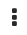

<!-- Format modified: converted from AsciiDoc to Markdown. See SOURCE.json for provenance. -->

Using Red Hat Advanced Cluster Security for Kubernetes (RHACS) you can view policy violations, go to the actual cause of the violation, and take corrective actions.

<a id="policy-violations-and-security-findings_respond-to-violations"></a>

# Policy violations and security findings

The built-in policies in RHACS identify a variety of security findings, including vulnerabilities (CVEs), violations of DevOps best practices, high-risk build and deployment practices, and suspicious runtime behaviors.

Whether you use the default out-of-box security policies or your own custom policies, RHACS reports a violation when an enabled policy fails.

<a id="namespace-conditions-for-platform-components_respond-to-violations"></a>

# Namespace conditions for platform components

By understanding the namespace conditions for platform components, you can identify and manage the namespaces that fall under OpenShift Container Platform, layered products, and third party partners in your environment.

<table>
<caption>Namespace conditions for platform components</caption>
<colgroup>
<col style="width: 25%" />
<col style="width: 75%" />
</colgroup>
<thead>
<tr>
<th style="text-align: left;">Platform component</th>
<th style="text-align: left;">Namespace condition</th>
</tr>
</thead>
<tbody>
<tr>
<td style="text-align: left;"><p>OpenShift Container Platform</p></td>
<td style="text-align: left;"><ul>
<li><p>Namespace starts with <code>openshift-</code></p></li>
<li><p>Namespace starts with <code>kube-</code></p></li>
</ul></td>
</tr>
<tr>
<td style="text-align: left;"><p>Layered products</p></td>
<td style="text-align: left;"><ul>
<li><p>namespace = <code>stackrox</code></p></li>
<li><p>Namespace starts with <code>rhacs-operator</code></p></li>
<li><p>Namespace starts with <code>open-cluster-management</code></p></li>
<li><p>namespace = <code>multicluster-engine</code></p></li>
<li><p>namespace = <code>aap</code></p></li>
<li><p>namespace = <code>hive</code></p></li>
</ul></td>
</tr>
<tr>
<td style="text-align: left;"><p>Third party partners</p></td>
<td style="text-align: left;"><ul>
<li><p>namespace = <code>nvidia-gpu-operator</code></p></li>
</ul></td>
</tr>
</tbody>
</table>

Red Hat Advanced Cluster Security for Kubernetes (RHACS) identifies the workloads belonging to platform components by using the following regex pattern:

``` text
^kube-.*|^openshift-.*|^stackrox$|^rhacs-operator$|^open-cluster-management$|^multicluster-engine$|^aap$|^hive$|^nvidia-gpu-operator$
```

The platform definition is not yet customizable. You can see the impact of the definition in your environment by using the global search. To do a global search, follow these steps:

1.  Click **Search**.

2.  Select **Show Orchestrator Components**.

3.  Apply the filter `Platform Component: true`.

<a id="analyzing-all-violations_respond-to-violations"></a>

# Analyzing all violations

By viewing the **Violations** page, you can analyze all violations and take corrective action.

<div>

<div class="title">

Procedure

</div>

1.  In the RHACS portal, click **Violations**.

2.  Click one of the following tabs to view violations by category:

    - **User Workloads**: Displays violations for user-managed workloads.

    - **Platform**: Displays violations for workloads used by OpenShift Container Platform and layered services.

    - **All violations**: Displays violations for user workloads and platform components. It also displays audit log violations for cluster resources.

3.  Click one of the following tabs to view violations by type:

    - **Active**: Displays violations in the build and deploy stages or unresolved runtime violations.

    - **Resolved**: Displays the following violations:

      - Violations in the build and deploy stages for workloads that you removed or modified for compliance

      - Manually resolved runtime violations

      - Violations that occurred before you added a policy exclusion

    - **Attempted**: Displays violations for deployment actions that enforced policies prevented. For example, if the admission controller detected that the attempted deployment action, such as a deployment create, update, or scale, would cause a policy violation, it prevented the operation from running in the cluster.

4.  Optional: Choose a method to reorganize or filter information on the **Violations** page:

    - To sort the violations in ascending or descending order, select a column heading.

    - To filter violations, use the filter bar.

    - To see more details about the violation, select a violation in the **Violations** page.

5.  Optional: Choose the appropriate method to exclude a deployment from the policy:

    - If you selected a single deployment, click the overflow menu  and then select **Exclude deployment from policy**.

    - If you selected several deployments, from the **Row actions** drop-down list, select **Exclude deployments from policy**.

</div>

<a id="violations-page-overview_respond-to-violations"></a>

# Violations page overview

The **Violations** page shows a list of violations and organizes information into the following groups:

- **Policy**: The name of the violated policy.

- **Entity**: The entity where the violation occurred.

- **Type**: The type of entity.

  For workload violations, the type indicates the workload type, for example, `Deployment`, `Pod`, `DaemonSet`, and so on.

  For other resource violations, the type indicates the resource type, for example, `Secrets`, `ConfigMaps`, `ClusterRoles`, and so on.

- **Enforced**: Indicates if RHACS enforced the policy when the violation occurred.

- **Severity**: The severity of the violation.

  The severity of the violation uses the following values:

  - `Low`

  - `Medium`

  - `High`

  - `Critical`

- **Categories**: The category of the violated policy.

  To view the policy categories:

  - In the RHACS portal, click the **Platform Configuration** → **Policy Management** → **Policy categories** tab.

- **Lifecycle**: The lifecycle stages to which the policy applies.

  The lifecycle stages use the following values:

  - `Build`

  - `Deploy`

  - `Runtime`

- **Time**: The date and time when the violation occurred.

<a id="view-violation-details_respond-to-violations"></a>

# Viewing violation details

When you select a violation in the **Violations** view, a window opens with more information about the violation. It provides detailed information grouped by several tabs.

<a id="violation-view-violation-tab_respond-to-violations"></a>

## Violation tab

The **Violation** tab of the **Violation Details** panel explains the policy violation. If the policy targets deploy-phase attributes, you can view the specific values that violated the policies, such as violation names. If the policy targets runtime activity, you can view detailed information about the process that violated the policy, including its arguments and the ancestor processes that created it.

<a id="violations-view-deployment-tab_respond-to-violations"></a>

## Deployment tab

The **Deployment** tab of the **Details** panel displays details of the deployment to which the violation applies.

<a id="violations-deployment-overview-section_respond-to-violations"></a>

### Overview section

The **Deployment overview** section lists the following information:

- **Deployment ID**: The alphanumeric identifier for the deployment.

- **Deployment name**: The name of the deployment.

- **Deployment type**: The type of the deployment.

- **Cluster**: The name of the cluster hosting the container.

- **Namespace**: The unique identifier for the deployed cluster.

- **Replicas**: The number of the replicated deployments.

- **Created**: The creation date and time of the deployment.

- **Updated**: The date and time of the last deployment update.

- **Labels**: The labels that apply to the selected deployment.

- **Annotations**: The annotations that apply to the selected deployment.

- **Service Account**: The name of the service account for the selected deployment.

<a id="violations-deployment-container-config_respond-to-violations"></a>

### Container configuration section

The **Container configuration** section lists the following information:

- **containers**: For each container, provides the following information:

  - **Image name**: The name of the image for the selected deployment. Click the name to view more information about the image.

  - **Resources**: This section provides information for the following fields:

    - **CPU request (cores)**: The number of cores requested by the container.

    - **CPU limit (cores)**: The maximum number of cores that the container can request.

    - **Memory request (MB)**: The memory size that the container requests.

    - **Memory limit (MB)**: The maximum memory that the container can request.

  - **volumes**: Volumes mounted in the container, if any.

  - **secrets**: Secrets associated with the selected deployment. For each secret, provides information for the following fields:

    - **Name**: Name of the secret.

    - **Container path**: Storage location of the secret.

  - **Name**: The name of the mount location for the service.

  - **Source**: The data source path.

  - **Destination**: The data storage path.

  - **Type**: The type of the volume.

<a id="violations-deployment-port-config_respond-to-violations"></a>

### Port configuration section

The **Port configuration** section provides information about the ports in the deployment, including the following fields:

- **ports**: All ports exposed by the deployment and any Kubernetes services associated with this deployment and port if they exist. Each port includes the following fields:

  - **containerPort**: The port number exposed by the deployment.

  - **protocol**: Protocol that the port uses, such as TCP or UDP.

  - **exposure**: Exposure method of the service, for example, load balancer or node port.

  - **exposureInfo**: This section provides information for the following fields:

    - **level**: Indicates if the service exposing the port internally or externally.

    - **serviceName**: Name of the Kubernetes service.

    - **serviceID**: ID of the Kubernetes service as stored in RHACS.

    - **serviceClusterIp**: The IP address that another deployment or service *within the cluster* can use to reach the service. This is not the external IP address.

    - **servicePort**: The port used by the service.

    - **nodePort**: The port on the node where external traffic comes into the node.

    - **externalIps**: The IP addresses for accessing the service externally, from outside the cluster, if any exist. This field is not available for an internal service.

<a id="violations-deployment-security-context_respond-to-violations"></a>

### Security context section

The **Security context** section lists whether the container is running as a privileged container.

- **Privileged**:

  - `true` if the container runs as **privileged**.

  - `false` if the container does not run as **privileged**.

<a id="violations-deployment-network-policy-section_respond-to-violations"></a>

### Network policy section

The **Network policy** section lists the namespace and all network policies in the namespace containing the violation. Click on a network policy name to view the full YAML file of the network policy.

<a id="violation-view-policy-tab_respond-to-violations"></a>

## Policy tab

The **Policy** tab of the **Details** panel displays details of the policy that caused the violation.

<a id="violation-policy-overview-section_respond-to-violations"></a>

### Policy overview section

The **Policy overview** section lists the following information:

- **Severity**: A ranking of the policy (critical, high, medium, or low) for the amount of attention required.

- **Categories**: The policy category of the policy. You can view policy categories in **Platform Configuration** → **Policy Management** in the **Policy categories** tab.

- **Type**: Whether the policy is user generated (policies created by a user) or a system policy (policies built into RHACS by default).

- **Description**: A detailed explanation of what the policy alert is about.

- **Rationale**: Information about the reasoning behind the establishment of the policy and why it matters.

- **Guidance**: Suggestions on how to address the violation.

- **MITRE ATT&CK**: Indicates if there are MITRE tactics and techniques that apply to this policy.

<div>

<div class="title">

Additional resources

</div>

- [MITRE ATT&CK tactics and techniques for containers](https://attack.mitre.org/matrices/enterprise/containers/)

</div>

<a id="violation-policy-behavior_respond-to-violations"></a>

### Policy behavior

The **Policy behavior** section provides the following information:

- **Lifecycle Stage**: Lifecycle stages that the policy belongs to, `Build`, `Deploy`, or `Runtime`.

- **Event source**: This field is only applicable if the lifecycle stage is `Runtime`. It can be one of the following:

  - **Deployment**: RHACS triggers policy violations when event sources include process and network activity, pod execution, and pod port forwarding.

  - **Audit logs**: RHACS triggers policy violations when event sources match Kubernetes audit log records.

- **Response**: The response can be one of the following:

  - **Inform**: Policy violations generate a violation in the violations list.

  - **Inform and enforce**: RHACS enforces the violation.

- **Enforcement**: If you set the response to **Inform and enforce**, lists the enforcement type for the following stages:

  - **Build**: RHACS fails your continuous integration (CI) builds when images match the criteria of the policy.

  - **Deploy**: For the **Deploy** stage, RHACS blocks the creation and update of deployments that match the conditions of the policy when the RHACS admission controller runs.

    - In clusters with admission controller enforcement, the Kubernetes or OpenShift Container Platform API server blocks all noncompliant deployments. In other clusters, RHACS edits noncompliant deployments to block pod scheduling.

    - For existing deployments, policy changes only result in enforcement at the next detection of the criteria, when a Kubernetes event occurs. For more information about enforcement, see "Deploy stage enforcement".

  - **Runtime**: RHACS deletes all pods when an event in the pods matches the criteria of the policy.

<a id="violation-policy-criteria_respond-to-violations"></a>

### Policy criteria section

The **Policy criteria** section lists the policy criteria for the policy.

<a id="policy-enforcement-deploy_respond-to-violations"></a>

### Deploy stage enforcement

RHACS supports two forms of security policy enforcement for deploy-time policies: hard enforcement through the admission controller and soft enforcement by RHACS Sensor.

The admission controller blocks creation or updating of deployments that violate policy. If you disable the admission controller or it is unavailable, Sensor can perform enforcement by scaling down replicas for deployments that violate policy to 0.

> [!WARNING]
> Policy enforcement can impact running applications or development processes. Before you enable enforcement options, inform all stakeholders and plan how to respond to the automated enforcement actions.

<div>

<div class="title">

Additional resources

</div>

- [Using admission controller enforcement](manage_security_policies/use-admission-controller-enforcement.md)

</div>

<a id="network-policies-tab_respond-to-violations"></a>

## Network policies tab

The **Network policies** section lists the network policies associated with a namespace.
